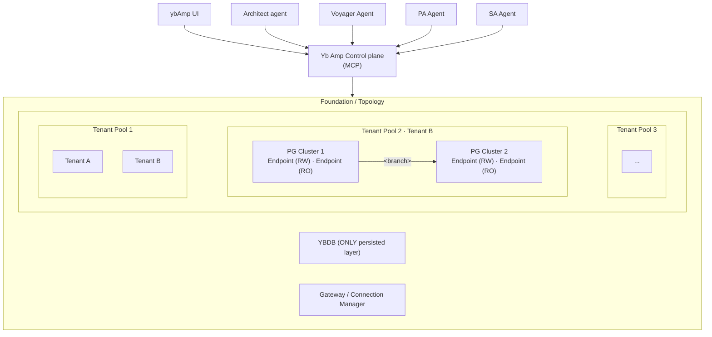
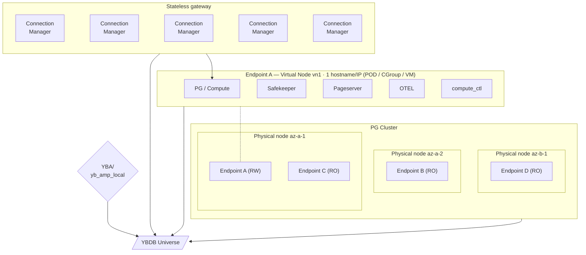

<p align="center">
  
</p>

# YugabyteDB AMP

**AMP** (Agentic Multitenant Postgres) is Yugabyte's next-generation
data-platform service that lets you run **PostgreSQL-compatible, multi-model
databases** (Postgres, pgvector, Apache AGE, Timeseries, Babelfish SQL Server,
HexaBridge Oracle, DocumentDB Mongo, …) as **managed data planes** inside the
user's own VPC or on-prem Kubernetes clusters, while a cloud-hosted **control
plane** handles lifecycle, security, metering and billing.

Under the hood, compute nodes are stateless PostgreSQL computes and the storage
tier is row-per-page tables in **YugabyteDB** — so the system inherits
YugabyteDB's highly available, geo-distributed, multi-region, multi-cloud,
infinitely-scalable replication model directly underneath every byte of every
page.

## Core concepts

| Concept | What it is | Why it matters |
|---------|------------|----------------|
| **Control plane** | SaaS service (`ctl.amp.yugabyte.cloud`) that provisions, upgrades, and monitors data planes via MCP + REST API + UI. | Centralized ops, SOC 2-compliant, tiered tenancy (shared vs dedicated). |
| **Data plane** | The actual database workloads, deployed in the customer's VPC/on-prem K8s. One data plane per BU or geography for regulatory isolation. | Data never leaves the customer network; outbound-only mTLS to control plane. |
| **Foundation** | Shared storage + topology (cloud/geo-bound, compute-storage separation). | Provides elastic, high-performance storage for all databases. |
| **Shared pool** | Logical multitenancy boundary (team/BU) with PITR, quota, burst policy. | Enables safe, cost-controlled sharing of resources. |
| **Agents** (Architect, Voyager, Perf Advisor, Nexus) | Built-in AI-driven helpers that plan, migrate, tune, and integrate databases. | Reduce operational overhead and accelerate time-to-value. |
| **Meko** | Governance layer that records context & decision traces for every agent action. | Auditable, reproducible operations. |
| **Metering & billing** | 4 core meters: data-plane compute (vCPU + branches), IOPS, data stored, and data-plane usage. Branches are **metered on logical size + IOPS** (not CoW delta). Backup storage, network egress, and S3/NFS live in the customer VPC and are **pass-through costs**, not AMP meters. Marketplace billing is available on all major clouds. | Transparent, usage-based pricing. |

## Key benefits

- **Fast, agent-augmented operations** — agents automate provisioning, migration, and performance tuning.
- **Regulatory compliance** — data planes run inside your VPC/on-prem, with BYOK and outbound-only control-plane connections.
- **Scalable performance** — Local File Cache (LFC) gives strong read performance; benchmarks show AMP matches or exceeds Aurora on read-heavy workloads and stays within 25% on write-heavy ones.
- **Flexible deployment** — deploy via Terraform provider, Helm chart, or the Kubernetes Operator.
- **Managed vs self-managed** — choose a shared control plane (lower tier) or a dedicated one (higher tier) with SOC 2 compliance.

## Repository layout

This repo holds AMP's three main components, each with its own README and
architecture docs:

- [`compute/`](compute/) — the storage / compute engine (the data plane): the
  patched PostgreSQL compute, pageserver, safekeeper, the `yb_amp` Postgres
  extension, and supporting Rust libraries.
- [`controller/`](controller/) — the control plane for a placement group:
  owns the lifecycle of storage pools, projects, PG clusters/branches, and
  endpoints, exposed through a REST API.
- [`amp_ui/`](amp_ui/) — the web UI: a React 19 + Vite + Tailwind SPA over
  the controller REST API.


## AI assistants

AI coding agents working in this repo should read [`AGENTS.md`](AGENTS.md)
first for repo conventions, architecture pointers, and ongoing project
context. [`CLAUDE.md`](CLAUDE.md) just points there.

This repo has a Meko datapack associated with it for agent memory:

- **Name**: `yb-amp`
- **ID**: `fd3b43a0-ebd6-4732-958b-fae9a50a0505`


## AMP topology and deployment

Two complementary views of an install. **AMP Topology** is the logical
view — tenant pools and branches, how capacity is carved up and
presented. **AMP Deployment** is the physical view — processes, nodes,
and availability zones, where bytes and connections actually live.

### AMP Topology: tenant pools, branches



### AMP Deployment: processes, nodes, AZs



## Quick Local Start

AMP is a hosted service. For local development you run just the compute
yourself: a YugabyteDB cluster as the durable backing store, plus a
compute pointed at it. You can point at any YB deployment
(local single-node, YBA-managed multi-region, YBM); the bundled workflow
below assumes a local single-node cluster.

Start a local YugabyteDB first — `./scripts/yb-local.sh` runs the same
pinned image CI uses, reachable at `127.0.0.1:5433` / db `yb_storage`:

```sh
./scripts/yb-local.sh start         # run (first pull ~1GB) + wait until ready
./scripts/yb-local.sh status        # is it up and accepting connections?
./scripts/yb-local.sh stop          # stop and remove the container
```

Then bring up the AMP stack with the bundled `yb_amp_local` workflow.

`yb_amp_local` is a Go binary under `controller/local/`; build it once:

```sh
./build.sh                        # build patched PG + Rust daemons (see "Building from source")
go build -C controller -o target/debug/yb_amp_local ./local/cmd/yb_amp_local
```

The repo-root `./yb_amp_local` wrapper execs the debug binary and resolves the
repo root from its own location, so it works from any working directory
(`./yb_amp_local_release` execs the release build):

```sh
./yb_amp_local init                          # writes the .yb_amp repo dir
./yb_amp_local start                         # controller, safekeeper, pageserver, endpoint_storage
./yb_amp_local branch create --set-default
./yb_amp_local endpoint create main --branch-name main
./yb_amp_local endpoint start main
```

The compute expects to find a YB cluster reachable from the host;
configure host_ports/user/dbname/sslmode in `config.toml` under the
`yb_storage_conn` section. `host_ports` is a single
CSV key of the form `host:port[,host:port,...]` (default port 5433);
a bare host with no `:port` defaults to 5433 and a comma-separated list
of YB tservers (`"10.0.0.1:5433,10.0.0.2:5433,10.0.0.3:5433"`) — the
client tries them in order on connect, giving libpq-style failover
across the cluster. Table names are not configurable: each component
hardcodes the table(s) it owns.

Once running, connect with any Postgres client:

```sh
psql -p 55432 -h 127.0.0.1 -U cloud_admin postgres
```

Branches are a cheap timeline forks at a given LSN, served out of
the same YB rows:

```sh
yb_amp_local branch create --branch-name migration_check --ancestor-branch-name main
yb_amp_local endpoint create migration_check --branch-name migration_check
yb_amp_local endpoint start migration_check
```


## Service endpoints

Default HTTP endpoints for a `yb_amp_local` dev cluster (all bind
`127.0.0.1`).

| Service | HTTP API | Other ports |
|---|---|---|
| Controller | `http://127.0.0.1:1234` | — |
| Pageserver | `http://127.0.0.1:9898` | gRPC `51051`, libpq `64000` |
| Safekeeper | `http://127.0.0.1:7676` | libpq `5454` |
| Endpoint storage | `http://127.0.0.1:9993` | — |

Notes:

- Pageserver ports increment per node (node *i* → HTTP `9898+i`, libpq
  `64000+i`, gRPC `51051+i`).
- The controller shares its port with the control-plane upcall
  API (`/upcall/v1/`); its REST API lives at `/control/v1` and `/v1` on
  the same port.
- `compute_ctl` exposes a per-endpoint HTTP control port assigned at
  `endpoint create` time (see `yb_amp_local endpoint` output).


## Building from source

### Linux deps

```sh
# Ubuntu / Debian
apt install build-essential libtool libreadline-dev zlib1g-dev flex bison \
  libseccomp-dev libssl-dev clang pkg-config libpq-dev cmake \
  postgresql-client protobuf-compiler libprotobuf-dev libcurl4-openssl-dev \
  openssl python3-poetry lsof libicu-dev

# Fedora
dnf install flex bison readline-devel zlib-devel openssl-devel \
  libseccomp-devel perl clang cmake postgresql postgresql-contrib \
  protobuf-compiler protobuf-devel libcurl-devel openssl poetry lsof \
  libicu-devel libpq-devel python3-devel libffi-devel
```

`protoc` ≥ 3.15 required.

### Rust

Use the toolchain pinned in [`rust-toolchain.toml`](./rust-toolchain.toml) —
`rustup` picks it up automatically.

### macOS

```sh
xcode-select --install
brew install protobuf openssl flex bison icu4c pkg-config m4
brew install libpq && brew link --force libpq
```

### Build

`./build.sh` (repo root) is the single build entry point — use it for a
fresh clone and for every build after:

```sh
./build.sh                # debug   -> target/debug
./build.sh --release      # release -> target/release
./build.sh --release-tar  # release + shippable tarball (see below)
./build.sh --headers      # just install PG headers (for cargo check / IDE)
```

It does everything the build needs, so there's no manual `git submodule
update` or `make` to remember. Specifically it:

- Checks out the vendored **PostgreSQL v18** tree (`compute/vendor/postgres-v18`)
  on a fresh clone, and re-syncs + rebuilds PostgreSQL whenever the
  submodule gitlink has moved; otherwise it reuses the cached
  `pg_install/v18`.
- Installs the **PostgreSQL server headers** before `cargo build` (the
  `postgres_ffi` crate generates Rust bindings from them, so a bare
  `cargo build` would otherwise fail with `bindgen_deps.h: 'c.h' file not
  found`). `--headers` runs just this step for `cargo check` / IDE use.
- Builds the walproposer static lib, the `yb_amp` PG extensions, and the
  workspace binaries into `target/{debug,release}/`.

(The script is a thin `build.sh` shim over [`scripts/build.py`](scripts/build.py),
which holds the logic — run `./build.sh --help` for details. It drives the
same `make` targets directly if you prefer: `make -j$(nproc) -s` for debug,
`BUILD_TYPE=release make -j$(nproc) -s` for release.)

`--release-tar` packages a deploy as a single versioned tarball
(`/tmp/yb-amp-bundle-<date>-<sha>.tar.gz`) that unpacks into a deploy dir
laid out as:

```
yb-pageserver            # the binary yb_amp_local launches
yb_amp_local
yb-safekeeper
controller
yb-compute-ctl
yb-endpoint-storage
tools/                   # yb-dump-pages, yb-dump-wals, yb-reset-consistent-lsn
lib/                     # libssl/libcrypto 1.1 + libicu 60 (not on stock RHEL 9)
pg_install/v18/          # patched PG + extensions + the same runtime libs
REVISION.txt             # build host / date / commit
```

`yb_amp_local` launches `yb-pageserver` from `yb_amp_distrib_dir`
(set in `~/.yb_amp/config`).

## Tests

Rust unit tests:

```sh
cargo test --workspace
```

Several live-DB tests assert against a live YB with the production schema
migrated. They default to a developer-managed cluster on `5433`/`yb_storage`
(override with `YB_TEST_HOST/PORT/USER/DB`); without one,
`test/integration/compute/run.sh unit` runs them against an isolated ephemeral
cluster.

Integration tests (require a YB cluster reachable from the test runner):

```sh
CARGO_BUILD_FLAGS="--features=testing" make
DEFAULT_PG_VERSION=17 BUILD_TYPE=release ./scripts/pytest
```

The integration suite under [`test/integration/compute/`](test/integration/compute/) is a Rust harness
that brings up a real `yb_amp_local` cluster + YB and exercises full
boot, write, branch, restart, and WAL-replay-catch-up paths, scanning
`pageserver.log` for corruption markers after every test
(see [`test/integration/compute/README.md`](test/integration/compute/README.md)):

```sh
test/integration/compute/run.sh                 # unit then fast (default)
test/integration/compute/run.sh all             # unit, fast, then slow
test/integration/compute/run.sh unit            # live-DB cargo-test modules only
test/integration/compute/run.sh smoke           # one test by name (substring matches)
test/integration/compute/run.sh -n 20 <name>    # repeat N times, cumulative pass/fail
test/integration/compute/run.sh --release all   # release build
```

Scenario tests live in `test/integration/compute/{fast,slow}/` (typed
`tokio-postgres`/`reqwest` assertions); golden `.sql` workloads live in
`test/integration/compute/{fast,slow}/` and diff against checked-in `.out` captures.
Both are auto-discovered — adding a test is just dropping a file. Run
the suite before claiming any corruption-class fix.

Functional (end-to-end system) tests live under
[`test/functional/`](test/functional/) — `ampqa`, a standalone Go framework
that stands up a full AMP deployment on k8s / GCE / AWS, drives real workloads
and chaos through it, and reports what happened. See
[`test/functional/framework/README.md`](test/functional/framework/README.md).

## Operator tools

`cargo build -p pageserver` builds three row-store inspection binaries —
`yb-dump-pages`, `yb-dump-wals`, and `yb-reset-consistent-lsn` — for reading
and repairing the YB tables during an incident. `build.sh --release-tar` ships
them under `${BUNDLE}/tools/`. See
[`compute/README.md`](compute/README.md#operator-tools) for the per-tool flags
and sample invocations.

## Operational runbooks

[`runbooks/`](runbooks/) holds incident-time playbooks ("symptom → quick
diagnosis → fix") for a running AMP deployment — component startup failures,
throughput troubleshooting, and broader performance investigation. See
[`compute/README.md`](compute/README.md#operational-runbooks) for the index.

## Cleanup

```sh
make clean      # remove build artefacts
make distclean  # everything from build + configure
rm -rf .yb_amp    # local dev cluster state (destroys local data)
```

## Issue tracking

Cross-session work is tracked as **GitHub issues**.
See [`docs/issue-tracking.md`](docs/issue-tracking.md) for the
area labels, milestones, the create/filter contract, and how commit
subjects reference issues.

## Contributing

- Read [`AGENTS.md`](AGENTS.md) — applies to humans too.
