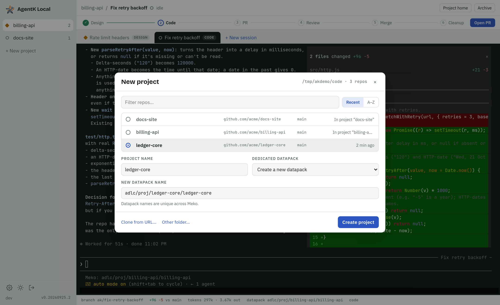
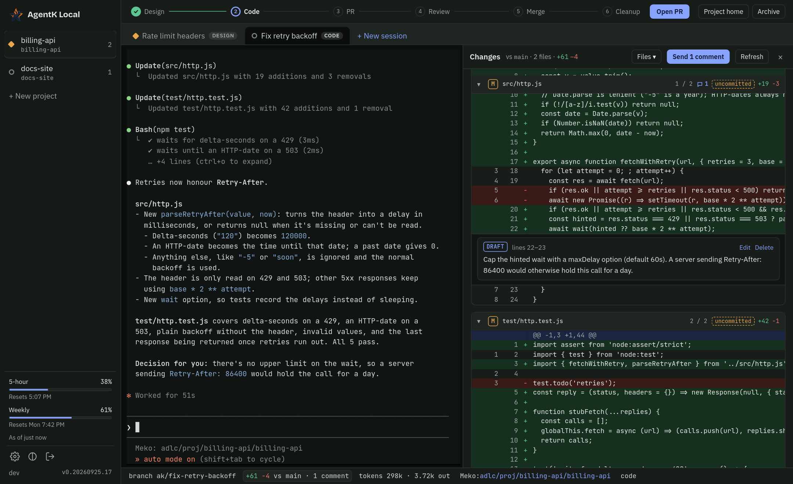

<p align="center"></p>

# AgentK Local

The agentic coder for ADLC. AgentK Local helps you work across many projects and
[Claude Code](https://claude.com/claude-code) sessions at once, with [Meko](https://mekodata.ai)
as its data layer. It's self-hosted, runs on your devserver (headless) or your Mac, and you use it
from a browser:

- **Projects** in a left rail, each one a git repo picked from your repos folder (`~/code` by default).
  A repo can back several projects, each with its own datapack, settings and sessions.
  New sessions start from the base branch after it's fast-forwarded to `origin`.
- **One git worktree and one Claude session per task.** The real Claude Code terminal UI is shown
  in the browser, and sessions are backed by tmux, so they keep running when you disconnect. You
  can still attach from iTerm: `tmux -L agentk attach -t ak-<project>--<session>` (sessions created
  before this naming keep `ak-<project>-<session>`).
- **Changes panel:** click the `+N −N` diff size in a session's footer to see every changed file
  (committed, uncommitted and untracked) with a diff per file. Jump between files with the
  **Files** menu or `[` / `]`, and leave review comments on lines that go to Claude as one prompt.
- **Works from your phone:** a drawer for projects, a key bar (Esc, a sticky Ctrl for
  Ctrl+letter shortcuts, Shift+Tab, arrows, Ctrl+C) and a compose box for the terminal, swipe to scroll back, and the stages and their gates
  in the ⋯ menu.
- **Status at a glance:** see which sessions are working, which need you (a permission prompt or a
  question), and which are idle, with browser notifications.
- **Task lifecycle:** Design → Code → PR → Review (AgentK) → Merge & Close. Complex designs are
  published as native Artifacts with diagrams and shown right next to the terminal; simple ones are
  markdown. You approve the design, opening the PR, and Merge & Close, which merges the PR and
  cleans up the worktree and branches. The server watches the PR and hands reviews (AgentK's and
  people's by default, or every reviewer's, or only people's) and CI failures to Claude.
- **Token usage** per session and per project (by model and by day), read from Claude Code transcripts,
  subagents included. **Usage** in the left panel adds it up across every project, deleted ones
  too, with what shipped: merged PRs and commits pushed straight to the base branch. On Pro and Max plans, the rail also shows your 5-hour and weekly usage limits
  and when they reset.
- **Meko datapacks** give every project a memory: one dedicated datapack plus any number of
  shared ones.
- **Survives restarts:** after a host reboot, every open session is brought back with
  `claude --resume`, and sessions that were mid-turn are told to continue.
- **One-click updates** from GitHub Releases, without interrupting running sessions, and rollback
  if a new version won't start.


<table>
  <tr>
    <td width="50%"><br><sub><b>Design review.</b> Claude's plan, rendered next to the terminal, waiting for your approval.</sub></td>
    <td width="50%"><br><sub><b>New project.</b> Pick a repo from your repos folder; a dedicated Meko datapack is created with it.</sub></td>
  </tr>
  <tr>
    <td width="50%"><br><sub><b>Project home.</b> Datapacks, memory search, activity, token usage by day, session and model, and settings.</sub></td>
    <td width="50%"><br><sub><b>Dark theme.</b> Follows your system, or pick one.</sub></td>
  </tr>
  <tr>
    <td width="50%"><br><sub><b>Review comments.</b> Comment on lines of the diff, then send them all to Claude at once.</sub></td>
    <td width="50%"><br><sub><b>On a phone.</b> The terminal with a key bar and a compose box, and the stage gate in reach.</sub></td>
  </tr>
</table>

Design: [`docs/design.md`](docs/design.md).

## Requirements

- Linux (x64 or arm64) with tmux ≥ 2.7, or macOS 14 or newer on Apple Silicon with tmux ≥ 3.2
- git, curl, the GitHub CLI (`gh`) and Claude Code. The installer offers to install any of them
  for you (with Homebrew on a Mac, your package manager and sudo on Linux, and Claude Code with
  Anthropic's own installer).
- A [Meko](https://mekodata.ai) account and API key. The installer offers to set up Meko for
  Claude Code (its plugin, MCP server and key) with Meko's own setup.

## Install

The repo is internal for now, so the installer is fetched with `gh`:

```sh
gh release download --repo yugabyte/agent-k-local --pattern install.sh --output - | sh
```

It first checks for tmux, git, curl, gh and Claude Code. If any are missing (or tmux is too old),
it lists the exact commands it would run, such as `sudo dnf install -y tmux git curl`,
`brew install tmux gh` or `curl -fsSL https://claude.ai/install.sh | bash`, and asks before
running them; on Linux, gh comes from its own GitHub release, checksum-verified, into
`~/.local/bin`, with no root needed. It then offers to sign gh in to GitHub (`gh auth login`) and
Claude Code in to your account (`claude auth login`) if they aren't. Later, once it has your Meko
key, it checks that Meko is set up for Claude Code and offers to run Meko's own setup
(`@yugabytedb/meko-mcp`) if the plugin, MCP server or key is missing. Pass `--install-deps` to
install without asking (for example with `--non-interactive`), or `--no-install-deps` to never
install anything. With `GITHUB_TOKEN` set, a missing gh is only installed with `--install-deps`;
otherwise downloads go through curl and the token.

Then it asks for your repos folder, listen address and port, checks Meko, installs to
`~/.agent-k-local`, starts two background services (the web server, and the tmux server that owns
your sessions), waits until the server answers, and prints a one-time setup link with the
certificate fingerprint to check in your browser. The services are systemd user units on Linux and
LaunchAgents on macOS.

On a Mac:

- Install while you're logged in to the desktop (in person or with Screen Sharing). Claude Code
  keeps its login in your Keychain, which the services can only reach during a desktop login.
- AgentK Local starts when you log in and stops when you log out. Sessions pause while the Mac
  sleeps, and other devices can't reach it until it wakes.
- With the macOS firewall on, allow incoming connections for
  `~/.agent-k-local/app/current/node/bin/node` (System Settings > Network > Firewall > Options)
  so your phone can connect.

| Command | What it does |
|---|---|
| `agent-k-local status` | Services, URL, certificate fingerprint, sessions, and whether the server answers |
| `agent-k-local logs -f` | Follow the server log (`~/.agent-k-local/logs/server.log`) |
| `agent-k-local setup-link` | A new one-time login link; also resets a lost password |
| `agent-k-local uninstall [--purge [--delete-worktrees]]` | Remove the services; `--purge` also deletes `~/.agent-k-local` except session worktrees and designs, which only `--delete-worktrees` removes (after reporting uncommitted changes). Branches are always kept. |
| `tmux -L agentk attach -t ak-<project>--<session>` | Attach to a session from any terminal |

## Develop

See [CONTRIBUTING.md](CONTRIBUTING.md).

## License

[Apache-2.0](LICENSE)
