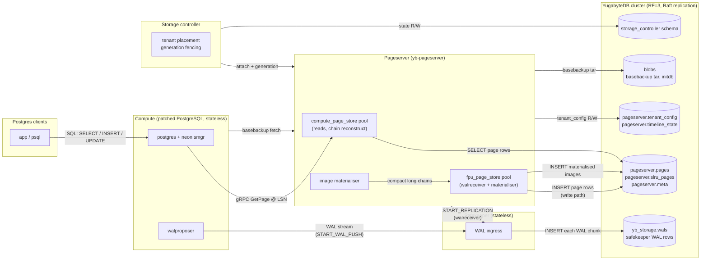

<p align="center">
  
</p>

# ybLight

**ybLight** is a serverless Postgres-compatible storage system that runs
PostgreSQL computes over **YugabyteDB** as the durable backing store.
Compute nodes are stateless and the storage tier is row-per-page tables
in YB — so the system inherits YugabyteDB's highly available,
geo-distributed, multi-region, multi-cloud, infinitely-scalable
replication model directly underneath every byte of every page.

ybLight started as a fork of [neondatabase/neon](https://github.com/neondatabase/neon)
but is no longer one in any meaningful sense. The layer-file storage
engine, the disk-backed page cache, the in-process LFC pretense of
"local cache", the secondary-tenant warm replicas, and most of the
S3 / GCS / Azure remote-storage machinery have all been removed. What
remains is the shape of the original control plane (`yb_light_local`,
`storage_controller`, `safekeeper`, `pageserver` binary layout, the
patched Postgres compute) wrapped around an entirely different storage
substrate. The "pageserver" is now a thin row-store gateway between
the Postgres compute and YugabyteDB.

## What's left of Neon, what's new

**Kept (the shell):**
- The compute / pageserver / safekeeper / storage_controller separation.
- The `yb_light_local` developer experience: `init`, `start`, `tenant create`,
  `endpoint create`, `endpoint start`, timelines as forks.
- The patched Postgres tree with the `neon` smgr extension wiring page
  reads and WAL writes through the gateway.
- The gRPC page_service protocol; the WAL streaming protocol to the
  safekeepers.

**Replaced wholesale:**
- **Page storage**: every block lives in a YugabyteDB row keyed by
  `(tenant, timeline, rel, fork, blknum, lsn, is_image)`. No layer
  files. No disk-backed page cache. Reads chain the LSN history out
  of YB rows + an in-RAM `UnifiedPages` buffer; an image materialiser
  task compacts long delta chains into walredo-applied images in the
  background.
- **Safekeeper**: **stateless, no consensus protocol**. Original Neon
  safekeepers ran a Paxos quorum of 3 (or more) nodes with local disk
  WAL + leader election to guarantee a single durable WAL stream. In
  ybLight every WAL record is `INSERT`ed into a YugabyteDB row at the
  moment it's received; durability is YB's Raft replication, not a
  per-safekeeper Paxos. The safekeeper itself holds no persistent
  state beyond its config — restart-from-scratch and it just resumes
  by reading the next LSN out of YB. You can run one safekeeper or
  ten; HA is provided by the YB cluster underneath either way.
- **Remote storage**: `YbStore` writes blobs (basebackup tar, initdb)
  into a YugabyteDB table — same connection model as the page store.
  S3 / GCS / Azure backends are deleted.
- **Concurrency model**: `YsqlClient` is a pooled, auto-reconnecting,
  prepared-statement-caching wrapper around `tokio_postgres`. Hot
  read paths run pool_size=4 (or more) so compute-side prefetches
  parallelise on YB.

**New properties inherited from YB:**
- **Highly available**: pages, WAL, and control-plane state all live
  in YB, so durability is YB's RF=3 Raft replication with online
  tablet repair. The pageserver layer is stateless-on-attach — no
  local layer files, no S3 layer-file handoff — so any pageserver
  can take over a tenant's attachment via the storage_controller's
  generation-fenced `live_migrate`.
- **Multi-region resilience**: YB's Raft replication runs across
  zones / regions / clouds. ybLight's storage tier is wherever the YB
  cluster says it is.
- **Geo-distributed**: tablet placement is YB's job. The pageserver
  just talks YSQL to whatever endpoint resolves.
- **Multi-cloud**: the storage tier is a YB cluster, which can live
  on AWS, GCP, Azure, on-prem, or any mix. ybLight follows.
- **Infinite scale**: tablet count grows with data; YB shards on the
  PK hash of `(tenant, timeline, fork)`. Adding YB nodes adds
  pageserver-side read capacity automatically.

## What removed for real

- ~30K LOC of Neon's layer-file machinery, secondary tenants, disk-usage
  eviction, heatmap synchronisation, compaction loops, and remote-
  storage backends. See `architecture/yb-pageserver.md` Phase 4d for the
  ongoing cascade.
- The OS-level page_cache is dead in this fork — preallocated buffers
  that the hot path never touches. Stub-sized in current builds; full
  removal is gated on the storage_layer cascade.

## Architecture overview



A ybLight install is:

- **Compute nodes**: patched PostgreSQL, stateless, configured against a
  pageserver endpoint and a safekeeper set. The `neon` smgr extension
  routes every `smgr_read` to a gRPC `GetPage` and every WAL flush to
  the safekeepers.
- **Pageserver (`yb-pageserver`)**: the row-store gateway. Two YSQL
  connection pools per pageserver:
  - `compute_page_store` (pool_size = 4 × `scale_factor`): serves
    compute reads, runs LSN-chain reconstruction over
    `pageserver.pages`.
  - `fpu_page_store` (pool_size = 4 × `scale_factor`): walreceiver
    WAL ingestion path + image materialiser writes. Image
    materialisation runs as a background task that compacts long
    delta chains into walredo-applied images so subsequent reads
    don't re-walk the chain.
- **Safekeeper**: stateless WAL ingress. Receives the WAL stream from
  the compute, `INSERT`s each record into a YB row, returns ack the
  moment the row is durable. No local disk, no quorum, no leader
  election. Run one for low-load deployments, run several behind a
  load balancer for connection-spread on heavy workloads — but every
  instance is independent and interchangeable. HA comes from YB.
- **Storage controller**: tenant/timeline placement & generation
  management. Backs its own state in YB too — its schema lives
  alongside the pageserver tables in the same YB database.
- **YugabyteDB cluster**: holds `pageserver.pages`, `pageserver.slru_pages`,
  `pageserver.meta`, `pageserver.tenant_config`,
  `pageserver.timeline_state`, the safekeeper WAL rows
  (`yb_storage.wals`), the storage_controller schema, and the blob
  table. This is the durable storage tier.

> **YB query contract**: every SQL statement issued through
> `YsqlClient` must be idempotent. The client retries connection drops
> internally and may replay an in-flight write whose commit status is
> unknown. Use `INSERT ... ON CONFLICT` (or upsert mode), absolute
> updates, and generation-fenced writes — never bare INSERTs or
> relative `SET col = col + 1`. See
> [`architecture/yugabyte.md`](architecture/yugabyte.md#client-side-retry-contract--every-yb-query-must-be-idempotent)
> for the full contract.

## AI assistants

AI coding agents working in this repo should read [`AGENTS.md`](AGENTS.md)
first for repo conventions, architecture pointers, and ongoing project
context. [`CLAUDE.md`](CLAUDE.md) just points there.

This repo has a Meko datapack associated with it for agent memory:

- **Name**: `yb-light`
- **ID**: `fd3b43a0-ebd6-4732-958b-fae9a50a0505`

## Quick start

ybLight is **not** a hosted service. To run it you bring your own
YugabyteDB cluster (any deployment — local single-node, YBA-managed
multi-region, YBM) and point a pageserver + safekeeper at it.

The bundled developer workflow uses `yb_light_local`:

```sh
make -j`nproc` -s             # build patched PG + Rust binaries
cargo yb_light init               # writes .yb_light repo dir against config.toml
cargo yb_light start              # storage_broker, safekeeper, pageserver
cargo yb_light tenant create --set-default
cargo yb_light endpoint create main
cargo yb_light endpoint start main
```

`cargo yb_light` rebuilds-then-runs the debug binary. Once it's built,
the repo-root wrapper scripts skip cargo's build check and exec the
binary directly — handy for fast, repeated invocations:

```sh
./yb_light_local init             # -> target/debug/yb_light_local
./yb_light_local_release start    # -> target/release/yb_light_local
```

Both pass all arguments straight through and resolve the repo root
from their own location, so they work from any working directory.

The pageserver expects to find a YB cluster reachable from the host;
configure host/port/user/dbname/sslmode in `config.toml` under the
`remote_storage` and `wal_yb_config` sections. `host` accepts a single
hostname/IP or a comma-separated list of YB tservers
(`"10.0.0.1,10.0.0.2,10.0.0.3"`) — the client tries them in order on
connect, giving libpq-style failover across the cluster. Smart-driver
load-balancing (`yb_servers()`-based fanout) is currently disabled
pending an upstream `yb-tokio-postgres` fix; see the comment in
`libs/ysql_client/src/lib.rs::build_pg_config` for the state of that
workaround.

Once running, connect with any Postgres client:

```sh
psql -p 55432 -h 127.0.0.1 -U cloud_admin postgres
```

Branches still work the same way as Neon — they're cheap timeline
forks at a given LSN, served by the same pageserver out of the same
YB rows:

```sh
cargo yb_light timeline branch --branch-name migration_check
cargo yb_light endpoint create migration_check --branch-name migration_check
cargo yb_light endpoint start migration_check
```


## Service endpoints

Default HTTP endpoints for a `yb_light_local` dev cluster (all bind
`127.0.0.1`).

| Service | HTTP API | Other ports |
|---|---|---|
| Storage controller | `http://127.0.0.1:1234` | — |
| Pageserver | `http://127.0.0.1:9898` | gRPC `51051`, libpq `64000` |
| Safekeeper | `http://127.0.0.1:7676` | libpq `5454` |
| Endpoint storage | `http://127.0.0.1:9993` | — |

Notes:

- Pageserver ports increment per node (node *i* → HTTP `9898+i`, libpq
  `64000+i`, gRPC `51051+i`).
- The storage controller shares its port with the control-plane upcall
  API (`/upcall/v1/`); its REST API lives at `/control/v1` and `/v1` on
  the same port.
- `compute_ctl` exposes a per-endpoint HTTP control port assigned at
  `endpoint create` time (see `cargo yb_light endpoint` output).


## Building from source

### Linux deps

```sh
# Ubuntu / Debian
apt install build-essential libtool libreadline-dev zlib1g-dev flex bison \
  libseccomp-dev libssl-dev clang pkg-config libpq-dev cmake \
  postgresql-client protobuf-compiler libprotobuf-dev libcurl4-openssl-dev \
  openssl python3-poetry lsof libicu-dev

# Fedora
dnf install flex bison readline-devel zlib-devel openssl-devel \
  libseccomp-devel perl clang cmake postgresql postgresql-contrib \
  protobuf-compiler protobuf-devel libcurl-devel openssl poetry lsof \
  libicu-devel libpq-devel python3-devel libffi-devel
```

`protoc` ≥ 3.15 required.

### Rust

Use the toolchain pinned in [`rust-toolchain.toml`](./rust-toolchain.toml) —
`rustup` picks it up automatically.

### macOS

```sh
xcode-select --install
brew install protobuf openssl flex bison icu4c pkg-config m4
brew install libpq && brew link --force libpq
```

### Build

```sh
make -j`nproc` -s                     # debug
BUILD_TYPE=release make -j`nproc` -s  # release
```

Build artefacts land in `target/{debug,release}/`. The release bundle
deployed to a target host typically contains:

```
yb-light-bundle/
  bin/
    yb-pageserver
    safekeeper
    yb_light_local
    compute_ctl
    endpoint_storage
    storage_broker
    storage_controller
  pg_install/v17/         # patched PG + libssl + libcrypto + libicu
  config.toml             # per-deploy YB connection settings
  start.sh / stop.sh
```

`bin/yb-pageserver` is the binary name `yb_light_local` launches; it lives
under `yb_light_distrib_dir` (set in `~/.yb_light/config`).

## Tests

Rust unit tests:

```sh
cargo test --workspace
```

Integration tests (require a YB cluster reachable from the test runner):

```sh
CARGO_BUILD_FLAGS="--features=testing" make
DEFAULT_PG_VERSION=17 BUILD_TYPE=release ./scripts/pytest
```

The end-to-end suite under [`test/e2e/`](test/e2e/) is a Rust harness
that brings up a real `yb_light_local` cluster + YB and exercises full
boot, write, branch, restart, and WAL-replay-catch-up paths, scanning
`pageserver.log` for corruption markers after every test
(see [`test/e2e/README.md`](test/e2e/README.md)):

```sh
test/e2e/run.sh                 # fast suite
test/e2e/run.sh all             # fast then slow
test/e2e/run.sh smoke           # one test by name (substring matches)
test/e2e/run.sh -n 20 <name>    # repeat N times, cumulative pass/fail
test/e2e/run.sh --release all   # release build
```

Scenario tests live in `test/e2e/src/scenarios/{fast,slow}/` (typed
`tokio-postgres`/`reqwest` assertions); golden `.sql` workloads live in
`test/e2e/{fast,slow}/` and diff against checked-in `.out` captures.
Both are auto-discovered — adding a test is just dropping a file. Run
the suite before claiming any corruption-class fix.

Many of the legacy Neon unit tests have been deleted along with the
layer-file machinery they exercised — they tested code paths that no
longer execute in ybLight. The remaining suite focuses on the
row-store gateway, the YB-side write batching, the chain
reconstruction, and the materialiser.

## Operator tools

Diagnostic helpers under [`tools/`](tools/) that wrap `psql` against
the YB cluster and render the row-store tables in a human-readable
form. They're staged into `${BUNDLE}/tools/` by
`scripts/yb-light-ship.sh` so they ship to deploy hosts alongside the
binaries.

- [`tools/yb-dump-pages`](tools/yb-dump-pages) — dump
  `pageserver.pages` rows for one (rel, fork) tuple. Renders the
  LSN bigint as `H/L` hex, forknum as `main`/`fsm`/`vm`/`init`, and
  the payload as `<bytes>; <16-byte hex sample>`. Required hash
  columns: `--tenant --timeline --spc --db --rel --fork`. Range
  filters: `--blknum` (or `--blknum-from/--blknum-to`),
  `--lsn-from`/`--lsn-to` (PG `X/Y` hex). Add `--raw` for the wide
  table form, `--no-payload` to drop the byte preview,
  `--limit 0` for unbounded.
- [`tools/yb-dump-wals`](tools/yb-dump-wals) — dump
  `public.wals` rows (the safekeeper's WAL-in-YB chunks). Required
  hash columns: `--tenant --timeline`. Range filters: `--segno`
  (or `--segno-from/--segno-to`), `--chunk-offset` (or its
  `-from/-to` variants), `--lsn-from`/`--lsn-to` (mapped to
  segno+offset via `--wal-seg-size`, default 16 MiB). `--summary`
  swaps the row dump for a per-segno health view
  (`(min/max chunk_offset, total_bytes, gap_bytes)`) which is the
  fastest way to spot a WAL hole during an incident.

Sample invocations:

```sh
tools/yb-dump-wals  --tenant <hex> --timeline <hex> --summary
tools/yb-dump-wals  --tenant <hex> --timeline <hex> \
                    --lsn-from 0/1545000 --lsn-to 0/15A0000 --limit 5
tools/yb-dump-pages --tenant <hex> --timeline <hex> \
                    --spc 1663 --db 5 --rel 16384 --fork 0 \
                    --blknum 0 --limit 3 --raw
```

Both default to a local `yb_light_local` cluster (`127.0.0.1:5433`,
`yugabyte`/`yb_storage`) and accept `--host`/`--port`/`--user`/
`--db-name`/`--password-env` overrides for remote clusters.

## Operational runbooks

[`runbooks/`](runbooks/) — incident-time playbooks for common failure
modes on a running ybLight deployment. Each runbook is structured as
"symptom → quick diagnosis → fix"; read them in advance once so the
shape is familiar, then jump straight to the relevant one during an
incident.

- [`runbooks/startup-failures.md`](runbooks/startup-failures.md) —
  a component (PS / SK / compute / storage_controller) won't start,
  won't register, or the compute can't serve queries.
- [`runbooks/throughput-troubleshooting.md`](runbooks/throughput-troubleshooting.md)
  — low throughput on TPC-C load / execute or any OLTP workload;
  isolating compute vs. PS vs. SK vs. YB as the bottleneck.
- [`runbooks/perf-investigation.md`](runbooks/perf-investigation.md) —
  broader performance investigation: memory growth, pageserver
  internals, WAL backlog, materialiser pacing.

## Flamegraphs

[`flamegraph-rs`](https://github.com/flamegraph-rs/flamegraph) works
out of the box.

> [!IMPORTANT]
> If you're linking with `lld` or `mold`, pass `--no-rosegment` —
> general Rust+alt-linker thing, not specific to this repo.

## Cleanup

```sh
make clean      # remove build artefacts
make distclean  # everything from build + configure
rm -rf .yb_light    # local dev cluster state (destroys local data)
```

## Documentation

Start here:

- [`architecture/README.md`](architecture/README.md) — index page for
  the whole architecture section; one-line summary of every component
  doc below.
- [`architecture/high-level.md`](architecture/high-level.md) —
  components, processes, ports, what-talks-to-what at a single page.

Per-component deep dives:

- [`architecture/compute.md`](architecture/compute.md) — the patched
  Postgres compute (unchanged in yb-light); how the `neon` smgr
  extension wires page reads and WAL writes through the gateway.
- [`architecture/yb-pageserver.md`](architecture/yb-pageserver.md) —
  the row-store gateway design: schema, chain reconstruction,
  `UnifiedPages` buffer, image materialiser semantics, write batching,
  and the phase plan for the Neon-shell deletion cascade.
- [`architecture/pageserver.md`](architecture/pageserver.md) — the
  original upstream-Neon pageserver design; kept for context on
  pieces yb-pageserver still inherits (gRPC `getpage`, walreceiver,
  basebackup).
- [`architecture/safekeeper.md`](architecture/safekeeper.md) — the
  upstream-Neon safekeeper (Raft acceptor); the WAL-in-YB
  reduction in ybLight is described inline in `yugabyte.md` and in
  the safekeeper module docs.
- [`architecture/storage-controller.md`](architecture/storage-controller.md)
  — tenant placement, generation fencing, and live-migrate semantics.
- [`architecture/remote-storage.md`](architecture/remote-storage.md)
  — the `RemoteStorage` abstraction and the `YbStore` backend that
  replaced S3/GCS/Azure (blob/basebackup tar/initdb layer).
- [`architecture/yugabyte.md`](architecture/yugabyte.md) — what the
  YB cluster looks like from ybLight's perspective: databases,
  tables, prefixes, idempotency contract, and the DDL the operator
  must provision.

Upstream-Neon material that's still mostly accurate for the shell:

- [`docs/sourcetree.md`](docs/sourcetree.md) — original Neon
  sourcetree map.

`cargo doc --no-deps --open` for rustdoc.

## Contributing

- Read [`AGENTS.md`](AGENTS.md) — applies to humans too.
- Read [`CONTRIBUTING.md`](/CONTRIBUTING.md) for style and process.
- Don't restore deleted Neon code without a concrete reason; if you
  need a removed feature, surface the requirement instead of resurrecting
  the implementation.
