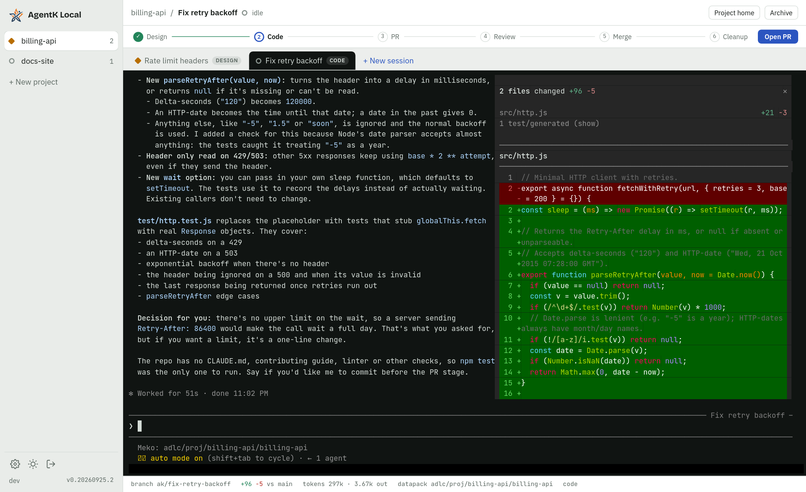
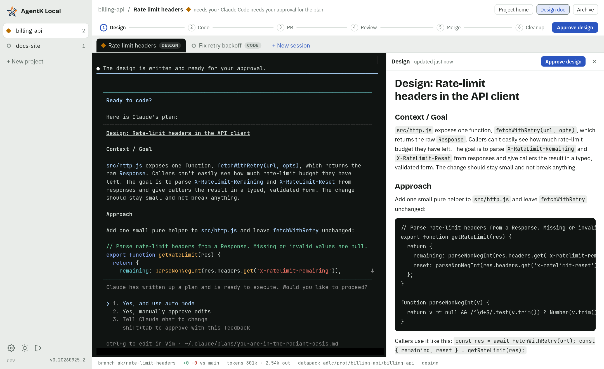
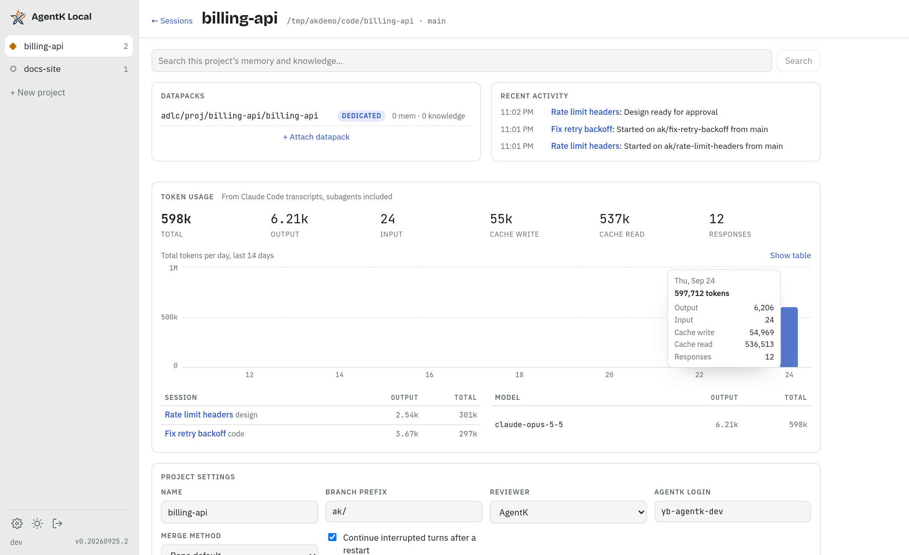
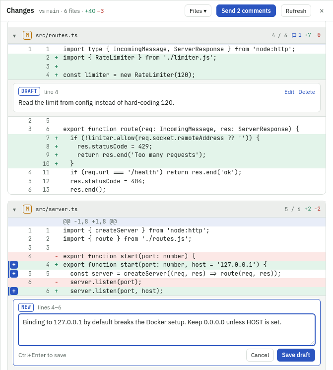
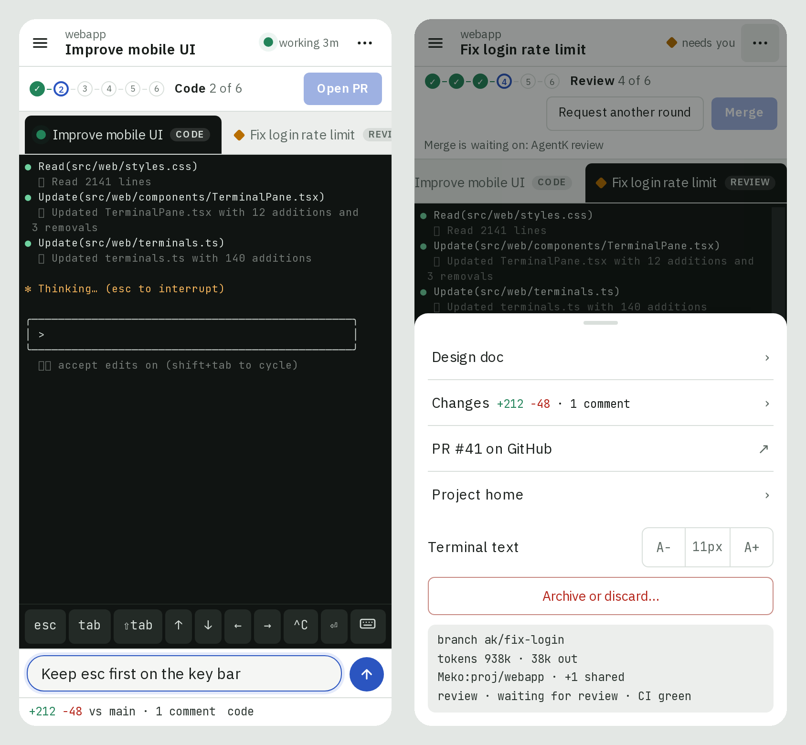

<p align="center"></p>

# AgentK Local

The agentic coder for ADLC. AgentK Local lets you manage many projects and [Claude Code](https://claude.com/claude-code) sessions at 
once, with [Meko](https://mekodata.ai) as the shared context layer so designs, transcripts, and what each session learned flow into 
datapacks your whole team and their agents can build on.

It's self-hosted on your devserver (headless), your Mac or a Mac mini, and you use it from a browser or
your phone.



<table>
  <tr>
    <td width="50%"><br><sub><b>Design review.</b> Claude's plan, rendered next to the terminal, waiting for your approval.</sub></td>
    <td width="50%"><br><sub><b>Open project.</b> Pick a repo from your repos folder; a dedicated Meko datapack is created with it.</sub></td>
  </tr>
  <tr>
    <td width="50%"><br><sub><b>Project home.</b> Datapacks, memory search, activity, token usage by day, session and model, and settings.</sub></td>
    <td width="50%"><br><sub><b>Dark theme.</b> Follows your system, or pick one.</sub></td>
  </tr>
  <tr>
    <td width="50%"><br><sub><b>Review comments.</b> Comment on lines of the diff, then send them all to Claude at once.</sub></td>
    <td width="50%"><br><sub><b>On a phone.</b> The terminal with a key bar and a compose box, and the stage gate in reach.</sub></td>
  </tr>
</table>

## Install

You need Linux (x64 or arm64) or macOS 14 or newer on Apple Silicon. A
[Meko](https://mekodata.ai) account and API key are optional: they give projects datapacks
(shared memory) and let you share projects. Without one, press Enter at the key prompt (or pass
`--no-meko`) and add a key later on the Meko tab in Settings, which links to Meko's sign-up and
login pages to make one. The repo is internal for now, so the
installer is fetched with `gh`:

```sh
gh release download --repo yugabyte/agent-k-local --pattern install.sh --output - | sh
```

It offers to install anything that's missing (git, gh, Claude Code) and to set up Meko for
Claude Code, asking first. It asks for **local** access (this computer only, no login) or
**remote** access (other devices too, like your phone, over HTTPS with a login); remote is the
default over SSH or on a machine with no display. Then it prints the address, or for remote
access a one-time setup link that creates your login. Local access trusts everyone who can log
in to the computer, so pick remote on a shared host.

Run again where AgentK Local is already installed with its services set up, the installer says so
and stops without changing anything. Newer releases are offered in AgentK Local itself (the Update
banner, or the button in Settings). To change its setup (repos folder, access, port, Meko) or set
up its services again, run `agent-k-local install`; to download and install it again, pass
`--reinstall` (`… | sh -s -- --reinstall`). Options for `agent-k-local install`, like `--port`,
also make it install again, so they're never dropped.

Forgot your password? Run `agent-k-local setup-link` on the host and open the link it prints to
choose a new username and password (the sign-in screen's **Forgot password?** says the same).

If your home directory is shared with other hosts (over NFS, say), AgentK Local runs only on the
host you installed it on: logging in to another host doesn't start a second server on the same
`~/.agent-k-local`. To run it on another host too, give that host its own home with `AK_HOME`.

If your home is under `/net` (the automounter's `/net/<host>/...`), Claude Code 2.1.292 and later
asks before every file it reads or edits there, even in auto mode. When the home is this host's
own folder, AgentK Local starts Claude in it without the `/net/<host>` prefix (with `HOME` to
match), so sessions don't stop for that. In plain Claude Code, open your repos by that path too.

On a Mac, install while you're logged in to the desktop (in person or with Screen Sharing): Claude
Code keeps its login in your Keychain, so AgentK Local runs while you're logged in. For a Mac mini
that stays on, turn on automatic login and stop it sleeping (System Settings > Energy). With the
macOS firewall on, allow incoming connections for `~/.agent-k-local/app/current/node/bin/node` so
your phone can connect.

## Features

- **Projects** in a left rail, each with its open sessions listed under it: each is an effort to build or improve a feature, product or service,
  worked on in a git repo picked from your repos folder (`~/code` by default), cloned into it, or
  started there as a new repo (git init and a first commit). A repo with no commits yet, or an
  empty folder, gets the same empty first commit, so sessions have a base to branch from; a repo
  with no commits but files in it is refused until you commit them.
  A repo can back several projects, each with its own datapack, settings and sessions.
  **Open project** starts one; **Close project** stops its sessions when you're done. The repo,
  branches and datapack stay: opening its datapack again brings the same project back, with its
  sessions, settings and usage.
  New sessions start from the base branch after it's fast-forwarded to `origin`, on a branch
  named `ak_<your GitHub login>/<task>` (the prefix is a project setting). Under
  **Advanced** a session can work in another of your repos, on a new branch you name, or pick up
  existing work: an **existing branch** (its open PR is linked), or one of your open **pull
  requests**, a fork's included when the fork is one of the repo's remotes. AgentK then builds on
  what's there instead of branching from it, and picks the PR up at PR & Review.
  The foot of the rail shows who you are and which server you're on (`you@dev-box`), so windows
  on different machines are easy to tell apart; give the server your own name in Settings.
- **Meko, the shared context layer:** every project has a dedicated datapack plus any number of
  shared ones. Designs, what each session learned and a summary of each merged PR are saved there,
  so the whole team, and its agents, start from the same context. (Session transcripts are kept
  out for now; `[meko] capture_transcripts = true` in `config.toml` sends them.) **Switch** on the project's home
  moves the project to another dedicated datapack; the old one stays attached to search, or is
  detached. When a session starts, AgentK searches the project's datapacks for its task (and the
  GitHub issues it names) and gives Claude what Meko already knows, and the prompts ask Claude to
  search Meko before reading code.
- **What sessions learn goes to the team's datapack.** When a PR merges or a session is discarded,
  before the session closes, AgentK asks the session what it learned about the product and repo (how things work, decisions
  and why, root causes, gotchas, measured numbers) and saves each new fact, after checking it
  against what the datapack already has: known facts are skipped, and ones that correct a memory
  replace it. Claude is told to leave out anything about your machine or one person's
  preferences. With AgentK's mod it runs out of sight (one cached look at the session, plus a small
  model for the duplicate check), and AgentK also drops any fact that names a local path; without
  the mod, AgentK asks Claude in a turn of its own and Claude saves under the same rule. **Save learnings** in the session's
  header (or the ⋯ sheet on a phone), or `/agentk_learn` in the terminal, does it any time.
  Check **Don't save learnings** beside Merge & Close or Discard to close a session without it.
- **Share a project** by sharing its dedicated datapack with someone. A project datapack shared
  with you shows a banner and a notification, and opens as a new project with the repo and name
  filled in. The Meko server and key are set on the Meko tab in Settings, for your own Meko too.
  When Claude Code is set up for another Meko server, or holds a token that can't see the
  projects' datapacks there, a banner says so and offers to set Claude Code up with AgentK's Meko;
  AgentK never changes Claude Code's setup unless you ask.
  Once a session has a PR, **Share with reviewers** lists the reviewers of the project's open PRs
  (in every repo its sessions work in) with their emails, to share with in one click. The Share
  dialog suggests the people you share with most, in any project, to add with a tap.
- **Review someone else's PR with AgentK:** a *Review a PR* session lists the open PRs, in any repo,
  of a project shared with you, checks one out on a branch a plain `git push` refuses, and has AgentK sum
  it up for you, with the author's design (named in the PR, fetched from Meko, with its questions and
  decisions) open beside the terminal and the decisions behind it from Meko. Then AgentK waits and helps with
  what you ask; it posts your review on GitHub only when you say. **Update to latest** checks out
  the author's new commits and sums up what changed.
- **Ask AgentK in plain words:** type an instruction into **Ask AgentK** (`⌘K`), such as "start a
  design task in agent-k-local to add dark mode to the Usage page" or "which sessions need me?".
  AgentK asks Claude Code (one quick call with no tools) and offers what to do: start a task at
  Explore, Design or Code with a prompt, go to a session, move one to another stage, or open its PR.
  Nothing runs until you pick it, a single "go to" included, and you can reply to refine it.
- **Find a session by what it's about:** type a few words into Ask AgentK (`⌘K`), such as "totp
  login". Besides names, it searches each session's task, PR title, branch and design, closed sessions
  included, in the project you're on (every project from elsewhere), and lists the best matches with
  the text that matched. Picking one goes to it, or opens its PR when it's closed.
- **Keyboard shortcuts you can change:** `⌘B` (`Ctrl+Shift+B` on Linux and Windows) hides or shows
  the projects pane, and Settings › Shortcuts changes it, Ask AgentK's `⌘K` and the session
  switching keys, or adds keys for New session, Rename, Move, Project home, Usage and Settings.
  Drag the pane's right edge to make it wider or narrower.
- **Paste a GitHub link to start:** paste a PR or issue link into Ask AgentK (`⌘K`). A PR
  gets a Review a PR session, an issue a task that fixes or implements it (from Design, or straight
  to Code), in the project it belongs to: the one whose datapack its description names, else the
  project you're on when it's on that repo, else the first one on the repo; the other projects on the
  repo are offered too. If there's none, AgentK opens a project for it and clones the repo if needed.
- **One git worktree and one Claude session per task.** The real Claude Code terminal UI is shown
  in the browser, and sessions run in AgentK Local's own session host (no tmux needed), so they keep
  running when you disconnect or the server updates. You can still attach from iTerm:
  `agent-k-local attach <session>` (`Ctrl+\` detaches).
- **One screen at a time.** A session is live in one browser tab or device at a time. Open it on
  another and that screen offers **Move to this screen**; it moves there by itself once the first
  screen has gone 10 seconds without being used, or right away if that screen isn't showing it.
- **Builds carry over between sessions.** When a session ends, its worktree waits for the next
  session on the same repo (from any project on it) with its ignored build outputs intact, so
  repos that take long to build start incremental. Each repo keeps up to 3 idle worktrees, and one
  no session has used for 14 days is removed; change both in Settings (0 idle worktrees removes
  worktrees when sessions end).
- **Changes panel:** click the `N files · +N −N` diff size in a session's footer to see every changed file
  (committed, uncommitted and untracked) with a diff per file. Jump between files with the
  **Files** menu or `[` / `]`, and leave review comments on lines that go to Claude as one prompt.
  Compare with another branch (a release branch for a backport, say) from the base in its header;
  when the branch has clearly moved onto another branch, the panel offers to switch.
- **Paste images for Claude:** paste a screenshot into the terminal, or drop image files on it, and
  Claude gets the image with your next message, even when AgentK Local runs on another machine.
  Images pasted into the New session dialog's first prompt go with it when the session starts.
- **Works from your phone:** a drawer for projects, a key bar (Tab, arrows, Ctrl+C, a ▾ row
  of more keys with a sticky Ctrl for Ctrl+letter shortcuts, Esc, Shift+Tab and an image key, and a select mode that copies the lines you drag over), a compose box that takes pasted images too, swipe to scroll back, and the stages and their gates
  in the ⋯ menu.
- **Status at a glance:** see which sessions are working, which need you (a permission prompt or a
  question), and which are idle, with browser notifications.
- **AgentK's mod in Claude:** with Claude Code 2.1.287 or later, each session loads a small Claude
  Code mod that takes AgentK's prompts and comments. Claude takes them when it's next idle, so they
  never land in a permission dialog or a running turn. When Claude asks you something
  (`AskUserQuestion`), the question shows in AgentK Local too, on a phone as well: answer it there or
  in the terminal, whichever comes first. During Design you can send answers or approve while AgentK
  is still working: the answers wait in Claude for the turn to end, and the approval goes when the
  turn ends if it left the design alone. AgentK gives you its design questions through a tool, so
  they show as soon as it has them. After each turn a ring in the footer shows how full
  Claude's context window is. Turn it off with `[claude] mod = false` in `config.toml` and restart
  the server (the file is read at startup): AgentK then types its prompts into the terminal, running
  sessions included, though those keep the mod loaded until they're relaunched
  ([details](docs/design/mod.md)). Claude Code's mods are early
  access, and its own rollout decides whether they load; when they don't, AgentK types its prompts.
  When the host's Claude Code is too old for the mod, a banner says so and can update it.
- **Start where you want:** every task runs on one pipeline, Explore → Design → Code → PR & Review →
  Merge & Close, and a new session asks where to start: *Explore* for investigating, POCs and
  experiments, *Design* (the default) for the full lifecycle below, or *Code* for small tasks that
  go straight to code. Or pick *Review a PR* (above). A task moves between stages, forward or back,
  at any point between turns: an exploration that should ship moves on to Code or opens a PR with
  **Move on…**, and a session in review can go back to Code or Design. A move carries on from what the
  session has discussed or done, not its first prompt. A move, and **Open PR** (its **+** notes
  button), takes optional instructions for AgentK, sent after the stage's prompt. Rename a session any time
  (double-click it in the rail): its branch and worktree keep their names.
- **Task lifecycle:** (Explore →) Design → Code → PR & Review (AgentK) → Merge & Close. Complex designs are
  published as native Artifacts with diagrams and shown right next to the terminal; simple ones are
  markdown, with Mermaid diagrams drawn (zoom them with − and +). The design's open questions are listed beside it, each
  with AgentK's options and recommendation picked to start: pick another, or write a custom answer, then send them for
  AgentK to revise the design, or approve with them. With open questions, **Answer & approve**
  takes you to them first. Once it's approved, AgentK writes the answers into the design and keeps it current
  while it codes and addresses reviews; each version goes to Meko, and the PR names the latest one.
  You approve the design, opening the PR, and Merge & Close, which merges the PR and
  cleans up the branches, leaving the worktree for the next session. Pressed early, they wait:
  **Open PR after this turn** goes when AgentK's turn ends, and **Merge when ready** merges once CI
  and AgentK's review have passed. The server watches the PR and hands reviews (only AgentK's by default, or AgentK's and
  people's, every reviewer's, or only people's), merge conflicts with the base (unless
  you turn that off in Settings → General) and CI failures to Claude. Every other review, and
  any review from someone without a role on the repo, is held for you: you read it in AgentK and
  send it to AgentK or dismiss it, and Merge & Close waits until you decide. Your own reviews
  always go to Claude.
- **Token usage** per session and per project (by model and by day), read from Claude Code transcripts,
  subagents included, with its cost at API list prices. **Usage** in the left panel adds it up across every project, closed ones
  too, with what shipped: merged PRs and commits pushed straight to the base branch.
- **Meko call log, for debugging:** turn on **Log Meko calls** in a project's settings and AgentK
  keeps every Meko call made for each session, its own (recall at start, design uploads, the learn
  step) and Claude's (its searches and saves, a reply too large for Claude's context included), with
  what was sent and what came back, in a file in the session's folder that's deleted with the
  session. **View calls** opens them, a session at a time, with filters for the tool, who made the
  call (AgentK or Claude) and failed calls.
- **What Meko doesn't know:** the project home says how many questions Meko couldn't answer, and
  links to a list of the searches that found nothing, or only memories scoring below the bar,
  grouped by question. **Teach Meko** saves your answer to the project's datapack; **Dismiss**
  hides a question until a session asks it again.
- **Meko usage**: the Meko lookups and saves each session made, an estimate of the tokens and
  cost that Meko searches saved, how many sessions had something from Meko in their first
  turn, and what the learn step saved (memories added and corrected) and cost, on the project home
  and the Usage page. On Pro and Max plans, the rail also shows your 5-hour and weekly usage limits
  and when they reset.
- **Usage stats:** once a day (hourly in its first day) AgentK Local sends anonymous counts to YugabyteDB: how many
  projects, sessions, PRs, commits and tokens (by model) it handled, and which file types changed.
  It never sends names, paths, prompts, code, or who you are. Turn it off in Settings → Account
  (details in [docs/design/usage-stats.md](docs/design/usage-stats.md)).
- **Survives restarts:** after a host reboot, every open session is brought back with
  `claude --resume`, and sessions that were mid-turn are told to continue.
- **One-click updates** from GitHub Releases, without interrupting running sessions, and rollback
  if a new version won't start.

Design: [`docs/design.md`](docs/design.md), an index with one file per area under `docs/design/`.

## Commands

| Command | What it does |
|---|---|
| `agent-k-local status` | Services, URL, certificate fingerprint, sessions, and whether the server answers |
| `agent-k-local logs -f` | Follow the server log (`~/.agent-k-local/logs/server.log`) |
| `agent-k-local setup-link` | A new one-time login link; also resets a lost password |
| `agent-k-local uninstall [--purge [--delete-worktrees]]` | Remove the services; `--purge` also deletes `~/.agent-k-local` except session worktrees and designs, which only `--delete-worktrees` removes (after reporting uncommitted changes). Branches are always kept. |
| `agent-k-local attach [session]` | Show a session's terminal in yours (`Ctrl+\` detaches; Claude keeps running); with no name, list the sessions |
| `agent-k-local host restart` | Restart the session host (its sessions resume); with the server stopped, `host stop` ends every session until the server starts |

## Develop

See [CONTRIBUTING.md](CONTRIBUTING.md).

## License

[Apache-2.0](LICENSE)
