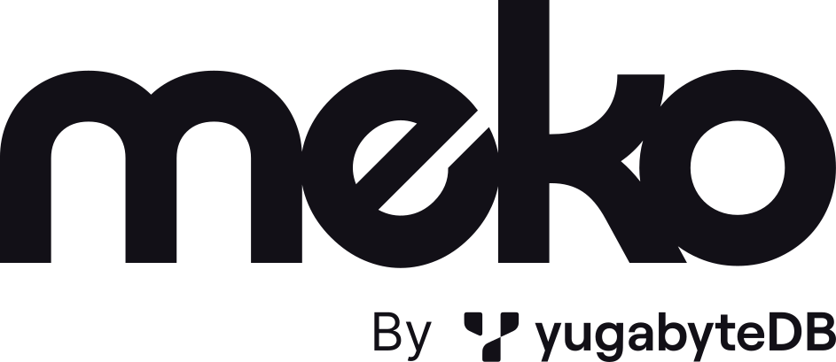

<p align="center">
  <picture>
    <source media="(prefers-color-scheme: dark)" srcset="backend/assets/meko-logo-white.svg">
    
  </picture>
</p>

# Meko

Meko is the memory your AI agents share: facts, conversations and files that last across
sessions, kept in datapacks that every agent working on the same thing can search and add to.
This repo holds `meko`, which runs Meko on your own machine, and the extensions built on it.
[Meko Cloud](https://mekodata.ai) is the hosted service.

`meko` is one binary, both the command line and the server. It serves Meko Cloud's MCP tools at
`/mcp` (memories, conversations, datapacks, artifacts, knowledge files, `context_search`) and the
`/api/v1` REST API Meko's web app uses, with Cloud's tool names, arguments and reply shapes, so an
agent set up for Cloud works against it. Everything lives under `~/.meko`: one SQLite file, and
knowledge files' bytes beside it. Search mixes vector similarity (sqlite-vec, with an embedding
model that runs locally) and keywords (FTS5); knowledge-base results are reranked by Cloud's
cross-encoder, also run locally.
Agents and the CLI reach it on `127.0.0.1:7778`. Browsers use its web listener on port 7777, for
the web UI and AgentK's at `/ext/agentk/`: with local access (the default) from this computer with
no login, with remote access from your other devices over HTTPS with a password and optional
two-step sign-in (`[web] access` in `config.toml`).

Meko is under construction. It has its storage, memory engine, conversations, knowledge files,
MCP, REST and a web UI, and an installer that runs it as a login service and keeps it updated.

## Install

On Linux (x64 or arm64) or macOS 14 or newer on Apple Silicon. The repo is internal for now, so
the installer is fetched with a signed-in `gh` (or `GITHUB_TOKEN`):

```sh
gh release download --repo yugabyte/agent-k-local --pattern install.sh --output - | sh
meko install_extension agentk     # optional: AgentK, using this Meko
```

It downloads the newest Meko release, checks its checksum, unpacks it into `~/.local/share/meko/app`, links
`~/.local/bin/meko`, and sets Meko up as a login service (launchd on macOS, systemd on Linux) that
restarts on failure and updates itself, rolling back an update that keeps failing to start. The
release bundles its own Node and its models (the embedder and the reranker), so the first start
needs no network. It
takes `--version`, `--reinstall` and `--no-service` (pass them through `sh -s --`). How it all
works: [`backend/docs/install.md`](backend/docs/install.md).

## Build and run from source

You need Go 1.26 (an older `go` downloads it on first use), a C compiler, and Node 22.13 or newer
for the memory engine and the web UI.

```sh
cd backend
make build memory_engine web_ui  # bin/meko, the memory engine and the web UI
./bin/meko start                 # runs in the background: 127.0.0.1:7778, and the web UI on :7777
./bin/meko status                # wait for "Memory engine: ready"
./bin/meko ui                    # opens the web UI in your browser
```

The first start downloads the embedding model (23 MB). On RHEL 8, set
`CC=/opt/rh/gcc-toolset-13/root/usr/bin/gcc` before building.

## Commands

| Command | What it does |
|---|---|
| `meko start` / `stop` / `restart` | Start the server (through its service once installed), and stop or restart it. `start` and `stop` also start and stop the extensions; `stop --keep-extensions` doesn't |
| `meko status` | Whether it's running, its URL, version, data folder, memory engine and auth mode, usage stats, its service, updates, the Meko Cloud link and extensions |
| `meko logs [-f] [-n N]` | The server's and the memory engine's logs, merged by time; `-f` follows them; `--server`, `--memory-engine` or `--service` shows one, `--json` the raw lines |
| `meko serve` | Run the server in the foreground |
| `meko version` | Meko's version, and Go's, SQLite's and sqlite-vec's |
| `meko ui [path] [--no-open]` | Open the web UI in the browser (`meko ui /ext/agentk/` opens AgentK's); `--no-open` only prints its link |
| `meko setup_link` | Print a one-time link that creates the web UI's login for remote access, or resets a lost one |
| `meko cloud_link [--url U] [--web-url W] [--api-url A] [--off]` | Link Meko Cloud (or another Meko server) for the extensions, such as AgentK: reads the API key from stdin, or asks for it on a terminal, checks it and saves it; `--off` unlinks. The web UI's Settings › Meko Cloud does the same |
| `meko export [<name\|id>] [-o FILE] [--force]` | Write a datapack (default: the default one) to one zip: memories, collective memories, conversations, knowledge files and artifacts with their embeddings and file contents, and the call log. It won't replace a file unless `--force` |
| `meko list mcp-tools [--json]` | The MCP tools Meko serves, each with a line on what it does; needs no running server |
| `meko token [--mcp] [--json]` | The token MCP and REST clients send; `--mcp` prints the `claude mcp add` command for Claude Code, `--json` the MCP URL, the web UI's URL, the token and the Meko Cloud link |
| `meko install [--no-service] [--access local\|remote]` | Set this meko up: the `meko` command, the login service, and how browsers reach the web UI |
| `meko uninstall [--purge [--force] [--with-extensions]]` | Remove the service and the installed releases, keeping the data; `--purge` also destroys the data as `meko destroy` does, asking first |
| `meko update [--check]` | Install the newest release now (under the service it updates itself); `--check` only looks |
| `meko install_extension agentk` | Install AgentK pointed at this Meko; `meko start` and `stop` then run it too, and the web UI's port serves it at `/ext/agentk/` |
| `meko install_extension presenter` | The same for Presenter, at `/ext/presenter/`: Meko installs its newest release itself, as the command `meko_presenter` (a `meko_presenter` already on PATH, a build from source, is used as it is) |
| `meko update_extension presenter [--check]` | Install Presenter's newest release now and restart it; one that fails to start is rolled back. AgentK updates itself |
| `meko uninstall_extension agentk` | Stop starting and stopping it with Meko (it stays installed) |
| `meko destroy [--force] [--with-extensions]` | Stop Meko and remove its data folder for good. It asks first; `--force` doesn't. The extensions' data in it (AgentK's home) stays unless you say so when asked, or pass `--with-extensions`, which uninstalls them first |
| `meko search "<question>"` | Search memories, the knowledge base and past conversations (`context_search`) |
| `meko add_memory "<text>"` | Save a memory, word for word; `-` or no text reads stdin |
| `meko datapacks [--cloud]` | List the datapacks; `--cloud` adds the linked Meko Cloud's after them, each marked local or cloud (and shared) |
| `meko create_datapack <name>` | Create a datapack |
| `meko delete_datapack <name\|id> [--force]` | Delete a datapack and everything in it, for good. It asks first; `--force` doesn't |
| `meko upload <file>... [--no-wait]` | Add PDF, text, Markdown, JSON, CSV, XML or HTML files (up to 50 MiB) to the knowledge base, and wait until they're indexed |
| `meko upload_status <key>` | How an uploaded file is doing |

Every command takes `--data-dir`. The default is `~/.meko` (or `MEKO_HOME`), but a home folder on a
network filesystem (NFS, say) moves it to `$XDG_STATE_HOME/meko` or `/var/tmp/<user>/meko`, since
SQLite's locking doesn't work over the network; `meko status` prints where it is. `start`,
`restart` and `serve` take `--port` (the API listener's, default 7778); the web UI's port and access are
`[web] port` (default 7777) and `access` in `config.toml`. `search`, `add_memory`, `upload` and
`upload_status` take `--datapack NAME|ID`, and use
the default datapack without it. Meko makes the default datapack only on first start, so once
it's deleted, they need `--datapack`. The data commands take `--json` for the raw reply.

## Connect an agent

Register Meko with Claude Code by running the command `meko token --mcp` prints. As printed, it
registers Meko only for the folder you run it in (Claude Code's default `local` scope); add
`--scope user` to it to use Meko in every repo. Meko's tools then show up as `mcp__meko__*`. Any MCP client works the same way: Streamable HTTP at
`http://127.0.0.1:7778/mcp`, with `Authorization: Bearer <token>`.

The REST API takes the same token:

```sh
curl -s localhost:7778/api/v1/datapacks -H "Authorization: Bearer $(./bin/meko token)"
```

## Usage stats

Meko sends usage stats (counts, versions and settings, never names or contents) to YugabyteDB
once a day, every hour on an install's first day. Turn them off in the web UI's Settings, or with
`[call_home] enabled = false` in `config.toml`. `MEKO_CALL_HOME=false` and `YB_DISABLE_CALLHOME=true`
work too, but only in the server's own environment: Meko's login service doesn't pass on your
shell's. [`backend/docs/callhome.md`](backend/docs/callhome.md) says what's sent.

## Extensions

**[AgentK](extensions/agentk/README.md)** (`extensions/agentk`) is the agentic coder built
on Meko. It runs many Claude Code, OpenCode and Kiro CLI sessions from a browser or your phone, takes each
task from design to merged PR, and keeps each project's designs and learnings in a Meko datapack.
Its README covers installing and using it.

**[Presenter](extensions/presenter/README.md)** (`extensions/presenter`) builds presentations
that branch with the room from your datapacks. Claude drafts a story map of scenes, forks and
detours, builds the slides, and takes changes by hand or in plain language; during the talk the
presenter picks each fork, switches depth, or jumps to a detour, while an audience window follows.
Decks are saved in Meko datapacks. Meko serves it at `/ext/presenter/`, and installs and updates
its releases (`meko install_extension presenter`, `meko update_extension presenter`).

## Develop

- [`AGENTS.md`](AGENTS.md): the repo's layout and its rules for commits and PRs.
- [`backend/AGENTS.md`](backend/AGENTS.md): building, testing and linting Meko.
- Meko's design: [`backend/docs/design.md`](backend/docs/design.md) (the server and storage),
  [`backend/docs/memory-engine.md`](backend/docs/memory-engine.md) (memories, conversations,
  search), [`backend/docs/api.md`](backend/docs/api.md) (MCP, REST and the CLI) and
  [`backend/docs/knowledge.md`](backend/docs/knowledge.md) (knowledge files) and
  [`backend/docs/install.md`](backend/docs/install.md) (releases, the installer, the service,
  extensions, updates and secrets) and [`backend/docs/callhome.md`](backend/docs/callhome.md)
  (usage stats).
- AgentK: [`extensions/agentk/CONTRIBUTING.md`](extensions/agentk/CONTRIBUTING.md).
- Presenter: [`extensions/presenter/AGENTS.md`](extensions/presenter/AGENTS.md).

## License

[Apache-2.0](LICENSE)

The Meko logo in `backend/assets/` is Meko's mark, from Meko Cloud's web app.
