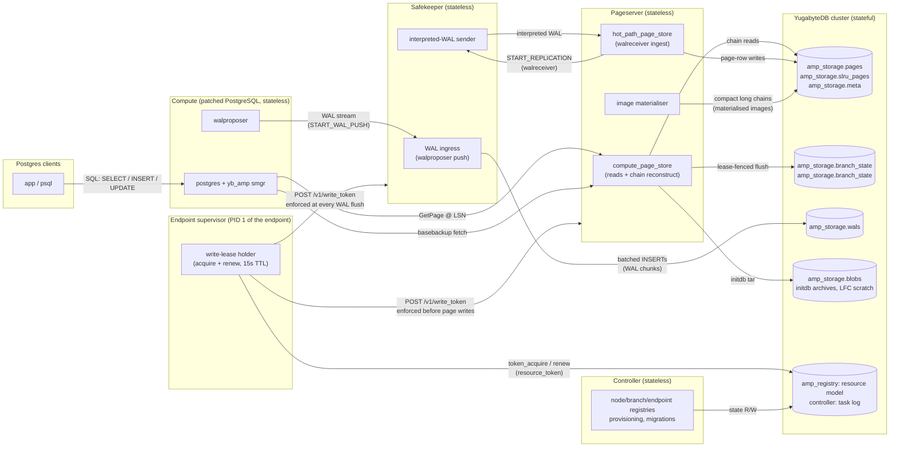

# High-level architecture

## System overview

Durability and resilience live in exactly one place: **YugabyteDB**.
The pageserver and safekeeper are stateless gateways that persist
everything they own as YB rows; the compute is stateless Postgres; the
controller keeps its registries in YB too. Any daemon can be killed and
restarted on another host without data loss — recovery is "reconnect to
YB and read your state back".



A yb-amp install is:

- **Compute nodes**: patched PostgreSQL, stateless, configured
  against a pageserver endpoint and a safekeeper. The `yb_amp` smgr
  extension routes every `smgr_read` to a pageserver GetPage request
  and every WAL flush to the safekeeper via the walproposer.
- **Pageserver (`pageserver`)**: the row-store gateway. Two YSQL
  connection pools:
  - `compute_page_store`: serves compute reads, running base-anchored
    LSN-chain reconstruction over `amp_storage.pages` /
    `amp_storage.slru_pages` / `amp_storage.meta`.
  - `hot_path_page_store`: the walreceiver ingestion path + image
    materialiser writes. Image materialisation runs as a background
    task that compacts long delta chains into walredo-applied images so
    subsequent reads don't re-walk the chain.
  The page read/write hot paths run over the direct-to-tserver RPC client;
  the YSQL pools carry the cold paths.
- **Safekeeper (`safekeeper`)**: stateless WAL ingress. Receives
  the WAL stream from the compute, batches it into
  `amp_storage.wals` rows, and ACKs a commit only once its bytes are
  durable in YB. No local WAL, no quorum, no leader election —
  **exactly one safekeeper per branch**. YB's own replication provides
  the quorum durability, so stacking a second consensus protocol on
  top of it would add latency and failure modes without adding safety;
  configurations that try are rejected at boot and at runtime (see
  [`safekeeper.md`](safekeeper.md) §5).
- **Controller** (`controller`, Go): the control plane — the branch/endpoint
  registries, endpoint provisioning, and the product API. It owns the
  `resource_token` store the write lease is taken from, but does not hold or
  enforce the lease itself. Its state lives in the same YB database
  (`amp_registry` + `controller` schemas), and it applies all schema migrations
  on startup. Documented under
  [`../../controller/architecture/`](../../controller/architecture/).
- **Endpoint supervisor** (`endpoint-supervisor`): PID 1 of the endpoint. It
  acquires the branch's write lease before starting anything and pushes it to
  the pageserver and the safekeeper, which enforce it against their own clocks —
  at most one endpoint writes a branch. See
  [`compute-fencing.md`](compute-fencing.md).
- **YugabyteDB cluster**: the durable storage tier for everything
  above.

> **YB query contract**: every SQL statement issued through
> `YsqlClient` must be idempotent. The client retries connection drops
> internally and may replay an in-flight write whose commit status is
> unknown. Use `INSERT ... ON CONFLICT` (or upsert mode), absolute
> updates, and key-scoped DELETEs — never bare INSERTs or
> relative `SET col = col + 1`. See
> [`yugabyte.md`](yugabyte.md#client-side-retry-contract--every-yb-query-must-be-idempotent)
> for the full contract.

## Components

| Component | Role | Process binary |
|---|---|---|
| Compute | User-facing Postgres backend. Speaks the Postgres wire protocol to clients. | `pg_install/v18/bin/postgres` (with smgr patches) |
| `compute_ctl` | Supervisor for the compute: applies the spec, starts/stops PG, runs catalog migrations. | `target/debug/compute-ctl` |
| Safekeeper | WAL durability gateway: receives WAL from the compute, persists it to `amp_storage.wals`, streams interpreted WAL to the pageserver. **One instance per branch** — YB provides the replication. | `target/debug/safekeeper` |
| Pageserver | Materializes pages from WAL into `amp_storage.*` rows and serves them to the compute on demand. | `target/debug/pageserver` |
| Endpoint supervisor | PID 1 of the endpoint: holds the branch's write lease and pushes it to the pageserver and safekeeper, renders their config, supervises them. | `target/debug/endpoint-supervisor` |
| Controller | Control plane: node/branch/endpoint registries, endpoint provisioning, schema migrations, and the `resource_token` store the write lease is taken from. | `controller` (Go, `controller/cmd/controller`) |
| YugabyteDB | Durable storage backend for everything yb-amp-internal. | external (`yugabyted`) |

## Write path (one INSERT from a client)

```
client
  |  SQL
  v
Compute (PG backend)
  |  WAL record buffer-flushed by walwriter / commit
  v
walproposer  ────────────►  the branch's Safekeeper
                              |  write_wal()  → chunks onto the consumer queue
                              |  consumer     → batched INSERT into amp_storage.wals
                              |                 (≤ 50 chunks / 4 MiB per batch,
                              |                  one placement bucket per batch)
                              |  durable watermark advances when the batch lands
                              v
                            ACK to walproposer  (compute returns commit to client)
```

Commit latency is bounded by the YB write round-trip for the batch
containing the commit record (~ms against local YB; more over a real
network). That round-trip is the headline cost of YB-backed WAL — and
the ingest loop never blocks on it: the producer keeps queueing the
next batch while the previous one is in flight, and ACKs ride the
durability watermark.

In parallel, the pageserver's walreceiver streams interpreted WAL from
the safekeeper (`START_REPLICATION`) and writes page rows into
`amp_storage.pages` / `slru_pages` / `meta`; its flushes advance
`amp_storage.branch_state.consistent_lsn` under the endpoint's write lease
([`compute-fencing.md`](compute-fencing.md)).

## Read path (a page miss in the compute)

```
client
  |  SELECT
  v
Compute backend --(miss)--> shared_buffers --(miss)--> LFC --(miss)-->
                                                                |
                                                        GetPage@LSN request
                                                                v
                                                          Pageserver
                                                                |
                                                  base-anchored chain read on
                                                  amp_storage.pages (one anchor
                                                  seek + range scan above it)
                                                                |
                                          one image row?  ──yes──►  return page bytes
                                                  |
                                                  no (image + deltas)
                                                  v
                                          walredo applies the delta chain
                                                  v
                                          return page bytes to compute
```

There is no per-page local cache on the pageserver: every miss in the
compute's own caches is answered from YB rows. The image materialiser
keeps chains short so the common case is a single image row (no
walredo). See [`pageserver.md`](pageserver.md).

## What's durable where

| State | Where | Key / shape |
|---|---|---|
| Relation pages | YB `amp_storage.pages` | one row per (block, LSN); images + deltas |
| SLRU blocks | YB `amp_storage.slru_pages` | one row per (block, LSN) |
| Metadata blobs (relsizes, dir listings, aux files, …) | YB `amp_storage.meta` | latest row ≤ LSN wins |
| Per-branch pageserver state (LSNs, ancestry) | YB `amp_storage.branch_state` | one row per branch, written under the endpoint's write lease |
| Safekeeper control file | YB `amp_storage.branch_state` | one row per branch, typed columns |
| Live WAL | YB `amp_storage.wals` | `(bucket_id, branch_id, segno, chunk_offset)` all-range, pre-split into 6 |
| initdb archives | YB `amp_storage.blobs` | `branches/<branch_id>/initdb.tar.zst` split across the namespace/branch_id/key columns, ≤ 100 MiB chunks |
| Endpoint scratch (LFC prewarm) | YB `amp_storage.blobs` | `{branch_id}/{endpoint_id}/lfc_state`, written by `compute_ctl` |
| Control-plane resource model | YB `amp_registry` schema | users, pools, clusters, grants, and the single `branch` / `endpoint` tables both the product API and the storage-layer surface read |
| Task log | YB `controller` schema | `task`, `task_step` |
| Compute `pgdata` + runtime | local FS | `.yb_amp/endpoints/<endpoint>/` — runtime working state only (`pgdata/` catalogs + ephemeral WAL pre-ship buffer, logs, the supervisor's pidfile and control socket, `compute_spec.json`); the directory and the daemon configs come from `endpoint create`, `compute_spec.json` from the supervisor at start, `pgdata` from `endpoint start`, and all of it goes on destroy |
| Pageserver / safekeeper local FS | local FS | `.yb_amp/endpoints/<endpoint>/{pageserver,safekeeper}/` — configs (`pageserver.toml`, `metadata.json`, `safekeeper.toml`), logs, pidfiles. No pages, no WAL, no control file. |

Everything in the local-FS rows is reconstructible; everything that
must survive a disk wipe is a YB row.

## Topology in the dev cluster (`yb_amp_local`)

The launcher is `yb_amp_local`
([`controller/local/cmd/yb_amp_local`](../../controller/local/cmd/yb_amp_local)),
a Go CLI that materializes a `.yb_amp/` repo (`init`) and drives the
local environment (`start`, `branch`, `endpoint`, `pageserver`,
`safekeeper`, `controller` subcommands). It targets
an external YugabyteDB (`controller.yb` config block) — external YB is
the only supported path — and `CREATE DATABASE`s `yb_storage` before
starting the controller, which then applies every schema migration.

Topology: single host, single YB instance, one controller, one
pageserver + one safekeeper **per branch**, co-located under the
endpoint that owns the branch. The PS+SK pair is provisioned at
`endpoint create` —
Branch creation only records the branch's init recipe (branch id,
branch name, pg version, optional ancestor + start LSN) in the
controller's `amp_registry.branches` row; the pair is laid out
under `endpoints/<endpoint>/{pageserver,safekeeper}` when the first
endpoint for that branch is created, which reads the recipe back and
deletes the pending row. Sibling endpoints on the same branch share the
PS+SK pair.

`endpoint start` runs one `endpoint-supervisor` per endpoint — the
binary that is PID 1 of a deployed endpoint pod — which starts the
safekeeper, the pageserver and the compute in dependency order and
restarts any that die. See
[single-container-endpoint.md](single-container-endpoint.md).

```
yugabyted                        :7100 (master), :5433 (ysql), :9100 (tserver RPC)
  +-- db `yb_storage`
        +-- schema `amp_storage`  blobs (chunked BYTEA) + blob_namespace ENUM
        |                         pages, slru_pages, meta, pending_gc
        |                         branch_state (one row per branch, shared by
        |                           the pageserver and the safekeeper)
        |                         wals (WAL chunks, 10 tablets)
        +-- schema `amp_registry` resource model: users, pools, clusters,
        |                         branches, endpoints (one table each, reached
        |                         through /api/v1)
        +-- schema `controller`  write-ahead task log

yb-amp processes
  controller --database-url postgresql://yugabyte@127.0.0.1:5433/yb_storage \
             --listen 127.0.0.1:1234 --deploy --deploy-driver local
                                               (control_plane_api http://127.0.0.1:1234/upcall/v1/)
  pageserver      (endpoints/<ep>/pageserver/pageserver.toml;
                      defaults :64000 pg, :9898 http, :51051 grpc — +2 per extra node)
  safekeeper      (endpoints/<ep>/safekeeper/safekeeper.toml;
                      defaults :5454 pg, :7676 http — +2 per extra node)
  compute-ctl --pgdata .yb_amp/endpoints/main/pgdata ...
    +-- postgres (+ yb_amp patches)      ports allocated from 55432 up
```

(`yb_amp_local init --port-base N` moves all the port lanes off their
defaults for parallel environments.)

A production deployment has M pageservers partitioned by branch (one
branch per pageserver — the pageserver does not shard a branch; YB
tablet-shards the keyspace underneath) and a YB cluster that is
actually distributed. The safekeeper count per branch stays at 1 — YB
provides the quorum durability that a safekeeper group would otherwise
exist to provide, and running two consensus protocols stacked on each
other is rejected at boot and at runtime (see
[`safekeeper.md`](safekeeper.md) §5).

### PS/SK co-location is NOT an invariant

The dev cluster co-locates each branch's pageserver and safekeeper on
one host, same build, provisioned together — but that is a dev-cluster
convenience, **not** something the design or the wire protocol may
assume. A pageserver and the safekeeper it streams WAL from can run on
**different nodes** and at **different versions** (e.g. during a
rolling upgrade). This is most visible with **read endpoints**: a
read-only / hot-standby replica can be served by a *separate*
pageserver — potentially on another node and a different build — that
streams interpreted WAL from a safekeeper elsewhere. A given safekeeper
may also fan its WAL out to more than one such pageserver. (The current
`yb_amp_local` launcher happens to point a read endpoint at the
primary's pair via `127.0.0.1`, but nothing downstream may rely on
that.)

Consequence: the **SK→PS interpreted-WAL wire format must stay
version-portable** — no encoding fast-path may assume the two ends are
the same build or the same host. There is currently no
version/capability handshake on that link beyond the `protocol=` format
selector, so any leaner-but-version-sensitive framing (see #69) must be
negotiated, with the portable protobuf encoding remaining the
default/fallback.

### The hot path needs direct tserver RPC access

The safekeeper (WAL write/read on `amp_storage.wals`) and the pageserver
(page read/write on `pages`/`slru_pages`/`meta`) speak YB's native pggate RPC
**straight to the yb-tserver RPC port** (9100), not through the YSQL frontend
(5433).

**Deployment invariant** — every host running a safekeeper or
pageserver must reach the RPC port of the tservers it targets: the
endpoints in `tserver_rpc_addrs`, or the `host_ports` hosts on 9100
when that is unset. (Tablet routing is server-side, so the client needs
only those configured endpoints, not every tserver.) A firewall /
security group / network policy that opens only 5433 (YSQL) and 7100
(master) lets the control plane and cold paths keep working while
breaking the hot path — it surfaces as startup
health-check failures (each daemon opens its table handles at boot) or
terminal getpage/WAL errors. Keep 9100 (and any ports named in
`tserver_rpc_addrs`) reachable from every SK/PS host. See
[`yugabyte.md`](yugabyte.md) §"Direct-to-tserver hot path".
