# Safekeeper LSNs

Authoritative inventory of every LSN the safekeeper tracks: name, where it
lives, what advances it, what reads it, and the invariants between them.
Grounded in the Rust sources (`compute/safekeeper/`, `compute/libs/utils`,
`compute/libs/safekeeper_api`), the walproposer C sources
(`compute/pgxn/yb_amp/`), and the controller-owned data-plane schema
(`controller/migrations/0003_compute_storage.up.sql`).

**System framing.** Durability and resilience come from YugabyteDB, the
underlying store. The safekeeper mirrors every WAL byte into the YB table
`amp_storage.wals` and persists its per-branch control state in
`amp_storage.branch_state`; it keeps no durable local state. Throughout
this doc, "flushed" means **persisted to YB** — `flush_lsn` is the frontier
of WAL confirmed durable in `amp_storage.wals`, and a commit is acked to the
compute only once its bytes are there.

See [`pageserver-lsns.md`](pageserver-lsns.md) for the pageserver side of
the replication link (how the `START_REPLICATION` position is chosen, what
`PageserverFeedback` reports back).

## Flow overview

```mermaid
flowchart LR
    COMP[Compute / walproposer] -->|AppendRequest| SK_ING[WAL acceptor ingest]
    SK_ING -->|write_wal producer| CHAN[chunk channel]
    CHAN -->|consumer batches| YB_WAL[(amp_storage.wals)]
    YB_WAL -->|DurableState watch| DUR[durable_lsn]
    DUR -->|caps| FL["flush_lsn = min(record boundary, durable_lsn)"]
    FL -->|AppendResponse.flush_lsn| COMP
    FL -->|commit_lsn watch| WS[walsender]
    PS[Pageserver] -->|START_REPLICATION start_pos| WS
    WS -->|InterpretedWalRecords| PS
    PS -->|PageserverFeedback ps_flushlsn| SK_FB[update_consistent_lsn]
    SK_FB -->|inmem only| RCS[consistent_lsn]
    RCS -->|removal horizon| GC[remove_up_to WAL GC]
```



---

## Commit semantics: the commit frontier IS the flush frontier

One safekeeper serves each branch, and its WAL is durable in YugabyteDB the
moment the INSERT commits — so there is a single acknowledgement frontier.
`commit_lsn` everywhere in the safekeeper is defined as `flush_lsn`:

```rust
// timeline.rs — WriteGuardSharedState::drop
let commit_lsn = self.guard.sk.flush_lsn();
let _ = self.tli.commit_lsn_watch_tx.send_if_modified(...);
```

Every release of the shared-state write guard re-derives `commit_lsn` from
`flush_lsn` and broadcasts it on `commit_lsn_watch_tx`; walsenders and the
manager subscribe to that watch. HTTP status and metrics report
`commit_lsn = flush_lsn`. The compute's walproposer applies the same rule:
`GetAcknowledgedWALPosition` returns the safekeeper's reported
`flushLsn` (once it has reached `propStartLsn`), and that becomes
`wp->commitLsn` — the position at which synchronous-commit waiters are
released. There is no LSN at which WAL is "flushed but not committed";
if `flush_lsn` covers a record, YB durably holds it.

`AppendRequestHeader` carries exactly `begin_lsn` and `end_lsn` — the WAL
byte range being appended. No commit or truncate positions travel on the
append path; truncation happens only via `ProposerElected`.

---

## Timeline control LSNs (`amp_storage.branch_state`)

Persisted in YB via `control_file::YbControlFileStorage`. Loaded at
timeline attach; written by `TimelineState::finish_change` (full row). The
read set is `COLUMNS` in `compute/safekeeper/src/control_file.rs`, which also
selects the pageserver-owned `consistent_lsn` to seed the retention floor —
that one the safekeeper reads and never writes.

| Column | Meaning |
|--------|---------|
| `timeline_start_lsn` | Earliest LSN the timeline covers (branch/bootstrap point) — also the earliest contiguous WAL in the store. Set on the first `ProposerElected` if still zero. Floors the restart record-boundary back-walk (below). |
| `pg_version`, `system_id`, `wal_seg_size` | Server info, set at creation; immutable. |
| `creation_ts` | Row insert time. |

**In-memory overlay** (`TimelineMemState`): a single field,
`consistent_lsn`, seeded at startup from the *pageserver's*
`amp_storage.branch_state.consistent_lsn` and advanced thereafter by
pageserver feedback (`Timeline::update_consistent_lsn`, monotonic max).
`handle_elected` additionally floors it at `timeline_start_lsn`, so a fresh
timeline doesn't pin the horizon at 0. The safekeeper never writes it back.

**Why no safekeeper-side copy:** the pageserver commits its
`advance_consistent_lsn` UPDATE — absolute, and taken under the endpoint's write
lease ([`compute-fencing.md`](compute-fencing.md)) — *before* echoing the same value as
`PageserverFeedback.consistent_lsn`, so every value the safekeeper ever
holds is already durable in a column the pageserver owns. Restart therefore
resumes at or above the last floor trimmed on, and WAL trimming keeps working
across a safekeeper restart taken while the pageserver is down. A `NULL`
`consistent_lsn` (pageserver not yet initialised) falls back to
`timeline_start_lsn`, which retains all WAL until the first feedback. The seed is
floored there rather than at 0 so the `floor >= timeline_start_lsn` invariant
holds from load, not just from the first election.

**Consensus/membership columns do not exist** in this schema: one
safekeeper serves each branch and YugabyteDB provides the durability
quorum, so the control row carries only the three LSNs plus server info.

---

## WAL storage watermarks

### The two in-memory watermarks (`yb_wal_storage.rs`)

`YbWalStorage` tracks the WAL stream with two values and no filesystem state.

| LSN | Meaning |
|-----|---------|
| `accepted_byte_end` | End of the byte stream accepted so far (may be mid-record). |
| record boundary | End of the last **fully parsed** WAL record, tracked by `WalStreamTracker` (`postgres_ffi::wal_record_boundary`) over a `WalStreamDecoder`. What `Storage::flush_lsn()` reports, capped at `durable_lsn`. |

Invariant: `accepted_byte_end ≥ boundary`. There is no separate flush watermark —
nothing is flushed at this layer, and durability is `durable_lsn` alone.
`write_wal` rejects rewrites (`startpos < accepted_byte_end`) and gaps
(`startpos > accepted_byte_end` when nonzero) — sequential append only; moving the
pointer requires a `ProposerElected` truncation first.

The tracker shares its decoder with `find_end_of_wal`, the restart scan in the
same module: were the two to disagree, a restart would seed from a point the
writer never called a boundary.

### `YbWalStorage` — durability tracking (`yb_wal_storage.rs`)

`write_wal()` is a **producer**: it splits the byte range into per-segment
`PendingChunk`s (each stamped with its `end_lsn`) and pushes them onto a
bounded channel without waiting for YB. A background **consumer** task
drains the channel into batches, coalesces contiguous chunks into single
rows, INSERTs them into `amp_storage.wals`, and publishes the batch's
highest `end_lsn` onto a `watch` channel as
`DurableState::Healthy(lsn)` — or `DurableState::Failed(msg)` on a
non-recoverable error, which fails both durability paths and terminates
the connection instead of freezing the watermark.

| LSN | Where | Meaning |
|-----|-------|---------|
| `durable_lsn` | `Arc<AtomicU64>` mirrored from the watch; lowered by `truncate_wal` | Highest `end_lsn` confirmed durable in `amp_storage.wals`. `wait_for_durable` reads it, not the watch value. |
| `submitted_max_lsn` | field | Highest `end_lsn` handed to the consumer; the target a blocking flush waits for. |

**The externally reported flush frontier is durability-capped:**

```rust
fn flush_lsn(&self) -> Lsn {
    std::cmp::min(self.record_boundary.last(), Lsn(self.durable_lsn.load(...)))
}
```

Nothing is ever advertised past what YB holds. Flush modes (`YbFlush`):

| Mode | Behavior | Used by |
|------|----------|---------|
| `NotifyAndWait` | wake consumer, `wait_for_durable(submitted_max_lsn)` | `flush_wal()` — the synchronous barrier (timeline init, truncation preludes) |
| `Notify` | wake consumer, return immediately | `handle_flush` (`FlushWAL` message) — steady-state; the ack follows via the durable watch |

**Ack pipeline** (`receive_wal.rs`): the WalAcceptor converts every
`AppendRequest` to `NoFlushAppendRequest` (ingest never blocks on YB), a
`flush_ticker` periodically issues `FlushWAL`, and a dedicated select arm
on `yb_durable_watch()` fires each time the consumer publishes a new
durable LSN — emitting an `AppendResponse` with the advanced,
durability-capped `flush_lsn` so the walproposer releases waiting
synchronous commits. A crash between `write_wal()` returning and the batch
landing in YB is a no-op for the compute: no ack was sent, so no commit
was acknowledged.

`wait_for_durable` is bounded (`YB_DURABLE_WAIT_MAX`, 60 s): callers hold
the timeline write lock, and an unbounded wait would wedge the whole
timeline; timing out drops the connection instead.

**`truncate_wal(end_pos)`** first drains in-flight durability
(`wait_for_durable(submitted_max_lsn)`) so a buffered chunk past `end_pos`
can't land after the DELETE, then **refuses `end_pos > durable_lsn`** —
accepting it would move the record boundary to `end_pos` and advertise WAL
the row store can't return. It then lowers `durable_lsn` and
`submitted_max_lsn` to `end_pos` — left at the old end, WAL re-streamed below
it is acked as soon as it is decoded, and doing it before the DELETE means a
DELETE that fails part way advertises nothing it removed. It deletes YB rows
lying entirely past the cut, drops cached chunks past the cut (so a reader
can't be served stale bytes that a subsequent write rewrites), and resets the
stream ends to `end_pos`.
The chunk straddling the cut is trimmed to end exactly at it, so the table
ends at `end_pos` with nothing past it.

### `SafeKeeper::flush_lsn()` wrapper (`safekeeper.rs`)

```rust
max(self.wal_store.flush_lsn(), self.state.timeline_start_lsn)
```

Avoids reporting zero before the first segment exists on a branch whose
timeline starts at a nonzero LSN.

### Restart rehydration (`YbWalStorage::new`)

1. `load_tail` reads the highest rows of `amp_storage.wals` across all
   buckets; their max end is the raw end, falling back to `timeline_start_lsn`
   when the table has no rows.
2. The raw end can sit above a hole: once a bucket's tablet splits, a flush
   cut short can store a later row of its batch without an earlier one.
   `contiguous_wal_end` walks those rows and cuts at the first gap that is a
   hole: one that doesn't close on a segment boundary, or one whose decode
   shows no `XLOG_SWITCH` ending there. A gap it can't classify is walked
   through, never cut at. Nothing past a hole was acked, unless more than one
   batch sits above it — then the load fails rather than delete them.
3. That byte offset can point inside a torn record or a torn trailing
   page (#61), so it is refined to a record boundary by replaying the
   decoder: `find_anchor` walks back (floored at the pageserver's
   `consistent_lsn`, which GC never trims below), then
   `find_end_of_wal` scans forward. A torn tail truncates `accepted_byte_end`
   *back*; a trailing `XLOG_SWITCH` advances it *forward* to the next
   segment boundary, past padding the compute never streamed. Clamping the
   switch case back to the raw max — or letting the anchor walk overshoot a
   mid-page floor — wedges the safekeeper (#181); see
   [`safekeeper.md`](safekeeper.md) §"Restart".
   The scan separates the WAL *ending* (no chunk covers the LSN) from a
   failed *read* of it, and a failed read fails `YbWalStorage::new` instead
   of yielding a boundary: truncating to the boundary reached so far would
   delete durable rows whose commits were already acked (#756), and
   advertising the raw max offset can publish a mid-record `flush_lsn` no
   reader can reach (#678). The walproposer handshake retries the load, so a
   transient read failure costs a reconnect.
4. Rows past the refined `accepted_byte_end` are deleted (best-effort; a failed
   cleanup is absorbed on the next restart), and `durable_lsn` +
   `DurableState::Healthy` are seeded at `accepted_byte_end` so an immediate
   `flush_wal()` returns at once.

---

## Walproposer link (compute ⇄ safekeeper)

| LSN | Carried in | Semantics |
|-----|-----------|-----------|
| `AcceptorGreeting.flush_lsn` | greeting reply | The safekeeper's end-of-WAL. The walproposer stores it as `propStartLsn` and derives its resume point from it; on bootstrap (`flushLsn == 0`) the compute starts from the basebackup redo LSN (`GetRedoStartLsn`). |
| `ProposerElected.start_streaming_at` | election message | Where the walproposer resumes appending; the safekeeper truncates its WAL to exactly this point. **Invariant (asserted in `handle_elected`): `start_streaming_at ≥ flush_lsn()`** — truncating below the durable frontier would discard acknowledged WAL. Because the walproposer derives it from the greeting's `flush_lsn`, the assert holds in steady state; a violation means the two sides disagree about durable history. First election also latches `timeline_start_lsn` and floors the in-memory `consistent_lsn` at it. |
| `AppendRequestHeader.begin_lsn` / `end_lsn` | each append | Byte range of the WAL chunk. `handle_append_request` enforces gap-free, rewrite-free sequencing against `accepted_byte_end`. |
| `AppendResponse.flush_lsn` | acks | The durability-capped flush frontier. Drives `wp->commitLsn` (syncrep release) and `CheckGracefulShutdown`. |
| `AppendResponse.hs_feedback` | acks | Aggregated hot-standby feedback (xmin/catalog_xmin), injected by `Timeline::process_msg` / `yb_emit_append_response` from `WalSenders::get_hotstandby`. |
| `AppendResponse.pageserver_feedback` | acks (optional) | The latest `PageserverFeedback` — the WalAcceptor clones the last `AppendResponse` and injects each incoming feedback so the compute sees pageserver progress promptly. |

On receiving feedback, `walprop_pg_process_safekeeper_feedback` advances
the compute's replication slot via `ProcessStandbyReply(standby_flush_lsn,
standby_flush_lsn, standby_apply_lsn, ...)` where `standby_flush_lsn =
wp->commitLsn` (durable in the safekeeper ⇒ in YB) and `standby_apply_lsn =
ps_feedback.consistent_lsn` (processed and durable at the pageserver).
Backpressure LSN handling is covered in
[`pageserver-lsns.md`](pageserver-lsns.md) §"Walreceiver LSNs and the
feedback wire format".

---

## Pageserver streaming (outbound)

### `START_REPLICATION PHYSICAL <start_pos>`

The **pageserver chooses `start_pos`** — the safekeeper does not pick a
resume point for it. The pageserver passes its durable `consistent_lsn`
(plus record padding and `normalize_lsn` page-header normalization), NOT
its eager applied frontier: after a reconnect mid-flush, the applied
frontier can point past records not yet in YB page storage, and a
subsequent pageserver crash would lose them if the safekeeper had already
trimmed that WAL.

The walsender streams from `start_pos` toward the commit frontier:

```rust
// send_wal.rs
let end_watch = EndWatch::new(tli.get_commit_lsn_watch_rx());
let end_pos = end_watch.get();
```

If `start_pos > end_pos` the walsender logs it (info) and proceeds — the
pageserver may be momentarily ahead during catch-up races; it simply waits
for the watch to advance. Every WAL read path (`WalReader` →
`YbSegmentReader`) is capped at the live flush frontier, so bytes that are
written but not yet durable — which a reconnecting walproposer may rewrite
— are never served (#139).

### Interpreted WAL batch LSNs (pageserver protocol)

Per batch (`wal_reader_stream.rs` → `send_interpreted_wal.rs`):

| Wire field | Source | Meaning |
|------------|--------|---------|
| `streaming_lsn` | `batch.wal_end_lsn` | End of the WAL chunk this message covers. |
| `commit_lsn` | `batch.available_wal_end_lsn` | End of WAL available on the safekeeper (the commit/flush frontier at read time). |

The pageserver maps these into its `WalReceiverConnectionStatus`
(`streaming_lsn` / `commit_lsn`).

### Pageserver feedback (inbound)

The pageserver sends `PageserverFeedback` as a CopyData message tagged
`NEON_STATUS_UPDATE_TAG_BYTE` (`b'z'`, `send_wal.rs`), distinguishing it
from standard standby status updates and hot-standby feedback. The reply
reader skips the tag and length bytes, parses the key/value payload
(`PageserverFeedback::parse`,
`compute/libs/utils/src/pageserver_feedback.rs`), records it in the
walsender slot, and applies exactly one field to retention:

| Field (wire key) | Safekeeper use |
|------------------|----------------|
| `consistent_lsn` (`ps_flushlsn`) | **`update_consistent_lsn`** — the WAL retention bound. Also relayed to the compute (slot apply position, backpressure); metrics. |
| `last_received_lsn` (`ps_writelsn`) | Relayed to the compute (backpressure `writeLsn`); `safekeeper_ps_last_received_lsn` metric. |
| `current_timeline_size`, `replytime`, `corruption_detected` | Relayed to the compute via `AppendResponse.pageserver_feedback`. |

The pageserver populates `consistent_lsn` from its single durable
watermark (`Timeline::get_consistent_lsn()`), so the truncation bound is
durable by construction. The safekeeper's own field carries the same name
because it holds the same fact.

`should_walsender_stop(reported_consistent_lsn)` terminates an
inactive walsender once the reported value reaches `flush_lsn` — nothing
left to stream, nothing left to wait for.

---

## Standby / hot-standby LSNs (in memory)

| LSN | Where | Role |
|-----|-------|------|
| `StandbyReply.apply_lsn` | Per walsender slot (`record_standby_reply`) | Aggregated (min across senders) in `update_reply_feedback`; observability. |
| `HotStandbyFeedback.xmin` / `catalog_xmin` | `WalSenders.agg_standby_feedback` | Min-aggregated across standby senders; injected into `AppendResponse.hs_feedback` for the compute's `ProcessStandbyHSFeedback`. |

Not persisted. Not inputs to WAL truncation.

---

## WAL removal horizon

The horizon is `consistent_lsn`, the pageserver's durable-ingest frontier.
The manager (`update_wal_removal`) computes
`removal_horizon_segno = consistent_lsn.segment_number() - 1` (saturating) and,
when it exceeds `last_removed_segno`, spawns
`YbWalStorage::remove_up_to(segno)` — dropping cached chunks first, then
DELETEing all `amp_storage.wals` rows with `segno < segno_up_to`, bounded below
by `delete_lower_bound` for a tight index range. The first removal after a load
resolves that bound from `min(segno)` on the branch — slow by nature, see
[`safekeeper.md`](safekeeper.md) → `remove_up_to` — and every removal after it
uses the previous one's upper edge.

It is safe to trim on directly even though the safekeeper holds it only in
memory — every value came from a `consistent_lsn` the pageserver had already
committed, so a crash restores a floor at or above whatever was trimmed.

No `flush_lsn` clamp is needed, provided nothing outside the safekeeper mutates
the branch's `wals` rows: the pageserver only ingests WAL this safekeeper
served, and `flush_lsn` never drops below what it served (trimming keeps the
horizon's segment, and `handle_elected` refuses to truncate below it).

**Timeline activity** (`update_is_active`): the timeline counts as active
while computes are attached or
`consistent_lsn < flush_lsn` (the pageserver hasn't durably ingested
everything). Drives the `broker_active` flag and the
`safekeeper_timeline_active` gauge.

---

## LSN ordering (steady state)

```
sk consistent_lsn  ≤  branch_state.consistent_lsn
                      (feedback trails the pageserver's own commit)

sk consistent_lsn  ≤  flush_lsn (= commit_lsn)

timeline_start_lsn  ≤  flush_lsn

accepted_byte_end  ≥  record boundary

reported flush_lsn  =  min(record boundary, durable_lsn)
                       (never past confirmed YB durability)

start_streaming_at  ≥  flush_lsn      (asserted on ProposerElected)
truncate_wal end_pos ≤ durable_lsn    (refused otherwise)
```

**Why they hold / what breaks:**
- *Durability cap on `flush_lsn`*: the ack the compute releases
  synchronous commits on. If it ever exceeded `durable_lsn`, a safekeeper
  crash after the ack but before the YB INSERT would lose an acknowledged
  commit — the exact failure the producer/consumer split is designed to
  make impossible.
- *Record-boundary cap on `flush_lsn`*: `durable_lsn` alone is not enough, since
  a durable LSN can land mid-record. `Storage::flush_lsn` carries the full
  argument for why it takes the lower of the two.
- *`consistent_lsn ≤ flush_lsn`*: feedback describes ingested WAL,
  which the safekeeper streamed, which is ≤ its durable end. Nothing clamps
  the horizon to it; see [WAL removal horizon](#wal-removal-horizon).
- *Truncation floor*: `start_streaming_at < flush_lsn` would delete WAL
  already acked to the compute (and possibly already streamed to the
  pageserver); the assert makes the disagreement loud instead of silent.

---

## Cross-link: pageserver restart → stream → feedback loop

1. Pageserver loads `consistent_lsn` from `amp_storage.branch_state` and
   seeds both its eager applied frontier and its durable slot from it.
2. Pageserver sends `START_REPLICATION PHYSICAL {startpoint}` with
   `startpoint` derived from `get_consistent_lsn()`.
3. Walsender streams from `startpoint` toward the commit-frontier watch
   (`= flush_lsn`).
4. Pageserver ingests; its applied frontier races ahead at WAL speed while
   its durable slot waits for flushes.
5. After each successful `advance_consistent_lsn`, the
   pageserver's next `PageserverFeedback.consistent_lsn` advances.
6. Safekeeper bumps `consistent_lsn` immediately and the manager
   allows WAL removal up to it.

The lag in this loop degrades toward *extra retention*, not loss: a lagging
pageserver column means WAL gets re-streamed into idempotent UPSERTs.

---

## Persistence cheat sheet

| Field | YB `amp_storage.branch_state` | YB `amp_storage.wals` | In memory only |
|-------|-------------------------------|----------------------|----------------|
| `timeline_start_lsn` | Yes | — | — |
| `consistent_lsn` | — (read from the pageserver's `consistent_lsn` at startup) | — | `TimelineMemState` (live) |
| `flush_lsn` / `commit_lsn` | — | implied by the contiguous chunk end (rehydrated by `load_tail` + hole scan + boundary walk) | record boundary + `durable_lsn` |
| `accepted_byte_end` / record boundary | — | same rehydration | `YbWalStorage` |
| WAL bytes | — | Yes (coalesced chunk rows) | `WalCache` (hot cache) |
| Walsender positions / feedback | — | — | `WalSenders` slots |
| Standby `apply_lsn` / hs feedback | — | — | `WalSenders` aggregation |

---

## Code anchors

- `compute/safekeeper/src/state.rs` — `TimelinePersistentState`,
  `TimelineMemState`, `start_change` / `finish_change`.
- `compute/safekeeper/src/control_file.rs` — `COLUMNS`, row read/write.
- `compute/safekeeper/src/safekeeper.rs` — `AcceptorGreeting`,
  `ProposerElected`, `AppendRequest{,Header}`, `AppendResponse`,
  `flush_lsn()` wrapper, `handle_elected`, `handle_append_request`,
  `handle_flush`, `yb_emit_append_response`.
- `compute/safekeeper/src/wal_storage.rs` — `Storage` trait, `WalReader`.
- `compute/libs/postgres_ffi/src/wal_record_boundary.rs` —
  `WalStreamTracker` (write path), `find_end_of_wal` (restart scan).
- `compute/safekeeper/src/yb_wal_storage.rs` — producer/consumer batching,
  `DurableState`, `YbFlush`, `durable_lsn` cap, `load_tail`, `contiguous_wal_end`,
  `truncate_wal`, `remove_up_to`, `YbSegmentReader`.
- `compute/safekeeper/src/receive_wal.rs` — WalAcceptor loop:
  `NoFlushAppendRequest` conversion, `FlushWAL` ticker, durable-watch ack
  arm, feedback injection into `AppendResponse`.
- `compute/safekeeper/src/timeline.rs` — `WriteGuardSharedState::drop`
  (commit watch), `update_consistent_lsn`,
  `should_walsender_stop`, hs-feedback injection.
- `compute/safekeeper/src/send_wal.rs` — `NEON_STATUS_UPDATE_TAG_BYTE`,
  feedback intake, standby aggregation, `EndWatch`.
- `compute/safekeeper/src/send_interpreted_wal.rs` /
  `wal_reader_stream.rs` — `wal_end_lsn` / `available_wal_end_lsn` batch
  bounds.
- `compute/safekeeper/src/timeline_manager.rs` — `update_wal_removal`,
  `update_is_active`.
- `compute/pgxn/yb_amp/walproposer.c` / `walproposer_pg.c` — greeting →
  `propStartLsn`, `GetAcknowledgedWALPosition`, slot advance,
  feedback shared-memory relay.
- `compute/libs/utils/src/pageserver_feedback.rs` — feedback wire format.
- `controller/migrations/0003_compute_storage.up.sql` —
  `amp_storage.branch_state` + `amp_storage.wals` schemas.
- [`pageserver-lsns.md`](pageserver-lsns.md) — the pageserver side of the
  link.
