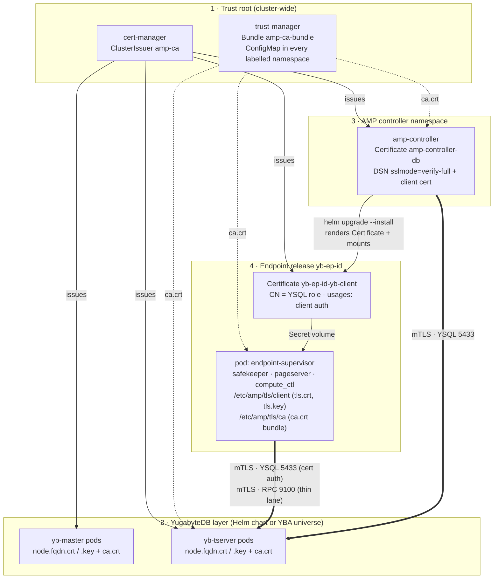

# ac — Certificate trust between endpoints and YugabyteDB (cert-manager)

**Status:** Phases 1 to 3 of the [delivery plan](#delivery-plan) implemented; decisions 1 to 5 taken 2026-09-03 (see [Decisions](#decisions)), one open.
The operator side is [`runbooks/tls.md`](../../runbooks/tls.md).
**Last updated:** 2026-09-08
**Tracks:** [#1114](https://github.com/yugabyte/meko/issues/1114)

One cluster-wide certificate authority issues every certificate the stack uses: the
YugabyteDB masters and tservers, the AMP controller, and one client certificate per
endpoint. Endpoint processes authenticate to YugabyteDB with that certificate instead
of a password, and pick up renewed certificates without a restart.

Encryption stays **optional and off by default**. TLS costs roughly 5% CPU and many
deployments on a private network will not opt in.

## Summary

Nothing in the AMP stack speaks TLS to YugabyteDB today. The dev deploy runs a single
`yugabyted` with auth off, the controller's own DSN is `sslmode=disable`, the endpoint
chart has `sslmode` and `sslrootcert` knobs the controller never sets, and the
safekeeper's thin lane cannot carry TLS at all. Since
[#1041](https://github.com/yugabyte/meko/pull/1041) removed the YSQL fallback lane, that
last gap is no longer a silent slowdown: on a TLS-enabled universe the safekeeper and
pageserver refuse to start. Fixing [#1114](https://github.com/yugabyte/meko/issues/1114) in isolation would wire the thin lane but leave
it nothing to load.

The design has four pieces, each owned by a different part of the repo:

1. **Trust root.** cert-manager plus trust-manager, a single `ClusterIssuer`, and a CA
   `Bundle` that lands as a ConfigMap in every namespace that needs to verify a peer.
2. **YugabyteDB layer.** The database gets its node certificates from the same issuer,
   whether it is deployed by the upstream Helm chart or by YugabyteDB Anywhere, and is
   configured to require client certificates and to map certificate CN to the YSQL role.
3. **AMP deploy and controller.** The installer installs or discovers cert-manager, and
   the controller learns the issuer. Every endpoint Helm release then carries a
   `Certificate` whose Secret is mounted into the pod, alongside the CA bundle.
4. **Endpoint processes.** Safekeeper, pageserver, compute_ctl and the supervisor present
   the client certificate on both the YSQL lane and the thin lane, fail loudly when TLS is
   required but unavailable, and watch the mounted files so a renewed certificate is used
   without a restart.

Cert-based auth also retires the YSQL password from endpoint pods, which answers the
password-rotation half of [#1114](https://github.com/yugabyte/meko/issues/1114) by removing the secret rather than rotating it.

## Where we started

The state this design was written against, kept because it is what the phases below
close. The gaps were independent, and all of them had to close for the thin lane to run
encrypted.

| Component | How it reaches YugabyteDB | TLS state | Gap |
|---|---|---|---|
| **Dev and CI YugabyteDB** (`amp/deploy/up.sh`, `up-gke.sh`, QA `builtin_yugabyted`) | Hand-rolled StatefulSet running `yugabyted start` with `ysql_enable_auth=false` | plaintext | No TLS gflag is set anywhere in the repo. yugabyted has no cert-manager integration. |
| **QA chart and YBA universes** (`yb_k8s`, `yba_provisioned` — the CI default for the run pipeline, amp-dev) | Upstream `yugabyte` chart 2025.2.1, or a YBA-created Kubernetes universe | plaintext | Universe create bodies set no TLS or root CA fields. Chart values leave `tls.enabled=false`. |
| **Controller** (`amp/controller`, `yb-amp-controller` chart) | `pgxpool` on `AMP_DATABASE_URL`; default `…?sslmode=disable` (`values.yaml:51`) | plaintext | pgx would honour `sslrootcert`, `sslcert` and `sslkey` in the URL, but the controller pod mounts no volumes, so there is no CA file to point at. |
| **Controller to endpoint** (`deploy/kubernetes.go`, `yb-amp-endpoint` chart) | One Helm release `yb-ep-<id>` per endpoint: Deployment (Recreate), Service, ConfigMap, optional Secret for the password | knobs unused | Chart renders `YB_SSLMODE` and `YB_SSLROOTCERT` from values the Go side never sets (`yugabyteValues` has no TLS fields). No volume exists for a CA or a client cert; the chart has no `extraVolumes`. RBAC grants nothing on `cert-manager.io`. |
| **YSQL lane** (`compute/libs/ysql_client`) | YugabyteDB smart-driver fork of tokio-postgres over rustls when `sslmode` is anything but `disable` | server-auth only | Without `sslrootcert` it installs an accept-anything verifier and logs. Every connector is built `with_no_client_auth()`; `YbConnConfig` has no `sslcert` or `sslkey`. |
| **Thin lane** (safekeeper `yb_wal_storage.rs`, pageserver `page_store.rs`, `libs/yb_thin_client`) | yb-client RPC to tservers on 9100 through the prebuilt C++ shim | no TLS path | `TsClientConfig.tls` is left at `None` at both call sites. `TlsOpts {ca_cert_path, cert_path, key_path}` already reaches the shim, which builds a `SecureContext` from explicit paths and always verifies the server. The fallback to YSQL that [#1114](https://github.com/yugabyte/meko/issues/1114) describes was removed by [#1041](https://github.com/yugabyte/meko/pull/1041); today the daemon fails at boot with `thin-client hot path init`. |

Two facts worth knowing before designing against them. The per-endpoint NLB work from
[#968](https://github.com/yugabyte/amp/issues/968) (commit 8f3c4fc1b) was removed again by the very next commit, 0fccf8f7d, so no
LoadBalancer Service or cloud detection exists at HEAD. And the endpoint pod is one
container: `endpoint-supervisor` forks safekeeper, pageserver and compute_ctl
in-process, so a cert mount is visible to all of them at once.

## Target architecture



Solid lines are certificate issuance and deployment. Dotted lines are trust
distribution. Heavy lines are the runtime connections that become mutually
authenticated. Only layers 3 and 4 are owned by the AMP controller; layers 1 and 2 are
installer and operator responsibilities.

### Identity model

| Certificate | Subject and SANs | Used for | Issued by | Lifetime (proposed) |
|---|---|---|---|---|
| **Root CA** | CN "AMP Root CA", or the customer's CA | Anchor in every trust store | Self-signed bootstrap, or customer PKI (Vault, AWS PCA, internal CA) through an external issuer | Years; rotated by the staged procedure below |
| **yb-master, yb-tserver** | SANs: pod FQDNs and headless Service FQDN (the chart generates these); server auth and client auth | Node-to-node RPC, client-to-server YSQL, and as the client cert when tservers call each other | `amp-ca` through the chart's `tls.certManager` or YBA's K8S cert-manager type | 90d, renew 15d before (chart default) |
| **Controller** | CN = controller's YSQL role; client auth | Controller's own `yb_storage` pool | `amp-ca` through a Certificate in the controller chart | 30d, renew 10d before |
| **Endpoint (one per release)** | CN = the endpoint's YSQL role (a shared `amp_storage` role at first); SAN `yb-ep-<id>.<ns>.svc.cluster.local` for audit; client auth only; ECDSA P-256 | YSQL lane (cert auth) and thin lane (RPC mTLS) from every process in the pod | `amp-ca` through a Certificate template in the endpoint chart | 30d, renew 10d before, `rotationPolicy: Always` |

**Two different authentication semantics.** On the YSQL lane the tserver maps the
certificate's CN to the database role, so the cert is the login. On the thin lane the
RPC layer only checks that the client certificate chains to `ca.crt`; there is no role.
Any holder of a certificate from the CA has tserver-level RPC access. That is the same
trust a tserver extends to its peers, and it is why endpoint certificates are
short-lived and why the issuer must not be shared with unrelated workloads.

## 1. Trust root

**cert-manager** (cluster-scoped, shared)

- Installed once per cluster. Many customer clusters already run it, so the AMP
  installer must support **install** and **bring-your-own** equally: detect the CRDs and
  only install when asked.
- Run with `--enable-certificate-owner-ref=true` (Helm value `enableCertificateOwnerRef`)
  so deleting a `Certificate` also deletes its Secret. Without it, `helm uninstall` of an
  endpoint leaves the key material behind.

**ClusterIssuer `amp-ca`** (one per cluster)

- Default: a self-signed bootstrap `Issuer` mints a root CA `Certificate` (`isCA: true`)
  into a Secret, and `amp-ca` is a `ca` issuer over that Secret. This mirrors what the
  yugabyte chart does with `bootstrapSelfsigned`, but at cluster scope so YugabyteDB, the
  controller and every endpoint namespace share one anchor.
- Customer PKI: `amp-ca` is whatever issuer they already have. Issuer `kind`, `name` and
  `group` are the three values the rest of the stack consumes, exactly as YBA's
  Kubernetes provider region already models them.

**trust-manager Bundle `amp-ca-bundle`** (trust distribution)

- Sources: the root CA copied into a ConfigMap in the trust namespace, not a direct
  reference to the issuer Secret, so a rotation can hold old and new roots side by side.
- Target: ConfigMap `amp-ca-bundle` with key `ca.crt` in every namespace labelled
  `amp.yugabyte.com/trust=true`. The installer labels the controller namespace and the
  YugabyteDB namespace; the controller labels the namespace it creates endpoints in.
- Consumers mount this ConfigMap, never the issuer's own `ca.crt`, so CA rotation is a
  Bundle edit rather than a redeploy.

## 2. YugabyteDB layer

Only the endpoints and the controller are the AMP controller's to configure. YugabyteDB
is stood up by whichever path the deployment uses, and each path needs the same four
things: node certificates from `amp-ca`, TLS turned on, client certificates demanded on
the RPC port, and a host-based auth rule that accepts a certificate as the login.

### What the database must be told

| Setting | Value | Why |
|---|---|---|
| `use_node_to_node_encryption`, `use_client_to_server_encryption`, `allow_insecure_connections` | true / true / false | TLS on both the RPC port (9100, thin lane) and the YSQL port (5433). The chart sets these from `tls.nodeToNode`, `tls.clientToServer` and `tls.insecure`. |
| `node_to_node_encryption_use_client_certificates` | true (default false; restart needed) | By default the RPC server does **not** ask for a client certificate, so the thin lane would be encrypted but unauthenticated. Turning this on makes tservers verify the endpoint's certificate against `ca.crt`. Postgres backends inside the tserver pod then present the node certificate for their own RPCs, which the chart's cert layout already provides. |
| `ysql_enable_auth` and `ysql_hba_conf_csv` | true, and `hostssl yb_storage amp_storage all cert,hostssl all all all scram-sha-256` | The endpoint role logs in by certificate CN; everything else still needs TLS and a password. Auth must be on: with it off YugabyteDB appends `hostssl all all all trust` after the custom rules, which would let any TLS client in as any role. On 2.25 and later, `scram-sha-256 clientcert=verify-full` also exists if both factors are wanted. |
| Certificate SANs | pod FQDNs and the headless Service FQDN | RPC clients verify the server endpoint by default (`verify_server_endpoint=true`), and `sslmode=verify-full` does the same on YSQL. The chart's Certificate template already lists both, and `server_broadcast_addresses` is the pod FQDN, so clients that learn tserver addresses from the master see names that are in the cert. |

### Path A: the upstream Helm chart

The `yugabyte` chart already has a complete cert-manager mode. With
`tls.certManager.enabled=true`, `bootstrapSelfsigned=false`, `useClusterIssuer=true`,
`clusterIssuer=amp-ca` and `rootCA.cert` set to the trust bundle, it renders one
`Certificate` per StatefulSet with the right SANs, a `certmanager-init` container that
copies `tls.crt` and `tls.key` into the `node.<fqdn>.crt` and `.key` names the server
expects, and the three TLS gflags. The two AMP-specific gflags go in `gflags.tserver`
and `gflags.master`.

This is the path to move the dev deploy onto: when TLS is requested, `up.sh` and
`up-gke.sh` install the chart instead of the hand-rolled yugabyted StatefulSet, which
the QA framework's `yb_k8s` backing already knows how to do. yugabyted can consume
externally issued certs from a `--certs_dir`, but wiring a Secret into that layout
would be a second, AMP-only integration to maintain.

**Chart limitation to plan around.** The chart copies certificates only at pod start,
refuses to refresh them if `ca.crt` changed, and its values file states that re-issued
certificates are not reloaded by the service. A renewed tserver certificate therefore
takes effect on the next restart. The server can hot-reload (`yb-ts-cli
reload_certificates` re-runs the same `UseCertificates` path used at boot), but nothing
in the chart triggers it, and the chart has no `extraContainers` hook for a sidecar. See
[Rotation](#rotation) for the options.

### Path B: YugabyteDB Anywhere

YBA supports the same arrangement under the **K8S cert-manager** certificate type. The
operator uploads the CA (a chained bundle is allowed), sets issuer kind, name and group
on the Kubernetes provider region (`certManagerIssuerKind`, `certManagerIssuerName`,
`certManagerIssuerGroup`), and creates the universe with node-to-node and
client-to-node TLS enabled and that certificate selected. YBA then generates the chart
overrides above itself (`certManager.enabled=true`, `bootstrapSelfsigned=false`), and
rejects `bootstrapSelfsigned` because it could not trust a CA it never saw.

What AMP adds on this path is the universe-level gflag overrides for
`node_to_node_encryption_use_client_certificates` and `ysql_hba_conf_csv`, and the QA
framework's universe request learning the TLS fields (`enableNodeToNodeEncrypt`,
`enableClientToNodeEncrypt`, `rootCA`, `rootAndClientRootCASame`) so `yba_provisioned`
stacks can run encrypted. YBA on Kubernetes supports hot certificate reload from
2025.2, so rotation on this path is a YBA action rather than a chart workaround.

## 3. AMP deploy and controller

### Installer

- `deploy/up.sh` and `up-gke.sh` gain a TLS mode, off by default. When on: ensure
  cert-manager and trust-manager are present (install or verify), apply the bootstrap
  issuer, `amp-ca` and the `amp-ca-bundle` Bundle, label the namespaces, deploy
  YugabyteDB through the chart with the values above, create the `amp_storage` role with
  grants on the storage schemas, and pass the issuer reference to the controller chart.
- The `yb-amp-controller` chart gets a `tls` block: `enabled`, `issuerRef {kind, name,
  group}`, `caBundleConfigMap`, `certificate {duration, renewBefore}`. It renders a
  `Certificate` for the controller's own role, mounts its Secret and the bundle, and
  builds `AMP_DATABASE_URL` with `sslmode=verify-full` plus the three file paths. The
  same values flow to the controller as `AMP_DEPLOY_YB_TLS_*` env for endpoint
  rendering.

### Controller

The controller materializes endpoints by shelling out to `helm upgrade --install` on the
endpoint chart, and reaches the API server only through a hand-rolled REST client for
reads and the pod resize patch. The design keeps to that: **the per-endpoint
`Certificate` is a template in the endpoint chart**, not an object the Go code creates.
That gives the controller no new Kubernetes client, keeps creation and deletion tied to
the release, and reuses the crash-safe `recoverPending` path.

| | |
|---|---|
| **Config** | New fields on `DeployConfig`'s Kubernetes block and flags beside `--deploy-yb-existing-secret`: `--deploy-yb-tls-mode` (`off` or `verify-full`), `--deploy-yb-tls-issuer-kind`, `-name`, `-group`, `--deploy-yb-tls-ca-configmap`, `--deploy-yb-tls-cert-duration` and `-renew-before`. Validated in `validateDeployKubernetes`, threaded into `KubernetesConfig` in `main.go`. The Docker deployer gets the same fields as host paths. |
| **Chart values** | `yugabyteValues` in `kubernetes.go` grows `sslmode`, `sslrootcert`, `sslcert` and `sslkey`; a new `tls` block carries issuer and bundle. `deploy.YBConn` grows the matching fields. |
| **Endpoint chart** | New `templates/certificate.yaml` gated on `tls.enabled`: `secretName: <release>-yb-client-tls`, `commonName` from `yugabyte.user`, `dnsNames: [<release>.<ns>.svc.cluster.local]`, `usages: [client auth]`, `privateKey: {algorithm: ECDSA, size: 256, rotationPolicy: Always}`. The Deployment mounts the Secret at `/etc/amp/tls/client` and the bundle ConfigMap at `/etc/amp/tls/ca` as whole-directory mounts, never `subPath`, because subPath mounts do not receive Secret updates. The ConfigMap gains `YB_SSLCERT` and `YB_SSLKEY`; `YB_PASSWORD_ENV` is omitted in cert mode. |
| **Ordering** | Helm applies the Certificate and Deployment together. The kubelet holds the pod in ContainerCreating until the Secret exists, cert-manager issues within seconds, and the existing `helm --wait` plus the `verifyReady` round trip to the safekeeper's status endpoint cover the rest. No new wait logic. |
| **RBAC** | The namespaced Role adds `cert-manager.io/certificates` with get, list, watch, create, update, patch and delete. Reading the resulting Secret already works (`secrets: *`). A `ClusterIssuer` is referenced by name and needs no grant. |
| **Existing endpoints** | Switching a deployment to TLS mode is a re-render of every live release: a helm upgrade that adds volumes recreates the pod (Recreate strategy), so the address is re-recorded. It ships as `rerender_endpoints`, a fan-out over the subtask machinery the version upgrade introduced (`ac-endpoint-upgrade.md` §5) — one parent holding `fleet:endpoints` and a `rerender_endpoint` child per endpoint holding that endpoint's own lock, which is the protection [meko#976](https://github.com/yugabyte/meko/issues/976) notes `add_branch_extensions` still lacks. Collapsing the two near-identical rolls into one parameterised pair is [meko#1202](https://github.com/yugabyte/meko/issues/1202). |
| **Version skew** | `YbConnConfig` is `deny_unknown_fields`, so a controller that emits `sslcert` to an endpoint image that predates the field breaks that endpoint at boot. TLS mode therefore requires a minimum endpoint image tag, checked in config validation. |
| **Own connection** | pgx loads `sslcert` and `sslkey` once at `ParseConfig`. Either set `tls.Config.GetClientCertificate` to read the files per handshake, or accept that the controller restarts on its own cert renewal; it is stateless and its leases are fail-fast, so the restart is cheap. |

## 4. Endpoint processes

Every YugabyteDB connection from the pod goes through one of two transports:
`ysql_client::YsqlClient` (the smart-driver tokio-postgres fork with an optional rustls
connector) and `yb_thin_client::TsClient` (the shim on RPC 9100). Both read the same
`YbConnConfig`, which the supervisor renders three ways from its environment: an inline
TOML table in `pageserver.toml` and `safekeeper.toml`, a JSON block in the compute
spec, and the typed struct it uses itself. Compute Postgres and the `yb_amp` extension
never talk to YugabyteDB; they talk to the pageserver and safekeeper.

| Process | Lanes | Connection lifetime | What changes |
|---|---|---|---|
| **safekeeper** | 1 YSQL connection (control file, GC) and 1 thin pool (all WAL traffic) | Long-lived, lazily recycled every 15 min with jitter | Both lanes present the client cert; thin lane refuses to start without a CA |
| **pageserver** | 3 YSQL pools (compute reads, hot path, GC) and 3 thin pools, plus 1 YSQL blob-store connection | Same 15 min recycle | Same as safekeeper |
| **compute_ctl** | 1 YSQL blob-store connection for LFC prewarm and offload, on demand | Transient | Cert from the compute spec's `yb_storage_conn`; picks up renewals on next open |
| **endpoint-supervisor** | 1 long-lived YSQL connection for the write-fence lease (renewed about every 5 s); fresh connections for registry reads | Lease: long-lived. Registry: per attempt | Lease connection needs the connector swap; registry reads pick up renewals for free |
| **postgres-exporter sidecar** | Loopback to compute Postgres only | n/a | Unaffected |

### Configuration

- `YbConnConfig` grows `sslcert` and `sslkey` beside `sslrootcert`. Every encoder
  follows: the supervisor's inline TOML and compute-spec JSON, `to_database_url`, the Go
  mirror in `controller/local/config`, and the diagnostic CLIs' `YbConnArgs`. The
  supervisor reads them from `YB_SSLCERT` and `YB_SSLKEY`.
- **YSQL lane.** `build_yb_rustls_connector` takes the trio and uses
  `with_client_auth_cert` when a cert and key are present. The accept-anything verifier
  used when `sslrootcert` is absent stays for `require`, but `verify-ca` and
  `verify-full` without a root cert become a configuration error instead of a logged
  warning.
- **Thin lane.** Whenever `sslmode` is not `disable`, `TsClientConfig.tls` is
  `Some(TlsOpts { ca_cert_path: sslrootcert, cert_path: sslcert, key_path: sslkey })` at
  both call sites. The shim always verifies the server and has no accept-anything mode,
  so a TLS `sslmode` without `sslrootcert` is rejected when the client is built, rather
  than as a handshake failure buried in RPC logs. `YbConnConfig::validate` is what
  rejects it; deserializing the block does not run it.
- The password path is untouched: when `password_env` is absent and a cert is present,
  the login is the certificate. Nothing else in the pod needs to know which mode it is in.

### Failing loudly

Since [#1041](https://github.com/yugabyte/meko/pull/1041) a daemon that cannot open its thin lane already refuses to start, so the
"silent fallback" is gone. What the design adds is diagnosis before and after that
point:

- At daemon start, validate the files: they exist, the key matches the certificate, the
  certificate is within its validity window, and its CN equals `user`. A mismatch is a
  startup error naming the file, not a handshake failure buried in RPC logs.
- The safekeeper's `/v1/status`, which the controller's `verifyReady` already polls,
  reports `yb_tls: {enabled, sslmode, sslrootcert, client_cert: {common_name, serial,
  not_before_unix, not_after_unix}}`, or `client_cert_error` when the pair does not check
  out. The pageserver mirrors it.
- A `yb_client_cert_not_after_seconds` gauge per process, so an alert fires long before
  anything expires.

### Hot reload

Kubernetes rewrites a mounted Secret in place, as an atomic swap of the `..data`
symlink, within the kubelet sync period plus its cache delay. Existing TLS sessions are
not affected by a renewal, because certificates are validated only at handshake. What
has to change is which certificate the *next* handshake uses, and today's two
transports differ in how far they are from that:

- **Thin lane, nearly free.** The `Recycling` wrapper rebuilds the client on its
  15-minute cadence by calling `ybthin_client_create` with the same `TsClientConfig`,
  and the shim reads the three files inside that call. A renewed leaf is therefore in
  use within one recycle period with no code change, and old generations drain as their
  references drop. To react promptly, the watcher calls a new `recycle_now()` on the
  pool.
- **YSQL lane, needs one refactor.** The pool's reopen closure captures the already-built
  `MakeRustlsConnect`, so a recycle re-dials with the old certificate forever. The
  connector moves behind a swappable handle (`arc_swap`) that the watcher replaces; the
  reopen closure reads it per dial. After a swap the 15-minute recycle drains the old
  sessions naturally, which also bounds how long old-chain sessions survive the last
  step of a CA rotation. The supervisor's write-fence connection uses the same handle.
- **Watcher.** One small module in `libs/utils`, modelled on the digest poller
  compute_ctl already uses for Postgres's server certificate (`compute_tools/src/tls.rs`):
  hash `ca.crt`, `tls.crt` and `tls.key` every 30 to 60 seconds, retry on read errors,
  and verify the key matches the cert before announcing a change so a half-written
  renewal is never loaded. That existing verifier handles only ECDSA P-256, which is one
  more reason to issue endpoint certificates as ECDSA P-256. The `notify` crate is
  already vendored if inotify turns out to be preferable to polling.
- **Fallback lever.** The supervisor's `POST /v1/settings/reload` re-renders the daemon
  TOML files and restarts the daemons whose files changed. It is the wrong default for
  rotation because it restarts the pageserver and safekeeper, but it remains the escape
  hatch if a rotation ever needs a full re-handshake.

## Rotation

### Leaf renewal: routine, automatic, no restart

```mermaid
sequenceDiagram
  autonumber
  participant CM as cert-manager
  participant S as Secret (endpoint client cert)
  participant K as kubelet
  participant W as cert watcher in pod
  participant P as safekeeper / pageserver / supervisor
  participant YB as yb-tserver
  CM->>CM: renewBefore reached (10d before expiry)
  CM->>S: new tls.crt and tls.key (rotationPolicy Always)
  K->>K: periodic sync sees the Secret change
  K-->>P: atomic swap of ..data in /etc/amp/tls/client
  W->>W: digest changed; verify key matches cert
  W->>P: swap YSQL connector; recycle thin-lane pool
  P->>YB: new connections handshake with the new cert
  Note over P,YB: existing sessions keep running and drain on the 15 min recycle
```

Worst-case latency from renewal to first use is the kubelet sync period plus cache delay
(about a minute by default) plus the watcher's poll interval. With a 30-day certificate
renewed 10 days early, the window is irrelevant to availability.

On the YugabyteDB side the same renewal lands in the tserver Secret, but the chart
applies it only at pod start. Options, in order of preference:

1. **YBA universes.** Rotation is a YBA action with hot reload on 2025.2 and later; the
   operator runs it after `cmctl renew`, per the YBA cert-manager docs.
2. **Chart universes, near term.** A rolling restart of the StatefulSets picks up renewed
   certs through the init container. A small CronJob in the AMP install compares the
   Secret's certificate serial with the running pod's and triggers `kubectl rollout
   restart` when they differ. No code in the database, one restart per 90 days per
   StatefulSet.
3. **Chart universes, later.** Contribute a sidecar to the chart that copies the renewed
   files into the certs directory and calls `yb-ts-cli reload_certificates`. The server
   already supports it; only the plumbing is missing.

### CA rotation: rare, staged, operator-driven

A new root cannot be swapped in one step because every party verifies its peer against
`ca.crt`. The Bundle makes the staging explicit:

1. **Add the new root to the Bundle.** Both roots are now in `amp-ca-bundle`.
   trust-manager rewrites the ConfigMap in every namespace; endpoint and controller
   watchers reload their trust store; YugabyteDB receives it as `rootCA.cert` (chart) or
   as a re-uploaded chained CA (YBA) and reloads.
2. **Point the issuer at the new CA.** Repoint `amp-ca`, or create `amp-ca-v2` and update
   the issuer references in the controller values. Nothing breaks yet: every consumer
   trusts both roots.
3. **Renew every leaf.** `cmctl renew -A -l app.kubernetes.io/part-of=amp`, then the
   YugabyteDB certificates. Endpoints pick up new leaves through the leaf-renewal path
   with no restart; the database follows its own rotation path.
4. **Remove the old root.** Edit the Bundle again. Sessions established under the old
   chain stay up until they recycle, then are refused; that is correct.

The YSQL password is not rotated by this design because it no longer exists on endpoint
pods. Roles that still use passwords (operators, migration tooling) keep their existing
story.

## Enabling TLS on an existing deployment

This is the procedure a running deployment follows to move from plaintext to mTLS
without recreating the database or the endpoint records; the operator copy, with the
commands, is [`runbooks/tls.md`](../../runbooks/tls.md). Each endpoint pod is recreated
exactly once, and nothing is refused until the final tightening step, which is the only
one to schedule.

The mechanism is YugabyteDB's permissive transition flags. With
`allow_insecure_connections=true`, a TLS-enabled tserver still accepts plaintext RPC, so
endpoints on the old thin lane keep working. A transitional `host all all all trust`
HBA rule keeps plaintext YSQL logins working, which is what the deployment has today
anyway. Both are removed at the end.

**Preconditions.** Controller and endpoint images at or above the release that carries
the client-cert fields and TLS config (phases 1 and 3). Cluster-admin for the
cert-manager install. For a YBA universe, YBA 2025.2 or later on Kubernetes, so
certificate reloads do not need a restart afterwards.

1. **Stand up the trust root.** Install or confirm cert-manager (with
   `enableCertificateOwnerRef`) and trust-manager. Apply the bootstrap issuer, `amp-ca`
   and the `amp-ca-bundle` Bundle, and label the controller, database and endpoint
   namespaces. To bring in an existing CA instead of bootstrapping one, create a TLS
   Secret from its certificate and key and point a `ca` ClusterIssuer at it; that is how
   certificates are "passed in" to cert-manager. Verify `kubectl get clusterissuer
   amp-ca` is Ready and the bundle ConfigMap exists in each namespace. Nothing running is
   affected.
2. **Turn TLS on at the database, permissively.**
   *Chart universe:* `helm upgrade` with `tls.enabled=true`, the `tls.certManager`
   block, `tls.insecure=true`, and gflags `node_to_node_encryption_use_client_certificates=true`,
   `ysql_enable_auth=true`, and
   `ysql_hba_conf_csv="hostssl yb_storage amp_storage all cert,hostssl all all all scram-sha-256,host all all all trust"`.
   The StatefulSets roll.
   *YBA universe:* add the K8S cert-manager certificate, set the issuer on the provider
   region, add the `tls.certManager` Kubernetes override, then Edit Security → Encryption
   in-Transit to enable node-to-node and client-to-node TLS with a rolling restart, and
   apply the three gflags. YBA sequences its own permissive phases.
   Verify existing endpoints are still healthy on plaintext: `select * from pg_stat_ssl`
   shows `ssl = false` for their backends and the thin-lane metrics keep advancing.
3. **Create the storage role.** `CREATE ROLE amp_storage LOGIN` and grant it what the
   pageserver, safekeeper, blob store, registry and write fence touch in `yb_storage`.
   The certificate CN will be `amp_storage`.
4. **Move the controller.** `helm upgrade yb-amp-controller` with `tls.enabled=true`,
   the issuer reference, the bundle ConfigMap, `controller.endpoint.ybUser=amp_storage`,
   endpoint TLS mode `verify-full`, and a `databaseUrl` carrying `sslmode=verify-full`
   and the mounted paths. The controller pod restarts once; its Certificate is issued
   before it comes up. Verify its backend shows `ssl = true` in `pg_stat_ssl`. From here
   on, new endpoints are created with certificates.
5. **Re-render existing endpoints.** Run the re-render task from phase 3, or trigger it
   per endpoint. Each release is helm-upgraded with the Certificate, the two mounts and
   the `YB_SSL*` env, and its pod is recreated once (Recreate strategy), so do them one at
   a time and expect a short outage per endpoint. Verify per endpoint: the safekeeper's
   `/v1/status` reports TLS enabled with the thin lane up, `pg_stat_ssl` shows `ssl =
   true` for the `safekeeper:*` and `pageserver:*` application names, and
   `path="yb_thin_client"` metrics advance.
6. **Tighten the database.** When `pg_stat_ssl` shows no plaintext backends and every
   endpoint has been re-rendered, drop `host all all all trust` from the HBA rules and
   set `allow_insecure_connections=false` (`tls.insecure=false` in the chart, the gflag in
   YBA). Rolling restart. Anything still on plaintext is refused from this point.
7. **Clean up.** Remove the endpoint password Secret and `YB_PASSWORD_ENV` if they
   existed, and record the TLS values in the deployment's checked-in values so a redeploy
   keeps them.

**Rollback.** Every step before 6 is reversible on its own: turning TLS mode off on the
controller and re-rendering puts endpoints back on plaintext, which the database still
accepts while `allow_insecure_connections=true`. After step 6, restore the permissive
flags with a rolling restart first, then unwind.

**The dev environment.** amp-dev's database is the YBA universe in `yb-dev-amp2-db`, so
step 2 is the YBA path and the rest applies as written. Stacks from `up.sh` and
`up-gke.sh` run yugabyted with no chart; for those the path is a redeploy with TLS mode
on rather than an in-place toggle, since they are disposable.

## Delivery plan

Phases are ordered so each one is testable on its own, and so the [#1114](https://github.com/yugabyte/meko/issues/1114) fix lands first
against a locally issued CA without waiting for the deployment work.

1. **Client certificates in compute** (`amp/compute`, integration test). `sslcert` and
   `sslkey` on `YbConnConfig` and every encoder; client auth in the rustls connector;
   `TsClientConfig.tls` populated at both call sites; config-time validation and the
   status fields. Tests: the existing `cli_tests` and `conn_tests`, the supervisor render
   tests, and a TLS variant of the compute integration cluster (yugabyted with generated
   server certs, an openssl-issued client cert, `cert` HBA) running
   `fast/hot_path_lane.rs`, the one test that proves both daemons serve on the thin lane.
   This closes the code half of [#1114](https://github.com/yugabyte/meko/issues/1114).
2. **Trust root and YugabyteDB on cert-manager** (`amp/deploy`, QA framework, runbook).
   Installer TLS mode: cert-manager and trust-manager install-or-verify, `amp-ca`,
   Bundle, namespace labels, chart-deployed YugabyteDB with the values in section 2, the
   `amp_storage` role. YBA path: TLS fields in the QA universe request, gflag overrides,
   provider issuer settings. Runbook for both paths.
3. **Controller and charts** (`amp/controller`, helm). Config flags, `yugabyteValues` TLS
   fields, endpoint chart Certificate and mounts, controller chart Certificate and DSN
   (with the client certificate re-read on every new connection), RBAC, the
   `rerender_endpoints` roll and `POST /api/v1/endpoint-rerenders` for existing
   endpoints, `TLS=1` on `redeploy.sh`/`up.sh`/`up-gke.sh` and a `tls` input on the GKE
   workflow. Chart unit tests for both charts. There is no minimum-image check: an
   endpoint image without the TLS fields refuses the `sslcert` key at boot, which is
   the same failure earlier and louder. Deferred to the phase 4 test work: a
   controller integration test that creates an endpoint against a TLS yugabyted and
   asserts the thin lane through the safekeeper status endpoint. `amp/runbooks/tls.md`
   landed with phase 2 and gains this phase's flags here.
4. **Hot reload in endpoint processes** (`amp/compute`, `amp/controller`). Shared cert
   watcher, swappable YSQL connector, `recycle_now` on the thin pool, controller
   `GetClientCertificate`. Integration test: `cmctl renew` against a live endpoint, then
   assert new handshakes carry the new serial and the pod never restarted. Alert on
   cert-manager's expiry metrics and the new gauge.
5. **Database-side renewal and CA rotation rehearsal** (`amp/deploy`, QA framework,
   runbook). The rollout-restart CronJob for chart universes, the CA rotation runbook,
   and a QA scenario that rotates the root end to end on a shared stack.

## Decisions

Taken 2026-09-03 unless marked open.

**1. Where the endpoint Certificate is created — decided: a template in the endpoint
chart.** Alternatives were a REST call from the controller, or cert-manager's CSI driver
(per-pod ephemeral volume, key never leaves the node, no Secret). The template matches
how every other endpoint object is made, needs no new client, and deletes with the
release. The CSI driver is attractive for key hygiene but adds a DaemonSet, cannot use a
self-signed bootstrap issuer, and loses the cert on node restart; revisit once the
Secret-based path is in production.

**2. YSQL role — decided: one shared `amp_storage` role for all endpoints, for now.** CN
must equal the role. A per-endpoint role (`amp_ep_<id>`) would give revocation and audit
per endpoint but needs the controller to create and drop roles and needs per-endpoint
grants on the shared storage tables, which do not exist today. The SAN carries the
endpoint identity for audit in the meantime. Either way, endpoints stop running as the
`yugabyte` superuser.

**3. Client certificates on the RPC port — decided: on.**
`node_to_node_encryption_use_client_certificates=true` is the only thing that makes the
thin lane authenticated rather than merely encrypted. It is a restart-needed flag, so it
is set at universe creation or during the permissive step of the enable procedure.

**4. HBA rule for the endpoint role — decided: `cert` alone.** The two-factor form
(`scram-sha-256 clientcert=verify-full`, YugabyteDB 2.25 and later) would keep the
password on the pod, which is the thing being removed.

**5. Who owns cert-manager — decided: both, explicitly.** Install-if-absent for dev and
CI; bring-your-own issuer as the documented production path, since cert-manager is
cluster-scoped and usually already present. The `--enable-certificate-owner-ref`
requirement is stated for the BYO case; if an installation cannot meet it, the
controller deletes the Secret itself on endpoint delete.

**6. Database-side renewal on chart universes — open.** Rolling restart triggered
externally, or a chart contribution for in-place reload. Recommendation: rolling restart
first. It is one restart per 90 days and needs no upstream change; contribute the
sidecar when the rest is stable.

## Files and docs touched

| Layer | Code | Docs and runbooks |
|---|---|---|
| Trust root and installer | `amp/deploy/up.sh`, `up-gke.sh`, new `amp/deploy/tls/` manifests (bootstrap issuer, `amp-ca`, Bundle), `amp/deploy/helm/yb-amp-controller` (tls block, Certificate, mounts, RBAC) | `amp/deploy/README.md`, controller chart README, new `amp/runbooks/tls.md` |
| YugabyteDB layer | QA: `apps/yba/universe_create.go` TLS fields, `apps/ybk8s` chart values, `ybbacking` sslmode propagation, a `tls` axis in `configs/default.yaml` | `amp/docs/qa-framework/architecture.md` section 5 |
| Controller | `internal/config/config.go`, `internal/deploy/deploy.go`, `kubernetes.go`, `docker.go`, `cmd/controller/main.go`, `internal/db/db.go`, new re-render task in `internal/task`, `controller/local/config` mirror; endpoint chart `values.yaml`, `templates/certificate.yaml`, `configmap.yaml`, `deployment.yaml` | `ac-k8s-deploy.md` values table, endpoint chart README, `controller_runbook.md` DSN section |
| Endpoint processes | `libs/ysql_client`, `libs/yb_thin_client` (Rust side only; the shim is unchanged), `safekeeper/src/yb_wal_storage.rs`, `pageserver/src/page_store.rs`, `endpoint_supervisor` env and render, `libs/utils` cert watcher and write fence, `tools` CLIs | `remote-storage.md`, `safekeeper.md`, `yugabyte.md`, `single-container-endpoint.md`, `startup-failures.md` section D |

Sources verified for this note: the `yugabyte` chart 2025.2.5 templates, YBA's
`KubernetesCommandExecutor` and `KubernetesRegionInfo`, `src/yb/rpc/secure.cc`,
`secure_stream.cc` and `src/yb/thin_client/yb_thin_client.cc` in yugabyte-db,
cert-manager and trust-manager documentation, and the AMP tree at 0fccf8f7d.
