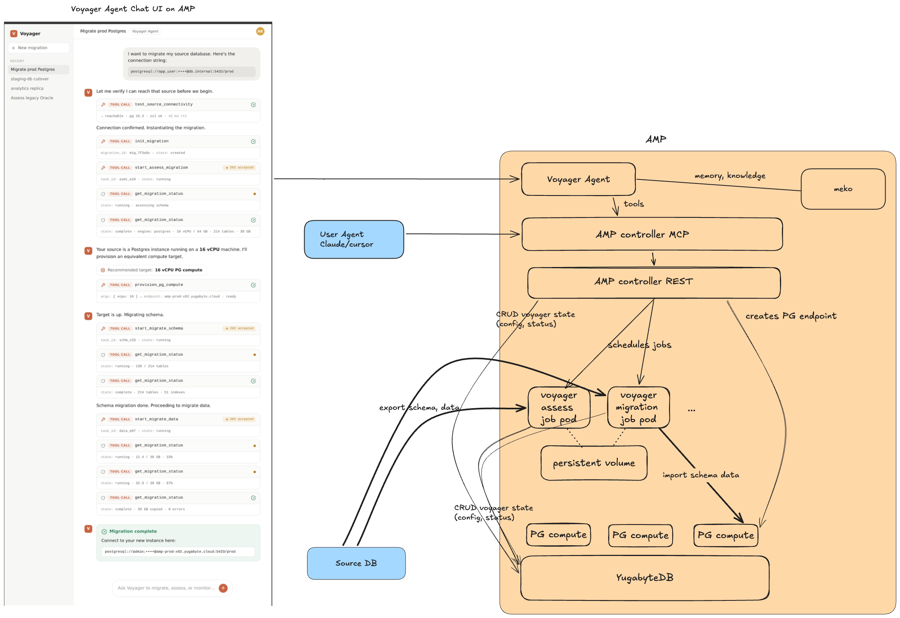
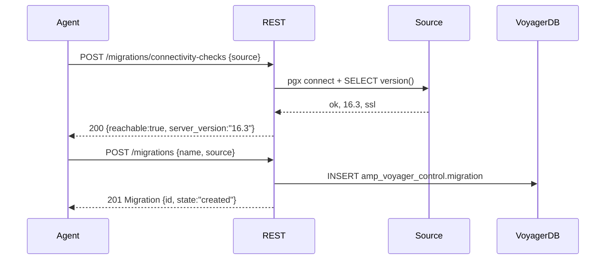
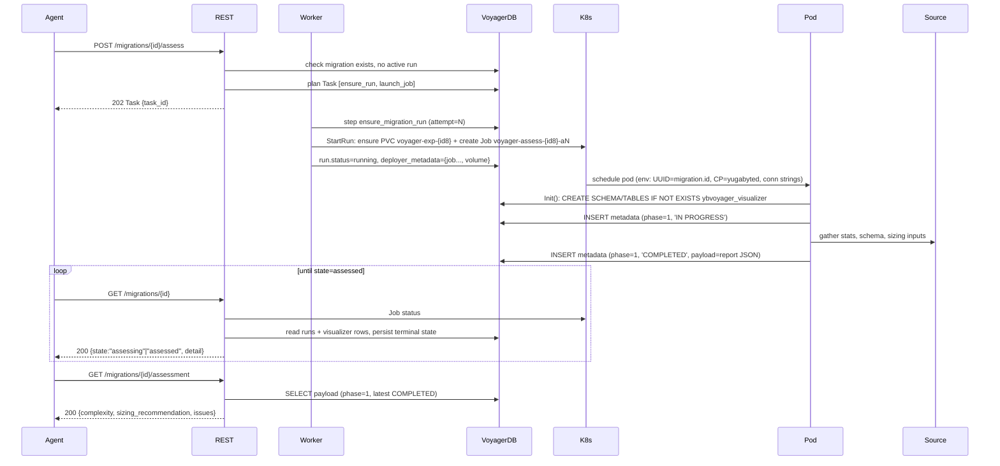
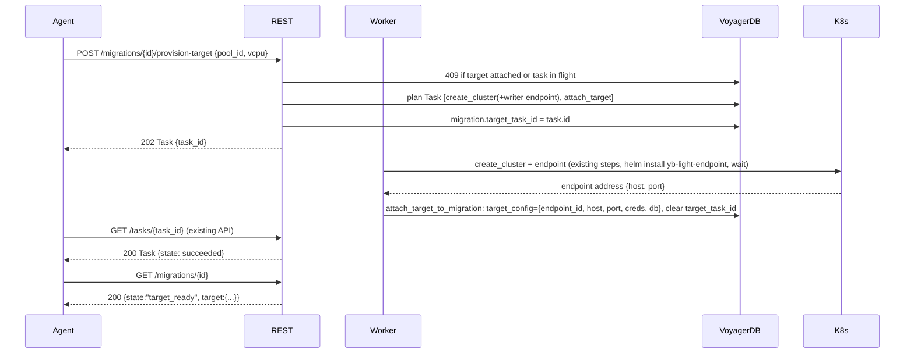
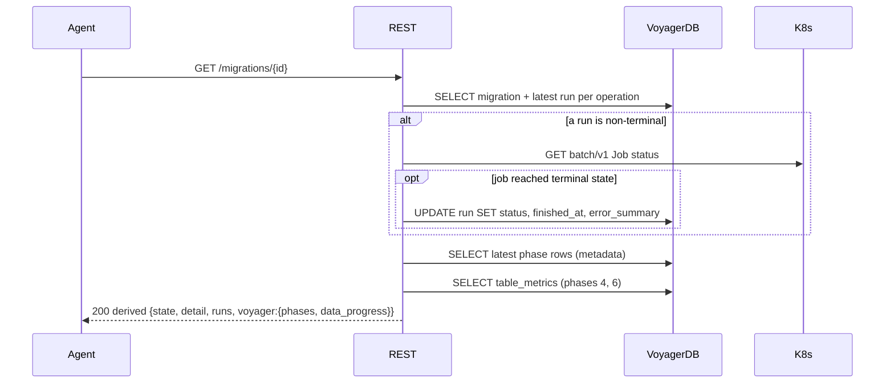

# AC-Voyager: Voyager migration APIs in the AMP controller (POC)

Status: **POC design** · Owner: amakala · 2026-07-09

The Voyager Agent (chat UI on AMP) or a user's agent migrates a customer PostgreSQL database into an
AMP PG compute endpoint by calling MCP tools backed by AMP controller REST APIs.
This doc specifies those APIs, the database schema behind them, the task/job
orchestration, and per-API sequence diagrams.

Scope of the POC: **offline migration only**, **PostgreSQL source only**,
**`yugabytedb-amp` target only**, two operations — **assess** and **migrate**
(migrate = export schema → import schema → export data → import data →
finalize-schema-post-data-import, in one job).

---

## 1. The end goal: the mock chat, API by API

The mock conversation drives the whole design. Each agent tool call maps to one
controller API:

| Mock tool call | Controller API | Kind |
|---|---|---|
| `test_source_connectivity` | `POST /migrations/connectivity-checks` | sync, stateless |
| `init_migration` | `POST /migrations` | sync, 201 |
| `start_assess_migration` | `POST /migrations/{id}/assess` | async, 202 + Task |
| `get_migration_status` (polled) | `GET /migrations/{id}` | sync read |
| *(agent reads sizing)* | `GET /migrations/{id}/assessment` | sync read |
| `provision_pg_compute` | `POST /migrations/{id}/provision-target` | async, 202 + Task |
| `start_migrate_schema` + `start_migrate_data` (merged) | `POST /migrations/{id}/migrate` | async, 202 + Task |
| *(sidebar "Recent")* | `GET /migrations` | sync read |

The final chat message ("Connect to your new instance here: `postgresql://…`")
is assembled by the agent from the migration's `target` in the status response.

## 2. Architecture and reuse strategy

```
Voyager Agent ──tools──▶ AMP controller MCP ──HTTP──▶ AMP controller REST (/api/v1)
                                                        │            │
                                              reads/writes DB   plans Tasks → launches Jobs
                                                        │            │
                                                        ▼            ▼
                                              central YugabyteDB      voyager job pods (assess / migrate)
                                              database: voyager           │ export from Source DB
                                              ├─ amp_voyager_control.*        │ import into PG compute endpoint
                                              │  (controller-owned)       │
                                              └─ ybvoyager_visualizer.*  ◀┘ CONTROL_PLANE_TYPE=yugabyted
                                              (voyager-written)          (unchanged voyager write path)
```



### Key decisions

Each decision is tagged by whether the underlying machinery is **reused
unchanged**, **reused as logic**, **reused as-is**, or **new**.

#### Voyager
1. **State colocates in one `voyager` database.** Voyager control-plane state and
   AMP entity state live together → status reads are plain SQL joins. AMP
   controller APIs read/write their state via the database (YugabyteDB); voyager
   runs read/write theirs via SQL.
1. **Voyager's write path is reused unchanged.** Job pods run stock `yb-voyager`
   with `CONTROL_PLANE_TYPE=yugabyted` and `YUGABYTED_DB_CONN_STRING` pointed at
   the central `voyager` database. Voyager creates and writes the two
   `ybvoyager_visualizer` tables exactly as it does for yugabyted today
   (yb-voyager `src/cp/yugabyted/yugabyted.go`). *(May change post-POC.)* 
1. **Single `migrate` API/job** — no separate schema/data control points; the
   agent narrates phase progress from status reads.
1. **`migration.id` *is* voyager's `migration_uuid`**, via a one-line
   non-breaking voyager patch (`YB_VOYAGER_MIGRATION_UUID`, §8) — the one *new*
   voyager change. No id mapping anywhere.


#### AMP
1. **Target provisioning is a voyager API** (`POST /migrations/{id}/provision-target`) that
   internally reuses the existing cluster/endpoint task steps and attaches the
   result to the migration — the agent never hand-carries endpoint ids.
1. **AMP's task framework is reused as-is** (`internal/task/`) for the three
   mutations, along with the existing cluster/endpoint provisioning steps for
   target creation.
1. **Voyager Runs are deployer-agnostic:** `deployer_type` + `deployer_metadata jsonb`,
   mirroring the existing `Deployer` split (kubernetes/docker).
1. **Tasks launch, runs live:** a task completes when the job is *submitted*; the
   long-running execution is tracked by `migration_run` + derive-on-read status.
1. **New in AMP:** the `amp_voyager_control` schema, the seven REST APIs, a
   deployer-style `VoyagerJobRunner` abstraction for voyager jobs, and the MCP
   tools.
1. **The yugabyted-ui read path is reused as logic, not as wire shapes.** The SQL
   and payload-parsing in yugabyted-ui's `api_voyager.go` is ported into the
   controller handlers, with its known warts fixed (no invocation-sequence
   parity hack; completion = latest row's `status='COMPLETED'`; no hardcoded
   fields; proper error envelope). The REST surface itself is fresh and
   AMP-idiomatic (spec-first OpenAPI, `202 + Task`, `{"error":{...}}`).


## 3. Database schema

Everything lives in the central YugabyteDB (foundation layer), database **`voyager`** (assumed to
exist; the controller opens a second pgxpool to it, separate from its own
`controller` schema/pool). Two schemas separate ownership:

| Schema | Owner / writer | Contents |
|---|---|---|
| `amp_voyager_control` | controller (golang-migrate, `internal/voyager/migrations/`) | `migration`, `migration_run` |
| `ybvoyager_visualizer` | voyager job pods (self-created/self-migrated on `Init()`) | `ybvoyager_visualizer_metadata`, `ybvoyager_visualizer_table_metrics` |

### 3.1 `amp_voyager_control` (controller-owned, new)

```sql
CREATE SCHEMA IF NOT EXISTS amp_voyager_control;

CREATE TABLE amp_voyager_control.migration (
    -- Doubles as voyager's migration_uuid (injected into the job via
    -- YB_VOYAGER_MIGRATION_UUID), so ybvoyager_visualizer.* rows join on this key.
    id              uuid PRIMARY KEY DEFAULT gen_random_uuid(),
    name            text NOT NULL,
    -- {db_type:'postgresql', host, port, username, password, database, schemas:[...]}
    -- POC: password in plaintext — see Post-POC action items.
    source_config   jsonb NOT NULL,
    -- Written by the attach-target-to-migration task step:
    -- {pool_id, cluster_id, branch_id, endpoint_id, host, port, username, password, database}
    target_config   jsonb,
    -- Task that is provisioning the target (drives state=provisioning_target).
    target_task_id  uuid,
    created_at      timestamptz NOT NULL DEFAULT now(),
    updated_at      timestamptz NOT NULL DEFAULT now()
);

CREATE TABLE amp_voyager_control.migration_run (
    id                uuid PRIMARY KEY,
    migration_id      uuid NOT NULL REFERENCES amp_voyager_control.migration (id),
    operation         text NOT NULL CHECK (operation IN ('assess', 'migrate')),
    attempt           int  NOT NULL,
    -- pending: task planned, job not yet observed running
    -- running / succeeded / failed: from deployer job state (lazily persisted)
    status            text NOT NULL DEFAULT 'pending'
                      CHECK (status IN ('pending', 'running', 'succeeded', 'failed')),
    error_summary     text,
    deployer_type     text,          -- 'kubernetes' | 'docker'
    deployer_metadata jsonb,         -- k8s: {namespace, job_name, job_uid}; docker: {container_id}
    task_id           uuid,          -- launcher task, for provenance/debugging
    started_at        timestamptz,
    finished_at       timestamptz,
    created_at        timestamptz NOT NULL DEFAULT now(),
    updated_at        timestamptz NOT NULL DEFAULT now(),
    UNIQUE (migration_id, operation, attempt)
);

-- At most one in-flight run per migration (assess and migrate never overlap).
CREATE UNIQUE INDEX one_active_run_per_migration
    ON amp_voyager_control.migration_run (migration_id)
    WHERE status IN ('pending', 'running');
```

Notes:

- **Multiple runs**: re-invoking assess/migrate creates a new row with
  `attempt = max(attempt)+1` for that `(migration_id, operation)`. The job name
  derives from it (`voyager-{operation}-{id8}-a{attempt}`), so the launch step
  is idempotent under task replay. Status always reports the latest attempt per
  operation. A retried migrate reuses the same export volume, so voyager's own
  resume logic continues where it left off.
- **`operation`, not `phase`**: "phase" is reserved for voyager's numeric
  migration phases (1 assess, 2 export schema, 3 analyze schema, 4 export data,
  5 import schema, 6 import data). Status responses surface these phases in
  workflow order: assess → export schema → analyze schema → import schema →
  export data → import data.
- No stored top-level `state` on `migration` — it is derived on read (§6).
- **Idempotency by id**: both a `migration` and a `migration_run` are inserted
  with a caller-supplied id and `ON CONFLICT (id) DO NOTHING` + read-back, so a
  retried create/launch converges on the existing row instead of duplicating it.
- **`target_task_id` is a provisioning claim**: only the task that holds the
  claim may attach the target (`attach_target_to_migration`) or clear it. A task
  that does not hold the claim is rejected (409), so it cannot overwrite the
  holder's target and orphan the compute it provisioned.
- **`migration_run.task_id` is an owner fence**: only the task that owns a run
  may transition it to `running` or a terminal status. A worker that has lost
  its lease is rejected, so it cannot write over the instance that now owns the
  run.

### 3.2 `ybvoyager_visualizer` (voyager-owned, for reference)

Created by voyager's yugabyted control plane on every command start; the
controller must **never** create or alter these — only read them.

```sql
-- Append-only event log; one row per phase invocation (start / complete).
-- Readers take the latest invocation_sequence per (uuid, phase).
ybvoyager_visualizer.ybvoyager_visualizer_metadata (
    migration_uuid uuid, migration_phase int, invocation_sequence int,
    migration_dir text, database_name text, schema_name text,
    payload text,             -- phase 1: assessment report JSON (payload v1.8)
    complexity varchar,       -- legacy, never written
    db_type varchar, status varchar,  -- 'IN PROGRESS' | 'COMPLETED'
    invocation_timestamp timestamptz,
    host_ip varchar, port int, db_version varchar, voyager_info varchar,
    PRIMARY KEY (migration_uuid, migration_phase, invocation_sequence)
)

-- Latest-state upsert; exactly one row per PK, counts overwritten in place.
-- Only phases 4 (export data) and 6 (import data) are written.
ybvoyager_visualizer.ybvoyager_visualizer_table_metrics (
    migration_uuid uuid, table_name varchar, schema_name varchar,
    migration_phase int,
    status int,               -- 0 not started · 1 in progress · 2 done · 3 completed
    count_live_rows bigint, count_total_rows bigint,
    invocation_timestamp timestamptz,
    PRIMARY KEY (migration_uuid, table_name, migration_phase, schema_name)
)
```

## 4. API specification

All under the existing `/api/v1` base. No auth (matches the rest of the
controller — deferred by design). Errors use the existing
`{"error":{"code","message"}}` envelope; async mutations return `202` with the
standard `Task` body and `Location: /api/v1/tasks/{taskId}` header. Paths and
schemas below are authored into `internal/api/openapi_spec.yaml` and
code-generated as usual.

### 4.1 `POST /migrations/connectivity-checks` — test source reachability

Stateless (nothing persisted; may be called before any migration exists). The
controller dials the source directly with pgx from inside the cluster.

```yaml
request:
  source:                      # SourceConfig
    db_type: postgresql        # enum; only 'postgresql' accepted in POC
    host: db.internal
    port: 5432
    username: app_user
    password: "****"
    database: prod
    schemas: [public]
response: 200
  reachable: true
  server_version: "16.3"
  ssl: true
  latency_ms: 42
  error: null                  # populated when reachable=false (still HTTP 200)
```

### 4.2 `POST /migrations` — create the migration entity (`init_migration`)

Synchronous `201` (like `createUser`/`createStoragePool`): a single row insert,
no side effects. The export volume is created lazily by the first run.

```yaml
request:
  name: "Migrate prod Postgres"
  source: { <SourceConfig> }
response: 201                  # Migration (see §4.4; state="created")
```

Validation: `db_type == postgresql`, required fields non-empty. `400` otherwise.

### 4.3 `POST /migrations/{migrationId}/provision-target` — provision PG compute + attach

Async `202 + Task`. Reuses the existing cluster/endpoint provisioning steps and
appends one new step that writes the result onto the migration.

```yaml
request:
  pool_id: <uuid>              # storage pool to create the cluster in
  vcpu: 16                     # sizing chosen by the agent from the assessment
  cluster_name: "prod-migration"   # optional; defaults to migration name
response: 202                  # Task; poll /tasks/{taskId}
errors:
  404: migration not found
  409: target already attached, or a provision task already in flight
```

Task plan (`KindVoyagerCreateMigrationTarget`):

1. `create_cluster` (existing step; with writer endpoint) — creates cluster,
   default branch, and the `read_write` endpoint via the `yb-light-endpoint`
   Helm release, waits for the address.
2. `attach_target_to_migration` (**new step**) — resolves the endpoint address
   and admin credentials, writes `target_config` (including the **explicit
   port**, required by `--target-db-type yugabytedb-amp`) and clears
   `target_task_id`. Target database name defaults to the source database name
   (created by the migrate job if absent, §5.3).

The handler stamps `target_task_id` on the migration row when planning the task
so status can report `provisioning_target`.

### 4.4 `GET /migrations/{migrationId}` — domain status (`get_migration_status`)

The primary polling surface for the agent. Derive-on-read (§6): merges the
migration row, latest run per operation, live deployer job state, and voyager's
visualizer rows. Passwords never appear in responses.

```yaml
response: 200
  id: "90b8b0b8-9013-4602-8898-fba5bf21f564"
  name: "Migrate prod Postgres"
  state: migrating             # §6 state machine
  detail: "importing data"     # human-readable, chat-ready
  source: { db_type, host, port, username, database, schemas }     # no password
  target:                      # null until attached
    { endpoint_id, cluster_id, pool_id, host, port, username, database }
  runs:                        # latest attempt per operation
    - operation: migrate
      attempt: 1
      status: running
      deployer_type: kubernetes
      deployer_metadata: { namespace, job_name, job_uid, volume }
      task_id: <uuid>
      started_at: ...
      finished_at: null
      error_summary: null
  voyager:                     # from ybvoyager_visualizer.*; null before first run
    phases:                    # latest invocation per phase that has rows
      - { phase: 2, name: export-schema, status: completed, updated_at: ... }
      - { phase: 5, name: import-schema, status: completed, updated_at: ... }
      - { phase: 4, name: export-data,   status: completed, updated_at: ... }
      - { phase: 6, name: import-data,   status: in_progress, updated_at: ... }
    data_progress:
      export: { rows_completed: 6704, rows_total: 6704, tables: [
                  { schema: public, table: orders, status: completed,
                    rows_completed: 2000, rows_total: 2000 }, ... ] }
      import: { rows_completed: 4103, rows_total: 6704, tables: [ ... ] }
  created_at: ...
  updated_at: ...
```

#### What polling looks like (assess and migrate)

Two handles answer two different questions while work is in flight: the
launcher **Task** (existing `GET /tasks/{taskId}`) covers only the launch and
completes within seconds; the **migration status** (`GET /migrations/{id}`) is
the only surface that tracks the job itself. The agent polls the latter.

**Assess — launcher task still in progress** (seconds after the `202`):

`GET /tasks/{taskId}` (existing Task schema, no step detail, no migration
semantics):

```json
{
  "id": "3f6c…task",
  "kind": "start_migration_run",
  "status": "running",
  "cluster_id": null,
  "target_ref": "90b8b0b8-9013-4602-8898-fba5bf21f564",
  "params": { "migration_id": "90b8b0b8-…", "operation": "assess", "attempt": 1 },
  "error": null,
  "created_at": "2026-07-09T10:15:01Z",
  "updated_at": "2026-07-09T10:15:01Z"
}
```

`GET /migrations/{id}` — once `ensure_migration_run` has executed, the run row
exists but the job isn't confirmed running yet:

```json
{
  "id": "90b8b0b8-…",
  "name": "Migrate prod Postgres",
  "state": "assessing",
  "detail": "starting assessment",
  "source": { "db_type": "postgresql", "host": "db.internal", "port": 5432,
              "username": "app_user", "database": "prod", "schemas": ["public"] },
  "target": null,
  "runs": [
    { "operation": "assess", "attempt": 1, "status": "pending",
      "deployer_type": null, "deployer_metadata": null,
      "task_id": "3f6c…task", "started_at": null, "finished_at": null,
      "error_summary": null }
  ],
  "voyager": null
}
```

Gap to know about: between the `202` and the worker executing
`ensure_migration_run`, no run row exists yet — `GET /migrations/{id}` still
reports the prior state (`created` on a first assess) and the task is the only
visible handle for those first moments.

**Assess — job running** (the steady state): the task now reads
`"status": "succeeded"` even though assessment has barely begun — never poll
the task to track migration work.

```json
{
  "id": "90b8b0b8-…",
  "name": "Migrate prod Postgres",
  "state": "assessing",
  "detail": "assessing schema",
  "source": { "…": "…" },
  "target": null,
  "runs": [
    { "operation": "assess", "attempt": 1, "status": "running",
      "deployer_type": "kubernetes",
      "deployer_metadata": { "namespace": "amp",
                             "job_name": "voyager-assess-90b8b0b8-a1",
                             "job_uid": "b1c2…", "volume": "voyager-exp-90b8b0b8" },
      "task_id": "3f6c…task", "started_at": "2026-07-09T10:15:04Z",
      "finished_at": null, "error_summary": null }
  ],
  "voyager": {
    "phases": [
      { "phase": 1, "name": "assess", "status": "in_progress",
        "updated_at": "2026-07-09T10:15:09Z" }
    ],
    "data_progress": null
  }
}
```

`voyager.phases` appears as soon as the pod's control plane writes the phase-1
`IN PROGRESS` row; `data_progress` stays `null` for assess (voyager writes
table metrics only for phases 4/6). When the pod finishes, the next poll sees
phase 1 completed + job `Succeeded`, lazily persists the run as `succeeded`,
and returns `state: "assessed"` — the agent's cue to call
`GET /migrations/{id}/assessment`.

**Migrate — job running, mid data-import** (launch-window snapshot is
structurally identical to assess):

```json
{
  "id": "90b8b0b8-…",
  "name": "Migrate prod Postgres",
  "state": "migrating",
  "detail": "importing data (4,103/6,704 rows)",
  "source": { "…": "…" },
  "target": { "endpoint_id": "e7a1…", "cluster_id": "p2f4…", "pool_id": "aa01…",
              "host": "amp-prod-x92.yugabyte.cloud", "port": 5433,
              "username": "cloud_admin", "database": "prod" },
  "runs": [
    { "operation": "assess", "attempt": 1, "status": "succeeded",
      "started_at": "2026-07-09T10:15:04Z",
      "finished_at": "2026-07-09T10:16:32Z" },
    { "operation": "migrate", "attempt": 1, "status": "running",
      "deployer_type": "kubernetes",
      "deployer_metadata": { "namespace": "amp",
                             "job_name": "voyager-migrate-90b8b0b8-a1",
                             "job_uid": "c9d0…", "volume": "voyager-exp-90b8b0b8" },
      "task_id": "77aa…task", "started_at": "2026-07-09T10:31:10Z",
      "finished_at": null, "error_summary": null }
  ],
  "voyager": {
    "phases": [
      { "phase": 2, "name": "export-schema", "status": "completed" },
      { "phase": 5, "name": "import-schema", "status": "completed" },
      { "phase": 4, "name": "export-data",   "status": "completed" },
      { "phase": 6, "name": "import-data",   "status": "in_progress" }
    ],
    "data_progress": {
      "export": { "rows_completed": 6704, "rows_total": 6704, "tables": [
        { "schema": "public", "table": "orders",    "status": "completed",
          "rows_completed": 2000, "rows_total": 2000 },
        { "schema": "public", "table": "customers", "status": "completed",
          "rows_completed": 503,  "rows_total": 503 } ] },
      "import": { "rows_completed": 4103, "rows_total": 6704, "tables": [
        { "schema": "public", "table": "orders",    "status": "completed",
          "rows_completed": 2000, "rows_total": 2000 },
        { "schema": "public", "table": "customers", "status": "in_progress",
          "rows_completed": 103,  "rows_total": 503 } ] }
    }
  }
}
```

Reading these:

- `runs` carries the latest attempt of *both* operations; `state` is driven by
  the migrate run per the §6 precedence.
- `detail` follows the phases in command order — "exporting schema" →
  "importing schema" → "exporting data (…rows)" → "importing data (…rows)".
  The visualizer tables carry **row counts only, not bytes**, so detail
  strings are row-based (the chat mock's "GB copied" is not derivable).
- During finalize (indexes/triggers), phase 6 already reads completed while
  the job is still running — voyager emits no control-plane events for
  finalize, so `detail` falls back to "finalizing schema (indexes, triggers)"
  (all phases complete + job still running). On exit 0 the next poll persists
  the run as `succeeded` and returns `state: "completed"`; the agent composes
  the final connection string from `target`.

### 4.5 `GET /migrations` — list (the "Recent" sidebar)

Standard `limit`/`offset` paging. Lightweight: derives `state` from persisted
rows only (no deployer calls), so it may lag until the next per-migration GET.

```yaml
response: 200
  { migrations: [ { id, name, state, detail, created_at, updated_at } ],
    count, total }
```

### 4.6 `POST /migrations/{migrationId}/assess` — run assessment

Async `202 + Task`. Task plan (`KindVoyagerStartMigrationRun`, operation=assess):

1. `ensure_migration_run` — insert the run row (run id, attempt fixed at plan
   time; idempotent by id).
2. `launch_voyager_job` — one call to `VoyagerJobRunner.StartRun` (§5.1), which
   ensures the export volume and submits the assess job; record
   `deployer_metadata`; run → `running`.

Errors: `404` unknown migration; `409` another run is in flight (the partial
unique index is the backstop).

### 4.7 `POST /migrations/{migrationId}/migrate` — run the offline migration

Same shape and task plan as assess with operation=migrate, plus a handler
precondition: `target_config` must be attached (`409 target_not_attached`
otherwise). Optional request body: `{ parallel_jobs: 8 }` (defaults to `8`,
hardcoded for now) — passed to `import data --parallel-jobs` (adaptive
parallelism is not supported for `yugabytedb-amp` targets).

### 4.8 `GET /migrations/{migrationId}/assessment` — parsed assessment report

Reads the latest completed phase-1 payload
(`SELECT payload FROM ybvoyager_visualizer_metadata WHERE migration_uuid=$1 AND
migration_phase=1 AND status='COMPLETED' ORDER BY invocation_sequence DESC
LIMIT 1`), parses voyager's `AssessMigrationPayloadYugabyteD` (payload v1.8) and
returns the agent-relevant projection — enough to size `provision_pg_compute`:

```yaml
response: 200
  voyager_version: "..."
  migration_complexity: LOW
  migration_complexity_explanation: "..."
  source_environment: { total_vcpu, total_memory, total_disk_size }   # often empty
  source_database: { total_table_size_bytes, total_index_size_bytes, table_row_count }
  sizing_recommendation:
    { num_nodes, vcpu_per_node, memory_per_node_gb,
      colocated_tables, sharded_tables, summary }
  issues:                       # flattened, agent-readable
    - { category, type, name, description, impact, object_type, object_name, docs_link }
  notes: [ ... ]
errors:
  404: no completed assessment for this migration
```

(The agent maps the recommendation to a single PG compute size — e.g. mock:
source is 16 vCPU → 16 vCPU compute. That heuristic lives in the agent, not the
controller.)

## 5. Job execution

### 5.1 `VoyagerJobRunner` abstraction (deployer-agnostic)

Sibling of the existing `Deployer` interface and pitched at the same altitude —
domain verbs taking a domain spec, no infra nouns (jobs, volumes) leaking out
to callers. Selected by the same `--deploy-driver`:

```go
type VoyagerJobRunner interface {
    // StartRun ensures the migration's export volume exists and launches the
    // job for one (migration, operation, attempt). Idempotent under task
    // replay: re-invocation returns the existing job.
    StartRun(ctx context.Context, spec VoyagerRunSpec) (RunRef, error)
    RunStatus(ctx context.Context, ref RunRef) (RunState, error)
}

// VoyagerRunSpec is domain-level, like EndpointSpec: migration id, operation
// (assess | migrate), attempt, source/target configs, parallel jobs.
// RunRef is what lands in migration_run.deployer_type + deployer_metadata
// (k8s: {namespace, job_name, job_uid, volume}; docker: {container_id, volume}).
```

Voyager assembly (env set, entrypoint selection, image ref, mount path) is
composed once in a shared spec-builder inside the runner package; only the
materialization differs per driver.

**Export-volume lifecycle** (shared by both jobs of a migration):

- The volume name is a pure function of the migration — `voyager-exp-{id8}` —
  a k8s PVC or docker named volume (size/storage-class/namespace from config).
  Nothing is stored in the DB: deterministic naming replaces remembered state,
  and post-POC cleanup derives the same name.
- Every `StartRun` begins with create-if-absent on that name: the first run
  (usually assess) creates it, later runs find and mount it — which is what
  lets a retried migrate resume via voyager's own logic. Create-if-absent means
  **first-run config wins**: a later change to size/storage-class config does
  not apply to an existing volume.
- A plain RWO volume is safe: the one-active-run-per-migration partial unique
  index (§3.1) guarantees two jobs never run concurrently for a migration, so
  the volume is never double-mounted.

Driver notes:

- **Kubernetes**: PVC + `batch/v1` Job via the raw authenticated API-server
  REST path the controller already uses for reads
  (`internal/deploy/kubernetes.go`) — no client-go dependency.
  `restartPolicy: Never`, `backoffLimit: 0` (retries are explicit new attempts
  via the API), no TTL (job objects are the status source until observed
  terminal; cleanup is post-POC). **RBAC**: add `batch/jobs` (and job
  `pods/log` read, for future error surfacing) to the controller Role in
  `deploy/helm/yb-amp-controller/templates/rbac.yaml` — it has no `batch`
  access today.
- **Docker**: named volume + `docker run` of the same image, container id in
  `deployer_metadata`.

### 5.2 Job pod anatomy

- **Image**: `yugabytedb/yb-voyager` — but the POC needs the
  `YB_VOYAGER_MIGRATION_UUID` patch (§8), so until it merges: a one-off image
  built from the patched branch. Image ref in controller config.
- **Entrypoints**: two small shell scripts (`assess.sh`, `migrate.sh`) rendered
  from a ConfigMap the controller manages — no image rebuild to iterate.
- **Env (both operations)**:

| Env | Value |
|---|---|
| `CONTROL_PLANE_TYPE` | `yugabyted` |
| `YUGABYTED_DB_CONN_STRING` | central YugabyteDB, database `voyager` |
| `YB_VOYAGER_MIGRATION_UUID` | the AMP `migration.id` |
| `EXPORT_DIR` | `/voyager/export` (on the mounted volume) |
| `SOURCE_DB_PASSWORD`, `TARGET_DB_PASSWORD` | from `source_config`/`target_config` (POC: plain env) |
| `YB_VOYAGER_SEND_DIAGNOSTICS` | `0` |
| source/target host, port, user, db, schemas, `PARALLEL_JOBS` | from configs |

### 5.3 Command sequences

`assess.sh`:

```bash
yb-voyager assess-migration \
  --source-db-type postgresql \
  --source-db-host "$SOURCE_HOST" --source-db-port "$SOURCE_PORT" \
  --source-db-user "$SOURCE_USER" --source-db-name "$SOURCE_DB" \
  --source-db-schema "$SOURCE_SCHEMAS" \
  --export-dir "$EXPORT_DIR" \
  --iops-capture-interval 0 \
  --yes
```

`migrate.sh` (any non-zero exit fails the job → run `failed`):

```bash
set -euo pipefail

yb-voyager export schema  <source flags> --export-dir "$EXPORT_DIR" --yes

# Target database may not exist on a fresh endpoint; create it idempotently.
PGPASSWORD="$TARGET_DB_PASSWORD" psql -h "$TARGET_HOST" -p "$TARGET_PORT" \
  -U "$TARGET_USER" -d postgres \
  -tc "SELECT 1 FROM pg_database WHERE datname='$TARGET_DB'" | grep -q 1 \
  || PGPASSWORD="$TARGET_DB_PASSWORD" psql -h "$TARGET_HOST" -p "$TARGET_PORT" \
       -U "$TARGET_USER" -d postgres -c "CREATE DATABASE \"$TARGET_DB\""

yb-voyager import schema  --target-db-type yugabytedb-amp <target flags> \
                          --export-dir "$EXPORT_DIR" --yes
yb-voyager export data    <source flags> --export-dir "$EXPORT_DIR" --yes
yb-voyager import data    --target-db-type yugabytedb-amp <target flags> \
                          --parallel-jobs "$PARALLEL_JOBS" \
                          --export-dir "$EXPORT_DIR" --yes
yb-voyager finalize-schema-post-data-import \
                          --target-db-type yugabytedb-amp <target flags> \
                          --export-dir "$EXPORT_DIR" --yes
```

Deliberate choices: `analyze-schema` is **skipped** (assessment already covers
issues; the yugabyted UI's analysis view has no consumer here);
`finalize-schema-post-data-import` is **included** (indexes and triggers are
deferred by `import schema` and would otherwise never be created). All import
commands pass `--target-db-type yugabytedb-amp`, which requires the explicit
`--target-db-port` and rejects adaptive-parallelism flags (yb-voyager
`cmd/import.go`).

Because assess and migrate mount the **same volume/export-dir**, and the UUID
is injected, one voyager migration identity spans the whole flow — the
visualizer tables tell one coherent story per AMP migration.

## 6. Status derivation (derive-on-read)

No background watcher in the POC. `GET /migrations/{id}`:

1. Load migration + latest run per operation (2 queries, one DB).
2. For each non-terminal run: `VoyagerJobRunner.RunStatus()`. If terminal,
   **lazily persist** `status`/`finished_at`/`error_summary` onto the run row
   (so the list API and future reads are accurate without deployer calls).
3. Read visualizer rows (1 query each for phases + table metrics, keyed by
   `migration_uuid = migration.id`). Phase completion = latest
   `invocation_sequence` row's `status` — **not** the parity hack.
4. Derive `state` / `detail`:

| Precedence | Condition | `state` | `detail` examples |
|---|---|---|---|
| 1 | latest migrate run in flight | `migrating` | from voyager phases: "exporting schema" / "importing schema" / "exporting data (X/Y rows)" / "importing data (X/Y rows)" |
| 2 | latest migrate run succeeded | `completed` | "migration complete" |
| 3 | latest run (either op) failed | `failed` | `error_summary` |
| 4 | latest assess run in flight | `assessing` | "assessing schema" |
| 5 | `target_task_id` set, target not attached | `provisioning_target` | "provisioning PG compute" |
| 6 | target attached | `target_ready` | "ready to migrate" |
| 7 | latest assess run succeeded | `assessed` | "assessment complete" |
| 8 | otherwise | `created` | "awaiting next step" |

Known trade-off (accepted): a job that fails while nobody polls remains
`running` in the DB until the next poll. The agent polls continuously during
active operations, so in practice staleness is bounded by the chat loop.

## 7. Sequence diagrams

Participants: **Agent** (via MCP, which is a stateless HTTP pass-through and is
omitted), **REST** (controller handlers), **Worker** (task worker),
**VoyagerDB** (central YB, database `voyager`), **K8s** (deployer/job runner),
**Pod** (voyager job pod), **Source** (customer PG), **Compute** (PG endpoint).

### 7.1 `connectivity-checks` + `POST /migrations` (sync APIs)



### 7.2 `POST /migrations/{id}/assess`



### 7.3 `POST /migrations/{id}/provision-target`



### 7.4 `POST /migrations/{id}/migrate`

```mermaid
sequenceDiagram
  participant Agent
  participant REST
  participant Worker
  participant VoyagerDB
  participant K8s
  participant Pod
  participant Source
  participant Compute
  Agent->>REST: POST /migrations/{id}/migrate {parallel_jobs?}
  REST->>VoyagerDB: 409 if target missing or active run exists
  REST->>VoyagerDB: plan Task [ensure_run, launch_job]
  REST-->>Agent: 202 Task
  Worker->>K8s: StartRun: create Job voyager-migrate-{id8}-aN (mounts same PVC as assess)
  K8s->>Pod: schedule pod
  Pod->>Source: export schema
  Pod->>VoyagerDB: metadata phase=2 IN PROGRESS / COMPLETED
  Pod->>Compute: CREATE DATABASE if absent, then import schema (--target-db-type yugabytedb-amp)
  Pod->>VoyagerDB: metadata phase=5 IN PROGRESS / COMPLETED
  Pod->>Source: export data (snapshot)
  Pod->>VoyagerDB: metadata phase=4 + table_metrics upserts (per-table rows, >=5s cadence)
  Pod->>Compute: import data --parallel-jobs N
  Pod->>VoyagerDB: metadata phase=6 + table_metrics upserts
  Pod->>Compute: finalize-schema-post-data-import (indexes, triggers)
  Note over Pod,VoyagerDB: finalize emits no control-plane events — job exit code covers it
  loop until state=completed|failed
    Agent->>REST: GET /migrations/{id}
    REST->>K8s: Job status
    REST->>VoyagerDB: runs + phases + table metrics; lazy persist terminal
    REST-->>Agent: 200 {state:"migrating", detail:"importing data (12.4/38 GB)"}
  end
  Agent-->>Agent: compose final connection string from target
```

### 7.5 `GET /migrations/{id}` (read composition detail)



## 8. Required voyager patch (minimal, non-breaking)

New env var **`YB_VOYAGER_MIGRATION_UUID`**, honored in exactly one place —
`MetaDB.InitMigrationStatusRecord` (`yb-voyager/src/metadb/migrationStatus.go:167`),
where `uuid.New()` runs today (line 180):

```go
record.MigrationUUID = uuid.New().String()
// becomes:
record.MigrationUUID = externalOrNewMigrationUUID()  // os.Getenv("YB_VOYAGER_MIGRATION_UUID"),
                                                     // used iff it parses as a UUID; else uuid.New()
```

Safety: the function already returns early when `MigrationUUID` is set
(subsequent commands read the persisted value from the export-dir metaDB and
never consult the env), invalid/absent values fall back to today's behavior,
and no flag/config surface is added. Effect for AMP: `migration.id` ==
`migration_uuid` in every `ybvoyager_visualizer` row — no correlation logic at
all. Upstreaming this patch is a post-POC action item; until it merges the job
image is built from the patched branch.

## 9. Controller wiring summary (implementation checklist)

1. `openapi_spec.yaml`: add the 7 paths + schemas → `make controller-generate`.
2. `internal/api/handlers.go`: implement handlers (reads: SQL over the voyager
   pool; mutations: plan tasks).
3. New voyager DB pool + `internal/voyager/migrations/` golang-migrate dir (run at
   startup against database `voyager`).
4. `internal/task/`: `KindVoyagerCreateMigrationTarget`, `KindVoyagerStartMigrationRun`; new
   steps `attach_target_to_migration`, `ensure_migration_run`,
   `launch_voyager_job`; register in `registry.go`.
5. `internal/deploy/` (or sibling package): `VoyagerJobRunner` with kubernetes +
   docker impls; ConfigMap-rendered `assess.sh` / `migrate.sh`.
6. Config: voyager DB conn string, job image ref, PVC size/storage-class,
   default `parallel_jobs`, job namespace.
7. Helm chart: add `batch/jobs` (+ `pods/log`) to the controller Role.
8. MCP: add tools `test_source_connectivity`, `create_migration`,
   `start_migration_assessment`, `provision_migration_target`,
   `start_migration`, `get_migration`, `get_migration_assessment`,
   `list_migrations` (`tools.py` + `controller_client.py` + `server.py`
   registrations). The three launchers return a Task for the launch only —
   their docstrings and the server instructions point agents at `get_migration`
   (not `get_task`) to track progress. See `ac-mcp.md` for the catalog.

## 10. Post-POC action items

Deliberate POC shortcuts to revisit before anything production-shaped:

1. **Credentials**: plaintext passwords in `source_config`/`target_config`
   jsonb and plain env vars in job specs → k8s Secrets (`secretKeyRef`) or a
   vault; encrypt at rest; redact from any API/log surface.
2. **Auth**: none (matches controller-wide deferred auth); migrations need
   ownership/grants once auth lands.
3. **Failure fidelity**: voyager's control plane emits no failure events — a
   failed phase just never completes; we infer failure from job exit only.
   Upstream failure/error events into the yugabyted control plane, and surface
   pod logs / `errs` details through the status API.
4. **Lifecycle & cleanup**: no cancel, delete, or `end migration`; PVCs, job
   objects, and visualizer rows accumulate forever. Add cancel (job deletion +
   run status), delete/archive, TTL/GC.
5. **Watcher**: replace derive-on-read lazy persistence with a background job
   watcher (or task-framework requeue) so terminal states land without polls.
6. **Upstream the `YB_VOYAGER_MIGRATION_UUID` patch** and return to the stock
   `yugabytedb/yb-voyager` image.
7. **Assessment tuned for AMP**: assessment targets YugabyteDB semantics
   (3-node cluster sizing, YB-version-gated issues). Map recommendations to a
   single PG compute size server-side, and re-evaluate which issue categories
   apply to a `yugabytedb-amp` target.
8. **Sources & modes**: Oracle/MySQL sources (ora2pg in the job image), live
   migration (voyager's yugabyted control plane is offline-only today — a
   bigger reuse question).
9. **Scale & quotas**: per-migration single-active-run guard exists; add global
   concurrent-job quotas, PVC sizing from assessment (instead of a fixed
   default), and job resource requests/limits.
10. **Run history retention** and task GC for launcher tasks.
11. **Run ↔ voyager-state attribution**: visualizer rows carry no run id, so
    `migration_run` cannot be joined to the metadata voyager pushes. The POC
    leans on two invariants — phase ownership by operation (assess → 1,
    migrate → 2/5/4/6) and at most one active run per migration — which is
    correct for the *latest* state but ambiguous across attempts: a crashed
    attempt leaves a permanent `IN PROGRESS` latest row for the phase it died
    in (which can mislead `detail` derivation during a retry), and
    `table_metrics` rows are overwritten in place (per-attempt data progress
    is unrecoverable). Known fixes: a per-run `invocation_sequence` watermark
    (`phase_seq_watermark jsonb` captured at run creation; rows with
    `seq > watermark[phase]` belong to the run) — controller-only, no voyager
    change; timestamp bracketing is *not* a fix (voyager stamps pod-local
    wall-clock strings). Deeper fix: upstream a run/attempt id column into the
    yugabyted control-plane schema.
12. **Potential direction — command queue with long-running voyager workers**
    (from the `voyager-cp-poc` exploration): instead of the controller pushing
    one ephemeral k8s Job per operation, a durable command queue in the
    `voyager` DB (fine-grained commands ordered by sequence, claimed by
    long-running stateless voyager pods via `FOR UPDATE SKIP LOCKED`) decouples
    control plane from data plane and suits a future where voyager itself is a
    stateless service reporting state back over REST. `migration_run` is a
    degenerate two-command version of that queue and can generalize into it
    without changing the REST read surface.
