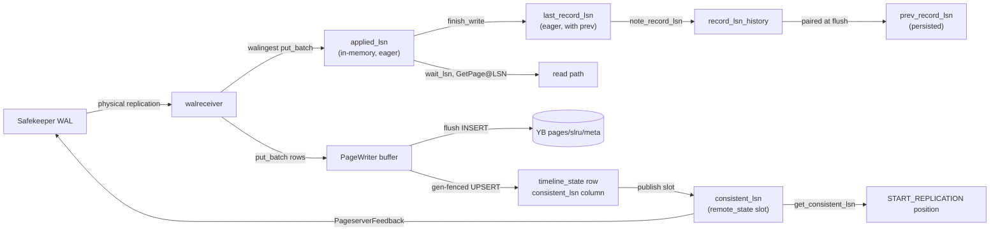

# Pageserver LSNs

Updated: 2026-06-07

Inventory of every LSN the pageserver uses, derived from the Rust sources
only (`pageserver/`, `safekeeper/`, `libs/utils`, `libs/pageserver_api`).
Do not treat other architecture docs as authoritative for this topic —
several of them describe upstream paths that no longer exist.

## The two key watermarks

yb-mode splits the durability concept into two distinct atomics on
`Timeline`. Conflating them is what made restart-after-flush lose
records before the eager/durable split was introduced:

| Atomic | Advances when | Use for |
|---|---|---|
| **`applied_lsn`** (eager, in-memory) | walreceiver puts a record into the `PageWriter` buffer (`put_batch` → `applied_lsn.fetch_max`) | Read-path waits: `wait_lsn`, GetPage@LSN, `compute_image_consistent_lsn`. Never blocks behind YB INSERT latency. |
| **`consistent_lsn`** (durable, gap-free) | After a successful gen-fenced `PageStore::advance_consistent_lsn` UPSERT (inside `PageWriter::flush`'s success branch) | Anything that crosses a crash boundary or leaves the process: SK feedback (`remote_consistent_lsn` + `disk_consistent_lsn` wire fields), restart resume position, HTTP API durability field. |

`applied_lsn ≥ consistent_lsn` at all times; the gap is the contents of the
in-RAM `PageWriter` buffer.

## Overview: three layers

1. **Timeline bookkeeping** — ingest progress, durability, GC, branching.
2. **Storage rows** — per-key version timestamps in YB (`pages`,
   `slru_pages`, `meta`) plus the in-RAM write buffer / cache.
3. **Ephemeral / derived** — walreceiver connection status, GC planning,
   caches.



---

## Timeline-global LSNs

### `applied_lsn` — eager, in-memory

**Where:** `Timeline.applied_lsn: AtomicLsn`
(`pageserver/src/page_server/timeline.rs`).

**Meaning:** End of the last WAL record the walreceiver has put into the
`PageWriter` buffer — i.e., the in-RAM ingest frontier. NOT a durability
claim; the buffered rows may not yet be in YB.

**Advances:** `TimelineWriter::put_batch` calls
`self.tl.applied_lsn.fetch_max(batch_max_lsn)` immediately after the
buffer write, so read-path waits don't block behind the YB INSERT
round-trip.

**Used for:**
- Internal: `compute_image_consistent_lsn` (basebackup gate), error-log
  diagnostics in `wait_lsn` timeouts.
- (`last_record_lsn`'s `.last` advance — same value, exposed via
  `SeqWait` for `wait_lsn` subscribers.)

**On restart:** Seeded from persisted `consistent_lsn`. The two
watermarks start at the same value; `applied_lsn` then runs ahead as
the walreceiver ingests.

**Do NOT use for:** anything that leaves the process. SK feedback,
START_REPLICATION position, HTTP `disk_consistent_lsn` field, restart
state — all must read `consistent_lsn` instead.

---

### `last_record_lsn` — eager, in-memory (with `prev` pairing)

**Where:** `Timeline.last_record_lsn: SeqWait<RecordLsn, Lsn>`
(`pageserver/src/page_server/timeline.rs`).

**Meaning:** End of the last fully ingested WAL record (`RecordLsn.last`).
`RecordLsn.prev` is the end of the record before that. Same eagerness
class as `applied_lsn` — both advance per-record as walingest commits.

**Advances:** `Timeline::finish_write()` after each
`DatadirModification::commit()`. Never written to YB.

**Used for:**
- `wait_lsn()` — getpage blocks until this reaches the requested LSN.
- GC horizon: `last_record_lsn - gc_horizon`.
- Metrics and HTTP status.

**On restart:** Seeded from persisted `consistent_lsn`, with `prev`
from persisted `prev_record_lsn` (or `Lsn(0)`):

```rust
last_record_lsn: SeqWait::new(RecordLsn {
    last: consistent_lsn,
    prev: metadata.prev_record_lsn().unwrap_or(Lsn(0)),
}),
```

**Correctness:** Ingest frontier. Can run **ahead of** durable YB storage
because ingest finishes before flush. **Not used for walreceiver
START_REPLICATION position** — that reads `consistent_lsn` instead.

---

### `prev_record_lsn` — in memory + persisted

**Where:**
- In memory: `RecordLsn.prev` inside `last_record_lsn`.
- Persisted: `pageserver.timeline_state.prev_record_lsn` (optional column).

**Advances:** On each `finish_write`, the old `last` becomes the new
record's `prev`. `PageWriter::note_record_lsn` stores `(last → prev)` in
a `BTreeMap`; at flush, `take_prev_at_or_below` pairs it with the flushed
LSN and persists via `advance_consistent_lsn` (`COALESCE($5,
prev_record_lsn)` keeps an existing value when the pairing misses).

**Used for:** Correct `xl_prev` when walreceiver resumes after restart.

**Correctness:** Best-effort. A flush can race ahead of `finish_write`;
persisted `prev` may be NULL and walreceiver re-derives from the stream.

---

### `consistent_lsn` — durable, gap-free

**Where:**
- Source of truth: `pageserver.timeline_state.consistent_lsn` (YB column).
- In-memory slot: `Timeline.remote_state.consistent_lsn:
  Arc<AtomicLsn>`. Held by `PageWriter` so the flush success path
  can bump it without going through `Timeline`.
- Accessor: `Timeline::get_consistent_lsn()`.

**Meaning:** Every record with LSN ≤ this is **durably** in
`pageserver.pages` / `slru_pages` / `meta` AND the `timeline_state` row
has been updated to claim it. The slot's value is the high-water mark
beyond which the pageserver would never advertise progress to the
safekeeper.

**Advances:** Only inside `PageWriter::flush`'s success branch
(`pageserver/src/page_writer.rs`):
1. `try_write_rows` lands the buffer in YB.
2. The throttled, gen-fenced `PageStore::advance_consistent_lsn` UPSERT
   updates `timeline_state.consistent_lsn`.
3. On success, `PageWriter::publish_consistent_lsn(lsn)` bumps the
   in-memory slot via `slot.fetch_max(lsn)`.

The bookkeeping atomics in `PageWriter` track the two halves:
- `consistent_lsn_observed` — max LSN of rows that landed in YB this
  process lifetime (advanced unconditionally after `try_write_rows`).
- `consistent_lsn_watermark` — max LSN actually persisted to the
  `timeline_state` column (only advances after a successful UPSERT,
  which is throttled to one per `max_age`).

`observed ≥ watermark` always; the gap is recovered on clean
shutdown by `force_upsert_consistent_lsn_if_advanced` — called both by
`Timeline::shutdown`'s `Flush` mode (right after the final `flush()`) and
by the `PageWriter` flusher task's final pass.

**Used for:**
- SK feedback fields: `disk_consistent_lsn` AND `remote_consistent_lsn`
  in `PageserverFeedback` both come from
  `Timeline::get_consistent_lsn()`. (Wire protocol carries both; in
  yb-mode they're semantically identical and one will be dropped in a
  future protocol bump.)
- Walreceiver `START_REPLICATION` startpoint
  (`walreceiver_connection.rs`).
- HTTP API `TimelineInfo.disk_consistent_lsn` (field name kept for
  back-compat).

**On restart:** YB column → `Timeline::new` seeds the in-memory slot
via `state.consistent_lsn.fetch_max(disk_consistent_lsn)` so the very
first walreceiver feedback already reports the correct value.

**Safekeeper behavior:** `send_wal.rs` calls
`update_remote_consistent_lsn(ps_feedback.remote_consistent_lsn)` only.
`disk_consistent_lsn` and `last_received_lsn` from feedback are metrics
only (`safekeeper_ps_last_received_lsn` gauge); no truncation logic uses
them. With both wire fields now carrying the same `consistent_lsn`
value, the truncation bound is correct by construction.

---

### `applied_gc_cutoff_lsn` — in memory + persisted (mostly frozen)

**Where:** `Timeline.applied_gc_cutoff_lsn: Rcu<Lsn>` +
`timeline_state.applied_gc_cutoff_lsn`.

**Meaning:** Lowest LSN reads are allowed to request.
`check_lsn_is_in_scope()` and `effective_request_lsn()` reject
`lsn < applied_gc_cutoff_lsn` (unless an LSN lease covers it).

**Written to YB by:** `insert_timeline_at_creation` at timeline creation
only. `PageStore::update_timeline_state` can write it back but has **zero
call sites** — dead code.

**Updated in memory by:**
- Load at attach (`synth_timeline_metadata_from_row`).
- HTTP `timeline_patch` (`routes.rs`) — **does not persist to YB**.

**GC:** `Timeline::gc()` returns `GcResult::default()` immediately — a
no-op. No row deletion, no post-GC advance of this LSN.

Enforcement exists at read time; the value effectively **freezes** after
creation unless an operator HTTP-patches it (and that patch won't survive
restart unless something else wrote the row — which nothing does
post-creation).

---

### `initdb_lsn` — in memory + persisted (optional)

**Where:** `Timeline.initdb_lsn` + `timeline_state.initdb_lsn`.

**Meaning:** LSN at which initdb/import seeded the timeline. On load,
falls back to `disk_consistent_lsn` if NULL. Low impact in yb-mode.

---

### `ancestor_lsn` — in memory + persisted

**Where:** `Timeline.ancestor_lsn` + `timeline_state.ancestor_lsn`.

**Meaning:** Branch point. Child timelines are created with
`disk_consistent_lsn = start_lsn` and hold `ancestor: Arc<Timeline>`.

**Used for:**
- Branch validation (`start_lsn >= applied_gc_cutoff` and planned GC
  cutoff).
- Parent `GcInfo.retain_lsns` — parent must retain history at child
  branch points.

**Sharp edge:** `branch_timeline_impl` still comments that "read-calls
know to look into the ancestor." That path is **gone**.
`get_vectored_impl` goes straight to `get_vectored_via_page_writer`,
which queries only this timeline's YB rows + buffer. `GetReadyAncestorError`
exists but is **never constructed** (upstream remnant). Child reads for
keys never written on the child return `MissingKey`, not parent data.

---

## Per-row LSNs (YB + buffer)

`PageRow.lsn`, `SlruPageRow.lsn`, `MetaRow.lsn` — one row per version in
`pageserver.pages`, `pageserver.slru_pages`, `pageserver.meta`.

Each WAL-derived write gets the **end-LSN of the record** that produced it.

**Read path:** `PageWriter::scan_range` / `read_chain` blend `UnifiedPages`
(buffer + LRU cache) with `PageStore` SQL. Queries are scoped to
`(tenant_id, timeline_id)` — no ancestor timeline.

**Rel/SLRU:** image-anchored chain, truncated at `will_init=true`.
**Meta:** latest row at `lsn ≤ target_lsn` (full overwrite).

**PageWriter internal (memory):**
- `flush_horizon_lsn` — caps materialiser reads so partial flushes can't
  create chain holes.
- `DeltaTally.last_lsn` — per-key delta tracking for image materialiser
  triggers.
- `record_lsn_history` — `BTreeMap<Lsn, Lsn>` pairing last→prev for
  flush-time `prev_record_lsn` persistence.

---

## GC / retention LSNs (mostly in memory, largely inert)

| LSN | Storage | Code behavior |
|-----|---------|---------------|
| `GcCutoffs.space` | `GcInfo` RwLock | `last_record_lsn - gc_horizon` |
| `GcCutoffs.time` | `GcInfo` | PITR time cutoff via `find_gc_cutoffs` |
| `retain_lsns` | `GcInfo` | `(Lsn, TimelineId)` child branch points |
| LSN leases | `GcInfo` BTreeMap | Per-LSN GC blockers |

`gc_iteration_internal` refreshes `GcInfo` cutoffs and calls `timeline.gc()`,
which is a no-op. No page-row pruning is implemented.

---

## Walreceiver / safekeeper ephemeral LSNs

| LSN | Where | Role |
|-----|-------|------|
| `commit_lsn` | `WalReceiverConnectionStatus` | SK committed WAL end |
| `streaming_lsn` | same | SK streaming position |
| `last_received_msg_lsn` | `WalReceiverInfo` | Last streaming / keepalive LSN advertised; same value as the `last_received_lsn` wire field — not the eager ingest frontier (`applied_lsn`). |
| `end_of_wal` | local var | From `IDENTIFY_SYSTEM` |

**PageserverFeedback** (after each processed record):

| Field | Source | SK uses for truncation? |
|-------|--------|------------------------|
| `last_received_lsn` | streaming_lsn of last processed message (== `last_received_msg_lsn`) | No (metrics) |
| `disk_consistent_lsn` | `Timeline::get_consistent_lsn()` (durable slot) | No |
| `remote_consistent_lsn` | `Timeline::get_consistent_lsn()` (durable slot) | **Yes** |

Both LSN fields now carry the same value. Pre-2026-06 the
`disk_consistent_lsn` wire field was sourced from the eager
in-memory atomic, which could be ahead of YB after a buffer write
but before flush — combined with PS crash-restart this lost the
buffered records permanently. Both fields are kept for SK protocol
back-compat; one will be dropped in a future protocol bump.

---

## Ingest / request LSNs (transient)

| LSN | Where | Role |
|-----|-------|------|
| `DatadirModification.lsn` | per walreceiver batch | Current record end being digested |
| `pending_lsns` | modification | Records batched before `finish_write` |
| `target_lsn` / `effective_lsn` | getpage requests | Compute's requested read version |
| `not_modified_since` | getpage | Drives `wait_lsn` target |

**Ingest chain:**

```
SK stream → walingest.ingest_record (sets modification.lsn)
         → DatadirModification::commit
              → TimelineWriter::put_batch (buffer + applied_lsn.fetch_max)
              → finish_write per pending_lsn (last_record_lsn + note_record_lsn)

PageWriter::flush (periodic)
         → snapshot_unflushed
         → try_write_rows → YB INSERT into pages/slru/meta
         → mark_flushed(snapshot) + consistent_lsn_observed.fetch_max
         → throttled, gen-fenced advance_consistent_lsn UPSERT
              → consistent_lsn_watermark.store
              → publish_consistent_lsn(lsn) → slot bumps
```

Filtered-out SK records still advance `applied_lsn` /
`last_record_lsn` via `modification.set_lsn(next_record_lsn)` +
commit. The durable `consistent_lsn` only moves when rows actually
land in YB.

**Getpage flow:**
1. `effective_request_lsn` (clamp, GC cutoff check, lease check).
2. `wait_lsn()` if future.
3. Read at `target_lsn` via `PageWriter::scan_range`.

---

## Minor / specialized LSNs

| LSN | Persisted? | Notes |
|-----|------------|-------|
| `standby_horizon` | In-memory `AtomicLsn` | Init to 0; metric wired; no writer found |
| `rel_size_migrated_at` | YB `timeline_state` | Rel-size v2 migration boundary |
| `rel_size_latest_cache` | In-memory `(Lsn, BlockNumber)` | Per-relation size cache |
| `rel_size_snapshot_cache` | In-memory LRU `(Lsn, RelTag)` | Snapshot reads |

---

## LSN ordering (as the code maintains it)

```
applied_gc_cutoff_lsn  ≤  valid read LSNs  (enforced at getpage)

consistent_lsn (slot)  ≤  consistent_lsn_watermark  ≤  consistent_lsn_observed
                         (after successful advance_consistent_lsn UPSERT
                          the slot is published from observed)

applied_lsn  ≈  last_record_lsn  (both advanced eagerly on put_batch /
                                  finish_write; same value modulo timing)

applied_lsn  ≥  consistent_lsn  (the gap is the in-RAM PageWriter buffer)

persisted timeline_state.consistent_lsn  ≤  consistent_lsn_observed
                         (throttle lag, ≤ max_age between UPSERTs)
```

---

## Correctness summary

**Holds:**
- Ingest ordering via `SeqWait`; getpage waits on `last_record_lsn`.
- Read correctness on a single timeline: buffer + YB blend; chains truncated
  at `will_init`.
- SK truncation safety: SK reads `remote_consistent_lsn` from feedback,
  which is now sourced from the durable `consistent_lsn` slot — only
  advances after a successful gen-fenced YB UPSERT.
- Restart replay: `consistent_lsn` seeded from persisted YB column;
  walreceiver `START_REPLICATION` position reads
  `Timeline::get_consistent_lsn()`; on crash mid-flush the slot stays at
  the last successful flush so re-streamed WAL is upserted idempotently
  with no gaps.
- Generation fencing: stale PS loses `advance_consistent_lsn` →
  `shutdown_for_stale_generation`.
- GetPage@LSN does NOT block behind YB INSERT latency — read-path
  waits use the eager `applied_lsn` / `last_record_lsn`.

**Sharp edges (designed-in):**
1. Persisted `consistent_lsn` can lag actual YB pages by up to `max_age`
   (UPSERT throttle) — extra WAL retained on SK, recoverable; shutdown
   catch-up via `force_upsert_consistent_lsn_if_advanced` closes most of
   the gap on clean exit.
2. GC is cosmetic — `gc()` no-op; no row deletion; `applied_gc_cutoff_lsn`
   frozen after creation.
3. Branches broken for inherited data — no ancestor read in
   `get_vectored_via_page_writer`.
4. `update_timeline_state` unused — full row upsert exists but nothing
   calls it; HTTP GC cutoff patches don't persist.

---

## Persistence cheat sheet

| Field | Written to YB by | Read from YB at attach |
|-------|------------------|------------------------|
| `consistent_lsn` | `advance_consistent_lsn` | Yes |
| `prev_record_lsn` | same UPDATE | Yes |
| `applied_gc_cutoff_lsn` | `insert_timeline_at_creation` only | Yes |
| `ancestor_lsn` / `ancestor_timeline_id` | creation INSERT | Yes |
| `initdb_lsn` | creation INSERT | Yes |
| `applied_lsn` / `last_record_lsn` | never | seeded from `consistent_lsn` + persisted `prev` |
| `remote_state.consistent_lsn` slot | never | seeded from `consistent_lsn` |
| Per-page `lsn` | `put_pages` / `put_slru_pages` / `put_meta` | on read |

---

## Code anchors

- `pageserver/src/page_server/timeline.rs` — `last_record_lsn`, `applied_lsn`,
  `get_consistent_lsn`, `applied_gc_cutoff_lsn`, `finish_write`,
  `get_vectored_via_page_writer`.
- `pageserver/src/page_server/timeline/remote_state.rs` — `consistent_lsn`
  slot owned by `TimelineRemoteState`.
- `pageserver/src/page_writer.rs` — flush, `consistent_lsn_observed` /
  `consistent_lsn_watermark`, `publish_consistent_lsn`,
  `force_upsert_consistent_lsn_if_advanced`, `record_lsn_history`.
- `pageserver/src/page_store.rs` — `advance_consistent_lsn`,
  `insert_timeline_at_creation`, `update_timeline_state` (unused).
- `pageserver/src/page_server/timeline/walreceiver/walreceiver_connection.rs` —
  ingest, feedback, resume startpoint (both read `get_consistent_lsn`).
- `pageserver/src/pgdatadir_mapping.rs` — `DatadirModification::commit`.
- `safekeeper/src/send_wal.rs` — `update_remote_consistent_lsn` (truncation).
- [`safekeeper-lsns.md`](safekeeper-lsns.md) — SK-side LSN inventory; the
  pair to this doc.
- `libs/utils/src/pageserver_feedback.rs` — feedback wire format.
- `storage_controller/migrations/00000000000001_initial_schema/up.sql` —
  `pageserver.timeline_state.consistent_lsn` column.
