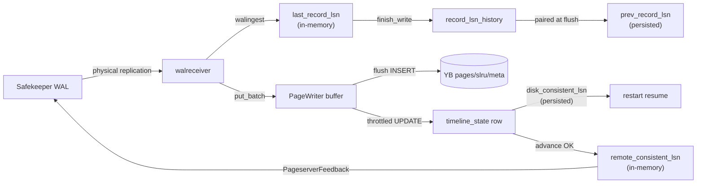

# Pageserver LSNs

Updated: 2026-06-06

Inventory of every LSN the pageserver uses, derived from the Rust sources
only (`pageserver/`, `safekeeper/`, `libs/utils`, `libs/pageserver_api`).
Do not treat other architecture docs as authoritative for this topic —
several of them overstate durability guarantees or describe upstream paths
that no longer exist.

## Overview: three layers

1. **Timeline bookkeeping** — ingest progress, durability, GC, branching.
2. **Storage rows** — per-key version timestamps in YB (`pages`,
   `slru_pages`, `meta`) plus the in-RAM write buffer / cache.
3. **Ephemeral / derived** — walreceiver connection status, GC planning,
   caches.



---

## Timeline-global LSNs

### `last_record_lsn` — in memory only

**Where:** `Timeline.last_record_lsn: SeqWait<RecordLsn, Lsn>`
(`pageserver/src/tenant/timeline.rs`).

**Meaning:** End of the last fully ingested WAL record (`RecordLsn.last`).
`RecordLsn.prev` is the end of the record before that.

**Advances:** `Timeline::finish_write()` after each
`DatadirModification::commit()`. Never written to YB.

**Used for:**
- `wait_lsn()` — getpage blocks until this reaches the requested LSN.
- Walreceiver resume startpoint (with padding / page-header normalization).
- GC horizon: `last_record_lsn - gc_horizon`.
- Metrics and HTTP status.

**On restart:** Seeded from persisted `disk_consistent_lsn`, with `prev`
from persisted `prev_record_lsn` (or `Lsn(0)`):

```rust
last_record_lsn: SeqWait::new(RecordLsn {
    last: disk_consistent_lsn,
    prev: metadata.prev_record_lsn().unwrap_or(Lsn(0)),
}),
```

**Correctness:** Ingest frontier. Can run **ahead of** durable YB storage
because ingest finishes before flush.

---

### `prev_record_lsn` — in memory + persisted

**Where:**
- In memory: `RecordLsn.prev` inside `last_record_lsn`.
- Persisted: `pageserver.timeline_state.prev_record_lsn` (optional column).

**Advances:** On each `finish_write`, the old `last` becomes the new
record's `prev`. `PageWriter::note_record_lsn` stores `(last → prev)` in
a `BTreeMap`; at flush, `take_prev_at_or_below` pairs it with the flushed
LSN and persists via `advance_disk_consistent_lsn` (`COALESCE($5,
prev_record_lsn)` keeps an existing value when the pairing misses).

**Used for:** Correct `xl_prev` when walreceiver resumes after restart.

**Correctness:** Best-effort. A flush can race ahead of `finish_write`;
persisted `prev` may be NULL and walreceiver re-derives from the stream.

---

### `disk_consistent_lsn` — three different copies

This name is overloaded. The code maintains **three** values that are
**not** kept in sync.

| Copy | Location | When it advances |
|------|----------|------------------|
| **Timeline in-memory** | `Timeline.disk_consistent_lsn: AtomicLsn` | Init from YB row at attach; `fetch_max` on every `put_batch` (buffer write, **not** flush) |
| **PageWriter trackers** | `dc_lsn_observed`, `dc_lsn_watermark` | `observed` after YB INSERT; `watermark` after successful `advance_disk_consistent_lsn` |
| **Persisted** | `timeline_state.disk_consistent_lsn` | `PageStore::advance_disk_consistent_lsn` only (gen-fenced UPDATE, throttled to ~`max_age` per flush policy) |

The in-memory `AtomicLsn` has exactly two writers: initialization in
`Timeline::new` and `fetch_max` in `TimelineWriter::put_batch`. Flush
success does **not** update it.

**Callers:**
- Walreceiver feedback `disk_consistent_lsn` → `timeline.get_disk_consistent_lsn()`
  (optimistic in-memory copy).
- HTTP status → same.
- Attach / restart → YB row seeds `AtomicLsn` and `last_record_lsn`.

The walreceiver comment ("guarantees local persistence") is **wrong** for
the in-memory atomic — it can be ahead of YB because `put_batch`
advances it before flush.

**Shutdown catch-up:** `PageWriter::force_upsert_dc_lsn_if_advanced`
persists any gap between `dc_lsn_observed` and `dc_lsn_watermark` that
the throttle skipped.

---

### `remote_consistent_lsn` — in memory only

**Where:** `TimelineRemoteState.rc_lsn: Arc<AtomicLsn>`. Slot installed
via `PageWriter::set_remote_consistent_lsn_slot` at attach.

**Advances:** `PageWriter::publish_remote_consistent_lsn` only after a
successful, generation-gated `advance_disk_consistent_lsn`.

**Used for:** Safekeeper WAL truncation. This is the **conservative,
crash-safe** bound — replaces upstream Neon's "uploaded to S3" LSN.

**Safekeeper behavior:** `send_wal.rs` calls
`update_remote_consistent_lsn(ps_feedback.remote_consistent_lsn)` only.
`disk_consistent_lsn` and `last_received_lsn` from feedback are metrics
only (`safekeeper_ps_last_received_lsn` gauge); no truncation logic uses
them.

Until the first successful persist, walreceiver sends `Lsn(0)` for this
field (`unwrap_or(Lsn(0))`).

---

### `applied_gc_cutoff_lsn` — in memory + persisted (mostly frozen)

**Where:** `Timeline.applied_gc_cutoff_lsn: Rcu<Lsn>` +
`timeline_state.applied_gc_cutoff_lsn`.

**Meaning:** Lowest LSN reads are allowed to request.
`check_lsn_is_in_scope()` and `effective_request_lsn()` reject
`lsn < applied_gc_cutoff_lsn` (unless an LSN lease covers it).

**Written to YB by:** `insert_timeline_at_creation` at timeline creation
only. `PageStore::update_timeline_state` can write it back but has **zero
call sites** — dead code.

**Updated in memory by:**
- Load at attach (`synth_timeline_metadata_from_row`).
- HTTP `timeline_patch` (`routes.rs`) — **does not persist to YB**.

**GC:** `Timeline::gc()` returns `GcResult::default()` immediately — a
no-op. No row deletion, no post-GC advance of this LSN.

Enforcement exists at read time; the value effectively **freezes** after
creation unless an operator HTTP-patches it (and that patch won't survive
restart unless something else wrote the row — which nothing does
post-creation).

---

### `initdb_lsn` — in memory + persisted (optional)

**Where:** `Timeline.initdb_lsn` + `timeline_state.initdb_lsn`.

**Meaning:** LSN at which initdb/import seeded the timeline. On load,
falls back to `disk_consistent_lsn` if NULL. Low impact in yb-mode.

---

### `ancestor_lsn` — in memory + persisted

**Where:** `Timeline.ancestor_lsn` + `timeline_state.ancestor_lsn`.

**Meaning:** Branch point. Child timelines are created with
`disk_consistent_lsn = start_lsn` and hold `ancestor: Arc<Timeline>`.

**Used for:**
- Branch validation (`start_lsn >= applied_gc_cutoff` and planned GC
  cutoff).
- Parent `GcInfo.retain_lsns` — parent must retain history at child
  branch points.

**Sharp edge:** `branch_timeline_impl` still comments that "read-calls
know to look into the ancestor." That path is **gone**.
`get_vectored_impl` goes straight to `get_vectored_via_page_writer`,
which queries only this timeline's YB rows + buffer. `GetReadyAncestorError`
exists but is **never constructed** (upstream remnant). Child reads for
keys never written on the child return `MissingKey`, not parent data.

---

## Per-row LSNs (YB + buffer)

`PageRow.lsn`, `SlruPageRow.lsn`, `MetaRow.lsn` — one row per version in
`pageserver.pages`, `pageserver.slru_pages`, `pageserver.meta`.

Each WAL-derived write gets the **end-LSN of the record** that produced it.

**Read path:** `PageWriter::scan_range` / `read_chain` blend `UnifiedPages`
(buffer + LRU cache) with `PageStore` SQL. Queries are scoped to
`(tenant_id, timeline_id)` — no ancestor timeline.

**Rel/SLRU:** image-anchored chain, truncated at `will_init=true`.
**Meta:** latest row at `lsn ≤ target_lsn` (full overwrite).

**PageWriter internal (memory):**
- `flush_horizon_lsn` — caps materialiser reads so partial flushes can't
  create chain holes.
- `DeltaTally.last_lsn` — per-key delta tracking for image materialiser
  triggers.
- `record_lsn_history` — `BTreeMap<Lsn, Lsn>` pairing last→prev for
  flush-time `prev_record_lsn` persistence.

---

## GC / retention LSNs (mostly in memory, largely inert)

| LSN | Storage | Code behavior |
|-----|---------|---------------|
| `GcCutoffs.space` | `GcInfo` RwLock | `last_record_lsn - gc_horizon` |
| `GcCutoffs.time` | `GcInfo` | PITR time cutoff via `find_gc_cutoffs` |
| `retain_lsns` | `GcInfo` | `(Lsn, TimelineId)` child branch points |
| LSN leases | `GcInfo` BTreeMap | Per-LSN GC blockers |

`gc_iteration_internal` refreshes `GcInfo` cutoffs and calls `timeline.gc()`,
which is a no-op. No page-row pruning is implemented.

---

## Walreceiver / safekeeper ephemeral LSNs

| LSN | Where | Role |
|-----|-------|------|
| `commit_lsn` | `WalReceiverConnectionStatus` | SK committed WAL end |
| `streaming_lsn` | same | SK streaming position |
| `last_received_msg_lsn` | `WalReceiverInfo` | Last processed this session |
| `end_of_wal` | local var | From `IDENTIFY_SYSTEM` |

**PageserverFeedback** (after each processed record):

| Field | Source | SK uses for truncation? |
|-------|--------|------------------------|
| `last_received_lsn` | ingest frontier | No (metrics) |
| `disk_consistent_lsn` | `timeline.get_disk_consistent_lsn()` (optimistic) | No |
| `remote_consistent_lsn` | `rc_lsn` slot | **Yes** |

---

## Ingest / request LSNs (transient)

| LSN | Where | Role |
|-----|-------|------|
| `DatadirModification.lsn` | per walreceiver batch | Current record end being digested |
| `pending_lsns` | modification | Records batched before `finish_write` |
| `target_lsn` / `effective_lsn` | getpage requests | Compute's requested read version |
| `not_modified_since` | getpage | Drives `wait_lsn` target |

**Ingest chain:**

```
SK stream → walingest.ingest_record (sets modification.lsn)
         → DatadirModification::commit
              → TimelineWriter::put_batch (buffer + disk_consistent_lsn.fetch_max)
              → finish_write per pending_lsn (last_record_lsn + note_record_lsn)
```

Filtered-out SK records still advance `last_record_lsn` via
`modification.set_lsn(next_record_lsn)` + commit.

**Getpage flow:**
1. `effective_request_lsn` (clamp, GC cutoff check, lease check).
2. `wait_lsn()` if future.
3. Read at `target_lsn` via `PageWriter::scan_range`.

---

## Minor / specialized LSNs

| LSN | Persisted? | Notes |
|-----|------------|-------|
| `standby_horizon` | In-memory `AtomicLsn` | Init to 0; metric wired; no writer found |
| `rel_size_migrated_at` | YB `timeline_state` | Rel-size v2 migration boundary |
| `rel_size_latest_cache` | In-memory `(Lsn, BlockNumber)` | Per-relation size cache |
| `rel_size_snapshot_cache` | In-memory LRU `(Lsn, RelTag)` | Snapshot reads |

---

## LSN ordering (as the code maintains it)

```
applied_gc_cutoff_lsn  ≤  valid read LSNs  (enforced at getpage)

remote_consistent_lsn  ≤  dc_lsn_watermark  ≤  dc_lsn_observed  (YB pages)
                         (after successful advance_disk_consistent_lsn)

Timeline.disk_consistent_lsn  ≈  last_record_lsn  (both advanced on ingest;
                         in-memory dc_lsn set by put_batch, not flush)

persisted disk_consistent_lsn  ≤  dc_lsn_observed  (throttle lag, ≤ max_age)
```

---

## Correctness summary

**Holds:**
- Ingest ordering via `SeqWait`; getpage waits on `last_record_lsn`.
- Read correctness on a single timeline: buffer + YB blend; chains truncated
  at `will_init`.
- SK truncation safety: `remote_consistent_lsn` only moves after gen-fenced
  YB UPDATE.
- Restart replay: `last_record_lsn` seeded from persisted row; WAL replay
  from that point; YB upserts idempotent.
- Generation fencing: stale PS loses `advance_disk_consistent_lsn` →
  `shutdown_for_stale_generation`.

**Does not hold (code gaps):**
1. `Timeline.disk_consistent_lsn` ≠ durable — `put_batch` advances before
   flush; walreceiver overstates it in comments.
2. Persisted `disk_consistent_lsn` can lag YB by up to `max_age` (flush
   throttle); shutdown catch-up via `force_upsert_dc_lsn_if_advanced`.
3. GC is cosmetic — `gc()` no-op; no row deletion; `applied_gc_cutoff_lsn`
   frozen after creation.
4. Branches broken for inherited data — no ancestor read in
   `get_vectored_via_page_writer`.
5. `update_timeline_state` unused — full row upsert exists but nothing
   calls it; HTTP GC cutoff patches don't persist.

---

## Persistence cheat sheet

| Field | Written to YB by | Read from YB at attach |
|-------|------------------|------------------------|
| `disk_consistent_lsn` | `advance_disk_consistent_lsn` | Yes |
| `prev_record_lsn` | same UPDATE | Yes |
| `applied_gc_cutoff_lsn` | `insert_timeline_at_creation` only | Yes |
| `ancestor_lsn` / `ancestor_timeline_id` | creation INSERT | Yes |
| `initdb_lsn` | creation INSERT | Yes |
| `last_record_lsn` | never | reconstructed from dc_lsn + prev |
| `remote_consistent_lsn` | never | starts at 0; rebuilt from flushes |
| Per-page `lsn` | `put_pages` / `put_slru_pages` / `put_meta` | on read |

---

## Code anchors

- `pageserver/src/tenant/timeline.rs` — `last_record_lsn`, `disk_consistent_lsn`,
  `applied_gc_cutoff_lsn`, `finish_write`, `get_vectored_via_page_writer`.
- `pageserver/src/page_writer.rs` — flush, `dc_lsn_*` watermarks,
  `publish_remote_consistent_lsn`, `record_lsn_history`.
- `pageserver/src/page_store.rs` — `advance_disk_consistent_lsn`,
  `insert_timeline_at_creation`, `update_timeline_state` (unused).
- `pageserver/src/tenant/timeline/walreceiver/walreceiver_connection.rs` —
  ingest, feedback, resume startpoint.
- `pageserver/src/pgdatadir_mapping.rs` — `DatadirModification::commit`.
- `safekeeper/src/send_wal.rs` — `update_remote_consistent_lsn` (truncation).
- `libs/utils/src/pageserver_feedback.rs` — feedback wire format.
