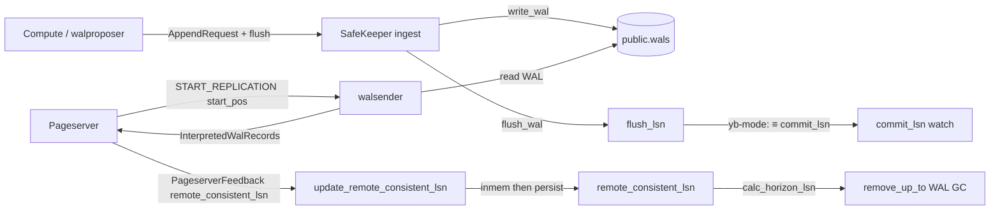

# Safekeeper LSNs

Updated: 2026-06-06

Inventory of every LSN the safekeeper uses, derived from the Rust sources
only (`safekeeper/`, `libs/utils`, `libs/safekeeper_api`). Do not treat
other architecture docs as authoritative — upstream Neon described local
segment files, `backup_lsn`, multi-SK quorum `commit_lsn`, and S3
offload paths that are gone or collapsed in yb-light.

See [`pageserver-lsns.md`](pageserver-lsns.md) for the pageserver side of
the replication link (what LSN the pageserver sends in
`START_REPLICATION`, what it reports back in `PageserverFeedback`).

## Overview: four layers

1. **Timeline control state** — consensus metadata + truncation horizon
   (`safekeeper.timeline_state` in YB).
2. **WAL storage watermarks** — in-memory bookkeeping + YB mirror
   (`public.wals` chunks).
3. **Streaming protocol** — walsender positions, interpreted-WAL batch
   bounds, standby feedback.
4. **Ephemeral / derived** — term switches, GC horizon, broker activity.



---

## yb-mode collapse: `commit_lsn ≡ flush_lsn`

Upstream Neon maintained separate `commit_lsn` (quorum-committed) and
`flush_lsn` (locally durable). In yb-light with a **single safekeeper**
and YB-mirrored WAL, every successful `flush_wal()` is treated as
committed:

```rust
// timeline.rs WriteGuardSharedState::drop
let commit_lsn = self.guard.sk.flush_lsn();
```

HTTP status, metrics, and `AppendResponse` all report `commit_lsn =
flush_lsn`. The walproposer's `msg.h.commit_lsn` / `truncate_lsn`
headers are ignored on append (`safekeeper.rs`).

---

## Timeline control LSNs (`safekeeper.timeline_state`)

Persisted in YB (`control_file::YbControlFileStorage`). Loaded at timeline
attach; updated via `TimelineState::finish_change` / `flush`.

| Column / field | Meaning |
|----------------|---------|
| `timeline_start_lsn` | Earliest LSN this timeline conceptually covers (branch/bootstrap point). Set on first `ProposerElected` if still zero. |
| `local_start_lsn` | Earliest LSN this **safekeeper node** has contiguous WAL from. Set to `start_streaming_at` on election. |
| `remote_consistent_lsn` | Oldest checkpoint the pageserver has durably ingested — **do not delete WAL at or above this** from the pageserver's perspective. Fed by `PageserverFeedback.remote_consistent_lsn`. |
| `term` + `term_history` | Raft acceptor state: term switches anchored at LSNs (`TermLsn` pairs in JSONB). |

**In-memory overlay** (`TimelineMemState`):
- `remote_consistent_lsn` — updated immediately on pageserver feedback;
  persisted copy lags until `state.flush()` (default interval
  `control_file_save_interval`, 300 s) or another `finish_change`.

`has_unflushed_inmem_state` is true when
`inmem.remote_consistent_lsn > pers.remote_consistent_lsn`.

**Not persisted as separate columns** (gone or in-memory only):
- `commit_lsn` — alias of `flush_lsn` in yb-mode.
- `backup_lsn`, `peer_horizon_lsn` — removed with S3 offloader.
- `term_start_lsn` — in-memory field on `SafeKeeper` struct only
  (epoch start for current proposer term).

---

## WAL storage watermarks

### `PhysicalStorage` (in-memory bookkeeping)

Used by `YbWalStorage`. No local pg_wal files in yb-light.

| LSN | Meaning |
|-----|---------|
| `write_lsn` | End of buffered byte stream (may be mid-record). |
| `write_record_lsn` | End of last **fully parsed** WAL record written. |
| `flush_lsn` | Durability watermark after `flush_wal()` (may be mid-record). |
| `flush_record_lsn` | End of last **fully flushed** WAL record. |

Invariant documented in code:
`write_lsn ≥ write_record_lsn ≥ flush_record_lsn` (with `flush_lsn`
alongside).

**`SafeKeeper::flush_lsn()`** wrapper:

```rust
max(self.wal_store.flush_lsn(), self.state.timeline_start_lsn)
```

Avoids reporting zero before timeline is initialized.

### YB mirror (`public.wals`)

Each `write_wal()` chunk gets an `end_lsn`. Durability sync point is
`flush_wal()` — waits for the background consumer's watermark to catch
the highest submitted `end_lsn`.

**On restart:** `load_write_lsn` scans YB for
`max(segno, chunk_offset + chunk_size)`; falls back to `commit_lsn`
(= `flush_lsn`) if the table is empty.

---

## Consensus / proposer LSNs

| LSN | Storage | Role |
|-----|---------|------|
| `start_streaming_at` | Message only (`ProposerElected`) | Where walproposer wants to start appending; SK truncates WAL here after finding common term history. Must be `≥ flush_lsn` (yb-mode: don't truncate durable tail). |
| `term_start_lsn` | `SafeKeeper` in-memory | LSN of current term's first record; set from elected proposer's term history. Triggers control-file sync when `flush_lsn` crosses it. |
| `term_history` | Persisted JSONB | `(term, lsn)` switches; `find_highest_common_point` picks resume/truncation point with proposer. |
| `last_log_term` | Derived | Term of WAL at `flush_lsn` from term history. |

---

## Pageserver streaming (outbound)

### `START_REPLICATION PHYSICAL <start_pos>`

The **pageserver chooses `start_pos`**, not the safekeeper. See
[`pageserver-lsns.md`](pageserver-lsns.md): on PS restart that is
`normalize_lsn(last_record_lsn + padding, WAL_SEGMENT_SIZE)` where
`last_record_lsn` was seeded from persisted `disk_consistent_lsn`.

Safekeeper accepts the requested LSN and streams forward:

```rust
// send_wal.rs — pageserver path (no term)
let end_watch = EndWatch::Commit(tli.get_commit_lsn_watch_rx());
// end_pos = flush_lsn (yb-mode)
```

If `start_pos > end_pos`, streaming starts anyway (logged as info) —
pageserver may be slightly ahead during catch-up races.

### Interpreted WAL message LSNs (pageserver protocol)

Per batch from `send_interpreted_wal.rs` / `wal_reader_stream.rs`:

| Wire field | Source | Meaning |
|------------|--------|---------|
| `streaming_lsn` | `batch.wal_end_lsn` | End of the WAL **chunk** in this message. |
| `commit_lsn` | `batch.available_wal_end_lsn` | End of WAL **available** on SK for this reader (= `commit_lsn` watch = `flush_lsn` for pageserver). |

Pageserver maps these to `streaming_lsn` / `commit_lsn` in walreceiver
connection status.

### Pageserver feedback (inbound)

`NEON_STATUS_UPDATE` (`PageserverFeedback`):

| Field | SK uses it for |
|-------|----------------|
| `remote_consistent_lsn` | **Yes** — `update_remote_consistent_lsn`, WAL GC horizon, broker activity. |
| `last_received_lsn` | Metrics only (`safekeeper_ps_last_received_lsn`). |
| `disk_consistent_lsn` | Metrics only — **not** used for truncation. |

```rust
// send_wal.rs
self.tli.update_remote_consistent_lsn(ps_feedback.remote_consistent_lsn).await;
```

---

## Compute / walproposer streaming

| Mode | `end_watch` | `available_wal_end_lsn` |
|------|-------------|-------------------------|
| Recovery / peer (term supplied) | `EndWatch::Flush` (term + flush_lsn) | `flush_lsn` |
| Pageserver (no term) | `EndWatch::Commit` | `commit_lsn` (= `flush_lsn`) |

Walproposer receives `AppendResponse` with `flush_lsn`, `commit_lsn`
(collapsed), and `hs_feedback` (hot-standby xmin hints aggregated from
standby replicas).

---

## Standby / hot-standby LSNs (in memory)

| LSN | Where | Role |
|-----|-------|------|
| `StandbyReply.apply_lsn` | Per walsender | Fed into `get_safekeeper_info`; aggregated across senders. |
| `HotStandbyFeedback.xmin` / `catalog_xmin` | `WalSenders.agg_standby_feedback` | Forwarded to compute in `AppendResponse.hs_feedback`. |

Not persisted. Not used for WAL truncation in yb-light.

---

## WAL removal horizon

`remove_wal::calc_horizon_lsn`:

```rust
horizon_lsn = min(
    cfile_remote_consistent_lsn,  // persisted remote_consistent_lsn
    flush_lsn,
    optional_laggard_walsender_lsn,
)
```

Segments with `segno < horizon.segment_number() - 1` are deleted from
**both** local bookkeeping and `public.wals` (`YbWalStorage::remove_up_to`).

**Critical:** `remote_consistent_lsn` in the horizon uses the
**persisted** control-file value (`cfile_remote_consistent_lsn`), not
the in-memory copy. A pageserver feedback bump that hasn't been flushed
to YB yet does **not** immediately allow WAL deletion.

Walsender laggard clamp prevents deleting bytes an active pageserver
connection still reads — in yb-mode there is no local-disk WAL fallback.

---

## LSN ordering (steady state)

```
remote_consistent_lsn (inmem) ≥ remote_consistent_lsn (persisted)

remote_consistent_lsn ≤ flush_lsn (= commit_lsn)

timeline_start_lsn ≤ local_start_lsn ≤ flush_lsn

write_lsn ≥ flush_lsn (after flush; may be equal at record boundary)
```

**Truncation safety:** WAL before `remote_consistent_lsn` can be GC'd
(subject to walsender laggard). Pageserver must keep
`remote_consistent_lsn` honest — that is the only pageserver feedback
field that affects SK retention.

---

## Cross-link: pageserver restart → SK stream start

1. PS loads `disk_consistent_lsn` from `pageserver.timeline_state`.
2. PS sets `last_record_lsn = disk_consistent_lsn`.
3. PS walreceiver sends `START_REPLICATION PHYSICAL {startpoint}` with
   padding/page-header normalization.
4. SK walsender reads from `start_pos` up to `commit_lsn` (= `flush_lsn`).
5. PS ingests, eventually sends `remote_consistent_lsn` back.
6. SK advances inmem `remote_consistent_lsn`; periodic flush persists it.

If PS persisted `disk_consistent_lsn` lags actual YB pages (flush
throttle), step 3–4 **re-stream WAL already in YB** — safe (idempotent
on PS side), wasteful.

If SK `remote_consistent_lsn` lags PS feedback (control-file flush
interval), SK retains extra WAL — safe, not data loss.

---

## Correctness summary

**Holds:**
- Single-SK `commit_lsn ≡ flush_lsn` is consistent with YB write-through
  mirror (`flush_wal` waits for YB INSERT).
- Truncation on `ProposerElected` refuses `start_streaming_at < flush_lsn`.
- WAL GC clamped by persisted `remote_consistent_lsn` + active walsender
  position.
- `load_write_lsn` rehydrates from YB on restart; no local segment scan.

**Sharp edges / gaps:**
1. **Persisted `remote_consistent_lsn` lags feedback** by up to
   `control_file_save_interval` (default 300 s) — extra WAL retained;
   crash loses recent feedback bumps (SK may GC less aggressively after
   restart, never more aggressively than persisted value).
2. **`commit_lsn` name survives** in metrics/API but equals `flush_lsn` —
   misleading when reading upstream Neon docs.
3. **Pageserver `disk_consistent_lsn` in feedback is ignored** — only
   `remote_consistent_lsn` matters; PS may send an optimistic
   `disk_consistent_lsn` (see pageserver doc).
4. **Multi-SK / quorum paths** still exist in wire format but yb-light
   runs single-SK; term history + membership switch are mostly vestigial.

---

## Persistence cheat sheet

| Field | YB `safekeeper.timeline_state` | YB `public.wals` | In memory only |
|-------|-------------------------------|------------------|----------------|
| `timeline_start_lsn` | Yes | — | — |
| `local_start_lsn` | Yes | — | — |
| `remote_consistent_lsn` | Yes (lagging) | — | `TimelineMemState` (live) |
| `term` / `term_history` | Yes (JSONB) | — | — |
| `flush_lsn` / `commit_lsn` | — | implied by chunk ends | `PhysicalStorage` |
| WAL bytes | — | Yes (per chunk) | `WalCache` optional |
| `term_start_lsn` | — | — | `SafeKeeper` struct |
| Walsender positions | — | — | per-connection state |
| Standby `apply_lsn` | — | — | `WalSenders` |

---

## Code anchors

- `safekeeper/src/state.rs` — `TimelinePersistentState`,
  `TimelineMemState`, `start_change` / `finish_change`.
- `safekeeper/src/control_file.rs` — YB row read/write.
- `safekeeper/src/safekeeper.rs` — consensus, `flush_lsn()`,
  `handle_elected`, `handle_append_request`.
- `safekeeper/src/wal_storage.rs` — `PhysicalStorage` watermarks,
  `Storage` trait.
- `safekeeper/src/yb_wal_storage.rs` — YB mirror, `load_write_lsn`,
  `flush_wal` durability.
- `safekeeper/src/send_wal.rs` — `START_REPLICATION`, pageserver
  feedback handling.
- `safekeeper/src/send_interpreted_wal.rs` — interpreted batch LSNs.
- `safekeeper/src/wal_reader_stream.rs` — `WalBytes.available_wal_end_lsn`.
- `safekeeper/src/remove_wal.rs` — `calc_horizon_lsn`.
- `safekeeper/src/timeline_manager.rs` — control-file flush, WAL removal,
  broker `is_active`.
- `libs/utils/src/pageserver_feedback.rs` — feedback wire format.
