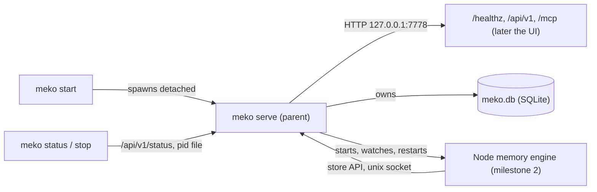

# Meko backend: foundation

Status: approved. Built in three stacked PRs: #164 (layout), #165 (vendored sqlite-vec), #166 (the foundation).
Milestone 2, the memory engine and conversations, is in [memory-engine.md](memory-engine.md). Part of Meko (product design: the Meko design doc;
requirements: the Meko PRD).

The product was called Meko Local until milestone 3 (#169), when the PRD named it Meko: the binary
went from `meko-local` to `meko`, the environment variables from `MEKO_LOCAL_*` to `MEKO_*`, the
data folder from `~/.meko-local` to `~/.meko`, and the Go module path to
`github.com/yugabyte/meko/backend`. Nothing had been released, so nothing was migrated.
Developers switching binaries: stop any `meko-local serve` first (`meko-local stop`), then move
`~/.meko-local` to `~/.meko` by hand if you want its data. The new binary checks only
`run/meko.lock`, so in a folder where an old server still runs it thinks no server is running.
`meko stop` would then kill the old server's memory engine, recorded in `run/children/`. `meko start` would
delete the `run/admin.token` that server's CLI still needs.

The foundation is the Go program everything else plugs into: one binary, `meko`, that is
both the CLI and the server, like yugabyted. This first milestone gives it a process model, a data
folder, a SQLite store with vector and full-text search, an HTTP server with auth, and a supervisor
for child processes. MCP tools, the REST API for meko_ui, the Node memory engine and knowledge-file
ingestion build on it in later milestones.

## Goals and scope

In the foundation (milestone 1):

- `meko` CLI: `start`, `stop`, `status`, `serve`, `version`. Access in this phase is
  through the CLI only: no browser and no API keys yet.
- One data folder, one SQLite file, schema migrations.
- SQLite with sqlite-vec and FTS5 compiled in, and a store layer every database call goes through.
- An HTTP server on 127.0.0.1:7778, authenticated with a local admin token, with the prod reply
  envelope, health, status and version.
- A supervisor that starts, watches, restarts and stops child processes.
- Logging, shutdown, a single-instance lock, build and CI for Linux and macOS.

Not in it (later milestones, sketched at the end): the memory engine's storage API and the Node memory engine,
MCP tools, the meko_ui REST API and serving the UI, knowledge-file ingestion, moving to Meko Cloud,
installers and releases.

## Layout

```
backend/
  go.mod                      module github.com/yugabyte/meko/backend
  cmd/meko/main.go      entry point: parses the CLI, nothing else
  internal/
    cli/                      start, stop, status, serve, version, token
    config/                   defaults, config.toml, flags, env
    paths/                    data folder layout and permissions
    server/                   echo server, middleware, health
    envelope/                 the {data, error} reply envelope (moved here from server/ in milestone 2)
    storeapi/                 the store API the memory engine calls (milestone 2, memory-engine.md)
    auth/                     the admin token, and the client token (milestone 3, api.md)
    store/                    open, connections, migrations, typed queries
      migrations/             0001_init.sql, ... (embedded, append-only)
    supervisor/               child processes: start, health, restart, stop
    logging/                  slog setup, file rotation
    version/                  version and commit, set with -ldflags
  docs/design.md              this file
  Makefile                    build, test, lint (sets the cgo tags)
```

The module path uses the repo's new name so nothing changes at the rename. AgentK Local's code is
in `extensions/agentk` (moved there in #158).

## Process model and CLI



| Command | What it does |
|---|---|
| `serve` | Runs the server in the foreground. What `start`, launchd and systemd run. |
| `start` | Starts `serve` in the background in its own session (setsid), waits until `/api/v1/status` (with the admin token) reports the new server's pid, prints the URL. If that doesn't happen within 10 s, it stops the server (SIGTERM, then SIGKILL) and prints `logs/start.log`. Already running: says so and exits 0. |
| `stop` | Sends SIGTERM to the pid in `run/meko.pid`, waits up to 30 s (longer than the server's 10 s drain plus 15 s for its children), then SIGKILL. Not running: says so and exits 0. |
| `status` | Prints running or not, version, port, uptime, data folder and each child's state, from `/api/v1/status`. Exits 3 when not running. |
| `version` | Version, commit, Go version, SQLite and sqlite-vec versions. |
| `destroy` | Removes the data folder, everything in it, for good. It prints the folder and its size and asks `Destroy it? [y/N]` (it reads stdin, and end of input means no; a no exits 1), or doesn't ask with `--force`. It removes only a folder holding `meko.db`, which only a server makes, never `/` or the home folder: the CLI's own commands write `run/meko.lock`, `client.token` and empty folders into whatever `--data-dir` names, so those prove nothing. A missing or empty folder is nothing to remove and is left as it is (a link to it too); otherwise a symlinked folder loses its target and then the link, which also goes if removing the moved target fails partway. It stops the server as `stop` does (nothing is removed if that fails), takes `run/meko.lock`, renames the folder to `<root>.destroying-<pid>` so a `start` at that moment finds all of it or none, releases the lock and removes the renamed folder. If the rename fails (the parent isn't writable), nothing is removed: removing the folder in place would unlink the lock file partway, and since flock locks the inode, a `serve` starting then could lock a new file and write into the folder. The binary and a Claude Code registration stay, and it says so: the registration's token stops working, so it's to be removed and made again after the next start. When the folder is `/var/tmp/<user>/meko`, `/var/tmp/<user>` stays (AgentK keeps its `state.db` there). |

Every command takes `--data-dir` (default `~/.meko`, or `MEKO_HOME`).

Only one server per data folder: `serve` takes an exclusive `flock` on `run/meko.lock`
and holds it until exit, so a stale pid file never blocks a start. Right after taking the lock it
clears the run files a killed server may have left and writes its own pid, so the lock and the pid
file always describe the same process. The lock is also how `status`
and `stop` tell whether a server is running. `serve` writes `run/meko.pid` and
`run/meko.port` so they can find it, and removes both at exit. `start` sends the detached
server's own stderr to `logs/start.log` and prints it if the server never answers, so errors from
before logging starts (a bad config file, a taken port) aren't lost.

Shutdown on SIGTERM or SIGINT: stop accepting connections, drain requests (10 s), stop the
children (each gets SIGTERM, then SIGKILL after its 10 s stop timeout; serve waits at most 15 s for
all of them), checkpoint the WAL, close the database, remove the pid file.

A client that needs Meko running, such as AgentK, runs `meko start`. It must not keep
`serve` as its own child, because then restarting the client would stop Meko.

## Data folder and config

```
~/.meko/               0700
  config.toml                optional; written only when the user changes a default
  meko.db, meko.db-wal       0600; the only database
  run/                       pid, port, lock, admin token, unix sockets (0600)
  logs/                      meko.log, memory_engine.log (rotated)
  models/                    model files, when downloaded (milestone 2)
  knowledgebase-files/       knowledge files' bytes, <datapack>/<sha256> (milestone 4)
```

The database must sit on a local disk, not a network filesystem: SQLite's WAL locking doesn't work
there, and neither does `flock` across hosts. When the default folder is on a network filesystem
(NFS, SMB, sshfs and the others in AgentK's `install.ts` list), the default moves to local disk
instead, as AgentK's installer does for `state.db` (`extensions/agentk/src/server/install.ts`):
`$XDG_STATE_HOME/meko` if that's local, else `/var/tmp/<user>/meko`, named by the user lookup; a
failed lookup is an error. An explicit `--data-dir` on a network filesystem is refused with a
message saying why.

Config precedence: flags > `MEKO_*` env > `config.toml` > defaults. The foundation has
few keys:

```toml
[server]
port = 7778       # next to AgentK's 7777; also --port and MEKO_PORT
[log]
level = "info"
```

## Storage

### Driver: mattn/go-sqlite3 + sqlite-vec, compiled in with cgo

| Option | Verdict |
|---|---|
| mattn/go-sqlite3 (cgo) + sqlite-vec 0.1.9 C source | **Chosen.** sqlite-vec is one C file compiled into the same binary and registered with `sqlite3_auto_extension`. FTS5 needs the `sqlite_fts5` build tag. Both now come from the `yugabyte/go-sqlite3` fork (below). |
| ncruces/go-sqlite3 (SQLite as WebAssembly, no cgo) + sqlite-vec | The sqlite-vec binding for it (sqlite-vec-go-bindings v0.1.6, Nov 2024) pins ncruces v0.17.1 and an old embedded SQLite; current ncruces is v0.35.6. We'd have to build and maintain our own WebAssembly SQLite. |
| ncruces + vec1 (sqlite.org's own vector extension, v0.8) | Approximate search (IVF + product quantization) and no partition keys yet (on its roadmap), so datapack filtering would be a post-filter. Worth revisiting later. |
| modernc.org/sqlite (pure Go) | Has FTS5 but can't load sqlite-vec. |

What cgo costs: each platform's binary is built natively (a macOS arm64 runner and Linux x64
and arm64), and the first build compiles SQLite (54 s here, cached afterwards). The binary is
8 MB.

Measured on the same 8-core Linux box and workload as the earlier Node benchmarks (Go 1.24.1,
mattn 1.14.52 with SQLite 3.53.4, sqlite-vec 0.1.9):

| What | Go (this driver) | Node (node:sqlite), earlier |
|---|---|---|
| 100k vectors, 384 dims, 40 datapacks: insert | 29 s, 191 MB file | 29 s, 191 MB |
| Top-20 KNN within one datapack (partition key) | 2.2 ms p50, 3.1 ms max | 2.2 ms |
| Top-20 KNN across all datapacks | 93 ms p50 | 92 ms |
| FTS5, 200 MB of text (275k rows), datapack as an FTS column: load | 29 s, 394 MB file | about 1 min |
| One datapack: 3 rare terms AND / 5 OR / 8 common OR | 1.1 / 13.7 / 32.9 ms p50 | 1 / 12 / 40 ms |
| Peak RSS | 17 MB (vectors), 28 MB (FTS) | 240 MB |

### Where SQLite and sqlite-vec come from: the `yugabyte/go-sqlite3` fork

`go.mod` keeps requiring `github.com/mattn/go-sqlite3` (imports don't change) and replaces it with
a tag of the fork: `replace github.com/mattn/go-sqlite3 => github.com/yugabyte/go-sqlite3
v1.14.52-yb.1`. The fork's `yb` branch is mattn's `v1.14.52` (SQLite 3.53.4) plus a
`sqlite_vec` build tag, added the way mattn adds FTS5. `sqlite3_opt_vec.c` compiles sqlite-vec
with `SQLITE_CORE` against the package's own `sqlite3-binding.h`, and `sqlite3_opt_vec.go`
registers it with `sqlite3_auto_extension` at init, so every connection has `vec0`. The
sqlite-vec source (0.1.9, commit `e9f598ab`, byte-identical to the release amalgamation) sits in
the fork's `sqlite-vec/` folder, synced from `yugabyte/sqlite-vec` by `upgrade/sqlite-vec.sh`. The
fork's `README.yugabyte.md` describes its branch, tags and upgrades. The binary is built with
`-tags sqlite_fts5,sqlite_vec`. A build without `sqlite_vec` fails at `store.Open` with an error
naming the tag.

Until this change, sqlite-vec's amalgamation and SQLite's header (24.8k lines) were vendored in
`backend/third_party` and compiled by an `internal/sqlitevec` cgo package. sqlite-vec was put into
the go-sqlite3 fork because cgo compiles only the C files in a package's own folder and can't take
headers from another module, while sqlite-vec has to compile against the exact header of the
SQLite it's linked with. Only mattn's package always has that header. These options were rejected:

- A git submodule of `yugabyte/sqlite-vec`. Meko would still have to copy SQLite's header (or add a
  second submodule that has to match `go.mod`), every AgentK worktree and CI checkout would have
  to initialize it, and Go modules leave submodules out.
- A Makefile download. Plain `go build`, `go test`, gopls and golangci-lint would fail until
  `make` had run.
- A Go package added to the sqlite-vec fork. That fork would have to commit SQLite's header and
  keep it matched to the go-sqlite3 fork.

To upgrade sqlite-vec or SQLite: follow the fork's README, cut a new `-yb.<n>` tag (tags are
never moved), bump the `replace`, and update the versions `TestLibVersions` expects.

### Connections

- WAL, `synchronous=NORMAL`, `busy_timeout=5000`, `foreign_keys=ON`.
- One write connection (a `database/sql` pool with one connection) and a read pool of 8.
  SQLite allows one writer at a time anyway, and a single writer keeps transactions from
  waiting on locks. Searches hold at most 4 of the readers at once (`store.SearchSlots`), so a
  slow search never makes a list or a get wait.
- Every query lives in `internal/store` behind typed methods, and no other package imports the
  driver.

### Migrations

Numbered SQL files embedded with `go:embed`, applied in order inside a transaction, with the
version recorded in `PRAGMA user_version`. They're append-only: a shipped migration is never
edited (the same rule as AgentK's `extensions/agentk/src/server/db.ts`). Before a migration runs on an existing database,
the old file is copied to `meko.db.bak-<version>` with `VACUUM INTO` (a consistent copy while
open), so a failed upgrade can be rolled back. A database whose version is newer than the binary
knows is refused with a message saying so.

### Ids

Records keep prod's UUIDs (meko_ui needs UUID datapack ids, and moving to Cloud keeps ids). A
table that needs vector or full-text search also has an `INTEGER PRIMARY KEY` rowid, because
sqlite-vec and external-content FTS5 key on integers:

```sql
CREATE TABLE memories (
  rowid        INTEGER PRIMARY KEY,
  id           TEXT NOT NULL UNIQUE,      -- UUID, as in prod
  datapack_id  TEXT NOT NULL REFERENCES datapacks(id) ON DELETE CASCADE,
  ...
);
```

### Schema in the foundation (0001_init.sql)

- `settings(key, value)`: install id, the embedding model and dimension once known, and since
  milestone 3 the local user's profile (`profile_first_name`, `profile_last_name`,
  `profile_email`, `profile_onboarding_done`).
- `datapacks(id, name UNIQUE, description, created_at, updated_at)`: a local default datapack
  is created on first start. It must not be named `meko_default_datapack*`, because meko_ui
  sets up Langfuse keys for datapacks with that name.

The memory and conversation tables come in milestone 2 (`0002_memory.sql` in #178,
`0003_conversations.sql` in #182); [memory-engine.md](memory-engine.md) describes them. Two things the
foundation fixed hold: the FTS5 table has `datapack_id` as a column so the filter runs inside
MATCH (the naive join with the filter outside FTS never finished at 200 MB), and the `vec0` tables
are made when the memory engine first reports its model and dimension.

## HTTP server

echo v4, the same framework as prod's `api_server`, so handlers ported from it keep their shape.

- Listens on `127.0.0.1` only; no option to bind other addresses in this milestone.
- Envelope: the same wire shape as prod's API, `{data, error{code, message, details}}`, with
  `error` omitted on success, written here (no prod code). Internal errors are logged, and the
  caller gets a generic message.
- Routes in the foundation: `GET /healthz` (no auth: status and version only),
  `GET /api/v1/status` (uptime, data folder, each child's state) and `GET /api/v1/version`.
  The CLI authenticates with an admin token that `serve` writes to `run/admin.token` (0600) at
  start. Milestone 3 mounts `/mcp` ([api.md](api.md)); the rest of `/api/v1` and `/` (the UI)
  come later.
- Middleware, in order: request id, recover, access log (slog), Host check, auth, then a body
  limit of 1 MB on `/api/v1`. Routes outside that group (uploads, later) set their own.

### Auth

The foundation had one client, the CLI, so one credential: the admin token. Milestone 3 added
the client token for MCP and REST clients (last bullet).

- `serve` generates 32 random bytes at each start and writes them to `run/admin.token` (0600, in
  a 0700 folder). So only the OS user who runs Meko can read it. The CLI sends it as
  `Authorization: Bearer <token>`. It's compared in constant time and never logged.
- Every route except `/healthz` needs it, or since milestone 3 the client token (or nothing, with
  `[server] auth = "none"`), except `/api/v1/status` and `/api/v1/version`, which take only it.
- Host check: requests must name `127.0.0.1:<port>` or `localhost:<port>`, which stops DNS
  rebinding. Any request with an `Origin` header is refused, since no browser client exists yet.
  That keeps web pages open in the user's browser from reaching the server.
- Milestone 3 added the client token, kept across restarts, for MCP and REST clients, and an
  opt-in `[server] auth = "none"`; the admin-only routes stay admin-only
  ([api.md](api.md)). Per-client API keys are #195, and browser access comes with the UI.

## Supervisor

A small, generic process manager. The memory engine is its first user in milestone 2, and connectors
later. The foundation tests it with a stub child.

- A child spec has: name, command, args, env, working folder, log file, a health check (a unix
  socket HTTP GET), a startup deadline and a restart policy.
- Each child runs in its own process group so the whole tree can be signalled. On stop the group
  gets SIGTERM, then SIGKILL after the stop timeout for anything left in it, even when the child
  itself exited first. Its stdout and
  stderr go to `logs/<name>.log`.
- Restarts back off exponentially (1 s doubling to 60 s). If a child crashes 5 times in 10
  minutes it's marked failed, and the server keeps running without it: features that need it
  return a clear "memory engine unavailable" error, and `status` shows why.
- Children get their sockets and a per-start token through env (`MEKO_STORE_SOCKET`,
  `MEKO_MEMORY_ENGINE_SOCKET`, `MEKO_INTERNAL_TOKEN`). The sockets sit in `run/` (0700) and are 0600.

### Go and the memory engine

The link is HTTP/JSON over unix sockets, one each way (decided). Go serves the store
API on `run/store.sock`, and the memory engine serves its own API (add, search, extract) on
`run/mem_eng.sock`. Both sides speak the same protocol, the link can be tested with curl, and
nothing has to multiplex two directions over one pipe, which stdio JSON-RPC would require. It
only goes over the internal sockets, never the TCP port.

The store API (milestone 2) mirrors mem0-ts's two storage interfaces, `VectorStore` and
`HistoryManager`, which is everything mem0-ts needs from a database. mem0's collection name maps
to a datapack: `<datapack id>` to `memories`, and `<datapack id>_entities` to `entities`. The
routes, the memory engine's API and the memory engine itself are in [memory-engine.md](memory-engine.md).

## Logging

`log/slog` with JSON lines in `logs/meko.log`, rotated at 10 MB with 5 files kept, and
text on stderr under `serve`. Logs never contain keys, tokens or memory text, only ids and
counts.

## Build, test and CI

- Go 1.25 at first, to match `api_server`; 1.26 since golang.org/x/sys 0.49 (#212). `CGO_ENABLED=1`, `-tags sqlite_fts5,sqlite_vec`. On the RHEL 8 dev servers
  that means `CC=/opt/rh/gcc-toolset-13/root/usr/bin/gcc`, as for node-pty.
- `make build`, `make test` (`go test -race ./...`), `make lint` (`go vet`, gofmt, golangci-lint).
- A `backend` CI job (in `.github/workflows/ci.yml`) runs on ubuntu-latest and macos-15, the
  same runners as AgentK's, when a PR changes `backend/**` (`scripts/ci-scope.sh`), and on every
  push to `main`. The npm checks don't cover Go. A failure here fails the required `CI gate`.
- golangci-lint v2.14.0 (pinned in CI). `backend/.golangci.yml` starts from prod's config and
  says what it changes: the cgo build tags, govet's fieldalignment off (it reorders structs for
  bytes, against readability), and errcheck allowing a deliberate `_ =`. Its exclusions apply
  everywhere, not per call site: `fmt.Fprint*` (used only for CLI output here) and Close or
  Rollback on handles that only clean up (listeners, response bodies, sql rows, transactions and
  databases). The Close of anything that writes (a file, the store, the log file) is checked,
  since it can be the only sign a write failed. gosec's few hits (running our own binary, a
  localhost client, paths from the data folder) carry `nolint` comments with the reason.
- Tests use a temporary data folder and never touch `~/.meko`. The server's tests start it
  in-process on port 0. The supervisor's tests re-run the test binary as the stub child.
- Commits are `chore(meko): ...` (or `chore(meko/<area>): ...`): nothing in `backend/` ships in
  AgentK Local's release, and a `feat` would make `main` cut an AgentK release with no AgentK
  change in it.

## Its own stack, no api_server code

Meko builds what it needs as its own stack and copies no code from prod's `api_server`
(decided; see below). Prod's code couldn't be imported anyway: its module path `meko/api_server`
isn't fetchable and every package is under `internal/`. What Meko keeps from prod are the
wire shapes clients depend on, written here from scratch: the `{data, error}` envelope now, and
the MCP and REST shapes in later milestones.

## Files to change

All new except the root `AGENTS.md` and `.gitignore`. Nothing under `extensions/agentk` changes.

| Path | What |
|---|---|
| `backend/go.mod`, `backend/go.sum` | Module `github.com/yugabyte/meko/backend`, Go 1.26 (1.25 until #212); echo v4, mattn/go-sqlite3, BurntSushi/toml (config), google/uuid, golang.org/x/sys (macOS statfs) |
| `backend/cmd/meko/main.go` | Entry point |
| `backend/internal/cli/` | `start`, `stop`, `status`, `serve`, `version`; detaching `serve` (setsid), pid file, waiting until `/api/v1/status` reports the new server |
| `backend/internal/config/` | Defaults, `config.toml`, `MEKO_*` env, flags; precedence |
| `backend/internal/paths/` | Data folder layout, 0700/0600 permissions, the network-filesystem check (statfs on macOS, `/proc/self/mountinfo` on Linux) |
| `backend/internal/server/` | echo setup, middleware (request id, recover, access log, Host and Origin checks, auth, body limit), `/healthz`, `/api/v1/status`, `/api/v1/version`, graceful shutdown. The envelope it replies with is in `backend/internal/envelope/` since milestone 2 |
| `backend/internal/auth/` | Admin token: generate, write, read (CLI side), constant-time check. Milestone 3 adds the client token ([api.md](api.md)) |
| `backend/internal/store/` + `migrations/0001_init.sql` | Open (writer + reader pools, pragmas), migrations with a pre-migration backup, `settings` and `datapacks` queries, default datapack |
| `backend/internal/sqlitevec/` | cgo glue registering sqlite-vec with `sqlite3_auto_extension` (removed since: the `yugabyte/go-sqlite3` fork registers it) |
| `backend/third_party/sqlite-vec/` | Removed since, for the `yugabyte/go-sqlite3` fork. It held the sqlite-vec 0.1.9 amalgamation (`sqlite-vec.c/.h`, 10.2k lines), its licenses, a VERSION file with the tarball's SHA-256, a README, and SQLite's header (`sqlite3-binding.h`, 14.4k lines) copied from mattn's module, since cgo can't point at the module cache. Built with `SQLITE_CORE`, sqlite-vec needs no `sqlite3ext.h` |
| `backend/internal/version/` | Version and commit, set at build time with `-ldflags` |
| `backend/internal/supervisor/` | Child specs, process groups, health checks, backoff, failed state, stop |
| `backend/internal/logging/` | slog JSON to a rotated file, text to stderr |
| `backend/Makefile`, `backend/.golangci.yml` | build, test, lint with the cgo tags |
| `backend/docs/design.md` | This design, kept in the repo with the code |
| `backend/internal/sqlitevec/sqlitevec_test.go` | sqlite-vec loads, and the vendored headers match the compiled SQLite (replaced since by `TestLibVersions` in `internal/store`) |
| `.github/workflows/ci.yml` (`backend` job) | Build, vet, gofmt, golangci-lint and `go test -race` on ubuntu-latest and macos-15 for `backend/**` |
| `.gitattributes` | Marks `backend/third_party/**` vendored and generated, so GitHub collapses it in diffs (removed along with `third_party/`) |
| `AGENTS.md` (root) | A `backend/` row in the layout, and a pointer to `backend/AGENTS.md` |
| `backend/AGENTS.md` | The backend's map, commands (Go toolchain, cgo), and rules |
| `backend/REVIEW.md` | What to check in a backend change (the root rules send reviewers to the REVIEW.md of the part changed) |
| `.gitignore` | `backend/bin/` |

## Risks

| Risk | Mitigation |
|---|---|
| cgo builds per platform; nothing has run on a Mac yet | The CI job builds and tests on macos-15 (Apple Silicon) from the first PR |
| Dev servers have Go 1.24.1; the module asks for 1.26 | Go downloads 1.26 on first build. `go.mod`'s `go` line is a hard minimum, so where downloads are blocked (`GOTOOLCHAIN=local`), install Go 1.26. A golangci-lint built with an older Go refuses to lint (CI's is current) |
| SQLite and sqlite-vec go stale | Both come from a tag of the `yugabyte/go-sqlite3` fork. Upgrading means a sync or rebase there, a new tag, and a bump of the `replace` |
| Slow CI from compiling SQLite (54 s) | Cache Go's build cache in the workflow |
| A detached `serve` dies silently at start | `start` waits up to 10 s for `/api/v1/status` to report the new server's pid; if it doesn't, it stops the server and prints `logs/start.log`, which holds errors from before logging starts |
| The port is taken | `serve` exits with a clear error naming the port and the setting to change |
| The data folder is on NFS | Default moves to local disk; an explicit network path is refused |
| Treat the repo as public (a root AGENTS.md rule) | No hostnames, paths or tokens in code or tests; the admin token lives only in the data folder |

## Test plan

Automated, in `go test -race ./...` (Linux and macOS in CI):

- **config**: precedence of flags, env, file and defaults; a bad `config.toml` gives an error naming the file and line.
- **paths**: folder and file permissions; the network-filesystem check refuses an explicit network path (faked filesystem type); a parent writable by others (or by a group that isn't the user's) is refused; the folder ends 0700; the `/var/tmp` fallback.
- **store**: `TestLibVersions` checks the fork's SQLite (3.53.4) and sqlite-vec (`vec_version()` is v0.1.9); `TestVecErr` checks that a missing `vec_version` (a build without `sqlite_vec`) becomes the error naming the tag, and that SQLite still words it "no such function"; migrations apply on a fresh file and are a no-op on a current one; `user_version` matches; the backup file is written before a migration; a newer database or a gap in the migrations is refused; a `vec0` table with a partition key answers KNN within a datapack; FTS5 is compiled in; the default datapack is created once with a UUID and a name that isn't `meko_default_datapack*`.
- **server** (in-process on port 0): `/healthz` answers without auth; `/api/v1/*` needs the admin token (401 without it or with a wrong one); a foreign Host gets 403; any `Origin` header is refused; replies use the envelope with `error` omitted on success; an internal error returns the generic message and logs the cause.
- **supervisor** (the test binary re-run as a stub child): starts and reports healthy; restarts with backoff after a crash; marks the child failed after 5 crashes in 10 minutes; stop sends SIGTERM, then SIGKILL to the whole process group, including a grandchild that outlives the child; restarts count only the restarts made; `UnixHTTPCheck` passes on 2xx and fails on other answers or a missing socket.
- **cli**: `start` then `status` then `stop` against a temp data folder; a second `serve` on the same folder fails on the lock; a stale pid file doesn't block `start` and is replaced by the new server's pid; a taken port gives the clear error.
- **shutdown**: SIGTERM drains, stops children, checkpoints the WAL and removes the pid file.

Manual, on a Mac (Apple Silicon, macOS 14+) and on Linux:

- `make build`; `meko start`, `status`, `stop`; `meko version` shows SQLite and sqlite-vec versions.
- `curl` to `127.0.0.1:7778/api/v1/status` without the token gets 401, with `run/admin.token` gets the status.

## Delivery: three stacked PRs

The vendored code is 24.9k of the change's 28k lines, so it gets a PR of its own. Each PR builds
and passes the backend CI job on its own, and each squash-merges as one `chore(backend)` commit:

| # | Branch | What | Review |
|---|---|---|---|
| 1 | `ak_hari90/meko-local-1-layout` | The module (`go.mod`), Makefile, lint config, CI workflow, `.gitignore`, the `version` package, a placeholder `main` that only answers `version`, `backend/AGENTS.md`, the root `AGENTS.md` row, and this design | Small; hand-written |
| 2 | `ak_hari90/meko-local-2-sqlite-vec` (on 1) | `third_party/sqlite-vec` unchanged, `internal/sqlitevec` (cgo glue) and its test, `.gitattributes`, mattn in `go.mod` | Check the tarball's SHA-256 in `VERSION` and that the headers match mattn's; the glue is about 30 lines |
| 3 | `ak_hari90/meko-local` (on 2) | Everything else: config, paths, logging, auth, store, server, supervisor, CLI, their tests, the map in `backend/AGENTS.md`, and `backend/REVIEW.md` | The functionality |

## Later milestones

| # | Milestone | Builds on the foundation with |
|---|---|---|
| 2 | Memory engine | Built in five stacked PRs, #178 to #182: [memory-engine.md](memory-engine.md). The store API, the memory and conversation tables, the Node memory engine (public `mem0ai` with Meko's providers) as the first supervised child, conversation search; children's process groups recorded in `run/` so `stop`'s SIGKILL path reaches them too |
| 3 | MCP and REST | Built in #197 (the rename) and the stack #201 to #204: [api.md](api.md). `/mcp` with Meko Cloud's tools, the `/api/v1` subset meko_ui calls, the client token, the call log |
| 4 | Knowledge files | Built in #170: [knowledge.md](knowledge.md). Uploads through Cloud's presigned flow onto a sink on Meko, files in `knowledgebase-files/`, extraction and chunking in Go, embedding and Cloud's cross-encoder in the memory engine, dedupe by content hash, promoted memories in the knowledge base |
| 5 | Install and release | Native builds with Meko's own Node, launchd and systemd units, installers, prefixed release tags (`meko-v...`), not marked latest (#171) |
| 6 | Web UI | The pinned meko_ui package served at `/`, local mode in meko_ui, browser access (#172) |
| 7 | Move to Meko Cloud | The export bundle, and prod's import API (#173) |

## Questions and decisions

| Question | Answer | Decided |
|---|---|---|
| How should the Go server and the Node memory engine talk to each other? (`go-node-link`) | HTTP/JSON over unix sockets, one each way | As proposed: Go serves the store API on `run/store.sock`, the memory engine its API on `run/mem_eng.sock`, with a per-start token. Built in milestone 2; the foundation's supervisor and `run/` layout already assume it. |
| How do we reuse prod's api_server code? (`api-server-reuse`) | No copy for now; build what Meko needs as its own stack | No code is copied from `api_server` and nothing waits on prod. Meko writes its own handlers, store and envelope, keeping only prod's wire shapes (the `{data, error}` envelope now; MCP and REST shapes later). |
| Which default port? (`default-port`) | 7778 | 7778, configurable with `--port`, `MEKO_PORT` or `config.toml`; `serve` exits with a clear error if it's taken, with no random fallback. |
| How does the browser authenticate in this phase? (`browser-auth`) | No browser login; CLI only | CLI-only access with the local admin token; no API keys yet. API keys come with MCP (milestone 3), browser access with the UI (milestone 4). Since revised: milestone 3 added a client token instead of keys, per-client API keys are #195, and the UI is milestone 6 (#172). |
| How should the change be reviewed, given 25.6k lines of vendored SQLite and sqlite-vec code? (asked while coding) | Break the third-party code into its own PR; stacked PRs: base layout, third party, functionality | Three stacked PRs, one `chore(backend)` commit each (see Delivery). The header-version test moved into `internal/sqlitevec` so PR 2 stands alone. |
| Which commit type? (came up while coding) | (no question asked; follows the repo's rules) | `chore(backend)`: nothing in `backend/` ships in AgentK Local's release, so a releasing type would cut an empty AgentK release. |
| Check the third-party code in, or pull it at build time? (asked while coding) | Store third-party code in yugabyte forks, as yugabyte-db does; forks will take time, so copy the code for now | Vendored in `backend/third_party` at first (option A), until the forks existed. Since then, `third_party/` and `internal/sqlitevec` are gone: `go.mod` replaces go-sqlite3 with a tag of `yugabyte/go-sqlite3`, which compiles in sqlite-vec synced from `yugabyte/sqlite-vec` (see "Where SQLite and sqlite-vec come from"). The sqlite-vec fork stays unchanged: it gains no Go package. |
| AgentK moved to `extensions/agentk` on main (#158) while this was in review | Rebase on main first, then open the three stacked PRs | Rebuilt the stack on the new main. The backend's docs moved out of AgentK's files into `backend/AGENTS.md`, `backend/REVIEW.md` and a row in the root `AGENTS.md`. |
| Must `stop`'s SIGKILL path reach the children? (AgentK review of #166) | (no question asked) | Yes, from milestone 2, when the first child exists: serve records its children's process groups in `run/` and `stop` kills them after killing serve. The foundation starts no children, and `stop` now waits 30 s, longer than serve's own shutdown, so SIGKILL is only for a hung server. |
| Adopt prod's golangci-lint config as is? (came up while coding) | (no question asked) | Start from it, with the exceptions listed under Build, test and CI; it flagged 130 issues on this code, mostly struct field order and unchecked Close calls on cleanup paths. |
