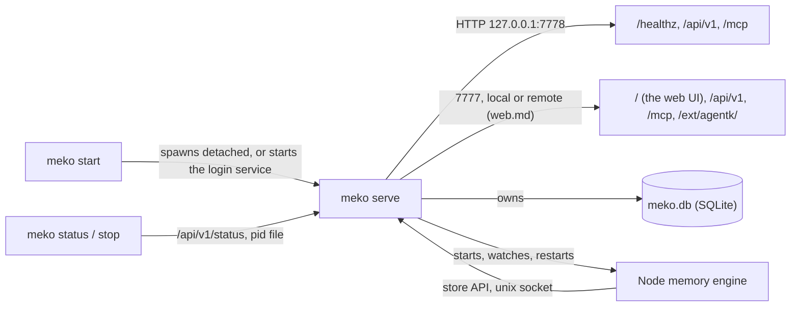

# Meko backend: design

The core of Meko's backend: one Go binary, `meko`, that is both the CLI and the server, the way
yugabyted runs YugabyteDB. It owns a data folder, a SQLite store with vector and full-text search,
an HTTP server with auth, and a supervisor for child processes. The rest builds on it:

| Doc | What |
|---|---|
| [memory-engine.md](memory-engine.md) | The store API, the Node memory engine (mem0), memories and conversations |
| [api.md](api.md) | MCP at `/mcp`, REST at `/api/v1`, the client token, the call log, the CLI's tool commands |
| [knowledge.md](knowledge.md) | Knowledge files: uploads, ingestion, hybrid search with a reranker |
| [install.md](install.md) | Release builds, releases, the installer, the login service, extensions, updates, secrets |
| [web.md](web.md) | The web listener browsers use: local or remote access, the login, TLS, extensions at `/ext/<name>/`, the handoff from AgentK |
| [web-ui.md](web-ui.md) | The web UI served at `/` |
| [callhome.md](callhome.md) | Usage stats |

Meko is sized for 200 MB of content: the stored data itself (memory text, conversation turns,
artifact and knowledge-file bytes) across all datapacks, with indexes on top. That's a target the
design and `make bench` are measured against, not a quota Meko enforces.

Meko's code is its own. Where it follows Meko Cloud, it keeps Cloud's wire shapes (the
`{data, error}` envelope, MCP tool names and replies, REST paths), written here from scratch, so
clients work against either and a datapack can move to Cloud without losing anything. Meko Cloud's
code is private: nothing here copies it or cites its paths.

## Process model and CLI



The binary is two commands, told apart by the name it's run by (`cli.Main`): `meko` runs Meko,
and `mekosh` (`~/.local/bin/mekosh`, a link to the same binary that `meko install` makes, and a
release's serve makes at start for an install from before it) works with what Meko keeps, through
the running server, and with the linked Meko Cloud's datapacks ([cloud.md](cloud.md#mekosh)):
`datapacks`, `create_datapack`, `delete_datapack`, `export`, `search`, `add_memory`, `upload` and
`upload_status`. Alone, `mekosh` is a prompt (`shell.go`): it
reads one command a line, split as a shell would, and runs each as `mekosh <line>`; `use <datapack>`
fills in `--datapack` for the commands that take it, and a confirmation (`delete_datapack`'s) reads
the next line from the same buffer. From a pipe it runs the lines as a script. Given one of
`mekosh`'s commands, `meko` runs nothing and names the `mekosh` command instead (exit 2).

Each command's help comes from one table (`help.go`: its group, summary, usage and examples, and its
flag set's flags), which `meko --help`, `meko help <cmd>`, `<cmd> --help` (exit 0) and the prompt's
`help` all print. `install`, `start`, `stop`, `restart` and `status` print a summary
(`report.go`): a row per step marked `✓`, `!` or `✗`, the links (`Humans (web UI)` on the web
listener, `Agents (MCP, API)` on the API listener), and the commands to run next; the extensions
print their own rows ([install.md](install.md#the-summary-rows)). `status` is that checklist;
`status --verbose` has everything, and `status --json` the server's status reply.

Every command takes `--data-dir` (default `~/.meko`, or `MEKO_HOME`). The repo's README lists them
all; the ones that run the server:

| Command | What it does |
|---|---|
| `serve` | Runs the server in the foreground. What `start`, launchd and systemd run. |
| `start` | With the login service installed, starts it ([install.md](install.md)). Otherwise starts `serve` in the background in its own session (setsid), waits until `/api/v1/status` (with the admin token) reports the new server's pid, and prints the URL. If that doesn't happen within 10 s, it stops the server (SIGTERM, then SIGKILL) and prints `logs/start.log`. Already running: says so and exits 0. Then starts the extensions, and waits up to 10 s for the web listener (which binds after their handoff) before it prints the links. |
| `stop` | Stops the extensions, then the service, or sends SIGTERM to the pid in `run/meko.pid` and waits up to 30 s (longer than the server's 10 s drain plus 15 s for its children) before SIGKILL. Not running: says so and exits 0. |
| `status` | Running or not, with a row each for the memory engine, the service, updates, the Meko Cloud link and the extensions, then the links, from `/api/v1/status`; `--verbose` adds the version, port, uptime, models, certificate, auth mode, usage stats and children, `--json` the reply itself. Exits 3 when not running. |
| `version` | Version, commit, Go version, SQLite and sqlite-vec versions (`--json` for installers and updates). |
| `destroy` | Removes the data folder for good (below). |

Only one server per data folder: `serve` takes an exclusive `flock` on `run/meko.lock` and holds it
until exit, so a stale pid file never blocks a start. Right after taking the lock it clears the run
files a killed server may have left and writes its own pid, so the lock and the pid file always
describe the same process. The lock is also how `status` and `stop` tell whether a server is
running. `serve` writes `run/meko.pid` and `run/meko.port` so they can find it, and removes both at
exit. `start` sends the detached server's own stderr to `logs/start.log` and prints it if the
server never answers, so errors from before logging starts (a bad config file, a taken port) aren't
lost.

Shutdown on SIGTERM or SIGINT: stop accepting connections, drain requests (10 s), stop the children
(each gets SIGTERM, then SIGKILL after its 10 s stop timeout; serve waits at most 15 s for all of
them), checkpoint the WAL, close the database, remove the pid file.

No client keeps `serve` as its own child, because restarting the client would then stop Meko. It's
the other way round: Meko runs as a login service and starts and stops its extensions, AgentK first,
through their own CLIs ([install.md](install.md#extensions)).

### destroy

`meko destroy` prints the folder and its size and asks `Destroy it? [y/N]` (it reads stdin, and end
of input means no; a no exits 1), or doesn't ask with `--force`.

- It removes only a folder holding `meko.db`, which only a server makes, never `/` or the home
  folder: the CLI's own commands write `run/meko.lock`, `client.token` and empty folders into
  whatever `--data-dir` names, so those prove nothing. A missing or empty folder is nothing to
  remove and is left as it is (a link to it too). A symlinked folder loses its target and then the
  link, which also goes if removing the moved target fails partway.
- It stops the service, then the server as `stop` does (nothing is removed if that fails), takes
  `run/meko.lock`, renames the folder to `<root>.destroying-<pid>` so a `start` at that moment finds
  all of it or none, releases the lock and removes the renamed folder. If the rename fails (the
  parent isn't writable), nothing is removed: removing the folder in place would unlink the lock
  file partway, and since flock locks the inode, a `serve` starting then could lock a new file and
  write into the folder.
- Extensions' data in the folder (`extensions/`, where AgentK's home is, and `extensions.json`) is
  kept unless the user says so at a second question, or passes `--with-extensions`, which runs each
  extension's own uninstall first ([install.md](install.md#extensions)); `--force` alone keeps it.
  Keeping it can't rename the folder, which would pull AgentK's home out from under its running
  sessions: holding the lock, it moves every other entry into `<root>.destroying-<pid>`, `run/`
  (which holds the lock file) last, so no server starts before Meko's data is all gone, then removes
  them; a failed move puts back what was moved.
- The binary, the service and a Claude Code registration stay, and it says so: the registration's
  token stops working, so it's to be removed and made again after the next start. The client token
  goes, from the Keychain too. When the folder is `/var/tmp/<user>/meko`, `/var/tmp/<user>` stays.

## Data folder and config

```
~/.meko/                     0700
  config.toml                optional; Meko never writes it
  web.toml, cloud.toml       what Meko chose itself: the web listener's settings (web.md), the
                             Meko Cloud link's URLs (cloud.md; its key is a secret)
  meko.db, meko.db-wal       0600; the only database
  meko.db.bak-<version>      the copy made before a migration (below)
  client.token               the client token (api.md), unless it's in the Keychain
  run/                       pid, port, lock, admin token, unix sockets, children's pids (0600)
  logs/                      meko.log (rotated), memory_engine.log and service.log (appended),
                             start.log (rewritten at each start)
  models/                    model files, when downloaded (a build from source)
  memory_engine/             mem0's own config folder
  knowledgebase-files/       knowledge files' bytes, <datapack>/<sha256> (knowledge.md)
  secrets/                   the file secret store (install.md)
  update.json                the last update check
  extensions.json            the extensions meko start and stop run (install.md)
  extensions/<name>/         each extension's own data: extensions/agentk is AgentK's home, which
                             follows wherever this folder is; destroy keeps it unless told otherwise
```

The database must sit on a local disk, not a network filesystem: SQLite's WAL locking doesn't work
there, and neither does `flock` across hosts. When the default folder is on a network filesystem
(NFS, SMB, sshfs and the others in AgentK's `install.ts` list), the default moves to local disk
instead, as AgentK's installer does (`extensions/agentk/src/server/install.ts`):
`$XDG_STATE_HOME/meko` if that's an absolute path on a local disk (a relative one is ignored, as the
XDG spec says), else `/var/tmp/<user>/meko`, named by the user lookup; a failed lookup is an error.
`/var/tmp/<user>` must be a real folder (not a symlink) owned by the user and not writable by
others, or by a group other than the user's own. An
explicit `--data-dir` on a network filesystem is refused with a message saying why. Meko, AgentK
and Presenter check their rule against the cases in `internal/paths/testdata/resolve-cases.json`.

Config precedence: flags > `MEKO_*` env > `config.toml` > defaults. An unknown key in
`config.toml` is an error naming it.

| Key | Env | Default | What |
|---|---|---|---|
| `[server] port` | `MEKO_PORT`, `--port` | 7778 | The API listener's port on 127.0.0.1. A taken port is an error naming the setting, with no random fallback. |
| `[web] port`, `access`, `name`; `[tls] cert`, `key` | `MEKO_WEB_PORT`, `MEKO_WEB_ACCESS` | 7777, `"local"` | The web listener ([web.md](web.md#settings)). A taken port is retried, not an error: AgentK may still hold it. What Meko chose itself (`meko install`, the handoff from AgentK) is in `web.toml`, which these keys in `config.toml` override. |
| `[server] auth` | `MEKO_AUTH` | `"token"` | `"none"` lifts the credential on `/mcp` and the data routes ([api.md](api.md)). |
| `[log] level` | `MEKO_LOG_LEVEL`, `--log-level` | `"info"` | |
| `[memory_engine] node`, `dir` | `MEKO_NODE`, `MEKO_MEMORY_ENGINE_DIR` | found | Node and the built memory engine ([memory-engine.md](memory-engine.md)). |
| `[conversation_search] max_distance` | | 0.6 | Conversation search's cosine cutoff. |
| `[knowledge_base] max_distance` | | 0.6 | `context_search`'s cutoff for knowledge-base results ([knowledge.md](knowledge.md)). |
| `[web_ui] dir` | `MEKO_WEB_UI_DIR` | found | The built web UI ([web-ui.md](web-ui.md)). |
| `[secrets] store` | `MEKO_SECRETS` | `keychain` on macOS, else `file` | [install.md](install.md#secrets). |
| `[update] channel`, `auto`, `interval_hours`, `repo` | `MEKO_UPDATE_CHANNEL`, `_AUTO`, `_REPO` | `stable`, true, 6, this repo | [install.md](install.md#updates-and-rollback). |
| `[call_home] enabled`, `url` | `MEKO_CALL_HOME`, `MEKO_CALL_HOME_URL`, `YB_DISABLE_CALLHOME` | on, from a release install | [callhome.md](callhome.md). |

## Storage

### Driver: mattn/go-sqlite3 and sqlite-vec, compiled in with cgo

| Option | Verdict |
|---|---|
| mattn/go-sqlite3 (cgo) + sqlite-vec's C source | **Chosen.** sqlite-vec is one C file compiled into the same binary and registered with `sqlite3_auto_extension`. FTS5 needs the `sqlite_fts5` build tag. Both come from the `yugabyte/go-sqlite3` fork (below). |
| ncruces/go-sqlite3 (SQLite as WebAssembly, no cgo) + sqlite-vec | sqlite-vec's binding for it pins an old ncruces and an old embedded SQLite, so Meko would have to build and maintain its own WebAssembly SQLite. |
| ncruces + vec1 (sqlite.org's own vector extension) | Approximate search (IVF and product quantization) and no partition keys yet, so datapack filtering would be a post-filter. Worth revisiting. |
| modernc.org/sqlite (pure Go) | Has FTS5 but can't load sqlite-vec. |

What cgo costs: each platform's binary is built natively, and the first build compiles SQLite
(about a minute, cached afterwards).

Measured on an 8-core Linux x64 machine (mattn 1.14.52 with SQLite 3.53.4, sqlite-vec 0.1.9),
against Node's `node:sqlite` on the same workload:

| What | Go (this driver) | Node (node:sqlite) |
|---|---|---|
| 100k vectors, 384 dims, 40 datapacks: insert | 29 s, 191 MB file | 29 s, 191 MB |
| Top-20 KNN within one datapack (partition key) | 2.2 ms p50, 3.1 ms max | 2.2 ms |
| Top-20 KNN across all datapacks | 93 ms p50 | 92 ms |
| FTS5, 200 MB of text (275k rows), datapack as an FTS column: load | 29 s, 394 MB file | about 1 min |
| One datapack: 3 rare terms AND / 5 OR / 8 common OR | 1.1 / 13.7 / 32.9 ms p50 | 1 / 12 / 40 ms |
| Peak RSS | 17 MB (vectors), 28 MB (FTS) | 240 MB |

### Where SQLite and sqlite-vec come from: the `yugabyte/go-sqlite3` fork

`go.mod` requires `github.com/mattn/go-sqlite3` (so imports are mattn's) and replaces it with a tag
of the fork: `replace github.com/mattn/go-sqlite3 => github.com/yugabyte/go-sqlite3 v1.14.52-yb.1`.
The fork's `yb` branch is mattn's `v1.14.52` (SQLite 3.53.4) plus a `sqlite_vec` build tag, added
the way mattn adds FTS5. `sqlite3_opt_vec.c` compiles sqlite-vec with `SQLITE_CORE` against the
package's own `sqlite3-binding.h`, and `sqlite3_opt_vec.go` registers it with
`sqlite3_auto_extension` at init, so every connection has `vec0`. The sqlite-vec source (0.1.9,
commit `e9f598ab`, byte-identical to the release amalgamation) sits in the fork's `sqlite-vec/`
folder, synced from `yugabyte/sqlite-vec` by `upgrade/sqlite-vec.sh`. The fork's
`README.yugabyte.md` describes its branch, tags and upgrades. The binary is built with
`-tags sqlite_fts5,sqlite_vec`; a build without `sqlite_vec` fails at `store.Open` with an error
naming the tag.

sqlite-vec lives in the go-sqlite3 fork because cgo compiles only the C files in a package's own
folder and can't take headers from another module, while sqlite-vec has to compile against the
exact header of the SQLite it's linked with. Only mattn's package always has that header. Rejected:

- Vendoring sqlite-vec and SQLite's header in this repo. It's third-party C code to keep in sync
  by hand, and the header has to match `go.mod`'s SQLite exactly.
- A git submodule of `yugabyte/sqlite-vec`. Meko would still have to copy SQLite's header (or add a
  second submodule that has to match `go.mod`), every worktree and CI checkout would have to
  initialize it, and Go modules leave submodules out.
- A Makefile download. Plain `go build`, `go test`, gopls and golangci-lint would fail until `make`
  had run.
- A Go package added to the sqlite-vec fork. That fork would have to commit SQLite's header and
  keep it matched to the go-sqlite3 fork.

To upgrade sqlite-vec or SQLite: follow the fork's README, cut a new `-yb.<n>` tag (tags are never
moved), bump the `replace`, and update the versions `TestLibVersions` expects.

### Connections

- WAL, `synchronous=NORMAL`, `busy_timeout=5000`, `foreign_keys=ON`.
- One write connection (a `database/sql` pool with one connection) and a read pool of 8. SQLite
  allows one writer at a time anyway, and a single writer keeps transactions from waiting on locks.
  Searches hold at most 4 of the readers at once (`store.SearchSlots`), so a slow search never makes
  a list or a get wait.
- Every query lives in `internal/store` behind typed methods, and no other package imports the
  driver.

### Migrations

Numbered SQL files in `internal/store/migrations/`, embedded with `go:embed`, applied in order
inside a transaction, with the version recorded in `PRAGMA user_version`. They're append-only: a
shipped migration is never edited (the same rule as AgentK's `extensions/agentk/src/server/db.ts`).
Before a migration runs on an existing database, the old file is copied to `meko.db.bak-<version>`
with `VACUUM INTO` (a consistent copy while open), so a failed upgrade can be rolled back
(`store.RestoreBackup`, [install.md](install.md#updates-and-rollback)). A database whose version is
newer than the binary knows is refused with a message saying so.

| Migration | What | Described in |
|---|---|---|
| `0001_init.sql` | `settings`, `datapacks` | Below |
| `0002_memory.sql` | Memories, entities, history | [memory-engine.md](memory-engine.md#storage) |
| `0003_conversations.sql` | Conversations, turns, their chunks | [memory-engine.md](memory-engine.md#storage) |
| `0004_call_log.sql` | The call log | [api.md](api.md#the-call-log) |
| `0005_learnings_artifacts.sql` | Learnings, promoted memories, provenance, artifacts | [api.md](api.md#learnings-promotion-and-artifacts) |
| `0006_knowledge.sql` | Knowledge files and the knowledge base's chunks | [knowledge.md](knowledge.md#storage-0006_knowledgesql) |

### Ids

Records keep Meko Cloud's UUIDs (clients expect UUID datapack ids, and moving to Cloud keeps ids).
A table that needs vector or full-text search also has an `INTEGER PRIMARY KEY` rowid, because
sqlite-vec and external-content FTS5 key on integers:

```sql
CREATE TABLE memories (
  rowid        INTEGER PRIMARY KEY,
  id           TEXT NOT NULL UNIQUE,      -- UUID, as in Meko Cloud
  datapack_id  TEXT NOT NULL REFERENCES datapacks(id) ON DELETE CASCADE,
  ...
);
```

### settings and datapacks

- `settings(key, value)`: the install id, the embedding model and dimension once known, the local
  user's profile (`profile_first_name`, `profile_last_name`, `profile_email`,
  `profile_onboarding_done`), the usage stats' switch and schedule, and other small state.
- `datapacks(id, name UNIQUE, description, created_at, updated_at, conversation_search_opt_out)`: a
  local default datapack is created on first start. It isn't named `meko_default_datapack*`, which
  Meko Cloud reserves for its own default datapacks.

Two things hold for every searchable table: the FTS5 table has `datapack_id` as a column so the
filter runs inside MATCH (a join with the filter outside FTS never finished at 200 MB), and the
`vec0` tables are made when the memory engine first reports its model and dimension.

## HTTP server

echo v4. Two listeners share the handlers: the **API listener**, below, for the CLI, MCP clients and
AgentK, and the **web listener** for browsers ([web.md](web.md)).

- The API listener listens on `127.0.0.1` only; there's no option to bind other addresses.
- Envelope: Meko Cloud's wire shape, `{data, error{code, message, details}}`, with `error` omitted
  on success (`internal/envelope`). HTTP errors below 500 keep their status; anything else is logged
  and the caller gets a generic 500.
- `GET /healthz` needs no auth (status and version only). `GET /api/v1/status` (uptime, data folder,
  the memory engine, auth mode, usage stats) and `GET /api/v1/version` take the admin token.
  `/mcp` and the rest of `/api/v1` ([api.md](api.md)) build on it.
- Middleware, in order: request id, recover, access log (slog), Host and Origin checks, auth, then
  a 1 MB body limit on the `/api/v1` group. It's on the group, not global, because echo's global
  `BodyLimit` would refuse bodies before a route's larger limit runs: `/mcp` takes 8 MB and the
  knowledge-file upload link 51 MiB (a 50 MiB file and its multipart framing).

### Auth

- **The admin token**, the CLI's: `serve` generates 32 random bytes at each start and writes them to
  `run/admin.token` (0600, in a 0700 folder), so only the OS user who runs Meko can read it. The CLI
  sends it as `Authorization: Bearer <token>`. It's compared in constant time and never logged.
- **The client token**, for MCP and REST clients, kept across restarts ([api.md](api.md#auth)).
- Every route needs one of them, or nothing with the opt-in `[server] auth = "none"`, except:
  `/api/v1/status`, `/api/v1/version` and `/api/v1/auth/setup-link` take only the admin token;
  `/healthz` and the knowledge-file links (a one-time ticket instead) take none
  ([api.md](api.md#auth)). The check runs on the matched route (`c.Path()`), never the raw URL. The
  web listener has its own check: local access or the owner's session ([web.md](web.md)).
- Host check: requests must name `127.0.0.1:<port>` or `localhost:<port>`, which stops DNS
  rebinding. A request with an `Origin` header is refused unless it's this server's own
  (`http://127.0.0.1:<port>` or `http://localhost:<port>`), so no page can call it from a browser;
  no CORS headers are sent.

## Supervisor

A small, generic process manager (`internal/supervisor`). Its child is the memory engine; its tests
use a stub child.

- A child spec has: name, command, args, env, working folder, log file, a health check (a unix
  socket HTTP GET), a startup deadline and a restart policy.
- Each child runs in its own process group so the whole tree can be signalled. On stop the group
  gets SIGTERM, then SIGKILL after the stop timeout for anything left in it, even when the child
  itself exited first. Its stdout and stderr go to `logs/<name>.log`.
- Restarts back off exponentially (1 s doubling to 60 s), and `Restarts` counts only those made. If
  a child crashes 5 times in 10 minutes it's marked failed, and the server keeps running without
  it: features that need it return a clear "memory engine unavailable" error, and `status` shows
  why.
- Each child's pid and process group are recorded in `run/children/`, so `stop` can kill a hung
  server's children ([memory-engine.md](memory-engine.md#key-decisions)).
- Children get their sockets and a per-start token through env (`MEKO_STORE_SOCKET`,
  `MEKO_MEMORY_ENGINE_SOCKET`, `MEKO_INTERNAL_TOKEN`). The sockets sit in `run/` (0700) and are 0600.

### Go and the memory engine

The link is HTTP/JSON over unix sockets, one each way. Go serves the store API on `run/store.sock`,
and the memory engine serves its own API (add, search, embed, rerank) on `run/mem_eng.sock`. Both
sides speak the same protocol, the link can be tested with curl, and nothing has to multiplex two
directions over one pipe, which stdio JSON-RPC would require. It only goes over the internal
sockets, never the TCP port.

The store API mirrors mem0-ts's two storage interfaces, `VectorStore` and `HistoryManager`, which
is everything mem0-ts needs from a database. mem0's collection name maps to a datapack:
`<datapack id>` to `memories`, and `<datapack id>_entities` to `entities`. The routes, the memory
engine's API and the memory engine itself are in [memory-engine.md](memory-engine.md).

## Logging

`log/slog` with JSON lines in `logs/meko.log`, rotated at 10 MB with 5 files kept, and text on
stderr under `serve`. Logs never contain keys, tokens, or memory, turn or file text: only ids,
counts and timings.

## Build, test and CI

- Go 1.26 (`go.mod`'s `go` line is a hard minimum; an older `go` downloads it unless
  `GOTOOLCHAIN=local`). `CGO_ENABLED=1`, `-tags sqlite_fts5,sqlite_vec`. On RHEL 8 that needs
  `CC=/opt/rh/gcc-toolset-13/root/usr/bin/gcc`.
- `make build`, `make test` (builds the memory engine, then `go test -race ./...` and the memory
  engine's tests),
  `make lint` (`go vet`, gofmt, golangci-lint, `tsc` on the memory engine and the web UI).
- The `backend` CI job (in `.github/workflows/ci.yml`) runs on ubuntu-latest and macos-15 when a PR
  changes `backend/**` (`scripts/ci-scope.sh`), and on every push to `main`. A failure there fails
  the required `CI gate`. It caches Go's build cache and the models.
- golangci-lint v2 (pinned in CI). `backend/.golangci.yml` lists its choices at its top: the cgo
  build tags, govet's fieldalignment off (it reorders structs for bytes,
  against readability), and errcheck allowing a deliberate `_ =`. Its exclusions apply everywhere,
  not per call site: `fmt.Fprint*` (used only for CLI output here) and Close or Rollback on handles
  that only clean up (listeners, response bodies, sql rows, transactions and databases). The Close
  of anything that writes (a file, the store, the log file) is checked, since it can be the only
  sign a write failed. gosec's few hits (running our own binary, a localhost client, paths from the
  data folder) carry `nolint` comments with the reason.
- Commits name the `meko` component; `feat`, `fix`, `perf` and `deps` ones cut a Meko release
  ([install.md](install.md#releases)).

## Tests

In `make test` on Linux and macOS:

- **config**: precedence of flags, env, file and defaults; a bad `config.toml` gives an error naming
  the file and line.
- **paths**: folder and file permissions; the network-filesystem check refuses an explicit network
  path (faked filesystem type); a parent writable by others (or by a group that isn't the user's)
  is refused; the folder ends 0700; the `/var/tmp` fallback.
- **store**: `TestLibVersions` checks the fork's SQLite (3.53.4) and sqlite-vec (v0.1.9);
  `TestVecErr` checks that a missing `vec_version` (a build without `sqlite_vec`) becomes the error
  naming the tag; migrations apply on a fresh file and are a no-op on a current one; the backup file
  is written before a migration; a newer database or a gap in the migrations is refused; a `vec0`
  table with a partition key answers KNN within a datapack; FTS5 is compiled in; the default
  datapack is created once with a UUID and a name that isn't `meko_default_datapack*`.
- **server** (in-process on port 0): `/healthz` answers without auth; `/api/v1/*` needs a token
  (401 without it or with a wrong one); a foreign Host gets 403; an `Origin` other than the server's
  own is refused; replies use the envelope with `error` omitted on success; an internal error
  returns the generic message and logs the cause. The web listener: local access and its refusals
  (a proxy's headers, another site, a foreign Host, a Bearer token); with remote access the setup
  link, the cookie, sign-in for an extension's page, the proxy's headers, and a WebSocket closed at
  sign-out; an extension that isn't answering.
- **login**, **auth** and **tlscert**: an AgentK hash verifies; TOTP's RFC vector, its window and
  replay; the rate limit by /64 and site-wide; sessions slide and run out; a password change keeps
  this browser only; a self-signed pair names localhost and is renewed near its end.
- **supervisor** (the test binary re-run as a stub child): starts and reports healthy; restarts with
  backoff after a crash; marks the child failed after 5 crashes in 10 minutes; stop sends SIGTERM,
  then SIGKILL to the whole process group, including a grandchild that outlives the child;
  `UnixHTTPCheck` passes on 2xx and fails on other answers or a missing socket.
- **cli**: `start`, `status`, `stop` against a temp data folder; `ui`, `setup_link` and
  `token --json`'s `web_url`; the handoff from a fake AgentK (its port, remote access, certificate
  and login taken over, then AgentK reached through Meko over HTTPS, and nothing added twice); a second `serve` on the same
  folder fails on the lock; a stale pid file doesn't block `start` and is replaced by the new
  server's pid; a taken port gives the clear error; `destroy`'s refusals and what it keeps; every
  printed line ends without a period (`TestOutputLinesEndWithoutPeriod`).
- **shutdown**: SIGTERM drains, stops children, checkpoints the WAL and removes the pid file.

By hand, on a Mac and on Linux: `make build`; `meko start`, `status`, `stop`; `meko version` shows
the SQLite and sqlite-vec versions; `curl` to `127.0.0.1:7778/api/v1/status` without a token gets
401, and with `run/admin.token` the status.
