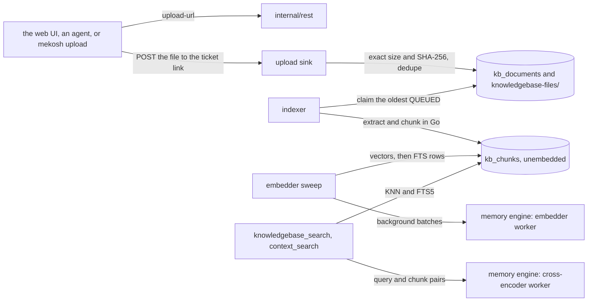

# Meko backend: knowledge files

Knowledge files work on Meko as they do on Meko Cloud, on the MCP and REST API in [api.md](api.md)
and the memory engine in [memory-engine.md](memory-engine.md):

- **Uploads** of PDF, TXT, Markdown, JSON, CSV, XML and HTML up to 50 MiB, through Cloud's
  presigned flow: `upload-url`, then a multipart POST of the file to the link it returns. The web UI,
  agents (`knowledgebase_upload_document`) and `mekosh upload` use it. An agent on the same
  machine can instead pass a path to `knowledgebase_upload_file`, which Meko reads itself.
- **Ingestion** in Go: text extraction and chunking, then embedding in the memory engine, into FTS5 and
  `vec0` indexes. It runs in the background and never holds up other requests. The same bytes
  uploaded twice to a datapack are stored once.
- **Search**: vector and keyword candidates merged, then reranked to 0–1 by a cross-encoder.
  `knowledgebase_search`, `knowledgebase_delete_document` and the three upload tools on MCP, and
  `context_search`'s `knowledge_base` bucket.
- **Promoted memories** are in the knowledge base, as in Cloud: searchable beside file chunks with
  their memory id and source `memory`, and counted.

Where Meko follows Cloud, the behavior is stated here and the code is written from scratch.

## Decisions

| Decision | Why |
|---|---|
| **The presigned flow, plus a local path.** `upload-url` gives a link on Meko itself (`/api/v1/knowledge-uploads/<ticket>`), which takes the multipart POST the way S3 does. There's no `POST .../knowledge-bases/upload`. | It's the only upload flow Cloud has, so clients need one flow for both. AgentK's drop-a-file upload uses it; `TestAgentKUpload` (`internal/rest`) replays its calls against Meko. `knowledgebase_upload_file` is Meko's own: an agent on this machine would otherwise read a file, hash it and base64 it through its own context. It runs the same checks and storing as the link, refuses a call with no token (it reads as the server's user), and stats before it opens, so a FIFO can't hang it. |
| **Files live in `knowledgebase-files/<datapack>/<sha256>`** beside `meko.db` (folders 0700, files 0600); `kb_documents` keeps their metadata, unique per datapack and SHA-256 | Chosen over BLOBs in `meko.db`. A file is written to a temporary name and renamed into place before its row commits, and deleted after its row is; a datapack's folder goes with it; `serve` sweeps files no row names at start. The bytes count toward the 200 MB content target, and a datapack's export carries them. |
| **The upload and download links carry a one-time ticket**: 256 random bits, kept in memory for 5 minutes, good once; an upload ticket is bound to its datapack, key, exact size and SHA-256 | A browser form post, a new download tab and an agent posting to `knowledgebase_upload_document`'s link can't send a Bearer token, as S3's presigned URLs need none. These two routes take no token, as `/healthz` and the web UI's files ([web-ui.md](web-ui.md)) don't; the Host and Origin checks still apply. A restart voids the tickets, as their 5 minutes would. |
| **Ingestion in Go, the document's status as the queue**: an indexer goroutine claims the oldest QUEUED file, extracts and chunks it outside any transaction, and stores its chunks unembedded, 500 per transaction; the embedder sweep that embeds conversation turns embeds them, turns first | Nothing holds the writer for long, and a large file never holds up conversation search. Chunk rowids are `AUTOINCREMENT`, as conversation chunks' are, so a vector embedded for a chunk deleted meanwhile can't land on another. |
| **Two embedding queues in the memory engine**: the sweeps' batches (`/v1/embed` with `background: true`) wait while a search's query is queued | A query waits for at most the one batch being embedded. |
| **Chunks sized to the embedder's window**: 1000 characters overlapping by 100, Markdown and HTML cut at their headings with a `Document:` / `Section:` prefix | all-MiniLM-L6-v2 reads 256 tokens, about 1000 characters, so a longer chunk's tail wouldn't be embedded. Text before the first heading is kept. |
| **Hybrid search on FTS5 and `vec0`**, a cross-encoder (ms-marco-MiniLM-L-6-v2) run locally, and the best 20 candidates by reciprocal-rank fusion reranked | The cross-encoder costs about 11 ms a pair (Measured): 40 candidates would take 440 ms. Without the reranker, results come back in fused order, untrimmed and without `rerank_score`, as Cloud's do. |
| **context_search keeps knowledge-base results within cosine distance 0.6** (`[knowledge_base] max_distance`), **and every keyword or hybrid match the reranker scored** | With MiniLM a paraphrase measured 0.37 to 0.51 from its chunk and unrelated chunks 0.87 to 0.99. The cutoff is for meaning alone: a name or an id matches on its words while its chunk's embedding sits far from a short query (a resume's name measured 0.65), so a match on the query's own words is kept, as Cloud keeps it. Only a reranked one: while the reranker is loading or down, a word match is any chunk sharing one of the query's words. |
| **Promoted memories are chunks too**, with a new UUID, the conversation as `document_id`, and `metadata_filters` `{source: "memory", agent_id, memory_id}`; promotion copies the memory's vector | As Cloud stores them. The memory is searchable at once. |
| **Counts as Cloud's**: `knowledge_chunk_count` is every chunk, promoted memories' too; `knowledge_base_file_count` is 1 when the datapack has a knowledge base, else 0 | Cloud counts knowledge-base sources there, not files. The REST metrics' `kb_*` fields have real file, chunk and byte counts. |
| **Conversation hits aren't reranked** | It would add the reranker's time to every `context_search`. |

## Flow

A file is `QUEUED` when its bytes arrive, `PROCESSING` once the indexer takes it, and `COMPLETED`
in the transaction that stores its last chunk's vector, or `FAILED` with a reason (no text, a file
it can't read, a deadline of 2 minutes plus 1 a 10 MB, its bytes gone, or an error of Meko's own,
which is logged). Meko never sets Cloud's `NOT_STARTED` or `RETRY`. A file stays `PROCESSING` while
the memory engine is down, since only embedding needs it. At start, `serve` puts `PROCESSING` files
back in the queue without their chunks. A `FAILED` file asked an upload link for again is queued
again; if its bytes are gone, the reply is a link to send them to (not `already_uploaded`), and
they're queued once they arrive. `mekosh upload` waits for a file already uploaded as for a new one.

## Storage (`0006_knowledge.sql`)

- `kb_documents`: a file's id (the `document_id` callers see), datapack, key
  (`<user>/<datapack>/<sha256>/<sanitized name>`, Cloud's), filename, MIME type, SHA-256, size,
  status, error, chunk count once chunked, uploader, and times. Unique per datapack and SHA-256.
- `kb_bases`: the datapacks with a knowledge base (a file stored, or `create` called).
- `kb_chunks`: a file's chunk or a promoted memory's (exactly one of `document_rowid` and
  `promoted_rowid`, each cascading), its text, `metadata` (Cloud's `metadata_filters`) and
  `embedded`. `kb_chunks_fts` (contentless FTS5, Porter-stemmed, the datapack a column so its
  filter runs inside MATCH) gets a chunk's terms when its vector lands in `kb_chunks_vec`, so a
  chunk is findable both ways at once.
- `kb_chunks_vec` is a `vec0` table the store makes with the other vector tables, at the memory
  engine's next hello on an older database.
- `promoted_memories.promoted_to_kb_at`: when a promoted memory's chunk became searchable.

## Ingestion (`internal/knowledge`)

| Type | Text | Chunks |
|---|---|---|
| `.txt`, `.text`, `.json`, `.xml` | UTF-8 as it is, BOM and CRs dropped | Recursive: paragraphs, lines, words, characters; 1000 / 100 |
| `.csv` | Its lines | Packed to 1000 characters, 100 overlapping; the header isn't repeated |
| `.md` | Front matter's title, ATX and setext headings outside code fences | A section per heading, prefixed `Document: <title>` and `Section: h1 > h2` |
| `.html`, `.htm` | `golang.org/x/net/html`, without `script`, `style`, `noscript`, `template`, `svg` or `head` (but its title); block elements become line breaks | Sections at `h1`–`h6`, as for Markdown |
| `.pdf` | `ledongthuc/pdf`, each page's text in drawing order, a line break where the next piece is more than half the font size above or below, and spaces decided a line at a time by most of its pieces: from the gaps when most letters have widths; with none and most steps zero (a word's letters drawn at its start), at every step forward and the PDF's own spaces; with none and letters spread out (design tools often leave widths 0), from the PDF's own spaces plus any jump past three times the line's usual step (a column gap). A spread-out line with no spaces drawn gets only its column gaps, since a word break can't be told from a wide letter's step | Recursive 1000 / 100 |

Every type is checked against its first 3 KB before it's stored, as Cloud checks it: a PDF
signature, UTF-8 with no NUL bytes for the rest, and a fitting first character for JSON, XML and
HTML. A file's chunks hold at most 4 times its size in text (or 1 MiB, for a small file whose
section prefixes outweigh its text), and a title or heading in a prefix is cut to 200 characters,
so a hostile file (a PDF that expands, Markdown with a huge heading over many tiny sections) can't
fill the indexer's memory or the database. A parser that panics fails the file.

## Search

1. Embed the query, ahead of the sweeps' batches.
2. Take the nearest `max(20, limit)` chunks by cosine, and as many keyword hits: the query's words
   less stop words, OR'd, Porter-stemmed by FTS5; once the knowledge base holds 1000 chunks, words
   in half or more of them are dropped, as BM25 weighs them at nothing. Each keyword hit gets its
   distance too.
3. Merge: `semantic`, `keyword`, or `hybrid` (found both ways), ordered by reciprocal-rank fusion,
   which adds a hybrid's two ranks' shares, so it usually comes first (with a pool past about 60, a
   hybrid ranked low in both lists can fall below one list's best).
4. The cross-encoder scores the best `max(20, limit)`; `rerank_score` is the sigmoid of its logit.
5. Keep results while each scores at least 0.3 of the one before and of the best, and at least one.

As in Cloud, `limit` widens the pool but doesn't cap the reply. `context_search` then keeps the
results within cosine distance 0.6, and past it any keyword or hybrid match the reranker scored
(an unranked word match is any chunk sharing one of the query's words, so it isn't kept). Each search scan takes one of the store's search slots.

## Memory engine

- **The cross-encoder**: `Xenova/ms-marco-MiniLM-L-6-v2`, the ONNX build of ms-marco-MiniLM-L-6-v2, q8 (23 MB),
  pinned to commit `a09144355adeed5f58c8ed011d209bf8ee5a1fec`, in a worker thread of its own
  (`rerankworker.ts`). It loads after the embedder, retrying with the same backoff, and the memory engine
  is ready without it: `/v1/rerank` answers 503 `RERANKER_NOT_READY` until it's in, and `/healthz`
  and `meko status` say how it is. A worker that dies after loading is replaced by the next rerank
  that finds it (`revive`, at most once every 30 s); meanwhile results are unranked, and Go logs it
  at debug level.
- **Tests** get a word-overlap reranker with the hashing embedder.
- **The embedder's two queues**: `WorkerEmbedder` sends the worker one batch at a time, interactive
  ones first (`Lanes`).
- CI caches both models (the `backend` job's cache key names both commits).

## Interfaces

MCP tools, REST routes and the CLI commands are in [api.md](api.md).

## Measured

On an 8-core Linux x64 machine, with the real models (`make bench`, `TestKnowledgeBudget`):

| What | Result |
|---|---|
| Indexing a 10 MB text file | 15,025 chunks; chunked in 0.9 s; embedded in 5 min 47 s, about 43 chunks a second (a 50 MiB file: about 30 minutes) |
| `knowledgebase_search` with 10 MB of files | p50 433 ms, p95 735 ms |
| `knowledgebase_search` with 50 MB (61,629 chunks) | p50 688 ms, p95 907 ms |
| of which: vector scan (20 nearest) | p50 82 ms |
| of which: keyword search (20) | p50 100 ms, p95 151 ms |
| of which: reranking 20 generated chunks | p50 548 ms, p95 693 ms |
| `context_search` (memory, knowledge base, conversations) at 50 MB | p50 1.19 s, p95 1.70 s |
| the same while a 5 MB file indexes | p50 1.87 s, p95 2.38 s |

The 40 MB beyond the first 10 were loaded straight into the store with random vectors (loading
them through the model would take half an hour and time the same searches). Reranking dominates,
and `context_search` runs it beside memory search's own embedding, both on the same cores (each
ONNX session uses all of them). This misses a 500 ms p95 target; the levers are capping each worker's
ONNX threads and reranking fewer candidates.

The reranker costs about 11 ms per pair of a query and a 1000-character chunk, whatever the
batch size (4, 8, 16 or 40): 10 pairs took about 180 ms, 20 about 260 ms, 40 about 440 ms. It
loads in about 1.4 s. It scores a paraphrase that shares no words with the text
as unrelated: "how do I revert a broken deployment?" got a logit of −11 against a chunk about rolling
back a bad release, which "how do I undo a bad release?" got 0.999 against.

## Tests

In `make test` on Linux and macOS:

- **knowledge**: each type's extraction (PDFs made in the test), chunk sizes and overlap, section
  prefixes, the type check's refusals, the text cap, a canceled extraction, the files folder
  (modes, the size limit, the sweep).
- **store**: dedupe, claim order, requeueing, chunks findable only once embedded, completion with
  the last vector, cascades, the promotion copy, the migration's chunks for earlier promotions,
  stats, the activity feed, dropping common terms.
- **memory engine**: `/v1/rerank`, a query overtaking background batches, the reranker's loader retrying.
- **service**: upload links (single use, refused bytes), indexing with the memory engine down and back,
  vanished bytes, the sweep, deletes taking bytes along, fusion and trimming; with the real models,
  the end-to-end check (below).
- **mcp**, **rest**, **server**, **cli**: every tool's and route's shapes and errors, the ticket
  routes taking no token and a body past 1 MB, `mekosh upload` and `upload_status`, and AgentK's
  upload calls replayed as it makes them (`TestAgentKUpload`).

The end-to-end check, with the real models (`TestKnowledgeSearchWithTheModels`): a file uploaded through
an upload link is found by a paraphrased question through `knowledgebase_search` and
`context_search`, a promoted memory is found the same way, the same file twice is stored once, and
no file text reaches the memory engine's log.
