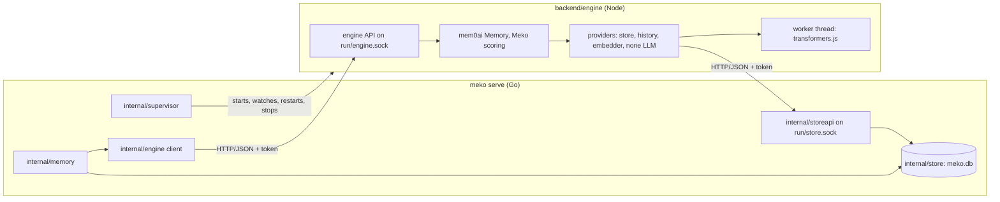

# Meko backend: memory engine and conversations

Status: approved. Built in five stacked PRs; each section below names the PR that adds it, so the
doc matches the code at every step:

| PR | Adds |
|---|---|
| #178 | The store: `0002_memory.sql`, mem0's filters, vector and keyword search, history; this doc |
| #179 | The store API on `run/store.sock`, and `internal/envelope` |
| #180 | The Node engine, `backend/engine` |
| #181 | Running the engine under `serve`; `internal/engine` and `internal/memory` (memories) |
| #182 | Conversations and conversation search: `0003_conversations.sql`, `make bench` |
 Milestone 2 of the backend (issue #168), on the foundation in
[design.md](design.md).

Milestone 2 makes memories and conversations work end to end on the local store, as prod Meko's
do:

- **Memories:** add (verbatim, as prod's `memory_add`), search with vector + BM25 + entity boost,
  prod's 0–1 `score` and the cosine as `raw_similarity_score`, get, list, update and delete.
- **Conversations:** created idempotently per session, turns stored with a dedupe key, and turns
  indexed for conversation search, `context_search`'s conversation bucket.

The engine is mem0's TypeScript library in a Node child process that `serve` supervises. It embeds
with a local model and makes no LLM calls in this milestone. Every database call stays in Go. MCP
and the REST API come in milestone 3, so this milestone ends at a Go service layer
(`internal/memory`) that the tests drive.

Prod Meko's code is private and this repo will be public, so nothing here copies it or cites its
paths: where Meko follows prod, this doc states the behavior and the code is written from
scratch. The engine builds on public upstream mem0 (`mem0ai` on npm, Apache-2.0).

## Left for later milestones

| What | Decided so far |
|---|---|
| LLM extraction of memories from turns, and its LLM | Runs asynchronously from a durable queue in SQLite, which that milestone adds in its own migration. As in prod, only a turn's input is extracted, with earlier turns as context. The engine's `getLastMessages` will read Go's messages table. |
| Links from turns to the memories they produced | A `message_memories` table written in the same transaction that marks a turn extracted (prod infers the link from timestamps). |
| Learnings (keep, promote, counts) | Built in milestone 3: [api.md](api.md). |
| Re-embedding, and embedders other than the local one | Until then the model is locked at first start (below). |

## Key decisions

| Decision | Why |
|---|---|
| **Public `mem0ai` 3.1.2, pinned exactly**, with Meko's providers registered by wrapping the exported factories' `create` methods before `new Memory()` | Meko Cloud's mem0 2.0 branch carries an unmodified upstream 3.1.2 TypeScript port (its Meko Cloud changes are Python-only), so the public package loses nothing. mem0 builds providers by name in fixed switch statements but looks the factories up at call time, so no fork or patch is needed. `engine/test` checks the seam. |
| **Meko Cloud's scoring, in our own code** | Upstream divides every memory by the most any memory in the results could reach; Meko Cloud divides each by what it earned, and returns the cosine as `raw_similarity_score`. The engine asks mem0's search for its score parts (`explain: true`) and rescores. |
| **Keyword scores are true BM25** (FTS5's `bm25()`, negated) | The scale mem0's BM25 sigmoid was tuned for. Prod's Postgres keyword search returns a `ts_rank_cd`-scale number the sigmoid maps close to 0. |
| **Embedder: `Xenova/all-MiniLM-L6-v2` (384 dims, q8, pinned to commit `751bff3` of its Hugging Face repo) on transformers.js, in a worker thread; locked at first start** | 23 MB, offline once downloaded, and the runtime milestone 4's cross-encoder needs. mem0-ts has no local transformers.js embedder, so the engine adds one. Changing the model needs re-embedding, which is deferred, so an engine reporting another model is refused. |
| **No LLM:** mem0 always builds one, so the engine registers a `none` provider that throws; `/v1/add` takes verbatim adds only | Extraction is deferred. |
| **Verbatim adds link no entities** | As in prod and upstream mem0: entities are linked for extracted memories (and on a text update). Search still queries the entity store and scores the boost. |
| **Conversation and message ids are prod's**: a 32-hex `session_id` is the id, any other is the first 32 hex of its SHA-256, none is random; a message id is the first 32 hex of the seed's SHA-256 | AgentK passes stable session ids and already derives the same fallback; prod's ids keep the Cloud move lossless. Ids are unique per datapack, and the first agent owns the conversation: another agent creating one with the same session id is refused (`ErrAgentMismatch`) rather than handed a conversation it can't add to. |
| **Conversation search keeps prod's shape with a MiniLM cutoff**: 1024-character windows overlapping by 256, the 10 nearest outside the caller's conversation, hits within cosine distance 0.6, and a thread of the top 3 conversations' most recent searchable turns (50 in all, oldest first) | Prod's 0.35 suits its embedding models. With MiniLM a paraphrase measured 0.52 from its turn and unrelated turns 0.98 and more. `[conversation_search] max_distance` changes it. No reranker until milestone 4 (`rerank_score` is null). |
| **The engine is plain `tsc` output with its `node_modules`**, `legacy-peer-deps`, and a stub package for better-sqlite3 | mem0ai lists every store it supports as a peer, and npm installs non-optional peers, native better-sqlite3 among them. Only better-sqlite3 is imported statically and missing, so a stub (`engine/stubs/better-sqlite3`) replaces it; no bundler is needed. |
| **Meko finds its own Node**: `[engine] node` (or `MEKO_NODE`), then `<bin>/../node/bin/node`, then `node` on PATH, 22.13 or newer | An explicit setting replaces the search. Nothing checks whose Node it finds: AgentK's own is avoided by packaging (meko isn't installed in AgentK's app folder). Release packaging of Node is milestone 5. |
| **`stop` reaches the children**: the supervisor records each child's pid and process group in `run/children/`, and `stop` (after killing a hung serve) and a new `serve` kill recorded groups whose leader still has that pgid and the recorded start time (boot id and start ticks on Linux, the kernel's start time on macOS); `stop` does it holding the data folder's lock | A pid reused since (after a crash or a reboot) is never hit, and a server starting at the same moment keeps its new engine. The engine also exits on its own when its parent changes or `store.sock` goes away. |

## Layout (#179–#181)



- Both sockets are 0600 in the 0700 `run/` folder and need the per-start internal token (a Bearer
  token, separate from the admin token, passed to the engine in its environment). Neither is on
  the TCP port. A data folder whose socket paths would pass 103 bytes (macOS's limit) is refused.
- Go never holds a write transaction while it waits on the engine, which calls back into the
  store API and needs the single writer.
- `/api/v1/status` reports the engine: `state` (starting, loading, ready, error, restarting,
  failed, unavailable), `reason`, and the embedder. When the engine doesn't answer, the
  supervisor's state of its child says whether it's starting, restarting after a crash, or failed.
  `meko status` prints it.
- Get, update and delete reach only the local user's memories, as search and list do.

### Data folder additions

```
run/store.sock, run/engine.sock   the two APIs
run/children/engine               "<pid> <pgid>" while the engine runs
logs/engine.log                   the engine's JSON lines: ids, counts, timings, never text
models/                           the embedding model, downloaded on first start
engine/                           mem0's own config folder (MEM0_DIR)
```

## Storage

The migrations this engine's data lives in: `0002_memory.sql` (memories, entities, history; #178),
`0003_conversations.sql` (#182), and milestone 3's `0005_learnings_artifacts.sql` (learnings,
promoted memories, provenance and artifacts; [api.md](api.md)).

- `memories`: id (mem0's UUID), datapack, `user_id` (the install's local user, as an account id
  is in prod), `agent_id`, `conversation_id`, `role`, `actor_id`, `text`, `text_lemmatized`,
  `hash`, `source` (`add`), times, and the rest of mem0's payload as JSON. Absent ids are `''`
  (vec0 metadata columns take no NULL). Since milestone 3, `promotion_action` (`''` for a learning,
  `keep_as_memory` once kept) and `connector_id` (provenance, `''` for none).
- `promoted_memories` (milestone 3): memories promoted out of `memories`, with every column but the
  lemmas, the promotion time and the agent that promoted them. Text only until milestone 4.
- `memories_fts`: contentless FTS5 (`contentless_delete=1`) over the lemmas (the text when mem0
  gave none), with the datapack as a column so the filter runs inside MATCH:
  `datapack_id:"<id>" AND text_lemmatized:("a" OR "b")`, every term quoted, at most 64 terms. The
  datapack column's bm25 weight is 0. `memories_fts_vocab` (fts5vocab, per column) counts each
  term's rows in the text column, so terms in half or more of all rows, which `bm25()` weighs at
  1e-6, are dropped from the query (see Measured).
- `entities`: mem0's `<datapack>_entities` store (text, type, linked memory ids).
- `memory_history`: mem0's change log, per datapack (prod dropped it; it costs little).
- (#182) `conversations` (datapack NULL for none; unique per datapack and id), `messages` (unique per
  conversation and id, so a repeated seed is the same turn), `message_chunks` (a turn's windows,
  `embedded` 0 until searchable), and `datapacks.conversation_search_opt_out`.
- Vector tables `memories_vec`, `entities_vec` and (#182) `message_chunks_vec`:
  `vec0(datapack_id TEXT partition key, <metadata columns>, embedding float[D] distance_metric=cosine)`,
  keyed by the owner's rowid. They're made at the engine's first hello, when D is known (and the
  model recorded in `settings`), with a delete trigger on each owner table, since vec0 takes no
  foreign keys: every delete, a datapack's cascade included, takes its vectors along.

### What the store API does with mem0's calls (#179)

| Route on `store.sock` | mem0 call | Notes |
|---|---|---|
| `POST /v1/collections/:c/insert` | `insert` | `:c` is `<datapack>` or `<datapack>_entities`. Payload keys map to columns (`data`, `textLemmatized`, `hash`, ids, `meko_conversation_id`, `role`, `actor_id`, times); a caller's `metadata.created_at` wins over mem0's own (prod's backdating). An id in another datapack is refused. |
| `POST .../search` | `search` | KNN in the datapack's partition. Equality on user, agent or conversation runs inside the scan; other filters run on 10× candidates. Scores are cosine similarity (1 − distance). |
| `POST .../keyword-search` | `keywordSearch` | Memories only; scores are `-bm25()`. |
| `GET`, `PUT`, `DELETE .../vectors/:id`, `POST .../list` | `get`, `update`, `delete`, `list` | Scoped to the datapack; `get` of a missing id is `null`. |
| `DELETE /v1/collections/:c` | `deleteCol` | Refused. |
| `POST /v1/history/:datapack`, `GET /v1/history/:datapack/:memory` | history | `reset` is refused in the engine. |
| `POST /v1/engine/hello` | engine start | Records the model and makes the vector tables, accepts the same model, refuses another (`MODEL_CHANGED`). |

Filters follow mem0's grammar: equality, `*`, lists as `in`, `eq ne gt gte lt lte in nin contains
icontains`, and `AND`/`OR`/`NOT` (or `$and`/`$or`/`$not`), compiled to SQL over the columns or
`json_extract` on the payload, every value bound.

## The engine (`backend/engine`, #180)

TypeScript on Node 22, built with `tsc` to `dist/`. `make engine` runs `npm ci` and the build.

| File | What |
|---|---|
| `src/main.ts` | Sets `MEM0_TELEMETRY=false` and `MEM0_DIR` before mem0 loads, then runs `app.ts`. |
| `src/app.ts` | The embedder, the providers, the API, then the hello; exits when the Go server goes. It retries a failed model load or hello with backoff (1 s up to 60 s, staying `loading` and saying why); only another model already in the store (`MODEL_CHANGED`) leaves it in `error`. It sets umask 077, so the model cache and mem0's config are the user's only. |
| `src/providers.ts` | `MekoStore`, `MekoHistory`, `NoLLM` and `register()`, which wraps mem0's factories. |
| `src/embedder.ts`, `src/embedworker.ts` | The worker-thread embedder (mean-pooled, normalized, batches of 32), and a hashing embedder for tests (set only by the CLI's tests, never by an environment variable of the shipped binary). |
| `src/engine.ts` | One mem0 `Memory` per datapack, the 256 most recently used kept (a dropped one is rebuilt on its next call); verbatim add (role, actor, conversation), search (mem0's candidate pool rescored, prod's reply shape), update, delete, embed. |
| `src/scoring.ts` | Meko's score: `min((semantic + bm25 + boost) / (1 + [bm25 > 0] + 0.5·[boost > 0]), 1)`. |
| `src/server.ts` | The API on `engine.sock`: `GET /healthz`, `POST /v1/add`, `/v1/search`, `/v1/update`, `/v1/delete`, `/v1/embed`. It logs routes, statuses and timings only, never an error's message. |

Search asks mem0 for `max(limit × 16, 240)` results with their score parts. mem0 asks the store
for 4× that many candidates and keeps its own top results, so the store provider returns only a
quarter of what mem0 asks for on a datapack's collection: mem0's candidates are then exactly the
results it returns, and Meko's score, not upstream's ranking, picks the top `limit` from all of
them (240 nearest memories and 240 keyword hits for the default limit of 10).

## Conversations (`internal/memory`, #182)

- `CreateConversation`, `AddMessage`, `GetConversation`, `ListConversations`,
  `UpdateConversation`, `DeleteConversation`, `SetConversationSearchOptOut`,
  `SearchConversations`: what milestone 3's conversation tools and `context_search` call.
- A turn is searchable when its input or output has 40 characters or more, its conversation has
  a datapack, the datapack hasn't opted out, and the caller didn't ask to skip it; the reply's
  `conversation_search_skipped` names which of the last three kept a substantive turn out (a short
  turn is left out silently, as in prod). Adding a turn never waits on the engine: its chunks are
  stored unembedded, and `RunEmbedder` (started by `serve`) embeds them right away, and every 30 s
  catches any the engine missed while down (logged at debug while the engine is down or loading,
  as a warning for any other failure).
- Opting out also keeps turns that were still waiting for their vectors out of search: the store
  drops a chunk whose datapack opted out when its vector arrives. A chunk's rowid is never reused
  (`AUTOINCREMENT`), so a vector computed for a chunk deleted meanwhile can't land on a newer one.
- A missing conversation is `ErrNoConversation` ("no such conversation").
- Deleting a conversation keeps the memories that name it, as in prod.

## Measured

On an 8-core Linux x64 dev server, with MiniLM q8 on transformers.js:

- The model loads in about 1.1 s and embeds a short query in about 6.5 ms.
- Fused scores depend on how much BM25 has to weigh terms against. In a datapack of 3 memories a
  keyword hit lowered scores (raw BM25 around 2 sits below the sigmoid's midpoint, and the hit
  adds 1 to the divisor): a paraphrase with cosine 0.61 scored 0.33. With 200 more memories, rare
  terms carry real weight: the same paraphrase scored 0.78 and an exact identifier
  (`MIN_MEMORY_SCORE`, cosine 0.81) 0.90, above AgentK's 0.75 recall cut.
- At 200 MB of content in one datapack (`make bench`: 50 MB of memories, about 210k, and 150 MB of
  turns, about 225k chunks, with random vectors and Zipf-distributed words; searches through the
  real engine and model):

  | Search | p50 | p95 |
  |---|---|---|
  | Memory search (limit 10) | 771 ms | 1,072 ms |
  | of which: vector scan (240 candidates) | 419 ms | 464 ms |
  | of which: keyword search | 337 ms | 496 ms |
  | of which: embedding the query | 7 ms | 15 ms |
  | Conversation search (hits in 3 conversations, a full 50-turn thread) | 230 ms | 256 ms |

  These were measured on a shared host (load average about 4 on its 8 cores). An earlier run on
  the quiet host measured the same store parts at 390 ms and 226 ms p50, and memory search at
  664 ms p50 and 772 ms p95. Each conversation search's query has chunks planted near it, so the
  thread is assembled every time.

  This misses the 300 ms first proposed for memory search. sqlite-vec 0.1.9 scans every vector of
  the partition, at about 1.1 ms per 1,000 (int8 and bit quantization measured no faster), so at
  this size the scan alone is most of it; a datapack of 20k memories scans in about 25 ms. Below
  this would take an ANN index (sqlite.org's vec1, for one) or smaller partitions. Keyword search
  drops query terms in half or more of all rows: FTS5's `bm25()` weighs them at 1e-6, and
  matching them made every row a candidate (366 ms before, 138 ms after, measured over 200k
  memories in the store alone).

## Test plan

In `make test` on Linux and macOS (CI caches the model):

- **store** (#178): migrations, the payload mapping and backdating, the filter grammar, KNN with
  and without pushed-down filters, keyword search (positive scores, quoting, datapack isolation,
  dropped common terms), the model lock, every delete path taking vectors along. With #182:
  conversations and turns (idempotence, seed dedupe, null datapacks), chunk search excluding a
  conversation, the opt-out (a waiting chunk dropped when its vector arrives), chunk rowids never
  reused, reading a conversation's newest turns.
- **storeapi** (#179): the token, each route's shapes and refusals, the hello.
- **engine** (#180; `tsx --test`, with a fake store): the factory override, Meko scoring, prod's reply
  shape, verbatim adds with role and actor and no entities, refusing extraction, update, delete;
  search rescoring all of mem0's candidates; the start-up retrying a failed load or hello and
  stopping at another model; the API refusing a body that isn't a JSON object, a malformed message
  and a non-numeric limit, and answering an oversized body with its 413.
- **end to end** (#181, and #182 for conversations; the real engine): add, get, list, search, update, delete; the engine down and
  back; an engine with another model refused; with MiniLM, a paraphrase found with a 0–1 score and
  its cosine, an identifier above 0.75, and conversation search's cutoff; turns waiting for the
  engine; no memory text in `engine.log`; `serve` starting the engine and `stop` stopping it, and
  `stop` killing a hung serve's recorded children, and `stop` and the next `serve` killing those
  of a serve killed from outside; a recorded pid now held by another group leader left alone; get,
  update and delete refusing another user's memory; a crashed engine's status. For conversations:
  another agent's session refused, each `conversation_search_skipped` reason, and the thread (three
  conversations, 50 turns, the newest of a conversation past 1000 turns, oldest first, the cutoff
  from the options).
