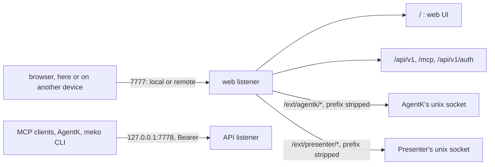

# Meko backend: the web listener

Browsers reach Meko, and its extensions, on one port: the **web listener** (`[web] port`, 7777).
It serves the web UI ([web-ui.md](web-ui.md)) at `/`, the data routes and `/mcp` the UI calls, the
sign-in routes, and each extension's own web UI at `/ext/<name>/`: AgentK's at `/ext/agentk/`, Presenter's at `/ext/presenter/`. Agents
and the CLI keep the **API listener** (`[server] port`, `127.0.0.1:7778`) with their Bearer tokens
([design.md](design.md#http-server), [api.md](api.md#auth)).



## Decisions

| Decision | Why |
|---|---|
| **Two listeners: the web listener for browsers, the API listener for agents and the CLI** | Remote access is HTTPS with a self-signed certificate, which MCP clients can't use, and every MCP URL clients have saved stays as it is. The web listener never takes a Bearer token and has no admin-only routes (`status`, `version`, `auth/setup-link` answer 404 there), so nothing a browser holds opens them. |
| **`[web] access`: `local`** (the default) **or `remote`** | Local listens on 127.0.0.1 over plain HTTP and needs no login from this computer (below). Remote listens on every address over HTTPS and needs the owner's login, even from this computer, so a tunnel or a proxy on the host can't skip it. An unknown value is refused at start. On a shared host, remote is the setting: local access trusts everything that reaches 127.0.0.1. |
| **Local access: no login, by the loopback rule AgentK had** (`LocalAccess` in `internal/server/local.go`): a loopback peer; Host `localhost`, `127.0.0.1` or `[::1]`; no `Forwarded`, `X-Forwarded-For`, `X-Forwarded-Host` or `X-Real-IP`; `Sec-Fetch-Site` `same-origin` or `none`; an Origin, when sent, that's this one | The owner chose it for this computer. The Host check keeps a DNS-rebound page out, the proxy headers keep out what a proxy forwarded, and the site checks do a SameSite cookie's job: an `` on another site gets a 401, not an answer it could time. Requests that fail it can still sign in with the login. |
| **Remote access: the owner's login, as AgentK had it** (`internal/login`): a username and a password (12 characters or more) hashed with scrypt in AgentK's format (`scrypt$N$r$p$salt$hash`), optional TOTP (RFC 6238, SHA-1, 30 s, one step of drift, a code used once), the `meko_session` cookie (32 random bytes; only its SHA-256 is stored; HttpOnly, SameSite=Strict, Secure; 14 days, slid forward at most hourly), and a limit of 5 failed attempts per client network (an IPv6 /64) and 50 in all in 15 minutes, with at most 2 password checks at once. Changing the password counts a wrong current one the same way | The page holds the owner's memories, knowledge and, through AgentK, shells on the host. Keeping AgentK's format lets Meko take over an AgentK login as it is, so nobody signs up again. The limit counts the connection's own address, never a header. An attempt counts as failed before its password is checked and only a right one takes that back, so requests sent together get no more guesses than ones sent one after another; and since each check takes 32 MiB of scrypt, a sign-in past the 2 at once is told to try again (`RATE_LIMITED`) rather than queued. |
| **`meko setup_link` makes and resets the login**: a one-time link, `<web URL>/setup?token=...`, good for 7 days. Using it sets the username and password, turns TOTP off and signs every browser out. A valid link gets past the rate limit | The login guards the host, so it's made and reset from the host's terminal, by someone who can already run commands there; there's no email reset. The token is 192 random bits, kept as its SHA-256. |
| **A sign-out, a password change or a new login closes the WebSockets its sessions opened** through an extension, and so does a session running out (checked every minute) | AgentK's terminals are WebSockets: a session that ends must not leave one open, and a terminal left open makes no request that would renew its cookie. The proxy keeps each upgraded connection by the session that opened it (`extproxy.Proxy.Revoke`). |
| **Remote access has no Host list**; Origin must be `https://<Host>` | As AgentK had it: a DNS-rebound page can't pass TLS for another name, and the cookie is host-only. People reach the host by its FQDN, short name or address alike. |
| **The certificate is `[tls] cert` and `key`, or a self-signed pair in `certs/`** (`internal/tlscert`), made at the listener's start and again within 30 days of expiring: 825 days, ECDSA P-256, naming the FQDN, the host name, localhost, 127.0.0.1, ::1 and the interface addresses. `meko status --verbose` shows its SHA-256 | Browsers cap a certificate at 825 days. Trusting the fingerprint once on a phone is the price of not needing a CA. |
| **Extensions are served at `/ext/<name>/`** (`internal/extproxy`), with the prefix stripped, to the unix socket the extension names, for each registered extension whose catalog entry has `WebUI` | One port and one sign-in for everything Meko runs. The extension trusts its socket (only this user can connect to it) and runs no login of its own. The proxy passes the browser's Host and Origin as they are, so the extension's own same-origin checks hold; it drops the Cookie (Meko's session) and adds no `X-Forwarded-*`. A page request with no session goes to `/signin?next=<path>`; `/ext/<name>` without the slash redirects to it with one, so relative URLs resolve. When the extension isn't answering, the reply is a 502 that says to start it. |
| **Meko tells a running extension when something it reads from Meko changed**: a POST of `{"what": "<thing>"}` to `/_meko/changed` on its socket, with no Origin, 5 s at most (`extproxy.Proxy.Notify`), to each extension with a web UI that answers. Today the one thing is `cloud`, the Meko Cloud link ([cloud.md](cloud.md)) | An extension reads such settings from `meko token --json`; this tells it to read again at once rather than poll. It's best effort: a failure is logged, and an extension that doesn't know the path answers 404, which is fine. |
| **`/api/v1/extensions`** lists every extension Meko knows: its name, title and description, whether it's installed (registered), its path while it's served, whether it accepts a connection on its socket (`extproxy.Answers`), the release Meko installed and whether Meko can update it (`version`, `updatable`: a `Managed` extension's release install, read from its `VERSION`, no network; `not_updatable` says why not for an installed one: a build from source, or an AgentK still in its old home), what the last check found (`latest`, `latest_url`, `update_available`, `checked_at`, `check_error`, from `update.json`), the update on probation (`pending`), the versions rolled back (`rolled_back`), **Update automatically** (`auto_update`), why an automatic update waits (`waiting`), and its last action (`auto` when Meko started it on its own) | The web UI's sidebar links to the running ones, and its Extensions page shows the rest. A socket file an extension left when it died refuses the connection, so it doesn't count as running. |
| **The Extensions page installs, updates, starts and stops extensions** (`POST /api/v1/extensions/<name>/install\|update\|start\|stop`), as `meko install_extension`, `meko update_extension` and the extension's own `start` and `stop` do, run by `serve` (`webListener.RunExtension`) as a background job, one per extension at a time, kept in memory with its last 16 KiB of output. The jobs belong to `serve`, not to one web server, so they outlive a restart of the web listener. An install from here never asks questions (`--non-interactive`, no stdin) and has 15 minutes. An install or a start of an extension with a web UI, or an update that leaves it running, ends only once the extension answers on its socket, or fails after 30 s (`extensions.ListenTimeout`). An update has 15 minutes too. The output and error have the client token blanked; the log gets only the extension, action and outcome | Installing takes minutes, longer than a request should be held open, so the page polls the list. Only known extensions, from the configured release repo, and only for local access or the owner's session, with the Origin check: no more than a signed-in owner can already do through AgentK's terminals. The installer is given the client token on its command line, but nothing promises it never echoes it, and the output is a reply to a browser. AgentK's `start` returns once its service is up, before its server listens, so the page would otherwise see it not running and stop looking. |
| **The Status page checks for and installs Meko's own updates** (`GET /api/v1/update`, `POST /api/v1/update/check` and `/update/apply`), through `serve`'s own `update.Updater`: the same check and install as the scheduled ones and `meko update`. The update lock (`update.Lock`: a mutex in `serve` and a `flock` on `run/update.lock`) keeps the page's, the scheduled ones, the extensions' and `meko update`'s apart, so they never stage at once: a scheduled check skips its turn while another holds it, the page's check and install answer 409 while `meko update` runs, and `meko update` refuses while `serve`'s runs. An install is a background job (checking, installing, restarting) and answers 202; once the new version is current, `serve` stops as for an automatic update: under the service it exits 0 for the service manager to start `app/current`, and started by hand it execs `app/current/bin/meko` with its own arguments, as a rollback does, unless a stop (`meko stop`, `restart` or `destroy`) arrived while it was stopping. It's refused (409) on a build from source, on a release install whose updater couldn't be set up (the card says why), while an update is on probation, while a check or an install runs, and while an Extensions-page action runs. `[update] channel = "off"` and `auto = false` stop only the scheduled ones | A helper `meko update` can't do it from inside the service: restarting the unit kills everything in it (`KillMode=mixed`), the helper too. Refusing while an extension's action runs keeps the restart, which waits for it, from hanging for the minutes an install takes. Only local access or the owner's session reaches these routes, never the API listener's client token: installing software is the owner's call, and the CLI has `meko update`. |
| **Check now and Update automatically** (`POST /api/v1/extensions/<name>/check`, `PATCH /api/v1/extensions/<name>` with `{"auto_update": bool}`). Check now runs the updater's check in the request (60 s), one release list for Meko and every extension, and answers with the row, or `409 UPDATE_BUSY` with the row while an update holds the update lock. The switch is saved in `extensions.json`. An update from the page holds the update lock too, so it waits for no other and fails at once while one runs. AgentK's own page calls these routes and the update one from the browser: it's served on this origin, behind the same sign-in | One check, one GitHub call, for everything Meko updates. AgentK's page keeps its banner and its Update button, and the job runs in Meko, so it survives AgentK's restart. |
| **The installer runs inside `serve`**, so in Meko's service unit: stopping or restarting Meko stops it, with everything it started (it has a process group of its own, which is killed), and the job fails, "stopped". **A self-update waits for running jobs** before it restarts Meko. Start and stop run to their own 2-minute limits. A command's output pipe is closed 5 s after it exits (`extensions.PipeWait`) | An install cut off part-way is repaired by Install again, which re-runs AgentK's own `install`. An update arrives on its own, so it shouldn't cut one off; a stop or restart someone asked for shouldn't wait 15 minutes. AgentK's server itself runs in AgentK's own services, so it doesn't stop with Meko. A process a command left running would otherwise hold the pipe open and keep the job running forever. |
| **Knowledge-file links follow the listener they're asked on** | Upload and download links are built for `http://127.0.0.1:7778`; asked on the web listener, they're given its own scheme and Host, which the browser can reach. |

## Settings

| Key | Env | Default | What |
|---|---|---|---|
| `[web] port` | `MEKO_WEB_PORT` | 7777 | The web listener's port. It can't be `[server] port`. |
| `[web] access` | `MEKO_WEB_ACCESS` | `"local"` | `"local"` or `"remote"`. |
| `[web] name` | | this host's FQDN | The host name links use with remote access. |
| `[tls] cert`, `key` | | a self-signed pair | PEM files, both or neither. |

Meko never writes `config.toml`. The web settings it chooses itself go in **`web.toml`** beside it
(`config.WebFile`), which a `[web]` or `[tls]` key in `config.toml` overrides key by key. They're a
file of their own because a release from before the web listener refuses `config.toml` keys it
doesn't know, so a rollback after an update that failed its probation, or a downgrade, would leave
a Meko that can't start; older releases never read `web.toml`. Meko writes it once, when neither
file has a `[web]` table (`config.AddWeb`):

- **`meko install`** writes it with `--access`, or by AgentK's old rule (remote over SSH or on Linux
  with no display, else local), unless AgentK is on this computer: its handoff decides then.
- **The handoff** writes it from what AgentK had (below).

## The handoff from AgentK

An AgentK install that served browsers itself (on its own port, with its own login and certificate)
hands them to Meko. At every start `serve` asks each registered extension with a web UI
`<command> _handoff --json` (15 s; `internal/extensions` `Handoff`):

```json
{"socket": ".../web.sock",
 "legacy": {"bind": "0.0.0.0", "port": 7777,
            "tls": {"cert": "...", "key": "...", "self_signed": true},
            "owner": {"username": "...", "pw_scrypt": "scrypt$...", "totp_secret": "..."}}}
```

- **`socket`** is where the proxy sends `/ext/<name>/`, kept in `settings` too, for a start whose
  handoff fails. When it's gone or refuses connections (the extension stopped, or its home moved
  and its socket with it), Meko forgets it and asks again on the next request that needs it.
- **`legacy`** is there only for an AgentK that served browsers itself. Meko takes it over once
  (recorded as `extension_took_over.<name>` in `settings`): the extension keeps reporting it, and a
  `web.toml` the owner removed, or a password changed since, mustn't come back. Even then it fills
  in only what Meko doesn't have:
  - `web.toml` with its port, and its access (loopback is local, anything else remote);
  - its self-signed pair, copied into `certs/` (or its own `[tls]` files, named in `[tls]`), so
    phones that trusted its fingerprint still do;
  - its owner, so the same password and authenticator sign in.
- **It runs before the web port is taken.** An AgentK too old to answer still holds 7777, so the
  listener waits: it tries the port and the handoff again every 30 s, logging each failure once,
  and `status` says why it isn't listening (`meko ui` waits for a listener that's starting, and
  stops with the reason rather than open whatever holds the port). When a later handoff changes `[web]` or `[tls]`, the listener starts
  again with them.
- **An extension registered while Meko runs** (`meko install_extension`) is asked on the first
  request that needs its socket, and again at most every 10 s.

Secrets in the reply never reach a log.
