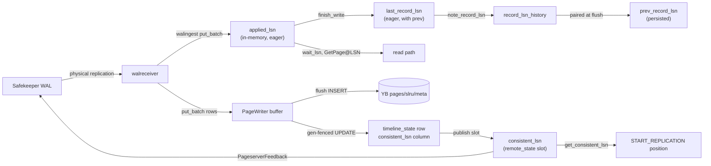

# Pageserver LSNs

Authoritative inventory of every LSN the pageserver tracks: name, where it
lives, what advances it, what reads it, and the invariants between them.
Grounded in the Rust sources (`compute/pageserver/`, `compute/libs/utils`)
and the controller schema
(`controller/migrations/0002_compute_storage.up.sql`).

**System framing.** Durability and resilience come from YugabyteDB, the
underlying store. The pageserver holds page data in an in-RAM buffer until a
flush lands it in the YB tables `pageserver.pages` / `pageserver.slru_pages` /
`pageserver.meta`; the per-branch `pageserver.timeline_state` row records how
far that durable state extends. Local process memory is never a durability
claim.

## The two key watermarks

The `Timeline` keeps ingest progress and durability as two distinct values.
They answer different questions and must never be substituted for each other:

| Watermark | Advances when | Answers |
|---|---|---|
| **`applied_lsn`** (eager, in-memory) | walreceiver puts a record batch into the `PageWriter` buffer (`put_batch` → `applied_lsn.fetch_max`) | "Can a read at LSN X be served from buffer+YB right now?" Read-path waits (`wait_lsn`, GetPage@LSN, `compute_image_consistent_lsn`) use this so reads never stall behind YB INSERT latency. |
| **`consistent_lsn`** (durable, gap-free) | a gen-fenced `PageStore::advance_consistent_lsn` UPDATE of `timeline_state.consistent_lsn` succeeds inside `PageWriter::flush` | "What survives a crash?" Everything that leaves the process — safekeeper feedback (`disk_consistent_lsn` and `remote_consistent_lsn` wire fields), the walreceiver `START_REPLICATION` resume position, the HTTP API `disk_consistent_lsn` field — reads this. |

`applied_lsn ≥ consistent_lsn` at all times; the gap is exactly the contents
of the in-RAM `PageWriter` buffer. Advertising `applied_lsn` to the
safekeeper would let it delete WAL whose page rows are still only buffered —
a crash then loses those records permanently, because the WAL is gone from
`safekeeper.wals` and the pages never reached YB. That is why every
externally visible durability value routes through
`Timeline::get_consistent_lsn()`.

## Flow overview



---

## Timeline-global LSNs

### `applied_lsn` — eager, in-memory

**Where:** `Timeline.applied_lsn: AtomicLsn`
(`compute/pageserver/src/page_server/timeline.rs`).

**Meaning:** End of the last WAL record the walreceiver has put into the
`PageWriter` buffer — the in-RAM ingest frontier. NOT a durability claim;
the buffered rows may not yet be in YB.

**Advances:** `TimelineWriter::put_batch` calls
`self.tl.applied_lsn.fetch_max(batch_max_lsn)` immediately after the buffer
write, so read-path waits don't block behind the YB INSERT round-trip.

**Read by:**
- `Timeline::get_applied_lsn()` — `compute_image_consistent_lsn` (basebackup
  LSN), `wait_lsn` timeout diagnostics.
- The paired `last_record_lsn.last` advance carries the same value into the
  `SeqWait` that `wait_lsn` subscribers block on.

**On restart:** Seeded from the persisted `timeline_state.consistent_lsn`.
Both watermarks start equal; `applied_lsn` then runs ahead as the
walreceiver ingests.

**Never use for:** anything that leaves the process. SK feedback,
`START_REPLICATION` position, HTTP durability field, restart state — all
must read `consistent_lsn`.

---

### `last_record_lsn` — eager, in-memory (with `prev` pairing)

**Where:** `Timeline.last_record_lsn: SeqWait<RecordLsn, Lsn>`
(`compute/pageserver/src/page_server/timeline.rs`).

**Meaning:** End of the last fully ingested WAL record (`RecordLsn.last`).
`RecordLsn.prev` is the end of the record before that. Same eagerness class
as `applied_lsn` — both advance per record as walingest commits.

**Advances:** `Timeline::finish_write(new_lsn)` after each
`DatadirModification::commit()`. Before advancing, it snapshots the current
`last` as the new record's `prev` and hands the pair to
`PageWriter::note_record_lsn`. Never written to YB directly.

**Read by:**
- `wait_lsn()` — getpage blocks until this reaches the requested LSN.
- GC horizon planning: `last_record_lsn - gc_horizon` → `GcCutoffs.space`.
- Metrics (`last_record_lsn_gauge`) and HTTP status.

**On restart:** Seeded from the persisted `consistent_lsn`, with `prev` from
the persisted `prev_record_lsn` column (or `Lsn(0)`):

```rust
last_record_lsn: SeqWait::new(RecordLsn {
    last: disk_consistent_lsn,
    prev: metadata.prev_record_lsn().unwrap_or(Lsn(0)),
}),
```

**Why it can exceed durable state:** ingest finishes before flush. That is
safe because nothing derives a durability claim from it; the walreceiver
resume position reads `consistent_lsn` instead, so any post-crash gap is
re-streamed and re-ingested idempotently.

---

### `prev_record_lsn` — in memory + persisted

**Where:**
- In memory: `RecordLsn.prev` inside `last_record_lsn`, and the
  `PageWriter.record_lsn_history` map (`BTreeMap<Lsn, Lsn>` of
  `last → prev`).
- Persisted: `pageserver.timeline_state.prev_record_lsn` (nullable column).

**Advances:** Each `finish_write` inserts the `(last → prev)` pair via
`note_record_lsn`. At flush time, `take_prev_at_or_below(flushed_lsn)` pulls
the pairing for the highest noted record at or below the flushed LSN and
passes it to `advance_consistent_lsn`; the SQL uses
`COALESCE($4, prev_record_lsn)` so a missed pairing keeps the existing
column value instead of nulling it.

**Read by:** restart — hands the walreceiver a correct `xl_prev` for the
first record it streams after resume.

**Semantics:** best-effort. A flush can land between `finish_write` calls;
the persisted `prev` may be NULL, in which case the WAL decoder re-derives
continuity from the stream.

---

### `consistent_lsn` — durable, gap-free

**Where:**
- Source of truth: `pageserver.timeline_state.consistent_lsn` (YB column,
  NOT NULL).
- In-memory slot: `Timeline.remote_state.consistent_lsn: Arc<AtomicLsn>`
  (`compute/pageserver/src/page_server/timeline/remote_state.rs`).
  `PageWriter` holds a clone (installed via `set_consistent_lsn_slot`) so
  the flush success path can bump it without touching `Timeline`.
- Accessor: `Timeline::get_consistent_lsn()`.
  `get_remote_consistent_lsn_projected` / `_visible` read the same slot
  (they are one `AtomicLsn`; there is no separate upload pipeline to
  distinguish them).

**Meaning:** Every record with LSN ≤ this is **durably in YB** — its rows
are in `pageserver.pages` / `slru_pages` / `meta` AND the `timeline_state`
row claims it. "Durable" here means committed to YugabyteDB; the pageserver
keeps no durable local state.

**Advances — only inside `PageWriter::flush`'s success branch**
(`compute/pageserver/src/page_writer.rs`):
1. Before snapshotting, flush captures the **ingest frontier**: the highest
   record in `record_lsn_history` (i.e. the last record `finish_write`
   noted). Every row of a noted record is already in the buffers, so the
   snapshot is guaranteed to contain every unflushed row at LSN ≤ frontier.
   Rows from records still mid-put can be captured only partially, which is
   why the frontier — not `max(snapshot LSNs)` — is the only value a
   durability watermark may be derived from. Deriving it from the snapshot
   max loses rows: the snapshot can hold a row at LSN X while missing a
   concurrently-put row below X.
2. `try_write_rows` INSERTs the snapshot into YB.
3. On success, `consistent_lsn_observed.fetch_max(frontier)` records that
   everything ≤ frontier is durable in the page tables.
4. If the frontier moved past `consistent_lsn_watermark` AND at least
   `policy.max_age` (default 5 s) elapsed since the last UPDATE, the
   gen-fenced `PageStore::advance_consistent_lsn` UPDATE writes
   `timeline_state.consistent_lsn` (and `prev_record_lsn`). On `Updated`,
   `consistent_lsn_watermark` stores the frontier and
   `publish_consistent_lsn` bumps the in-memory slot.

The two `PageWriter` bookkeeping atomics split the durable state in half:
- `consistent_lsn_observed` — max LSN durable in the page tables this
  process lifetime (advances on every successful `try_write_rows`).
- `consistent_lsn_watermark` — max LSN the `timeline_state` column claims
  (advances only on a successful, throttled UPDATE).

**Invariant:** `consistent_lsn_watermark ≤ consistent_lsn_observed`, and the
persisted `timeline_state.consistent_lsn` equals the watermark. The gap is
bounded by the `max_age` throttle window. Why the lag is safe: safekeeper
WAL truncation is bounded by the *persisted* value, so a lagging column only
makes the safekeeper retain extra WAL — on restart the walreceiver
re-streams the gap and the row UPSERTs are idempotent. The gap is closed on
clean shutdown by `force_upsert_consistent_lsn_if_advanced` (bypasses the
throttle), invoked from `Timeline::force_flush` (used by
`Timeline::shutdown`'s `Flush` mode and the branch-time flush endpoint) and
by the `FlushTask`'s final drain pass.

**Generation fencing:** `advance_consistent_lsn` carries
`WHERE current_generation = $our_gen`. A `StaleGeneration` outcome means a
higher-generation pageserver owns the row; the losing process calls
`shutdown_for_stale_generation` — a stale writer must not shrink the
safekeeper truncation bound or overwrite a live writer's progress.
`bump_generation_on_attach` (a CAS on `timeline_state.current_generation`
via `cas_bump_generation_on_attach`) establishes "YB column == our
generation" at attach so the strict fence holds from the first flush.

**Read by:**
- SK feedback: **both** `disk_consistent_lsn` and `remote_consistent_lsn`
  in `PageserverFeedback` are populated from
  `Timeline::get_consistent_lsn()`, so the two wire fields carry the same
  value (see the feedback table below).
- Walreceiver `START_REPLICATION` startpoint
  (`walreceiver_connection.rs`) — plus record-boundary padding and
  `normalize_lsn(_, WAL_SEGMENT_SIZE)` page-header normalization.
- HTTP API `TimelineInfo.disk_consistent_lsn` (`http/routes.rs`).

**Seeding:**
- Attach: `Timeline::new` runs
  `state.consistent_lsn.fetch_max(disk_consistent_lsn)` from the metadata
  synthesized off the YB row (`synth_timeline_metadata_from_row`,
  `compute/pageserver/src/page_server.rs`), so the very first feedback
  message already advertises the correct value. The `PageWriter` watermark
  is seeded via `seed_consistent_lsn_watermark` so the first flush doesn't
  redundantly UPDATE a value already in the column.
- Bootstrap: `write_timeline_row_to_yb` INSERTs the full row
  (`insert_timeline_at_creation`) with `consistent_lsn = applied_lsn` after
  datadir import, then seeds both the watermark and the slot — without the
  slot seed the walreceiver would read `get_consistent_lsn() == 0` and bail
  with "No previous WAL position".

**Safekeeper behavior:** `send_wal.rs` feeds only
`ps_feedback.remote_consistent_lsn` into `update_remote_consistent_lsn`
(the WAL-retention bound). `disk_consistent_lsn` and `last_received_lsn`
from feedback are used for metrics and walsender-laggard clamping, not
truncation. Since both LSN fields carry the durable `consistent_lsn`, the
truncation bound is correct by construction.

---

### `rel_size_cache_horizon` + the attach-replay window

**Where:** `Timeline.rel_size_cache_horizon: Lsn` (immutable per process)
and `Timeline.replay_caught_up_tx: watch::Sender<bool>`.

**Meaning:** `rel_size_cache_horizon` is the `disk_consistent_lsn` this
`Timeline` was constructed with — the end of the attach-time replay window.
After a restart the walreceiver re-ingests `(consistent_lsn, horizon]` to
rebuild in-memory state. Records replayed inside that window seed
`rel_size_latest_cache` with sizes that were only current mid-window while
`last_record_lsn` already sits at the horizon, so `wait_lsn` passes and a
reader could be served a stale size. `get_cached_rel_size` therefore only
trusts latest-cache entries stamped at or above this horizon; replay-seeded
entries fall through to the YB read, which is durably correct (#240).

**Replay quarantine:** on connect, the walreceiver compares its startpoint
with the safekeeper's `end_of_wal` (from `IDENTIFY_SYSTEM`). If
`startpoint < end_of_wal` it calls `begin_replay_window`; when the stream
reaches `end_of_wal` it calls `mark_replay_caught_up`. While the window is
open, materializer folds are suppressed and basebackups wait in
`wait_replay_caught_up` — a tarball built from mid-replay state (stale
pg_xact, truncated relation) poisons the compute for its lifetime.

---

### `applied_gc_cutoff_lsn` — in memory + persisted

**Where:** `Timeline.applied_gc_cutoff_lsn: Rcu<Lsn>` +
`timeline_state.applied_gc_cutoff_lsn` (NOT NULL column).

**Meaning:** Lowest LSN reads may request. `check_lsn_is_in_scope()` and
`page_service`'s `effective_request_lsn` reject `lsn <
applied_gc_cutoff_lsn` unless an LSN lease covers it.

**Written to YB by:** `insert_timeline_at_creation` at creation, and by
each GC tick (`Timeline::gc_iteration`,
[`pageserver-gc.md`](pageserver-gc.md)) when `enable_gc` is on: the tick
persists `applied_gc_cutoff_lsn = max(old, fresh cutoff)` to
`timeline_state` (generation-fenced, monotone) **before** publishing it
to the in-memory `Rcu` and deleting anything — the read floor is durable
before any delete.

**Updated in memory by:** the attach-time load, the GC tick's `Rcu`
publish (after the persist above), and the HTTP `timeline_patch`
endpoint (`routes.rs`) — the patch does not persist to YB, so it does
not survive a restart.

**Behavior:** enforcement exists at read time. With `enable_gc` off (the
default) the value stays at its creation-time setting — no writer
advances it; with GC on, each tick advances and persists it before the
drain.

---

### `initdb_lsn` — in memory + persisted (optional)

**Where:** `Timeline.initdb_lsn` + `timeline_state.initdb_lsn` (nullable).

**Meaning:** LSN at which initdb/import seeded the timeline. On load, falls
back to `disk_consistent_lsn` when NULL. Used in pre-initdb-LSN error
checks; low traffic otherwise.

---

### `ancestor_lsn` — in memory + persisted

**Where:** `Timeline.ancestor_lsn` (+ `ancestor_branch_id`) +
`timeline_state.ancestor_lsn` / `ancestor_branch_id` (nullable columns).

**Meaning:** Branch point. A child branch's row is created with
`consistent_lsn = ancestor_lsn` (`PageStore::insert_branch_timeline_row`
validates `anc.consistent_lsn >= ancestor_lsn`, and copies the ancestor's
`prev_record_lsn` only when the branch point equals the ancestor's
`consistent_lsn` exactly).

**Read by:**
- Branch validation (`start_lsn >= applied_gc_cutoff` and planned cutoff).
- Parent `GcInfo.retain_lsns` — `(Lsn, BranchId)` entries recording child
  branch points the parent must retain history for.
- Lineage reads (below).

**Ancestor reads go through the page store, not process memory.** A
pageserver hosts one branch; the ancestor's data is reached by SQL. The
branch's `LineageSegment` chain (`compute/pageserver/src/page_store.rs`)
lists `(branch_id, cap_lsn)` pairs from self (cap `Lsn::MAX`) up the
ancestry; the lineage-aware queries (`read_chain_lineage`,
`scan_range_lineage`, `scan_scattered_set_lineage`) read each segment's
rows capped at `min(target_lsn, seg.cap_lsn)` and stop at the first segment
whose chain is complete (a `will_init` row). A child reading a key it never
wrote gets the ancestor's pre-branch-point version rather than a missing
key. The chain is built once at attach and is immutable for the process
lifetime; detaching a branch from its ancestor is unsupported.

---

## Per-row LSNs (YB + buffer)

`PageRow.lsn`, `SlruPageRow.lsn`, `MetaRow.lsn` — one row per version in
`pageserver.pages`, `pageserver.slru_pages`, `pageserver.meta`. Each
WAL-derived write is stamped with the **end-LSN of the record** that
produced it. The tables' primary keys order by `lsn DESC` (with `is_image
DESC` breaking ties so an image sorts before a same-LSN delta).

**Read path:** `PageWriter::scan_range` / `read_chain` /
`scan_scattered_set` blend `UnifiedPages` (unflushed buffer + read cache)
with the lineage-aware `PageStore` SQL. Rel and SLRU pages are
image-anchored chains truncated at the newest `will_init=true` row; `meta`
reads take the latest row at `lsn ≤ target_lsn` (full overwrite semantics).

**`PageWriter` internal LSN state (memory only):**
- `flush_horizon_lsn` — advanced to the ingest frontier after a successful
  flush; caps materialiser reads (`read_chain_durable`) so a partially
  landed flush can't expose chain holes. Rows above the horizon may still
  have unflushed same-record siblings.
- `record_lsn_history` — the `last → prev` pairing map described under
  `prev_record_lsn`; its highest key is also the flush frontier capture.
- `DeltaTally.last_lsn` — per-key delta tally for materialiser triggers;
  cold-key residue dispatches at `last_lsn` once it is ≤
  `flush_horizon_lsn` (durable by construction).
- `consistent_lsn_observed` / `consistent_lsn_watermark` — see
  `consistent_lsn` above.

**Write backpressure:** `PageWriter::put` blocks in `await_backpressure`
while `unflushed_bytes + bytes_in_aux_buffers ≥ policy.backpressure_bytes`
(default 50 MiB; 0 disables); `flush` wakes waiters via `flush_completed`.
This bounds the `applied_lsn − consistent_lsn` gap in bytes.

---

## GC / retention LSNs (in memory)

| LSN | Storage | Behavior |
|-----|---------|----------|
| `GcCutoffs.space` | `GcInfo` RwLock | `last_record_lsn - gc_horizon` |
| `GcCutoffs.time` | `GcInfo` (`Option<Lsn>`) | PITR cutoff from `find_gc_cutoffs`; `None` = not yet computed, blocks GC |
| `retain_lsns` | `GcInfo` | `(Lsn, BranchId)` child branch points |
| LSN leases | `GcInfo.leases` BTreeMap | Per-LSN GC blockers with expiry |

`gc_iteration_internal` (`page_server.rs`) refreshes the cutoffs and calls
`Timeline::gc()`. With `enable_gc` on for the branch, the tick drains due
`pending_gc` candidates and deletes the superseded / truncated / dropped
`pages` rows they name ([`pageserver-gc.md`](pageserver-gc.md)). With it
off (the default), no rows are deleted and retention is effectively
unbounded in the page tables; the cutoffs still serve read-scope
enforcement and planning.

---

## Walreceiver LSNs and the feedback wire format

Connection-scoped values (`walreceiver_connection.rs`,
`connection_manager.rs`):

| LSN | Where | Role |
|-----|-------|------|
| `commit_lsn` | `WalReceiverConnectionStatus` | Safekeeper's committed WAL end (from keepalives / batch headers) |
| `streaming_lsn` | same | End of the last streamed chunk |
| `last_received_msg_lsn` | `WalReceiverInfo` | End of the last ingested record; the value fed into the `last_received_lsn` wire field |
| `end_of_wal` | local | Safekeeper WAL end from `IDENTIFY_SYSTEM` (`xlogpos`); drives the replay-window gate |

**`PageserverFeedback`** (`compute/libs/utils/src/pageserver_feedback.rs`)
is sent by the walreceiver after processed batches (and on
reply-requested keepalives) as a CopyData message tagged with
`NEON_STATUS_UPDATE_TAG_BYTE` (`b'z'`) so the safekeeper can distinguish it
from standard standby status / hot-standby feedback messages. The payload
is a self-describing key/value format (u8 key count; per key: cstring name,
i32 length, value) — unknown keys are skipped on both sides, which is what
makes the format extensible.

| Wire key | Struct field | Source | Safekeeper use |
|----------|--------------|--------|----------------|
| `ps_writelsn` | `last_received_lsn` | end of last ingested record | Backpressure relay to compute; walsender laggard clamp for WAL removal; `safekeeper_ps_last_received_lsn` metric |
| `ps_flushlsn` | `disk_consistent_lsn` | `Timeline::get_consistent_lsn()` | Relayed to compute (backpressure + standby slot apply position); metrics. Not a truncation input. |
| `ps_applylsn` | `remote_consistent_lsn` | `Timeline::get_consistent_lsn()` | **WAL truncation bound** — `update_remote_consistent_lsn` |
| `ps_replytime` | `replytime` | send time | staleness checks |
| `current_timeline_size` | `current_timeline_size` | logical size calc | relayed to compute for size limiting |
| `corruption_detected` | `corruption_detected` | `Timeline.corruption_detected: AtomicBool` (latched by walingest failures) | relayed to compute so walproposer + postgres stop sending WAL |

Both LSN durability fields carry the same value on the wire, by design:
each is a projection of the single durable watermark, so no consumer can
pick the wrong one.

**Backpressure (compute side):** the walproposer parses these fields
(`ParsePageserverFeedbackMessage`, `compute/pgxn/yb_amp/walproposer.c`) and
stores them in shared memory (`record_pageserver_feedback`,
`walproposer_pg.c`). `backpressure_lag_impl` reads them via
`replication_feedback_get_lsns` — `writePtr = last_received_lsn`,
`flushPtr = disk_consistent_lsn`, `applyPtr = remote_consistent_lsn` — and
throttles backends when the compute's own flush position exceeds
`writePtr + max_replication_write_lag`, `flushPtr +
max_replication_flush_lag`, or `applyPtr + max_replication_apply_lag`.
This is what stops the compute from running unboundedly ahead of durable
page state in YB.

---

## Ingest / request LSNs (transient)

| LSN | Where | Role |
|-----|-------|------|
| `DatadirModification.lsn` | per walreceiver batch | Record end currently being digested |
| `pending_lsns` | modification | Records batched before `finish_write` |
| `target_lsn` / `effective_lsn` | getpage requests | Requested read version after clamping |
| `not_modified_since` | getpage | Drives the `wait_lsn` target |

**Ingest chain:**

```
SK stream → walingest.ingest_record (sets modification.lsn)
         → DatadirModification::commit
              → TimelineWriter::put_batch (buffer + applied_lsn.fetch_max)
              → finish_write per pending_lsn
                   (last_record_lsn.advance + note_record_lsn)

PageWriter::flush (periodic FlushTask / size trigger)
         → capture ingest frontier (max record_lsn_history key)
         → snapshot_unflushed + aux buffers
         → try_write_rows → YB INSERT into pages/slru/meta
         → mark_flushed(snapshot); flush_horizon_lsn := frontier
         → consistent_lsn_observed.fetch_max(frontier)
         → throttled (max_age), gen-fenced advance_consistent_lsn UPDATE
              → consistent_lsn_watermark := frontier
              → publish_consistent_lsn → remote_state slot bumps
```

Records the safekeeper filtered out still advance `applied_lsn` /
`last_record_lsn` (the walreceiver commits an empty modification via
`modification.set_lsn(next_record_lsn)`), so `wait_lsn` can't hang on
records that produce no rows. The durable `consistent_lsn` only moves when
rows actually land in YB.

**Getpage flow:**
1. `effective_request_lsn` — clamp to `last_record_lsn`, reject below
   `applied_gc_cutoff_lsn` unless leased.
2. `wait_lsn()` if the target is ahead of `last_record_lsn`.
3. Read at the effective LSN via `PageWriter::scan_range` /
   `scan_scattered_set` (buffer + lineage-aware YB blend).

**Basebackup:** `handle_basebackup_request` waits on the applied frontier,
then `flush_for_basebackup` flushes the `PageWriter` so everything ≤ the
frontier is durable before the tarball reads — otherwise the read blends
durable YB with buffer state mid-record and can ship an inconsistent
`pg_xact` (#57). It also respects the replay-window gate
(`wait_replay_caught_up`, #240).

---

## Minor / specialized LSNs

| LSN | Persisted? | Notes |
|-----|------------|-------|
| `standby_horizon` | In-memory `AtomicLsn` | Initialized to 0; metric gauge wired; no writer |
| `rel_size_migrated_at` | YB `timeline_state` | Rel-size v2 migration boundary (`rel_size_v2_status`) |
| `rel_size_latest_cache` | In-memory `(Lsn, BlockNumber)` per rel | Only trusted at `lsn ≥ rel_size_cache_horizon` |
| `rel_size_snapshot_cache` | In-memory LRU `(Lsn, RelTag)` | Snapshot-read size cache |

---

## LSN ordering (as the code maintains it)

```
applied_gc_cutoff_lsn  ≤  every served read LSN        (getpage enforcement)

consistent_lsn (slot) == consistent_lsn_watermark
                       == persisted timeline_state.consistent_lsn
                      ≤  consistent_lsn_observed
      (watermark lags observed by at most the max_age throttle window;
       the slot is published only after the column UPDATE succeeds)

applied_lsn  ≈  last_record_lsn.last   (both advance eagerly; equal modulo
                                        put_batch/finish_write timing)

applied_lsn  ≥  consistent_lsn         (gap = in-RAM PageWriter buffer,
                                        bounded by backpressure_bytes)
```

**Why each invariant matters:**
- *slot ≤ durable column state*: the slot feeds
  `PageserverFeedback.remote_consistent_lsn`, the safekeeper's only
  truncation input. If the slot ever ran ahead of YB, the safekeeper could
  delete WAL whose pages exist only in RAM; a pageserver crash would then
  lose them with no replay source.
- *frontier-based advance*: deriving the durable watermark from anything
  other than the noted-record frontier (e.g. max of flushed rows) claims
  durability for records whose sibling rows missed the snapshot — restart
  replay would begin past the hole and never re-ingest it.
- *applied ≥ consistent*: reads are answered from buffer+YB blend, so the
  read frontier must cover everything the durable frontier claims;
  seeding both from the same column at attach establishes this and
  `put_batch` maintains it.

---

## Persistence cheat sheet

| Field | Written to YB by | Read from YB at attach |
|-------|------------------|------------------------|
| `consistent_lsn` | `advance_consistent_lsn` (throttled; forced at shutdown) | Yes |
| `prev_record_lsn` | same UPDATE (`COALESCE`) | Yes |
| `applied_gc_cutoff_lsn` | `insert_timeline_at_creation` only | Yes |
| `ancestor_lsn` / `ancestor_branch_id` | creation INSERT | Yes |
| `initdb_lsn` | creation INSERT | Yes (falls back to `consistent_lsn`) |
| `current_generation` | `cas_bump_generation_on_attach` | Yes (fence predicate) |
| `applied_lsn` / `last_record_lsn` | never | seeded from `consistent_lsn` (+ persisted `prev`) |
| `remote_state.consistent_lsn` slot | never | seeded from `consistent_lsn` |
| Per-page `lsn` | `try_write_rows` (pages / slru_pages / meta INSERTs) | on read |

---

## Code anchors

- `compute/pageserver/src/page_server/timeline.rs` — `applied_lsn`,
  `last_record_lsn`, `finish_write`, `get_consistent_lsn`,
  `applied_gc_cutoff_lsn`, `rel_size_cache_horizon`, replay-window gates,
  `write_timeline_row_to_yb`, `bump_generation_on_attach`,
  `flush_for_basebackup`.
- `compute/pageserver/src/page_server/timeline/remote_state.rs` —
  `TimelineRemoteState.consistent_lsn` slot contract.
- `compute/pageserver/src/page_writer.rs` — `flush`, ingest-frontier
  capture, `consistent_lsn_observed` / `consistent_lsn_watermark`,
  `publish_consistent_lsn`, `force_upsert_consistent_lsn_if_advanced`,
  `note_record_lsn` / `record_lsn_history`, `flush_horizon_lsn`,
  `await_backpressure`.
- `compute/pageserver/src/page_store.rs` — `advance_consistent_lsn`,
  `insert_timeline_at_creation`, `insert_branch_timeline_row`,
  `cas_bump_generation_on_attach`, `LineageSegment` + `*_lineage` reads,
  `update_timeline_state` (no call sites).
- `compute/pageserver/src/page_server/timeline/walreceiver/walreceiver_connection.rs`
  — startpoint selection, ingest loop, feedback assembly, replay-window
  detection.
- `compute/pageserver/src/page_server.rs` — `synth_timeline_metadata_from_row`,
  `gc_iteration_internal`.
- `compute/libs/utils/src/pageserver_feedback.rs` — feedback wire format
  (`NEON_STATUS_UPDATE_TAG_BYTE`-tagged message payload).
- `compute/pgxn/yb_amp/walproposer.c` / `walproposer_pg.c` — feedback
  parsing, shared-memory relay, backpressure lag computation.
- `compute/safekeeper/src/send_wal.rs` — feedback intake,
  `update_remote_consistent_lsn`.
- `controller/migrations/0002_compute_storage.up.sql` —
  `pageserver.timeline_state` schema.
- [`safekeeper-lsns.md`](safekeeper-lsns.md) — the safekeeper side of the
  replication link.
