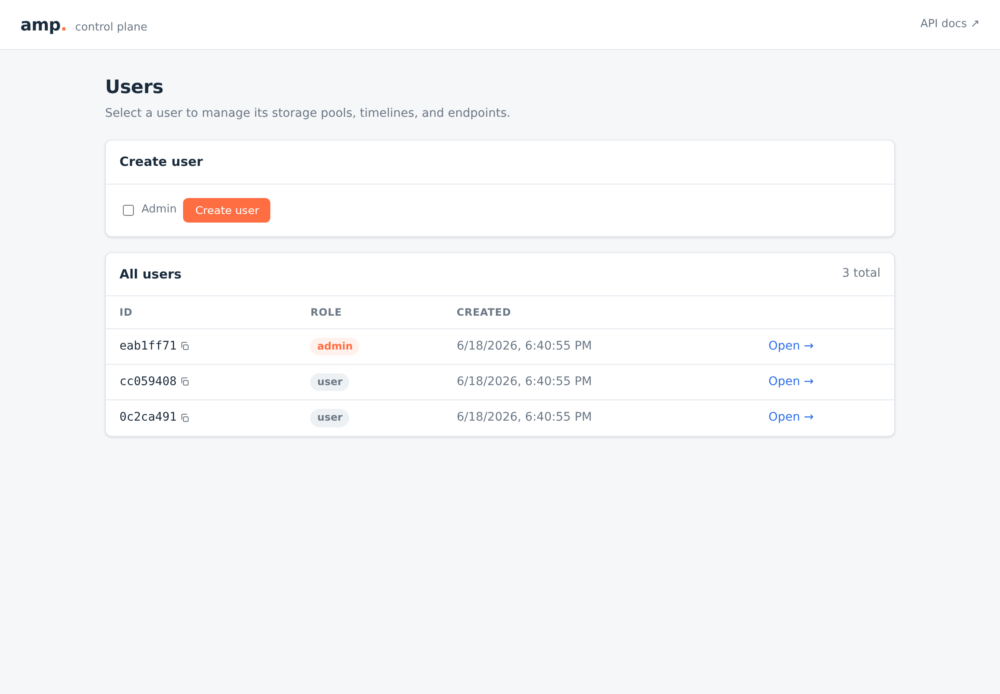
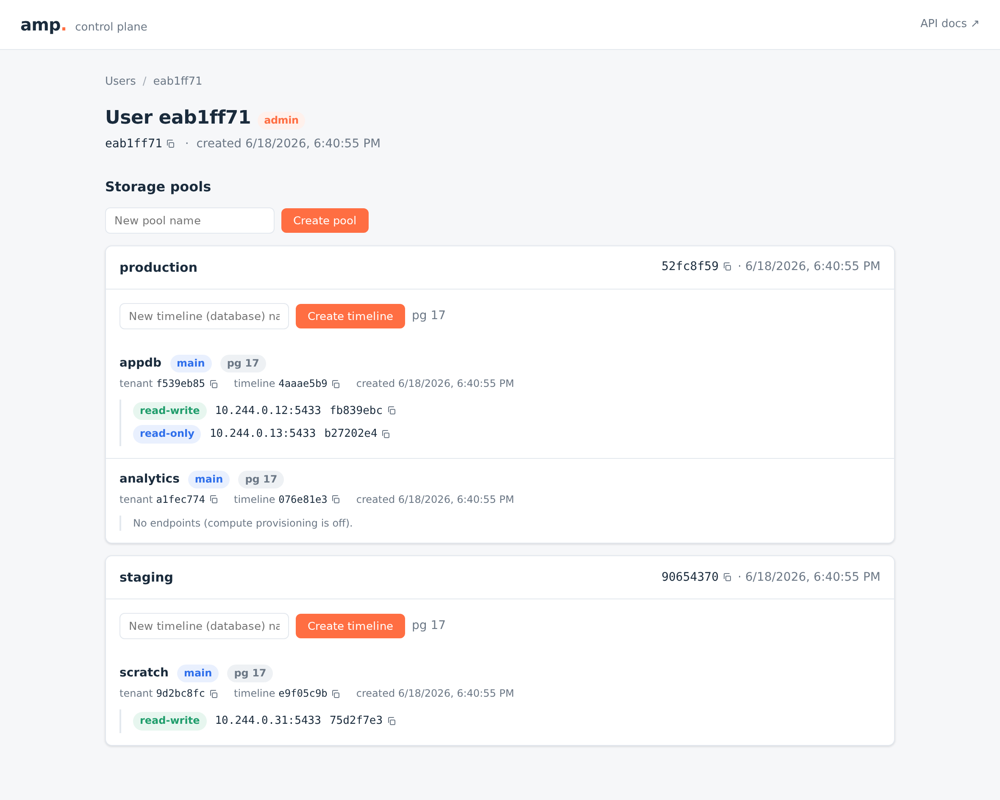

# ac — REST API

**Status:** Draft
**Last updated:** 2026-06-17

How the amp controller's REST API is defined, generated, served, and tested.
The guiding principle is amp-controller.md §3 (**API-first**, versioned in
the URL path). The initial surface landed in
[#92](https://github.com/yugabyte/yb-light/issues/92);
[#109](https://github.com/yugabyte/yb-light/issues/109) then promoted storage
pools to top-level resources and added paginated list endpoints, which is the
shape described here.

## Spec-driven, OpenAPI v3

The API is **defined by an OpenAPI v3 document**, not by the Go code:
[`controller/internal/api/openapi_spec.yaml`](../internal/api/openapi_spec.yaml) is the
single source of truth. From it, [`oapi-codegen`](https://github.com/oapi-codegen/oapi-codegen)
generates `controller/internal/api/api.gen.go`, which contains:

- the request/response **models** (`User`, `StoragePool`, `Error`, …);
- the **echo strict-server** interface (`StrictServerInterface`) the controllers
  implement, plus the router that binds requests to it; and
- a **Go client** (`ClientWithResponses`) — used by the tests to exercise the
  API exactly as a real consumer would.

Because the controllers implement a *generated* interface, the wire shape cannot
drift from the spec: change the YAML, regenerate, and the compiler points at
every handler that no longer matches.

```
openapi_spec.yaml ──oapi-codegen──> api.gen.go ──┬── StrictServerInterface  (handlers.go implements)
   (source of truth)                             ├── models                 (request/response types)
                                                  └── ClientWithResponses    (tests drive this)
```

Regenerate with `make controller-generate` (wraps `go -C controller generate ./...`). The
generated file is checked in. The codegen config is
[`oapi-codegen.yaml`](../internal/api/oapi-codegen.yaml); the tool is pinned as a
Go tool dependency in `controller/go.mod`, so generation needs no preinstalled binary.

The spec is linted with the rest of the repo's specs by `make lint-openapi-spec`
(redocly). Auth is deferred (below), so the `security-defined` warnings are
expected.

## Served on the API server

The controller hosts both the document and an interactive explorer off the same
server (`internal/api/docs.go`):

- `GET /api/v1/openapi.yaml` — the embedded spec (`go:embed`).
- `GET /api/v1/docs` — **Swagger UI**, the interactive explorer, with its assets
  embedded in the binary (`swaggest/swgui`), so it works with no network access.
- `GET /` — the **admin console** (`internal/api/ui.go`): a single static
  HTML+CSS+vanilla-JS page (`internal/api/ui/index.html`), embedded with
  `go:embed`. It is a pure client of the API below — the home page lists and
  creates users, and selecting a user shows that user's storage pools and their
  projects, branches, and endpoints, with create forms for pools and projects and a
  per-branch **branch** form (with an optional fork-LSN), and it shows a
  branch's lineage (which branch it forked from, and at what LSN). It does the
  owner filtering client-side (the list endpoints aren't owner-scoped yet). No
  build step and no server-side rendering, so it can't drift from the spec.

The home page lists and creates users; selecting one drills into that user's
storage pools, projects, branches, and endpoints:

| Users (home) | User detail: pools → projects → branches → endpoints |
|---|---|
|  |  |

## The surface

Everything is under `/api/v1`. The resource ladder is **storage pool → project →
branch → endpoint** (the user is not in the path). The error envelope is `{ "error": {
"code", "message" } }` for every non-2xx response.

| Method & path | Operation | Notes |
|---|---|---|
| `POST /users` | createUser | Create a user. No auth. |
| `GET /users` | listUsers | Paginated. |
| `GET /users/{userId}` | getUser | |
| `POST /storage-pools` | createStoragePool | Top-level; the owner is named in the body (`owner_user_id`). |
| `GET /storage-pools` | listStoragePools | Paginated; lists **every** pool (no owner filter yet). |
| `GET /storage-pools/{poolId}` | getStoragePool | By id; not owner-scoped. |
| `POST /storage-pools/{poolId}/projects` | createProject | Creates a project + its default branch and records the storage-controller pending-init recipe; returns a `Project` with its embedded `default_branch` (its `project_id`/`branch_id` are the storage-layer `tenant_id`/`timeline_id`). Does **not** deploy an endpoint. `201` / `404` / `409`. |
| `GET /storage-pools/{poolId}/projects` | listProjects | Paginated; the pool's projects, each with its `default_branch`. `404` if the pool is unknown. |
| `GET …/projects/{projectId}` | getProject | One project (with its `default_branch`). `404` if the pool/project is unknown. |
| `DELETE …/projects/{projectId}` | deleteProject | **Logged only** → `202`. |
| `POST …/projects/{projectId}/branches` | createBranch | Forks a parent branch (default: the project's default branch; override with `parent_branch_id` to branch off another branch) into a new branch under the same project, recording the storage-controller recipe with the ancestor + fork LSN set (default: the parent's latest LSN; override with `fork_point_lsn`). Returns the branch `{project_id, branch_id, parent_branch_id, fork_lsn, is_default}`. Does **not** deploy an endpoint. `201` / `404` / `409`. |
| `GET …/projects/{projectId}/branches` | listBranches | Paginated; the project's branches (default branch + forks). `404` if the pool/project is unknown. |
| `GET …/branches/{branchId}` | getBranch | One branch. `404` if the pool/project/branch is unknown. |
| `DELETE …/branches/{branchId}` | deleteBranch | **Logged only** → `202`. |
| `POST …/branches/{branchId}/endpoints` | createEndpoint | Creates the endpoint and **synchronously deploys** it → `201 {endpoint}` (its `address` set). `501` if `--deploy` is off. |
| `GET …/branches/{branchId}/endpoints` | listEndpoints | Paginated; the branch's endpoints. `404` if the pool/project/branch is unknown. |
| `GET …/endpoints/{endpointId}` | getEndpoint | One endpoint (its `address` is set once deployed). |
| `DELETE …/endpoints/{endpointId}` | deleteEndpoint | **Synchronously retires** the endpoint → `204`. `501` if `--deploy` is off. |
| `GET /tasks/{taskId}` | getTask | Status of a write-ahead task. |

### Pagination

Every list endpoint takes `limit` and `offset` query parameters and returns the
items array alongside `total` (the count of **all** matching items, ignoring
`limit`/`offset`) and `count` (the number of items in **this** response). `limit`
defaults to 100 and is clamped to `1..1000`; `offset` defaults to 0 and is
clamped to `>= 0` — out-of-range pagination is clamped, never a `400`. The
clamping lives in the controllers (`pageParams`); the backend applies the
resulting `LIMIT`/`OFFSET` and a separate `COUNT(*)` for `total`.

### Users and identity (no auth yet)

#92 calls for "a basic notion of users without authentication." A user is just
an identity (`app_user`); there is no credential. Storage pools used to be
addressed under `/users/{userId}`, but a pool will eventually be acted on by
more than its creator (pool grants), so #109 made pools top-level: the acting
user is named where it's actually needed — `owner_user_id` on pool create. The
user/grant model (amp-controller.md §10.1) is designed but authentication is
a separate, deferred concern (§12). When auth lands, the owner on create moves
to an authenticated principal; the resource model does not change.

Because there is no auth, `createUser` also lets a caller mint an **admin**
(`is_admin: true`) freely. That is intentional for this milestone, not a hole to
fix here — admin gating arrives with authentication.

### Storage pools

Pools are **top-level** resources, addressed by their own id. `createStoragePool`
names the owner in the body (`owner_user_id`, `404` if that user doesn't exist);
the new pool's `owner_user_id` records it. Pool names are unique across the
placement group. Pool sharing (pool grants) is still deferred, but listing is no
longer owner-scoped: `listStoragePools` returns **every** pool (an owner filter
can come with grants), and `getStoragePool` resolves a pool by id regardless of
who created it.

### Projects & branches: create + branch persist the resource and its recipe; delete is logged-only

**`createProject` records the control-plane resource and the pending-init
recipe.** It:
1. creates a project (a "database", unique name within the pool, else `409`)
   together with its **default branch** (`branch`, `is_default`) — one transaction,
   `core.Backend.CreateProject`; the pool is top-level, so an unknown pool
   surfaces as `404` (the `project.storage_pool_id` foreign key); and
2. records the storage controller's **pending-init recipe**
   (`storagecontroller.Client.RecordPendingTimelineInit`, keyed by the
   storage-layer `tenant_id`/`timeline_id`) when a controller is configured — the
   branch is declared, not yet materialized.

It returns a `Project` with its embedded `default_branch`; the project id and
branch id *are* the storage-layer `(tenant_id, timeline_id)`. It does **not**
eagerly create the tenant on the storage controller or deploy an endpoint: compute
is a separate resource (below), and the first endpoint deployed on the branch
materializes it (the recipe is then dropped). See
[`controller-project-create.md`](controller-project-create.md).

Compute is a **separate resource**: a caller `POST`s an endpoint on the branch
(below), which the controller deploys synchronously. Bootstrapping a fresh
project's storage (initdb + the storage schema) is still out-of-band — the deploy
path attaches an existing storage-layer tenant (Mode B), it does not create one.

**`createBranch` forks an existing branch (#130).** The parent defaults to the
project's default branch, or any branch named with `parent_branch_id`
(branch-of-branch); the new branch is a non-default `branch` under the **same
project**, inheriting the parent's `pg_version` and recording its fork ancestry
(`parent_branch_id`, `fork_lsn`) — `core.Backend.CreateBranch`. The fork point
defaults to the parent's durable WAL end — the `flush_lsn` of the safekeeper
co-located with the parent's `read_write` endpoint, read directly from that node
(`node.Client.TimelineFlushLSN`); a caller can pin an earlier point with
`fork_point_lsn`. Like create-project, it then records the storage controller's
**pending-init recipe**, this time with the ancestor and `start_lsn` set, and the
branch is materialized lazily by the first endpoint deployed on it (the
pageserver clones from the ancestor at `fork_lsn` instead of running `initdb`).
It returns the branch (`201`); a missing pool/project/parent `404`s and a
duplicate name within the project `409`s. *(Reading the ancestor's own node is
routing-correct where the storage controller's per-tenant `describe` is not — it
routes to whichever pageserver attached the tenant last and misses the parent
timeline once the tenant has multiple endpoints, #133; `flush_lsn` also never lags
durable WAL the way a pageserver's `last_record_lsn` can, #130. The parent must
have a `read_write` endpoint to resolve a default — otherwise pass
`fork_point_lsn`.)*

**`deleteProject` and `deleteBranch` are still logged-only.** They are meant to run
through the write-ahead task framework (amp-controller.md §5, §8), whose step
catalog does not exist yet, so per #92 they **only log** the request and return
`202 Accepted`. They bypass `core.Backend` and don't validate the target
(that validation belongs to the task steps that will replace the logging); no
`task` row is written, and `getTask` is wired to the store for when it is. Their
only outcomes are `202`, `400`, and `500`.

**`listProjects`, `listBranches`, and `listEndpoints` are read-only and
paginated.** `listProjects` returns the pool's projects (each with its
`default_branch`); `listBranches` returns a project's branches (default branch +
forks); `listEndpoints` returns a branch's endpoints. The branch is addressed by
`(poolId, projectId, branchId)`, so the backend first resolves the branch within
the project — `branch_id` is a generated UUID, unique within a project — and a
pool, project, or branch that doesn't exist is a `404`.

### Endpoints are deployed synchronously (#108)

`createEndpoint` resolves the branch within the project via
`core.Backend.GetBranch` (`(poolId, projectId, branchId)`: a missing link is
`404`), inserts the `endpoint` row (recorded first, so the single-writer rule is
enforced before a deploy is spent), then **synchronously deploys** it via the
runtime-agnostic [`deploy.Deployer`](../internal/deploy/) (Docker today,
Kubernetes via Helm), records the resolved `address`
(`core.Backend.SetEndpointAddress`), and best-effort drops the storage
controller's pending-init recipe (the endpoint has now materialized the
branch). It returns `201` with the deployed endpoint. If the deploy fails the
row is removed (compensation). A branch admits at most one `read_write`
endpoint — the schema's `one_writer_per_branch` partial unique index — which
surfaces as `409`. `deleteEndpoint` synchronously retires the endpoint (remove
the running instance + drop the row) and returns `204`. Both refuse with `501`
when the deployer is disabled (`--deploy` off). The Kubernetes deploy mechanism
(the Helm release per endpoint, Mode-B attach) is described in
[`ac-k8s-deploy.md`](ac-k8s-deploy.md); moving the deploy onto the
write-ahead task framework (async + `getTask` polling) is a follow-up.

## Layering

```
internal/api/    HTTP: generated contract (api.gen.go) + controllers (handlers.go),
                 echo wiring (server.go), error envelope (errors.go), docs (docs.go)
        │  implements StrictServerInterface, calls ↓
internal/core/   Domain: Backend interface + PgBackend (YBDB) + MemBackend (tests).
                 ErrNotFound → 404, ErrConflict → 409.
internal/task/   Task store, read by getTask.
internal/deploy/ Kubernetes endpoint provisioner; synchronous deploy/retire (ac-k8s-deploy.md).
```

The `core.Backend` seam is what lets the whole HTTP layer be tested without a
database: `MemBackend` mirrors `PgBackend`'s semantics (owner-existence checks,
globally-unique pool names, top-level + paginated listing, project create, and
in-project-unique branch names). The user, storage-pool, project (create), branch
(create + fork), and endpoint controllers go through it; the logged-only
delete-project / delete-branch controllers do not (above). A controller
that returns an unexpected (non-`echo.HTTPError`) error yields a `500` rendered
in the same `Error` envelope — documented per operation in the spec so the
generated client gets a typed handle for it.

## Testing

Two layers, both in `internal/api/*_test.go`:

- **Controller tests** drive the **generated client** against a real `httptest`
  server with the backend stubbed by `MemBackend` and a fake task store. They
  assert routing, path/body binding, status codes, and response shapes for every
  operation — validating the controllers against the generated contract.
- **Storage-pool flow test** runs the create → list → get workflow, asserting the
  top-level behaviour: listing returns every pool, and a pool is fetchable by id
  regardless of its creator.
- **List tests** (`lists_test.go`) cover the paginated lists: the `limit`/`offset`
  contract and clamping, `total` (all matches) vs `count` (this page), and the
  parent `404`s on the nested project/branch/endpoint lists.

`TestServesSpecAndExplorer` covers the spec/Swagger-UI/health endpoints, and
`TestServesUI` covers the admin console served at `/`.
