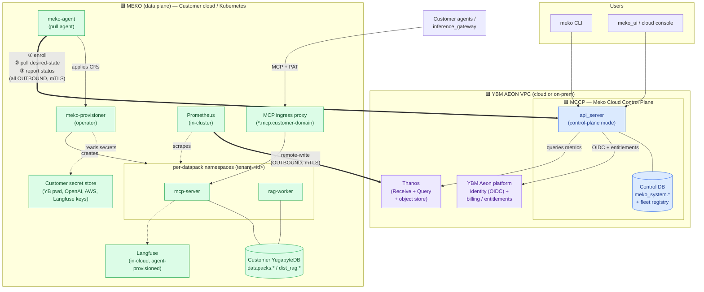
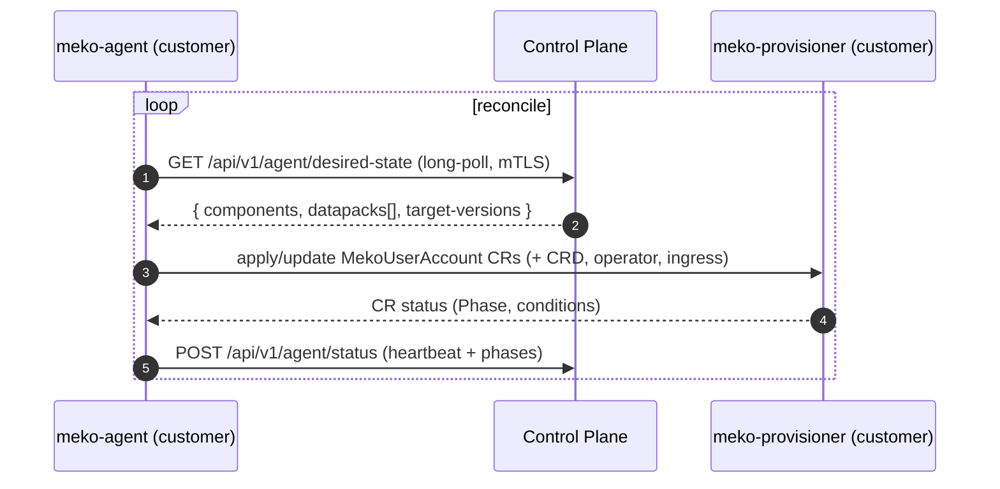

# Meko BYOC Control Plane — Design

**Status:** Draft · **Owner:** Platform · **Last updated:** 2026-07-16

---

## 1. Summary

Today Meko runs as a single-tenant-per-row SaaS: one set of Meko-operated
infrastructure (api_server + shared YugabyteDB universes + a shared MCP server)
holds *all* customer memory, RAG, and conversation data.

**BYOC (Bring Your Own Cloud)** splits the product into two named halves so that
all customer data stays in the customer's own cloud account:

- **MCCP — Meko Cloud Control Plane** (the control plane). Meko-operated. Owns
  the fleet registry and the *desired state* of every customer environment, and
  federates identity + entitlements from YBM Aeon (§4). Holds **no customer data
  and no customer cloud credentials**, and runs **no billing of its own** —
  billing lives upstream in Aeon. It runs **inside the YBM Aeon VPC**.
- **Meko** (the data plane). Customer-operated, running in the customer's own
  Kubernetes cluster. Runs the datapack workloads (MCP servers, RAG workers), the
  `meko-provisioner` operator, and the customer-owned YugabyteDB (a YBM Aeon
  cluster, cloud or self-managed).

Throughout this doc, **MCCP** means the cloud control plane and **Meko** means
the customer-side deployment. The two are connected by a **pull agent**
(`meko-agent`) that runs in the customer cluster alongside Meko. It only ever *dials out* to the control plane — there is no
inbound network path into the customer's cloud. This is the same model used for
the Amp BYOC control plane.

### Why the pull model

| Property | Push (control plane holds kubeconfig) | **Pull (chosen)** |
|---|---|---|
| Inbound access to customer cloud | Required | **None** |
| Customer cloud credentials at rest in control plane | Yes | **No** |
| Works behind customer NAT / private cluster | Hard | **Yes** |
| Blast radius if control plane is breached | Customer clusters | **Desired state only** |
| Customer audit story | Weak | **All actions originate from an in-cluster agent they run** |

---

## 2. Architecture

**Key invariant:** the only cross-plane channel is the agent's outbound
connection. Customer memory/RAG data, YugabyteDB, and all data-plane secrets
never leave the customer's cloud.

### 2.1 Functional split — MCCP vs Meko (data plane)

The split is deliberately narrow. **Meko (the data plane) keeps 100% of today's
Meko functionality** — every runtime feature the product ships now runs in the
customer's cluster, unchanged. BYOC only *lifts the control functions up* to
MCCP (identity, entitlements, fleet, desired state) and moves CR authoring into the
agent. **Nothing is removed from the data plane; no new dependency on MCCP sits
in the request path** — datapacks keep serving even if MCCP is unreachable
(§7, `DEGRADED`).

**Control functions → MCCP (cloud):**

| Function | Notes |
|---|---|
| Human identity / login | OIDC relying party of YBM Aeon (§4) |
| Entitlements / plan / free-tier caps | **Read from YBM Aeon upstream** — billing itself lives in Aeon; MCCP consumes the plan (via OIDC claims / Aeon billing API), it does not run Stripe |
| Fleet registry + environment lifecycle | The §7 state machine |
| Desired state (which datapacks/versions exist where) | The contract agents reconcile toward |
| Datapack **metadata** (name, owner, placement) | Not the data — just the pointer |
| Executive dashboard / fleet observability | Aggregated metrics only (§10) |
| Langfuse project-mapping **metadata** (optional) | Only a project id, to deep-link the console to the in-cloud Observe UI — no Langfuse API calls, no admin key |

**Full Meko functionality → data plane (customer cluster) — unchanged from today:**

| Function | Where in today's code |
|---|---|
| MCP servers (memory, conversations, RAG tools over the MCP contract) | per-datapack `mcp-server` |
| Memory + conversation storage & retrieval | YugabyteDB `datapacks.*` |
| RAG indexing / embeddings / retrieval | `rag-worker`, `dist_rag.*` |
| Datapack databases (one per datapack) | customer-owned YugabyteDB (YBM Aeon) |
| Langfuse instance + **provisioning** (org/project/keys) + **traces** | in-cloud Langfuse, created by the agent locally |
| MCP ingress + per-datapack routing | wildcard nginx proxy, customer domain |
| PAT issuance/validation for agents hitting MCP | data-plane auth (`internal/auth/pat.go`) |
| KB uploads / artifacts (S3) | customer-owned bucket |
| `meko-provisioner` operator + tenant reconcile | runs in-cluster |

So a customer's agents, CLI, and `inference_gateway` talk to Meko in the customer
cloud exactly as they do today; only the *management plane* (onboarding, entitlements,
fleet health, cross-customer dashboards) is what MCCP adds on top.

---

## 3. Data residency — what lives where

This is the entire point of BYOC, so it is stated explicitly.

**Stays in the customer cloud with Meko (never transmitted to MCCP):**

- YugabyteDB and all its contents — `datapacks.*`, `dist_rag.*` (memories,
  embeddings, conversations, RAG artifacts).
- The customer's YugabyteDB credentials.
- OpenAI / Bedrock / AWS keys used by MCP and RAG workloads.
- Langfuse entirely — the instance, its Postgres, provisioning (org/project/keys
  created by the agent), and all traces. MCCP holds no Langfuse admin key.
- The `meko-shared-credentials` secret and all per-tenant secrets.

**Held by MCCP:**

- Identity: users, accounts, Cognito subs, entitlements.
- Fleet metadata: environments, health, versions, capacity.
- Datapack *metadata*: id, name, owner, which environment it is placed on,
  desired image versions, phase — **but not its data**.
- Enrollment-token secrets and each environment's public identity (cert
  fingerprint). Never the customer's cloud credentials.

---

## 4. Authentication & identity — OIDC via YBM Aeon

MCCP runs **inside the YBM Aeon VPC** and authenticates humans as an **OIDC
client (relying party) of YBM Aeon's identity provider**. Aeon owns the login;
MCCP federates the identity and layers its own session + entitlements on top.
There is no bespoke Meko login for BYOC.

Because it is standard OIDC discovery, the *same* MCCP code works for both
deployment topologies — only the issuer URL and client credentials differ:

| Topology | Where MCCP runs | OIDC issuer |
|---|---|---|
| **Cloud MCCP** | Inside the YBM Aeon (cloud) VPC | YBM Aeon cloud |
| **On-prem MCCP** | Alongside a self-managed / on-prem Aeon | That on-prem Aeon |

There are three distinct auth channels — do not conflate them:

| Channel | Principal | Mechanism |
|---|---|---|
| Human → MCCP | Meko operators, customer admins | **OIDC** (relying party of YBM Aeon) → MCCP session |
| Agent → MCCP | `meko-agent` | **mTLS** environment identity (issued at enrollment, §7) |
| Agent / inference → datapack MCP | customer agents, `inference_gateway` | **PAT** (`mko_tkn_…`) |

**Cognito becomes legacy.** The existing `-cognito-*` flags and
`internal/auth/cognito.go` path are retired for MCCP; YBM Aeon OIDC
is the default (and only) human IdP. PAT auth for MCP (`internal/auth/pat.go`)
and the internal-secret path for MCP→api_server are unchanged.

**New flags:** `-oidc-issuer-url` (the Aeon issuer), `-oidc-client-id`,
`-oidc-client-secret`, `-oidc-redirect-url`. Discovery is via
`<issuer>/.well-known/openid-configuration`; the Aeon `sub` claim replaces the
Cognito `sub` as the account `user_id`, so downstream account plumbing is
unchanged.

## 5. MCCP — the minimal layer & its API surface

MCCP is `api_server` run with `-control-plane-mode`, deployed inside the YBM Aeon
VPC, plus its control DB. We build it **minimally** — it is only four things:

1. **Control DB** — `meko_system.*` plus the new `environments` fleet registry
   (§8.1). Holds metadata only; no tenant data ever lands here.
2. **Identity** — OIDC relying party of YBM Aeon (§4).
3. **Desired-state store** — the authoritative set of environments, datapacks,
   and target versions that agents reconcile toward.
4. **HTTP API surface** — below. MCCP is stateless and scales horizontally
   behind the Aeon VPC load balancer.

Nothing else from today's `api_server` is needed for the MVP: no per-datapack DB
provisioning, no in-cluster k8s client (that moves to the agent), no direct MCP
serving.

### 5.1 API surface — three groups

**A. Human / console API** — OIDC-authenticated (§4); called by the `meko` CLI
and the cloud console:

| Method + path | Purpose |
|---|---|
| `POST /api/v1/datapacks` | Create a datapack — writes metadata + placement, emits desired state; does **not** touch k8s. |
| `GET /api/v1/datapacks` · `GET /api/v1/datapacks/{id}` | List / read datapack metadata. |
| `DELETE /api/v1/datapacks/{id}` | Mark a datapack for teardown (agent reconciles). |
| `POST /api/v1/environments` | Register an environment — optionally with a **new-cluster spec** (provider / region / node size); mint a one-time enrollment token. |
| `GET /api/v1/environments` · `GET /api/v1/environments/{id}` | Fleet view + health + state (§7). |
| entitlement (read-only) | Plan/caps read from YBM Aeon upstream — no billing endpoints in MCCP. Observe is a deep-link to the in-cloud UI, not an MCCP-brokered session. |

**B. Agent API** — mTLS environment identity (§4); called by `meko-agent`
(detailed in §8.1):

| Method + path | Purpose |
|---|---|
| `POST /api/v1/agent/bootstrap-progress` | Pre-agent installer reports cluster-provisioning + install steps (token-authed, §7.1). |
| `POST /api/v1/agent/enroll` | Exchange enrollment token → mTLS identity. |
| `GET /api/v1/agent/desired-state` | Long-poll the resources assigned to this environment. |
| `POST /api/v1/agent/status` | Heartbeat + component/datapack phases + metrics (§9). |

**C. Internal API** — shared-secret (`X-Meko-Internal-Secret`); unchanged
MCP→api_server PAT validation under `/api/v1/internal/*`.

### 5.2 Minimal build order

Stand up MCCP with the control DB + OIDC + the `environments` registry + the
agent API behind `-control-plane-mode`, pointed at a **Meko-owned test
environment**. That is the smallest thing that exercises the full pull loop
end-to-end without a customer. The **desired-state payload is the contract**
between MCCP and Meko — version it from day one.

## 6. The pull agent (`meko-agent`)

A new lightweight Go binary in the monorepo (reuses the today-dormant k8s CR
client from `api_server/internal/k8s/client.go`). It runs as a Deployment in the
customer cluster and owns three outbound flows:

1. **Enroll** — on first start it presents a one-time enrollment token, gets
   attested by the control plane, and exchanges the token for a long-lived
   environment identity (mTLS client cert). It reports cluster facts
   (Kubernetes version, region, node capacity).
2. **Poll desired state** — long-polls the control plane for the set of
   resources assigned to this environment: which bootstrap components to run
   (CRD, operator, ingress), which `MekoUserAccount` / datapack specs should
   exist, and target image versions.
3. **Report status** — heartbeats plus per-component and per-datapack phase and
   version, so the control plane fleet view is accurate.

The agent is the **only** writer of `MekoUserAccount` CRs. This relocates
CR-authoring out of the control plane (where it is currently dead code) and into
the customer cluster, driven by desired state.

---

## 7. Bootstrapping state machine

The lifecycle of onboarding one customer environment, tracked as
`environment.status` in the control-plane fleet registry.

```mermaid
stateDiagram-v2
    [*] --> PENDING: admin creates env,<br/>issues enrollment token
    PENDING --> CLUSTER_PROVISIONING: "new cluster" — bootstrap<br/>installer provisions K8s
    PENDING --> ENROLLING: "attach" — installer runs<br/>in an existing cluster
    CLUSTER_PROVISIONING --> ENROLLING: cluster ready,<br/>agent + operator installed
    CLUSTER_PROVISIONING --> FAILED: cluster provisioning error<br/>(retry w/ backoff)
    ENROLLING --> ATTESTING: agent presents<br/>enrollment token
    ATTESTING --> PENDING: token invalid/expired<br/>(re-issue)
    ATTESTING --> PROVISIONING: token valid → agent gets<br/>mTLS identity; reports cluster facts
    PROVISIONING --> VALIDATING: agent installs CRD +<br/>operator + ingress + secrets scaffold
    PROVISIONING --> FAILED: component install error<br/>(retry w/ backoff)
    VALIDATING --> READY: smoke checks pass<br/>(operator healthy, YB reachable,<br/>canary datapack up+down)
    VALIDATING --> FAILED: smoke check fails
    FAILED --> PROVISIONING: operator retries
    READY --> DEGRADED: heartbeat missed OR<br/>component unhealthy
    DEGRADED --> READY: recovered
    READY --> SUSPENDED: Aeon billing lapse /<br/>admin hold
    SUSPENDED --> READY: hold cleared
    READY --> DRAINING: offboard requested
    DEGRADED --> DRAINING: offboard requested
    SUSPENDED --> DRAINING: offboard requested
    DRAINING --> DEREGISTERED: datapacks removed,<br/>workloads deleted, creds revoked
    DEREGISTERED --> [*]
```

| State | Meaning | Datapacks servable? | New placements? |
|---|---|---|---|
| `PENDING` | Env record exists; enrollment token issued, agent not yet seen. | No | No |
| `CLUSTER_PROVISIONING` | New-cluster path: the bootstrap installer is standing up a fresh K8s cluster in the customer's cloud. | No | No |
| `ENROLLING` | Installer running; agent starting. | No | No |
| `ATTESTING` | Control plane validating the enrollment token. | No | No |
| `PROVISIONING` | Agent installing bootstrap components (CRD, operator, ingress, secret scaffold). | No | No |
| `VALIDATING` | Smoke checks: operator healthy, customer YugabyteDB reachable, canary datapack provisions and tears down. | No | No |
| `READY` | Environment is healthy and schedulable. | **Yes** | **Yes** |
| `DEGRADED` | Heartbeat missed or a component unhealthy. Existing datapacks keep serving; no new placements. | Yes | No |
| `SUSPENDED` | Aeon billing lapse or admin hold. Agent stops accepting new work. | Yes (read) | No |
| `DRAINING` | Offboarding: datapacks migrated/deleted, workloads removed. | Winding down | No |
| `DEREGISTERED` | Environment removed; agent identity revoked. | No | No |

**Transition guarantees:**

- Every transition is triggered by an *agent-reported* fact or an *admin*
  action — never by MCCP reaching into the cluster.
- `PROVISIONING`/`VALIDATING` are idempotent and retried with backoff; a partial
  install re-converges rather than requiring a manual reset.
- Revocation (`DEREGISTERED`) invalidates the environment's mTLS identity so a
  leaked agent credential cannot resume pulling desired state.

### 7.1 Two onboarding modes — attach or provision

The customer chooses one when registering the environment. Both are driven by the
**`meko bootstrap`** installer (a wizard / one-command CLI shipped in the
`meko-devops` chart); both keep the customer's cloud credentials on the
customer's side — MCCP never receives them.

| Mode | Starting point | What `meko bootstrap` does |
|---|---|---|
| **Attach existing cluster** | Customer already has a K8s cluster + kubeconfig | Installs the Helm chart (agent + CRD + operator) into the cluster; `PENDING → ENROLLING`. |
| **Provision new cluster** | Customer has a cloud account but no cluster | Provisions a fresh cluster in the customer's cloud (via YBM Aeon's cluster API, or `eksctl`/`gke`/Terraform using the operator's local creds), then installs the chart; `PENDING → CLUSTER_PROVISIONING → ENROLLING`. |

The installer holds a short-lived **enrollment token** and reports each step
*outbound* to MCCP (`POST /api/v1/agent/bootstrap-progress`) so the fleet view
shows live progress before the long-running agent exists. Once the agent is up
and attested, it takes over all outbound reporting. The new-cluster path is the
natural pairing with a customer-owned **YBM Aeon** cluster: provision the Aeon
data cluster and the Meko K8s cluster in the same wizard, in the same cloud/region.

---

## 8. Changes by component

### 8.1 `api_server` — becomes MCCP in control-plane mode

`api_server` run with `-control-plane-mode` **is** MCCP; the same binary without
that flag, plus the operator and workloads in the customer cluster, **is** Meko.

- **New fleet domain.** Add an `environments` registry table to `meko_system`:

  | Column | Notes |
  |---|---|
  | `id` | environment id (per customer cloud) |
  | `account_id` | owning account |
  | `status` | the state-machine value in §7 |
  | `region`, `k8s_version`, `capacity` | reported cluster facts |
  | `agent_version`, `last_heartbeat_at` | health |
  | `mcp_base_url` | customer's MCP ingress domain |
  | `cert_fingerprint` | agent mTLS identity |

- **New agent-facing API** (mTLS + environment identity, separate from the human
  OIDC and PAT auth channels in §4):
  - `POST /api/v1/agent/enroll` — exchange enrollment token → mTLS identity.
  - `GET  /api/v1/agent/desired-state` — long-poll; returns bootstrap
    components + datapack specs + target versions for the calling environment.
  - `POST /api/v1/agent/status` — heartbeat + component/datapack phases.

- **Placement.** `AssignUniverse` (`internal/service/yba_service.go`) generalizes
  to `AssignEnvironment`: a datapack is placed onto a customer environment whose
  registered YugabyteDB becomes its "universe". Free-tier accounts can still be
  served by a Meko-hosted default environment (SaaS remains a special case of
  BYOC where the environment happens to be Meko-owned).

- **Stop shipping data-plane secrets.** Today the `MekoUserAccount` spec carries
  `YugabyteDBPassword` etc. from api_server. In BYOC the control plane emits a
  spec that *references* secret names; the agent injects real values from the
  customer secret store. The control plane never sees them.

- **Entitlements from Aeon.** MCCP does not run billing. The free-tier /
  plan / cap logic (today's `FreeTierUsageRepo` gate and Stripe integration)
  reads the customer's plan from YBM Aeon upstream — via OIDC claims or the Aeon
  billing API — and enforces caps against that. No money moves through MCCP.

- **New flags:** `-control-plane-mode`, `-agent-ca-cert`, `-agent-ca-key`,
  `-enrollment-token-key`, plus the OIDC flags from §4 (`-oidc-issuer-url`,
  `-oidc-client-id`, `-oidc-client-secret`, `-oidc-redirect-url`). The
  `-cognito-*`, `-stripe-*`, and `-crd-namespace` flags are removed — human auth
  and billing move to Aeon, CR authoring moves to the agent.

- **Langfuse moves fully into the data plane.** MCCP does **not** provision
  Langfuse and holds no Langfuse admin key. The instance, its Postgres, and
  provisioning (org/project/keys) all run in the customer cloud, created by the
  agent as ordinary desired state — it has local network access; MCCP does not.
  MCCP keeps only an optional project-id so the console can deep-link to the
  in-cloud Observe UI. Central Langfuse is a **fallback only**, for customers who
  explicitly accept trace data leaving their cloud (a per-environment setting).

### 8.2 `meko-provisioner` — runs in the customer cluster

- Reconcile logic is largely unchanged: it already creates per-tenant namespaces
  with `mcp-server` + `rag-worker` + config/secret + Service
  (`internal/controller/resources.go`), which is exactly the data-plane unit.
- It is now installed **by the agent in the customer cluster**, not centrally.
- `YugabyteDBHost`/`Port`/`User`/`Password`/`Name` in the CR spec already point
  at an arbitrary YugabyteDB — in BYOC they point at the customer's own DB.
  Minimal change.
- Add richer status conditions so the agent can relay accurate per-datapack
  phase back to the control plane.
- Add desired-version handling so the agent can drive rolling operator/image
  upgrades.

### 8.3 New: `meko-agent` binary + install chart

- New Go module/binary in the monorepo; reuses the dynamic k8s client already
  written in `api_server/internal/k8s/client.go`.
- Ships as a **Helm chart** in the `meko-devops` repo (where the existing
  deployment charts live), plus a single-command install script. The chart
  bundles the agent, the CRD, and the operator so a customer installs one thing.
- Responsibilities: enroll, poll desired state, apply manifests (CRD, operator,
  ingress, secret scaffold), author `MekoUserAccount` CRs, report status, and
  self-update.

### 8.4 Networking & secrets

- **All cross-plane traffic is customer→control-plane, outbound, over mTLS.** The
  customer's egress allowlist needs only the control-plane FQDN.
- **MCP ingress stays in the customer cluster** — the existing wildcard nginx
  proxy (`meko-provisioner/config/proxy/`) routes `*.mcp.<customer-domain>` to
  `mcp-server.tenant-<id>`. The control plane stores each environment's
  `mcp_base_url` and returns per-datapack MCP URLs on the customer's domain.
- **Data-plane secrets are customer-owned.** `meko-shared-credentials` and all
  per-tenant secrets are populated from the customer's secret manager
  (installer prompts, External Secrets Operator, Vault, or Sealed Secrets) —
  never shipped from the control plane.

---

## 9. Metrics & observability — Thanos

Observability flows **outbound only**, like everything else, and lands in
**Thanos** on the cloud side. The split is clean:

- **Time-series metrics → Thanos.** An **in-cluster Prometheus** scrapes the
  MCP servers, RAG workers, operator, and nodes, then **remote-writes** them
  *outbound* over mTLS to a **Thanos Receive** endpoint in the cloud. Thanos
  Receive lands them in object storage; **Thanos Query** gives MCCP a single
  global view across every environment. The customer's own Prometheus keeps a
  local copy for their own dashboards — same data, two readers.
- **Control signals → agent status API.** Heartbeat freshness, environment
  state, reconcile lag, and enrollment outcomes stay on the `POST /agent/status`
  path (§5) and land in the fleet registry — these drive the §7 state machine,
  not the time-series store.

**Privacy.** Only counts, rates, latencies, and resource utilization leave the
customer cloud — never memory text, embeddings, query contents, or PII. A metric
**label allowlist** is enforced at the Prometheus remote-write egress (env id,
datapack id, region, workload — nothing high-cardinality or user-derived).

**What Thanos holds (per datapack / environment):**

- MCP request rate, p50/p95 latency, error rate.
- RAG indexing throughput and queue depth.
- YugabyteDB connection health and slot utilization.
- Workload CPU/memory vs. limits.
- Token burn — feeds the existing `meko_admin` **Token Burn efficiency** tile.

**Reuse.** `meko_admin` already serves a usage-metrics dashboard through
`api_server`. In BYOC it queries **Thanos** for the fleet aggregate instead of
reading tenant databases directly (which now live in the customer cloud and are
unreachable from MCCP).

## 10. Executive dashboard — observability in the cloud

The metrics from §9 surface in MCCP as a **true executive dashboard**: one cloud
view across the entire fleet, aimed at leadership and account owners rather than
on-call engineers. It answers *"how is Meko doing across every customer, right
now and over time?"* — without anyone touching a customer cluster.

**Where it lives.** Served by MCCP (`api_server` in control-plane mode), rendered
in `meko_ui` / `meko_admin`, behind Aeon OIDC (§4). It queries **Thanos** (§9)
for the fleet aggregate and the fleet registry for state — never raw customer
data. Trace-level drill-down (individual Langfuse traces, memory contents) stays
in the customer cloud; the dashboard links out to the in-cloud Observe UI for
that detail.

**What it shows** (summary before detail, top to bottom):

- **Headline KPIs** — active environments, total datapacks, MCP requests/day,
  token burn (and $ equivalent), fleet uptime / SLO attainment.
- **Growth & adoption** — datapacks created over time, monthly active accounts,
  MCP request-volume trend.
- **Reliability** — environments by state (§7), open incidents, mean time in
  `DEGRADED`, heartbeat freshness.
- **Efficiency & cost** — token-burn efficiency (reuses the existing `meko_admin`
  tile), cost per datapack, capacity utilization vs. headroom per environment.
- **Residency posture** — cloud vs on-prem environment split and per-environment
  region, so leadership sees the compliance footprint at a glance.

**Design principles.** Summary tiles first, then trends; state encoded as
color **and** label (never color alone); every figure is fleet-aggregated and
privacy-safe. Drilling into any tile filters the fleet table below; deep trace
inspection hands off to the in-cloud Observe UI.

### 10.1 Per-environment view — Platform Operations (amp-style)

The fleet dashboard is the rollup; drilling into a single environment opens a
**Platform Operations** panel in the amp control-plane style — **one per
registered cluster**. It renders that cluster's own telemetry from its Thanos
series (the same Prometheus → Thanos pipeline from §9 runs inside the customer
cluster and streams outbound). Each panel has four bands:

- **Headline metrics** — availability (24h), active MCP servers, core services
  healthy, MCP requests/sec, managed datapacks, memory under management — big
  numbers with a corner sparkline and a 24h delta.
- **Service fleet** — the Meko components in that cluster with `up/total` counts:
  `meko-agent`, `meko-provisioner`, `mcp-server` (per-datapack), `rag-worker`,
  `yb-tserver` / `yb-master`, `langfuse`, `prometheus`.
- **Trends** — 24h charts at 10-minute resolution: MCP requests/sec, active
  datapacks, RAG indexing throughput, token burn.
- **Reliability signals** — reconcile lag, heartbeat freshness, MCP p95 latency,
  error rate.

Same privacy line as §9: these are counts/rates/latencies from Thanos, never
memory content. See the artifact for a mock of both the fleet rollup and this
per-environment panel.

## 11. SaaS today vs BYOC

| Dimension | SaaS today | BYOC |
|---|---|---|
| Human authentication | Cognito | OIDC relying party of YBM Aeon (cloud or on-prem) |
| Cloud footprint | Single Meko cloud deploy | MCCP inside the YBM Aeon VPC |
| Where customer data lives | Meko-owned shared YugabyteDB universes | Customer-owned YugabyteDB (YBM Aeon) |
| Who runs MCP/RAG workloads | Meko | Customer cluster |
| Who drives the operator | Nobody — `api_server` CR client is dormant | The agent, in the customer cluster |
| Cross-plane connection | n/a (single plane) | Agent, outbound-only, mTLS |
| Secrets custody | Meko | Customer |
| Billing | Stripe in api_server | Upstream in YBM Aeon; MCCP reads entitlements |
| Observability | Direct DB / Langfuse reads | Prometheus → Thanos (cloud); Langfuse in-cloud |
| `MekoUserAccount` CRs authored by | (Was intended for api_server; unused) | `meko-agent` |
| Onboarding | Instant (row insert) | Enrollment state machine (§7) |

SaaS is modeled as the degenerate BYOC case where the environment is
Meko-owned, keeping one code path.

---

## 12. Rollout phases

1. **Aeon OIDC auth** — make the control plane an OIDC relying party of YBM
   Aeon; retire Cognito. Verify against both cloud and on-prem Aeon issuers.
2. **Fleet registry + agent API** — add `environments` table and the three
   agent endpoints behind `-control-plane-mode`; no behavior change for SaaS.
3. **meko-agent MVP** — enroll + poll + author CRs against a *Meko-owned* test
   cluster (dogfood the pull path with no customer risk). Package the install
   chart in `meko-devops`.
4. **Bootstrapping — attach mode** — installer chart, attestation, smoke-check
   validation, health/heartbeat against an existing customer cluster.
5. **Bootstrapping — provision mode** — `meko bootstrap` stands up a *new* K8s
   cluster (Aeon cluster API / `eksctl` / Terraform) then installs; live
   progress via `bootstrap-progress`.
6. **Observability + executive dashboard** — in-cluster Prometheus remote-writes
   to a cloud Thanos; build the executive dashboard (§10) on Thanos Query;
   repoint `meko_admin` off tenant DBs.
7. **Customer secret custody** — stop shipping `YugabyteDBPassword` in specs;
   agent injects from customer secret store.
8. **Langfuse in the data plane** — agent provisions org/project/keys against
   the in-cloud Langfuse locally; MCCP drops all Langfuse admin access.
9. **GA** — first external customer environment reaches `READY`.

---

## 13. Open questions

- **Upgrades:** control-plane-driven (desired version) vs customer-approved
  maintenance windows? Enterprise customers usually want the latter.
- **Central-Langfuse fallback:** is it worth supporting at all, or is in-cloud
  Langfuse a hard requirement for BYOC? Supporting the fallback reintroduces an
  MCCP→Langfuse path for those tenants and complicates the residency story (§3).
- **Break-glass:** if an environment is `DEGRADED` and the customer needs help,
  what read-only diagnostic path exists without violating "no inbound access"?
  (Likely: agent-collected diagnostics pushed out on request.)
- **Multi-region / multi-cluster** per account: one environment per cluster, or
  can one account span several `READY` environments with datapacks placed across
  them?
