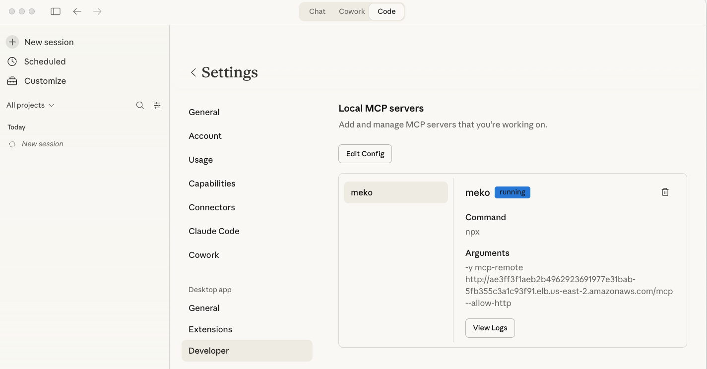

Meko integrates via the Model Context Protocol (MCP).  Each Datapack exposes an MCP server that your AI coding tools, agent frameworks, or consumer chat applications connect to.

You follow the same basic pattern with all tools and frameworks:

1. **Create a datapack** using either the Meko web portal or the Meko CLI.
2. **Register the Meko MCP server** with your coding tool or with your application's MCP Client.
3. **Start using Meko** through natural language prompts.

<!-- TODO: create cards here that link to the different sections below for Cursor Desktop, Claude Desktop, Claude Code, LangGraph/LangChain, etc. -->


  
  
  
  
  
  


## IDEs

Integrate with IDEs for interactive use cases, such as saving personal, team, and organizational preferences, standards, and policies.

### Cursor Desktop

1. In Cursor Desktop, choose **Cursor>Settings>Cursor Settings>Tools & MCPs>New MCP Server**.

1. Modify the `mcp.json` file that Cursor opens to add the following MCP server configuration.

    ```json
    {
      "mcpServers": {
        "meko": {
          "url": "<YOUR DATAPACK'S URL>",
          "headers": {
            "API_KEY": "<YOUR DATAPACK'S API KEY>"
          }
        }
      }
    }
    ```

    The result should look like the following:

    

1. Verify the Connection. In chat, type the following. If you're connected, Cursor will respond by indicating that it will use Meko's MCP tools to store memories.

    `You have access to the Meko platform through MCP server. Have Meko remember all my personal preferences.`


### Cursor Web

{}
This page is under development. Check back soon.
{}

Feel free to contribute here with info!

### Claude Desktop

In Claude Desktop (whether used for Chat, Cowork, or Code):

1. On a Mac, **Claude>Settings>Developer>Edit Config**.
1. Edit the `claude_desktop_config.json` file to add the following MCP Server entry.

    ```json
    {
      "mcpServers": {
        "meko": {
          "command": "npx",
          "args": [
            "-y",
            "mcp-remote",
            "<YOUR DATAPACK'S URL>",
            "--allow-http"
          ]
        }
      },
    }
    ```

1. Quit and restart Claude Desktop.

The result should look like this:




{}
TIP: If you see errors when restarting Claude, examine the log file that appears. Verify that you have the correct version of node.js binaries in your path, use absolute paths, and consult online MCP Server configuration troubleshooting guides.
{}

<!-- TODO : fix the Tip above to use proper formatting -->

### Claude Code (via CLI)

Run the setup command.   Run this command in your terminal to add the Meko MCP server to Claude Code. 

```sh
> claude mcp add --scope user --transport http meko <your-datapak-url> --header "API_KEY: <YOUR DATAPACK'S API KEY>"
```

To verify correct configuration, ask Claude at the command-line Console this question:

```txt
Is Claude configured with an MCP Server for Meko?
```

You should see a response like the following:


### Coming Soon

* OpenAI Codex
* VS Code / GitHub CoPilot 
* Opencode
* Google Anti-gravity
* OpenAI chatgpt Desktop
* Lovable                         
* Replit

Feel free to contribute here with info!

## Programmatic

To integrate Meko programmatically, register the Meko MCP Server with your application’s internal MCP Client. Most AI frameworks include built-in clients to simplify this process.

This approach enables your application to save memory and knowledge in Meko, such as conversation memory, user and team preferences, and even application state.  

### LangChain and LangGraph

Meko can be integrated with LangChain and LangGraph agent frameworks through MCP. This page documents the setup and usage patterns for using Meko as the data layer for LangChain-based agents.

### Python

You can connect to Meko's MCP server directly from Python using an MCP client library. This page documents the setup, connection pattern, and example code for interacting with Meko datapacks from Python.

### Coming soon

* OpenAI Agents SDK

