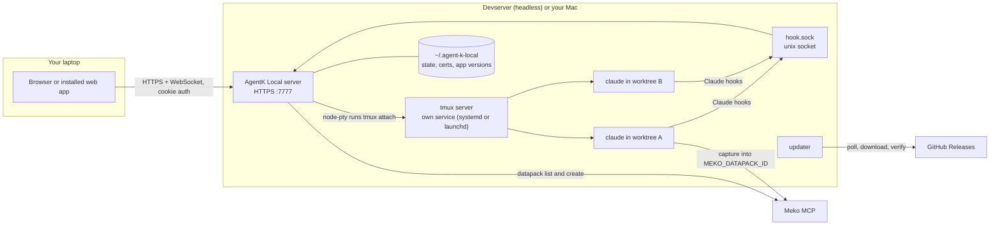
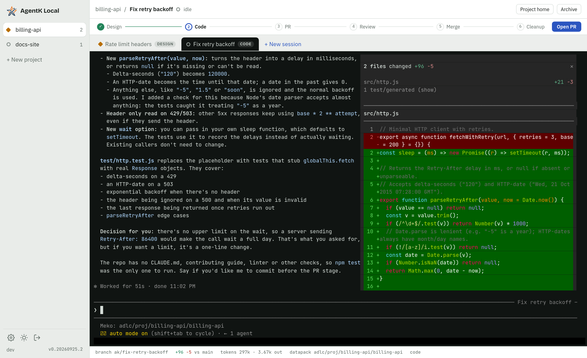
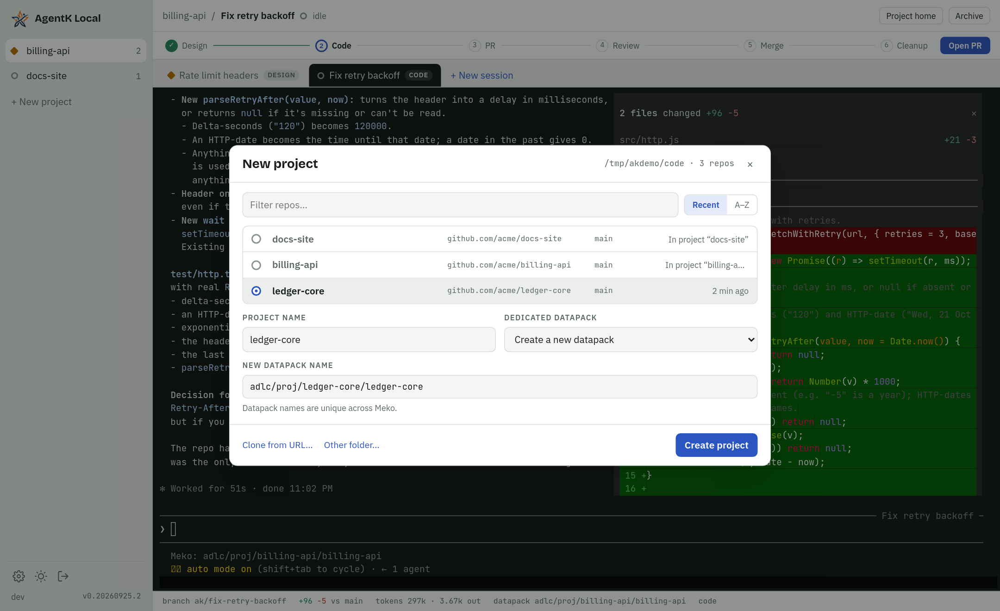
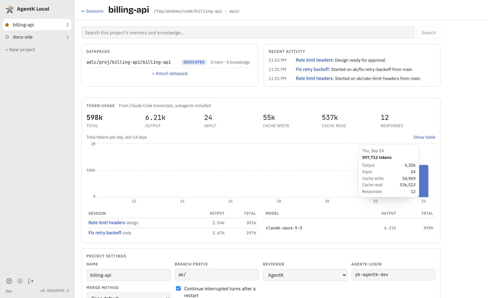
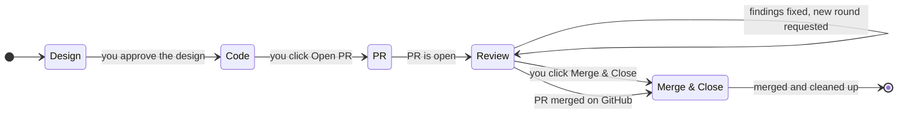
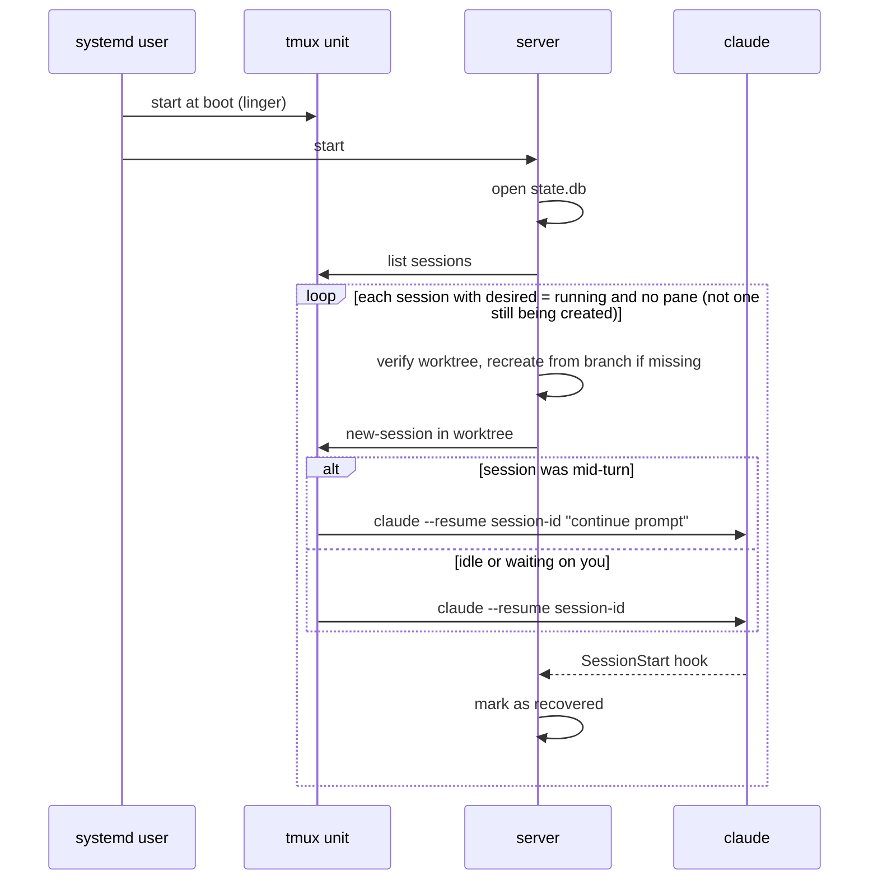

# AgentK Local

The agentic coder for ADLC. AgentK Local helps you work across many projects and
[Claude Code](https://claude.com/claude-code) sessions at once, with [Meko](https://mekodata.ai)
as its data layer. It's self-hosted, runs on your devserver (headless) or your Mac, and you use it
from a browser.

**Contents:** [Decisions](#decisions-so-far) · [Architecture](#architecture) · [The app](#the-app) ·
[Projects & sessions](#projects-worktrees-and-sessions) · [Task lifecycle](#task-lifecycle) ·
[Datapacks](#datapacks) · [Token usage](#token-usage) · [Login & security](#login-and-security) ·
[Crash recovery](#surviving-crashes-restarts-and-updates) ·
[Releases & updates](#releases-and-auto-update) · [Tech stack](#tech-stack) ·
[Milestones](#milestones) · [Open questions](#open-questions)

## Decisions so far

| Topic | Decision |
|---|---|
| Session UI | Embed the real Claude Code TUI (xterm.js over WebSocket). Don't rebuild Claude's interface. |
| Process host | tmux on a dedicated socket, in its own background service (a systemd user unit on Linux, a LaunchAgent on macOS), so the server can restart or update without touching sessions. |
| New project | Pick a repo from a list of the git repos under `~/code`. The folder is configurable, and you can clone a repo into it from a URL. |
| Local state | SQLite (`~/.agent-k-local/state.db`), WAL mode, schema versioned with `PRAGMA user_version`. |
| Working copy | Each session gets its own git worktree on its own branch. |
| Datapacks | Each project gets one dedicated datapack (the write target) and can attach any number of shared datapacks (read targets). |
| Meko | Required. Every install needs a working Meko key and the Meko plugin, and every project needs a dedicated datapack. |
| Meko wiring | Sessions get `MEKO_AGENT_ID=claude_code:<project>`, and the project's datapack is pinned for that agent id. The Meko hooks already honour both, so no plugin change is needed. |
| Datapack names | New dedicated datapacks default to `adlc/proj/<repo>/<project_name>`. |
| Runtime | Node 22 (bundled in releases). State uses the built-in `node:sqlite`; node-pty is the only native module. |
| Network | Reachable directly on the corp network over HTTPS, behind a login. |
| Existing tmux sessions | Not adopted. Only sessions created by AgentK Local are shown. |
| Crash behaviour | After a host reboot, the server automatically brings back every open project and session with `claude --resume`. Sessions that were mid-turn are told to continue. |
| Token usage | Tracked per session and per project (per model and per day too), read from Claude Code transcripts including subagents. |
| Task lifecycle | Design → Code → PR → Review (AgentK) → Merge & Close, with three human gates. More ADLC stages plug in later. |
| Host OS | Linux devservers, and Macs on Apple Silicon (macOS 14 or newer) while you're logged in to the desktop. Intel Macs and headless Macs aren't supported. |
| Distribution | Public GitHub repo. GitHub Actions for CI and releases, date-based versions (`0.YYYYMMDD.N`), tarball releases, and an update check built into the server. |
| Repo & license | Internal at `github.com/yugabyte/agent-k-local` for now, to be made public later. Apache-2.0. |
| Sharing | Everyone installs their own copy. One owner per install, with no shared instances. |
| Client | Browser first. Chrome's "Install app" gives it a dock icon: the web app manifest (`manifest.webmanifest`) names it "AgentK" and supplies the logo as regular and maskable icons. `/favicon.ico` and `/apple-touch-icon.png` are served at the root too, for browsers and phones that look there instead of reading the page's links; a missing file is a 404, never the app page. A native Mac wrapper is deferred. |

## Architecture

There are three long-lived pieces on the host: the web server, the tmux server that owns every
Claude process, and the state directory at `~/.agent-k-local`. The server is stateless enough to
be killed at any time. tmux and the on-disk state are what carry your work.



**Terminal path.** When you open a tab, the browser opens a WebSocket. The server spawns
`tmux -L agentk attach -t ak-…` in a pty and pipes it through. Closing the tab kills only that pty,
and Claude keeps running.

**Status path.** Each session starts with `claude --settings` pointing at an agent-k hooks file.
The `SessionStart`, `UserPromptSubmit`, `Notification` and `Stop` hooks post to a unix socket,
which drives the badges in the rail. Your global Claude settings stay untouched.

## The app

The left rail holds projects, each with its repo's folder name in small type under the project
name and the most urgent session state shown on it. The top tabs hold that project's sessions. The
main pane is the live Claude terminal, and the footer shows where the session is working: branch,
diff size, tokens, the project's Meko datapack (`Meko:<datapack>`) and stage.



Session states, shown with a dot in the rail and on each tab:

- **Working**
- **Needs you:** a permission prompt or a question
- **Idle**, waiting for your next prompt
- **Recovered** after a restart
- **Exited**

### New project

A new project starts from a repo you already have. The dialog lists every git repo directly under
your repos folder (`~/code` by default), with the most recently touched first. A repo can back
several projects: one that already has a project is marked with its name (*In "infra"*, or *In 2
projects*) and can still be picked. Each project on a repo gets its own datapack, Meko agent id,
settings, sessions and worktrees; project names must differ within a repo. Their session branches
share the repo, so a branch name that another project already uses gets a number added
(`ak/fix-tests-2`). Per-repo files such as `.agent-k/stages/` overrides apply to every project on
the repo.



- **What the list shows.** For each repo: its folder name, the `origin` remote, the current
  branch, and when it was last touched. The server scans the folder when the dialog opens, so
  repos you clone by hand appear straight away.
- **What it leaves out.** Folders that aren't git repos, and git worktrees (a `.git` *file*
  rather than a directory), are left out. Only the top level is scanned by default. The scan depth
  and the list of folders are both settings.
- **Clone from URL.** Paste a git URL and the server clones it into `~/code/<name>` using your
  existing git credentials, then selects it. "Other folder" takes any repo path on the host.

You type the project name; it isn't filled in from the repo. The dialog suggests a new dedicated
datapack named `adlc/proj/<repo>/<project>` from the repo and the name you type. You can rename it,
or switch to an existing datapack, before creating the project.

### New session

You give it a name and, optionally, a first prompt and a base branch (the default is the project's
default branch). The server fetches the base from `origin` and fast-forwards your local base
branch to it when that's safe, then creates the worktree and branch from it, starts Claude inside
it, and focuses the tab. If the local base can't be fast-forwarded (it has commits origin lacks, or
local edits would be overwritten), the session starts from `origin/<base>` and the activity log
says why.

### Changes

Clicking the `+N −N` numbers in the footer opens a side panel with every file changed on the
branch since it left the base: committed, uncommitted and untracked (ignored files are left out).
Each file has a kind (A, M, D, R, U), its line counts, an *uncommitted* tag when it has uncommitted
edits, and a collapsible diff. Single-file diffs are cut at 256 KB and the whole panel at 4 MB;
past that only line counts are shown. A changed image (PNG, JPEG, GIF, WebP, AVIF, BMP, ICO) is
shown as *Before* and *After* side by side with its size, instead of "Binary file";
`GET /api/sessions/:id/changes/image` serves the base's version from git or the worktree's from
disk, only for those types, only inside the repo (no `..`, no symlinks out), up to 20 MB, and with
a sandboxing content policy so the bytes can never run as a page. The footer counts use the same
comparison, so they always match. The file list is the header's **Files** menu, with a filter, so
you can jump to any file from anywhere in a long diff; each file's header shows its position
(*4 / 12*), and `[` / `]` step to the previous or next file.

### Review comments

Click **+** beside a line of any diff (shift-click a second line for a range) to leave a comment,
as on a PR. Comments are drafts in `state.db` until you click **Send N comments**, which pastes
them into Claude as one prompt, grouped by file, with the lines each one is about. If Claude is
mid-turn or waiting on a permission prompt, they queue and go out when it's back at its prompt in
the Code or Review stage. Each comment keeps an excerpt of its lines, so it follows them when
Claude moves code, and is shown as outdated (still sendable) when they're gone. Sent comments are
kept and shown with **Show sent**.

### Design panel

During Design the panel opens as soon as the design exists and again whenever it's revised, at
about 60% of the work area. An Artifact design is shown in a sandboxed frame (scripts allowed, no
same-origin access, and a content policy that blocks network requests and limits scripts, styles
and fonts to what Artifacts use), so the page can't read the login cookie or call the API.
**Open on claude.ai** links to the published Artifact. A markdown design is rendered as sanitized
HTML.

### Side panels

The design doc and the changes panel open on the right of the terminal, one at a time. Drag the
panel's left edge (or focus it and use the arrow keys) to resize it; double-click the edge to
switch between normal and widest. Each panel's width is remembered in the browser. The design doc
also opens full page in a new tab (`/p/<project>/s/<session>/design`), where it can still be
approved.

### Starting

Claude Code can take a while to load its plugins, MCP servers and startup hooks. While a session
starts, the terminal shows its steps (updating the base branch and creating the worktree, starting
Claude Code, loading, sending your task) with the current one animated and timed, plus the stage
the session opens in. The session's tab shows the current step in its tooltip.

### Keyboard

`⌘1–9` switches projects, `⌃Tab` cycles sessions, and `⌘K` opens a palette to jump to any
session, create one, or search the project's datapacks. Keys pass through to the terminal whenever
it has focus. To copy from the terminal, drag across the text: tmux selects it and sends it as
OSC 52, which the page puts on the clipboard. Shift-drag (Option-drag on a Mac) selects in the
browser instead, and then `Ctrl+C` (`⌘C`) copies rather than interrupting Claude. Clipboard access
needs HTTPS or localhost.

### Notifications

A browser notification fires when any session moves to *needs you* or finishes a turn while its
tab is hidden. You can mute it per project. Only one open AgentK page shows them, the one used
last (pages queue for a Web Lock and a page that gets focus steals it; when it closes, the next one
takes over), so clicking a notification opens its session in the window you're using rather than
in a forgotten background tab.

### On a phone

At 760 px wide or less the app switches to a phone layout. The rail becomes a drawer behind a top
app bar (the Back gesture closes it, and it holds **Search and commands** in place of `⌘K`). The
app bar shows the session and project names (the session tab shows its status). The session header,
the stage bar with its gate button (Approve design, Open PR, Merge & Close) and the footer details
move into a ⋯ sheet, leaving the screen to the terminal; a dot on ⋯ marks a gate that is ready for
you. Dialogs open as bottom sheets. The app is pinned to the visible viewport (its height and,
where iOS pans the page for a focused field, its offset), so the on-screen keyboard shrinks it
instead of covering the prompt; while you type, the terminal stays scrolled to its newest line. On
touch screens the terminal gets a key bar (Esc, a sticky Ctrl, Shift+Tab, arrows, Ctrl+C, Enter;
with Ctrl lit, the next letter typed in the compose box or in typing mode goes to Claude as Ctrl
plus that letter, such as Ctrl+O or Ctrl+R) and a compose box whose text goes in as one bracketed
paste, then Enter. Swiping scrolls through mouse-wheel reports, which tmux hands to Claude Code (it
runs full screen and takes the mouse). The steps are sent together once a frame, a flick keeps
coasting and slows down until it stops or a new touch lands, and the terminal on screen draws with
WebGL (fetched only on touch screens; it falls back to the DOM renderer if WebGL is missing, loses
its context, or sizes its canvas wrongly). Tapping the terminal only brings up the keyboard in
typing mode (the keyboard key). Phones default to an 11 px terminal font (about 48 columns),
adjustable in the ⋯ sheet and remembered per browser.

### Project home



Recent activity shows the project's last 50 events, newest first, and scrolls inside its box so it
never pushes the rest of the page down.

## Projects, worktrees and sessions

A **project** is a git repository on the host, picked from your repos folder (`~/code`) or cloned
into it at creation. The project only points at the repo. The one change it makes there: when a
session starts, it fast-forwards the local base branch to `origin`. That's a `merge --ff-only`
where the branch is checked out (git refuses if it would overwrite local edits), or a ref update
where it isn't. It never rewrites, resets or discards anything in your main checkout. A
**session** is one task. It has one worktree, one branch and one Claude conversation. Worktrees
live outside the repo so they never show up in `git status`.

```sh
# layout on the host
~/.agent-k-local/
  config.toml              # port, TLS paths, update channel, Meko key reference, repo roots
  state.db                 # SQLite: projects, sessions, events, auth (WAL)
  hook.sock                # Claude hooks → server
  certs/                   # self-signed pair, or symlinks to your own
  app/0.4.1/  app/current → 0.4.1
  worktrees/<project>/<session>/   # git worktree, branch ak/<session>
  designs/<session>/design.md      # markdown design written during Design (Artifact designs live on claude.ai)

# config.toml (excerpt)
[repos]
roots = ["~/code"]        # folders the New project dialog lists
depth = 1                 # 1 = only direct children
clone_into = "~/code"     # where "Clone from URL" puts new repos

[meko]
capture_transcripts = false  # send session transcripts to Meko conversations (off for now)
```

| Action | What the server does |
|---|---|
| New session | `git fetch origin <base>`, fast-forward the local `<base>` to `origin/<base>` if safe, `git worktree add … -b ak/<slug> <base>` (or `origin/<base>` if the fast-forward was skipped), then `tmux -L agentk new -d -s ak-<proj>-<slug> -c <worktree>` running `claude --session-id <uuid> --settings <hooks> -n "<name>" [prompt]` with the Meko env vars set. |
| Open tab | Spawns a pty on `tmux attach`, one per viewer. The terminal is resized to fit the browser. tmux 2.7 draws a window at its smallest viewer's size, so a phone lets go of its terminals after its page has been hidden for 30 seconds, and reconnects when shown again. |
| Close tab | Kills the pty only. tmux and Claude keep running. |
| Claude exits | The pane dies and the status becomes *exited*. **Resume** relaunches `claude --resume <uuid>` in the same worktree. |
| Archive | Kills the tmux session. The worktree is removed if it is clean, and the branch is always kept. The record stays, so the session can be restored later. |
| Discard | Chosen in Archive's confirmation step. Kills the tmux session, force-removes the worktree even with uncommitted changes, and deletes the local branch. It first warns about uncommitted files and commits that no remote has. The remote branch and any PR are left alone. The record and its token usage stay, as with Archive. |
| Delete project | Removes the records and worktrees after confirmation. Never deletes the repo or the datapacks. |

```sql
-- state.db (abridged). One writer: the server. Migrations keyed on PRAGMA user_version.
CREATE TABLE projects (
  id TEXT PRIMARY KEY,            -- slug of the repo, e.g. billing-api; later projects on it add their name: billing-api-release-tooling
  name TEXT NOT NULL, repo_path TEXT NOT NULL, default_branch TEXT NOT NULL,   -- several projects may share a repo
  position INTEGER, settings_json TEXT, created_at INTEGER, deleted_at INTEGER);
CREATE TABLE project_datapacks (
  project_id TEXT REFERENCES projects, datapack_id TEXT, name TEXT,
  role TEXT CHECK (role IN ('dedicated','shared')),
  PRIMARY KEY (project_id, datapack_id));
CREATE UNIQUE INDEX one_dedicated ON project_datapacks(project_id) WHERE role = 'dedicated';
CREATE TABLE sessions (
  id TEXT PRIMARY KEY, project_id TEXT REFERENCES projects, name TEXT,
  claude_session_id TEXT NOT NULL, branch TEXT, worktree_path TEXT, tmux_name TEXT,
  desired TEXT CHECK (desired IN ('running','archived')),   -- what recovery restores
  status TEXT,                    -- working | needs_input | idle | exited | recovered
  stage TEXT,                     -- design | code | pr | review | merge (Merge & Close) | done
  pr_number INTEGER, pr_url TEXT, review_state TEXT, ci_state TEXT,
  plan_mode INTEGER,               -- 1: designs in Claude's plan mode (sessions from before v0.13)
  last_event_at INTEGER, created_at INTEGER, archived_at INTEGER);
CREATE TABLE designs (         -- one per session: markdown, or an Artifact's page + claude.ai link
  session_id TEXT PRIMARY KEY, markdown TEXT, html TEXT, artifact_url TEXT, updated_at INTEGER);
CREATE TABLE review_comments ( -- comments on a session's diff: draft → queued → sent to Claude
  id TEXT PRIMARY KEY, session_id TEXT, path TEXT, side TEXT, line INTEGER, end_line INTEGER,
  excerpt TEXT, body TEXT, state TEXT, created_at INTEGER, updated_at INTEGER, sent_at INTEGER);
CREATE TABLE session_stages (  -- stage history: who moved it, and when
  session_id TEXT, stage TEXT, entered_at INTEGER, left_at INTEGER, moved_by TEXT);
CREATE TABLE session_events (  -- every hook call; feeds badges + project activity
  id INTEGER PRIMARY KEY, session_id TEXT, kind TEXT, payload_json TEXT, at INTEGER);
CREATE TABLE owner (id INTEGER PRIMARY KEY CHECK (id = 1), username TEXT, pw_scrypt TEXT, totp_secret TEXT);
CREATE TABLE auth_sessions (token_sha256 TEXT PRIMARY KEY, created_at INTEGER, expires_at INTEGER, user_agent TEXT, ip TEXT);
CREATE TABLE audit_log (id INTEGER PRIMARY KEY, at INTEGER, action TEXT, detail_json TEXT);
CREATE TABLE kv (key TEXT PRIMARY KEY, value TEXT);   -- UI prefs, update state, bad versions
```

- **Why SQLite.** You get transactions across projects, sessions and datapacks, an event history
  for the activity feed, and crash safety without hand-rolled atomic file writes. It's still one
  file you can back up or inspect with the `sqlite3` CLI.
- **Settings.** `journal_mode=WAL`, `synchronous=FULL` (so a host crash never loses a committed
  session record), `foreign_keys=ON` and `busy_timeout=5000`. There are so few writes that FULL
  sync costs nothing noticeable. Old `session_events` are pruned after 30 days.
- **Not on NFS.** SQLite locking is unreliable on network filesystems. The installer checks the
  filesystem type of `~/.agent-k-local`. If it's NFS, the installer puts `state.db` on local disk
  (`$XDG_STATE_HOME`, then `/var/tmp/$USER`) and records the path in `config.toml`.

`config.toml` keeps only what's needed before the database opens: the port, TLS paths, repo roots,
the update channel and the database path. Everything the UI changes lives in `state.db`.

## Task lifecycle

Every session is a task that moves through stages, from design to a merged PR with the branch
cleaned up. This first pipeline covers six stages of the development lifecycle. The pipeline is
defined as data, so later stages such as test, deploy and monitor can be added without reworking
sessions.

There are three **gates** that only you can pass: approving the design, opening the PR, and
merging. Everything between the gates runs on its own.



| Stage | Claude | AgentK Local | Moves on when |
|---|---|---|---|
| 1 · Design | Starts with your task (not in plan mode), reads the code, and designs the change in one place: a complex design is published as a native Artifact with diagrams; a simple one is written as markdown to `~/.agent-k-local/designs/<session>/design.md`. It doesn't touch the repo. | Blocks file edits inside the worktree and main checkout (a `PreToolUse` guard hook). Keeps the published Artifact's page and claude.ai link (from the Artifact tool's `PostToolUse` hook), or reads the markdown file when the turn ends. Saves the design to the project's dedicated datapack, marks the session *Design ready*, and opens the design panel by itself. | You click **Approve design**, and the server sends the Code prompt ("The design is approved…"). Small tasks can skip this stage at creation. Sessions created before this change still design in plan mode and are approved through Claude's plan dialog. |
| 2 · Code | Implements the design and runs the repo's tests and checks. | Shows the diff size against the base branch in the footer; clicking it opens the Changes panel with a diff per file, where you can leave review comments and send them to Claude. | You click **Open PR**. The button is disabled while Claude is mid-turn. |
| 3 · PR | Commits with the repo's own commit conventions, pushes the branch, and runs `gh pr create` with a summary taken from the design. | Records the PR number and URL and links them next to the stages. | Automatically, once the PR exists. |
| 4 · Review | When a review arrives, runs `/akr`: verifies each finding, fixes it, replies on every thread, votes, and pushes. | Polls GitHub every 60 seconds for the AgentK review, CI checks and approvals. This runs on the server, so waiting costs no tokens. On a new AgentK review, it sends `/akr` into the session. | You click **Merge & Close**. It is enabled once CI is green, no AgentK findings are left unaddressed, and the required approvals are in. |
| 5 · Merge & Close | Nothing. | Runs `gh pr merge` using the repo's merge method (or `gh stack` for a stacked PR). Once GitHub reports the PR as merged (also when it was merged on GitHub), writes a summary of what shipped (PR title, link and description) to the dedicated datapack, ends the tmux session, removes the worktree, deletes the local and remote branch, runs `git fetch --prune` in your main checkout, and archives the session. If the server restarts partway, the next poll finishes the job. | Done. The session record and its history stay. |

- **AgentK in the loop.** AgentK doesn't re-review on push, so after fixes the header offers
  **Request another round**, which posts `/agentk review`. If AgentK declines a PR (for example,
  because it's too large), the refusal is shown with a **Force review** button. Forcing is always
  your call.
- **Repos AgentK doesn't watch.** Each project has a reviewer setting: *AgentK* or *People only*.
  It's detected from recent PRs in the repo. With people only, the Review stage waits for CI and
  the required approvals.
- **Stage prompts.** Each stage's instructions to Claude come from a template. The defaults live
  in `state.db`, and a repo can override one with `.agent-k/stages/<stage>.md`. This lets a team
  change how designs are written or PRs described without changing agent-k-local. Review comments
  from the Changes panel go out through the `comments` template (`{{count}}` and `{{comments}}`).
- **Branch names.** The branch prefix is a project setting, `ak/` by default, because some orgs
  enforce a branch-name prefix with rulesets.

## Datapacks

- **Dedicated datapack (one per project).** It's created with the project, named
  `adlc/proj/<repo>/<project_name>` by default, or you can pick an existing one. It is the only
  place session transcripts and extracted memories are written.
- **Shared datapacks (zero or more).** These are attached from your `datapack_list`: a team
  knowledge base, org conventions, another project's memory. They are read-only from this
  project's point of view, and one datapack can be attached to many projects.

Each session is launched with this environment:

```sh
MEKO_DATAPACK_ID=dp_7f3…                 # dedicated: capture + memory writes
MEKO_AGENT_ID=claude_code:billing-api     # one memory bucket per project, not per worktree dir
MEKO_DATAPACK_IDS=dp_7f3…,dp_a01…,dp_c9e… # everything this session may read
AK_SESSION=billing-api/fix-retry-backoff
```

A short `--append-system-prompt` also lists the attached datapacks by name and purpose, so Claude
knows to pass the right `datapack_id` when it searches them.

> **No Meko plugin change needed.** The Meko hooks already take `MEKO_AGENT_ID` over the folder
> name, and they read the datapack pin from `~/.claude/meko-capture/pin-<agent id>.json`. AgentK
> Local sets `MEKO_AGENT_ID=claude_code:<project>` for every session and writes that pin when the
> project is created. So every worktree of a project shares one memory bucket, and capture goes
> into the dedicated datapack. `MEKO_DATAPACK_ID` is set too, for when the hooks learn to read it.

> **Transcript capture is off for now.** Sending every session's transcript overloaded Meko, so
> `[meko] capture_transcripts` in `config.toml` defaults to `false` (a restart applies a change).
> While it's off, the server doesn't run the plugin's `capture.js checkpoint` after each turn, at
> startup or when a session stops, and doesn't create a named conversation per session. Sessions
> also get `MEKO_CHECKPOINT_INTERVAL=2147483`, so the plugin's checkpoint timer, which its
> SessionStart hook starts for a resumed session, never fires in practice: that's the longest
> interval Node's `setInterval` honours, and a larger one would fire every millisecond. The
> plugin's own SessionStart, PreCompact and SessionEnd hooks still run. The shipped summary
> written at Merge & Close is a single memory, not a transcript, and is still sent.

> **Folder trust.** Claude Code asks "Do you trust this folder?" the first time it runs somewhere
> new, and fires no hooks until that's answered. For a worktree, Claude keys that decision by the
> main repository, so the server marks the project's repo as trusted in `~/.claude.json` when the
> project is created, and checks again before each launch (other Claude processes can overwrite a
> fresh entry when they start, so it re-checks after a moment). If the prompt still appears, the
> session shows *needs you* with an explanation.

> **Meko is required.** AgentK Local doesn't run without Meko. Datapacks are how a project keeps
> track of its work, so there is no mode without them.
>
> - **At install:** the installer needs a Meko API key. It reuses `MEKO_API_KEY` from
>   `~/.claude/settings.json` if one is there, and asks for one otherwise. It also checks that the
>   `meko-agent-skills` plugin is installed at a version that honours the env vars above. The
>   install stops if the key doesn't work or the plugin is missing.
> - **At project creation:** a dedicated datapack is mandatory. **Create project** stays disabled
>   until one is chosen or created.
> - **At session start:** every session gets the Meko environment. The server refuses to start a
>   session for a project whose dedicated datapack it can't resolve.
> - **If Meko goes down:** running sessions keep going, and the rail shows a "Meko unreachable"
>   banner. The Meko hooks capture from the transcript on disk, so they catch up once the service
>   is back (when transcript capture is on). New projects can't be created until then.

## Token usage

Claude Code writes every model response to the session transcript with its token counts. The
server reads new lines from each session's transcript, and from any subagent transcripts under
`<session>/subagents/`, after every turn (on the `Stop` hook), when a session ends or is archived,
and once a minute. It remembers the byte offset it reached, so each line is read once.

One response spans several transcript lines with the same message id, so usage is stored once per
message: `usage_messages(session_id, message_id, agent, model, at, input, output, cache_read,
cache_write)`. Totals per session, project, model and day are sums over that table, and archived
sessions keep counting toward their project.

**What shipped.** A merged PR is the session's `merged` event (counted once per session). A push
straight to the base branch is found in the same transcript pass: a Bash tool result that is a
push (git push's `To <remote>` line, or Claude Code's `gitOperation.push` marker, which also covers
output cut short with `| tail`) with a fast-forward `old..new  src -> <base>` ref update is stored
in `pushes(session_id, range, ref, at, commits)`, and `git rev-list --count old..new` in the
project's repo fills in `commits` (`-1` when git can't tell; the push still counts). Fetch and pull
output (`main -> origin/main`, under `From`), forced updates and new refs don't match. The
migration that added the table cleared the read offsets, so every transcript was read once more
(usage rows are upserts) and older pushes were found; transcripts of archived sessions are read at
startup, one session per tick.

**Plan limits.** On Pro and Max plans, Claude Code passes the account's 5-hour and weekly usage
(`rate_limits.five_hour` / `seven_day`: percent used and reset time) to its status line command.
Sessions are launched with AgentK Local's own status line (`run/statusline.sh`, set in the
`--settings` file). It sends inputs that carry limits to the server over the hook socket, in the
background, and then runs the user's own status line command with the same input, so the terminal
looks unchanged. That command is found at launch (local project settings, then project, then user
settings) and passed as `AK_USER_STATUSLINE`; sessions launched before this existed use the
user-level command saved in `run/user-statusline`; its `padding` and `refreshInterval` are copied.
The newest report from any session wins, since they all share one account. It is kept in the `kv`
table, and the rail shows each window with a bar, its reset time and how old the reading is,
turning amber at 80% and red at 95%. A window disappears once its reset time passes. The numbers
only move when a session gets a reply, so the rail says when they were last reported.

- **Where it shows.** The session footer and tab tooltip show the session's total and output
  tokens. The rail tooltip shows the project total. The project home has a **Token usage**
  section: headline numbers, a 14-day chart with a table view, and breakdowns by session and by
  model. **Usage** in the rail (and the command palette) opens `/usage`: totals, merged PRs and
  commits pushed straight to a base branch, a 14-day chart, and breakdowns by project (current ones
  first, then deleted ones, which keep their sessions and usage; each row shows its repo folder and
  when it was last active) and by model. Every column header sorts its table; tapping it again
  reverses the order.
- **What's counted.** Four numbers, kept separate: uncached input, cache writes, cache reads and
  output. Cache reads dominate long sessions, so the headline total is shown next to output. Only
  tokens are tracked; dollar estimates aren't, since most people use a subscription.
- **In Meko.** When a task is cleaned up, its token totals are included in the "shipped" summary
  written to the project's dedicated datapack.

## Login and security

The terminal is a shell running as your Unix user, so the web login protects the same thing as
your SSH key. Each install serves exactly one owner. Sharing the app means other people install
their own copy.

- **First run.** The installer prints a one-time setup link: `https://host:7777/setup?token=…`.
  You open it, choose a username and password, and can optionally enrol TOTP. The token stops
  working after it is used.
- **Sessions.** Passwords are hashed with scrypt. After login you get an `HttpOnly`, `Secure`,
  `SameSite=Strict` cookie that lasts 14 days, renewed as you use the app. Every WebSocket upgrade
  checks both the cookie and the `Origin` header.
- **TLS is mandatory.** Any address other than localhost requires HTTPS. You can point it at your
  own certificate from the corp CA, or let it generate a self-signed pair and show the fingerprint
  so you can trust it once on your laptop.
- **Guard rails.** Failed logins are rate-limited, with a lockout after repeated failures. There is
  an audit log of logins and new sessions. Hooks use the local unix socket with a per-session
  token, never the network port. The Design-stage edit guard asks the server over the same socket;
  if it gets no answer it lets the edit go ahead, so Claude is never stuck.

*Later: passkeys (WebAuthn), and single sign-on with Google Workspace or another OIDC provider.*

## Surviving crashes, restarts and updates

Two systemd user units run with lingering enabled, so they start at boot without anyone logging
in:

- `agent-k-local-tmux.service` owns the tmux server on socket `agentk`. It is never restarted by
  updates.
- `agent-k-local.service` is the web server, with `Restart=always`. Updates restart only this unit.

Keeping tmux in its own unit is the key point. If tmux were a child of the server's unit, systemd
would kill every Claude session on each update.

**On macOS** the same two services are LaunchAgents in your `gui/<uid>` domain
(`~/Library/LaunchAgents/com.yugabyte.agent-k-local.plist` and `….tmux.plist`), with `RunAtLoad`
and `KeepAlive`. They start when you log in, not at boot: Claude Code keeps its login in the
Keychain, which is only unlocked during a desktop login, so the installer refuses to run without
one. launchd wants a job's main process to stay in the foreground, so the tmux job runs `tmux -D`
(tmux 3.2 or newer), which also keeps running with no sessions; the server adds the `_ak`
keepalive session with `tmux -N`, which never starts a second server. The server job sets
`AbandonProcessGroup`, so stopping it never takes a tmux down with it. Both jobs set
`LANG=en_US.UTF-8`, because launchd sets no locale and tmux clients need a UTF-8 one. Updates
restart the server with `launchctl kickstart -k`, or by exiting and letting `KeepAlive` bring it
back; reinstalling never reloads a loaded tmux job.

All of this sits behind one interface in `src/server/service.ts` (install, start, state, remove,
boot check), with a systemd and a launchd implementation picked by platform.

| Event | What survives | What happens |
|---|---|---|
| Server crash or update | Everything | systemd (or launchd) restarts the server. It matches `state.db` against the running tmux sessions, and browsers reconnect automatically. |
| tmux crash | Worktrees, transcripts, state | The unit restarts tmux, and the server relaunches every session with `desired: running` using `claude --resume`. |
| Host reboot or crash | Worktrees, transcripts, state | Both units start at boot (on macOS, when you log in) and the same recovery runs. Sessions show as *recovered* until you interact. |



A turn that was in progress when the host died is lost, but the conversation up to that point
comes back. **Auto-continue is on by default**, with guards:

- **Only sessions that were working.** The session's status is written to `state.db` on every hook
  event, with full sync. A session whose last status was *working* is resumed with a continue
  prompt. Sessions that were idle or waiting on you come back exactly as they were.
- **Check before continuing.** The prompt says the host restarted mid-turn. It asks Claude to check
  the worktree and the last commands (and, in the Review stage, the PR threads) before continuing,
  so finished steps aren't repeated and replies aren't posted twice.
- **No crash loops.** A session is auto-continued at most once every 15 minutes. After two
  recoveries in an hour, it's parked as *needs you* instead. Each project can turn auto-continue
  off.

## Releases and auto-update

- **CI (on every PR).** Typecheck, lint and unit tests, on Linux and macOS. Integration tests run
  against real tmux and git, with a stub `claude` binary that fakes the TUI and fires the hooks.
- **Versioning (on push to main).** Versions are `0.YYYYMMDD.N`: the UTC date, and `N` counting
  from 0 for each release that day. A push with any `feat`, `fix` or `perf` commit since the last
  release runs the tests and cuts the next version; its Conventional Commit subjects become the
  release notes.
- **Build matrix (after the tests).** Self-contained tarballs are built for `linux-x64` and
  `linux-arm64`, and on a `macos-15` runner for `darwin-arm64`. Each bundles the Node 22 runtime,
  node-pty (built from source: gcc-toolset-13 on Linux, Xcode's clang on macOS) and the web assets.
  The installer and the updater pick the tarball for their platform. The updater skips releases
  with no build for its platform; the installer takes the latest release (or `--version`) and stops
  with a clear message if it has none. Releases since macOS support always include the macOS
  build: publishing waits for it, and only a rebuild of an older tag goes without. Each release also includes `SHA256SUMS`, a build provenance attestation
  and `install.sh`. Afterwards, releases beyond the newest 5 in each lane (`stable`, or the
  prerelease identifier such as `beta`) are deleted; their tags stay.

> **glibc.** RHEL 8 devservers ship glibc 2.28, and node-pty is a native module. Linux builds run
> in an AlmaLinux 8 container rather than on `ubuntu-latest`, so the binary loads on older hosts.

```sh
# install (one line, no root). The repo is internal for now, so this uses gh.
gh release download --repo yugabyte/agent-k-local --pattern install.sh --output - | sh

# what it does
#  1. checks for tmux (≥ 2.7 on Linux, ≥ 3.2 on macOS), git, claude, and the meko-agent-skills plugin
#     verifies the Meko API key (reuses MEKO_API_KEY from ~/.claude/settings.json, or asks)
#  2. unpacks to ~/.agent-k-local/app/<ver>, points app/current at it
#  3. installs both background services: systemd user units with linger if allowed,
#     or LaunchAgents on macOS (needs a desktop login)
#  4. asks for your repos folder (default ~/code) and writes config.toml
#  5. prints the one-time setup link
```

**Update loop.** The server checks the GitHub Releases API at startup and every 6 hours. The
channel can be *stable*, *prerelease* or *off*. When a newer version appears, the server:

1. downloads the tarball and verifies it against `SHA256SUMS`, and against the attestation if `gh`
   is available;
2. unpacks it next to the current version and runs its self-test;
3. snapshots the database with `VACUUM INTO state.db.bak-<old-ver>`, lets the new version run its
   migrations on start, and points `app/current` at the new version;
4. restarts only the web server unit. Sessions keep running;
5. if the new version fails to come up three times in a row (the service manager restarts it) before
   it has been healthy for 5 minutes, points back to the previous version and marks the new one as
   bad. A deliberate stop (SIGTERM, as for a service restart) takes its start back off the count,
   so restarting by hand in that window isn't mistaken for a crash loop.

Once a version has been healthy for 5 minutes, the server deletes every installed version under
`app/` except the running one and one to roll back to by hand: the version it updated from, or
(after a manual switch) the newest older one. Each version is about 180 MB, most of it the bundled
Node runtime.

The rail shows "Updated to v0.4.1" with a link to the changelog. Updates never need a maintenance
window, because they never touch tmux.

## Tech stack

| Layer | Choice | Why |
|---|---|---|
| Server | Node 22 + TypeScript, Fastify, `ws`, `node-pty` | node-pty builds on the target host. Using one language across server and web keeps it simple. |
| Web | Vite + React, xterm.js with the fit and web-links addons | xterm.js is the standard browser terminal. React handles the rail, tabs and dialogs. |
| State | SQLite via the built-in `node:sqlite`, WAL, `user_version` migrations | A synchronous API suits a single-writer server, and it needs no native module. |
| Processes | tmux on a private socket, in its own background service (a systemd user unit on Linux, a LaunchAgent on macOS) | tmux keeps sessions alive when the server restarts, and you can still attach from iTerm. |
| Integrations | Meko MCP over HTTP (required), Claude Code hooks, git worktrees | Meko is a core dependency. The hooks and git are thin adapters. |
| Release | GitHub Actions, date-based versions, artifact attestations | Versioning and supply-chain checks with no extra tooling. |

*Escape hatch:* `ssh host -t tmux -L agentk attach -t ak-billing-api-fix-retry-backoff` attaches
to any session from iTerm.

## Milestones

- **M0 · Repo.** Git repo, the commit skill without agent attribution, CLAUDE.md, a license, the CI
  skeleton, and publishing to GitHub.
- **M1 · Core.** The server with login and TLS, a Meko connection check, the New project repo
  picker with a mandatory dedicated datapack, worktree-backed sessions in tmux launched with the
  Meko env vars, and the browser terminal, rail and tabs. Folder trust for worktrees is handled
  automatically.
- **M2 · Status and durability.** Hooks drive the badges and notifications. The two systemd units,
  recovery on boot with guarded auto-continue, resume for exited sessions, and the "Meko
  unreachable" banner.
- **M3 · Task lifecycle.** Stages and gates, the design panel, opening the PR, the AgentK review
  loop with `/akr`, merge, and cleanup of worktrees and branches.
- **M4 · Shared datapacks.** Attaching shared datapacks, `MEKO_DATAPACK_IDS` and the system-prompt
  listing, and the project home page with activity and search.
- **M5 · Ship it.** The release pipeline, `install.sh`, the update loop with rollback, and making
  the repo public.
- **M6 · Polish and next stages.** The command palette, a diff view per session, passkeys, more
  lifecycle stages (test, deploy, monitor), and macOS support.

## Open questions

1. **Where approved designs live.** Only in the datapack, or also committed to the repo (for
   example `docs/designs/`) as part of the PR?
2. **Automatic gates.** Should a project be allowed to make **Merge** automatic once AgentK has no
   open findings and CI is green?
3. **Stacked PRs.** Should a session be able to produce a stack with `gh stack` instead of a single
   PR?
4. **Merge method.** Always follow the repo's default, or let each project choose squash, rebase or
   merge?
