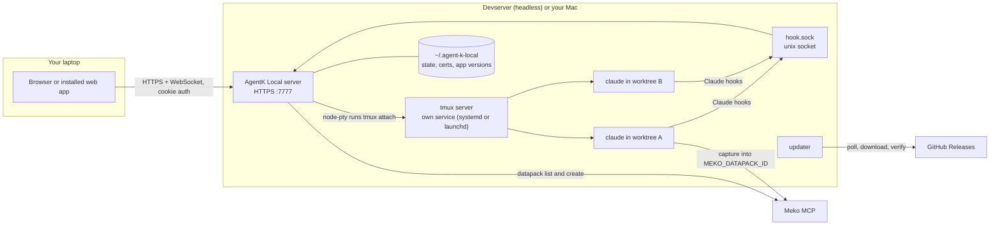
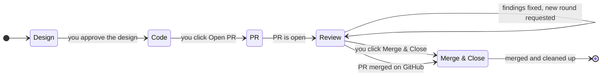

# AgentK Local

The agentic coder for ADLC. AgentK Local helps you work across many projects and
[Claude Code](https://claude.com/claude-code) sessions at once, with [Meko](https://mekodata.ai)
as its data layer. It's self-hosted, runs on your devserver (headless) or your Mac, and you use it
from a browser.

**Contents:** [Decisions](#decisions-so-far) · [Architecture](#architecture) · [The app](#the-app) ·
[Projects & sessions](#projects-worktrees-and-sessions) · [Task lifecycle](#task-lifecycle) ·
[Datapacks](#datapacks) · [Token usage](#token-usage) · [Login & security](#login-and-security) ·
[Crash recovery](#surviving-crashes-restarts-and-updates) ·
[Releases & updates](#releases-and-auto-update) · [Tech stack](#tech-stack) ·
[Milestones](#milestones) · [Open questions](#open-questions)

## Decisions so far

| Topic | Decision |
|---|---|
| Session UI | Embed the real Claude Code TUI (xterm.js over WebSocket). Don't rebuild Claude's interface. |
| Process host | tmux on a dedicated socket, in its own background service (a systemd user unit on Linux, a LaunchAgent on macOS), so the server can restart or update without touching sessions. |
| New project | Pick a repo from a list of the git repos under `~/code`. The folder is configurable, and you can clone a repo into it from a URL. |
| Local state | SQLite (`~/.agent-k-local/state.db`), WAL mode, schema versioned with `PRAGMA user_version`. |
| Working copy | Each session gets its own git worktree on its own branch. When it ends, a clean worktree waits, build outputs and all, for the next session on the repo. |
| Datapacks | Each project gets one dedicated datapack (the write target) and can attach any number of shared datapacks (read targets). |
| Meko | Optional. With a key, projects get a dedicated datapack (or start without one, when Meko is down or the plan's datapack limit is reached, and get one later). Without a key, or turned off in Settings, AgentK works without datapacks. |
| Meko wiring | Sessions get `MEKO_AGENT_ID=claude_code:<project>`, and the project's datapack is pinned for that agent id. The Meko hooks already honour both, so no plugin change is needed. |
| Datapack names | New dedicated datapacks default to `adlc/proj/<repo>/<project_name>`. Datapacks with the `adlc/proj/` prefix are *project datapacks*: offered when shared with you, and filled in automatically. |
| Project sharing | A project is shared by sharing its dedicated datapack in Meko. A project datapack shared with you shows a banner and a notification, and opens as a new project with its repo and name filled in. |
| Runtime | Node 22 (bundled in releases). State uses the built-in `node:sqlite`; node-pty is the only native module. |
| Network | Reachable directly on the corp network over HTTPS, behind a login; or local only, listening on 127.0.0.1 with no login. |
| Existing tmux sessions | Not adopted. Only sessions created by AgentK Local are shown. |
| Crash behaviour | After a host reboot, the server automatically brings back every open project and session with `claude --resume`. Sessions that were mid-turn are told to continue. |
| Token usage | Tracked per session and per project (per model and per day too), read from Claude Code transcripts including subagents. |
| Task lifecycle | Design → Code → PR → Review (AgentK) → Merge & Close, with three human gates; Quick Code sessions skip Design, and Exploration sessions have none of it. More ADLC stages plug in later. |
| Host OS | Linux devservers, and Macs on Apple Silicon (macOS 14 or newer) while you're logged in to the desktop. Intel Macs and headless Macs aren't supported. |
| Distribution | Public GitHub repo. GitHub Actions for CI and releases, date-based versions (`0.YYYYMMDD.N`), tarball releases, and an update check built into the server. |
| Repo & license | Internal at `github.com/yugabyte/agent-k-local` for now, to be made public later. Apache-2.0. |
| Sharing | Everyone installs their own copy. One owner per install, with no shared instances. |
| Client | Browser first. Chrome's "Install app" gives it a dock icon: the web app manifest (`manifest.webmanifest`) names it "AgentK Local" and supplies the logo as regular and maskable icons. `/favicon.ico` and `/apple-touch-icon.png` are served at the root too, for browsers and phones that look there instead of reading the page's links; a missing file is a 404, never the app page. A native Mac wrapper is deferred. |

## Architecture

There are three long-lived pieces on the host: the web server, the tmux server that owns every
Claude process, and the state directory at `~/.agent-k-local`. The server is stateless enough to
be killed at any time. tmux and the on-disk state are what carry your work.



**Terminal path.** When you open a tab, the browser opens a WebSocket. The server spawns
`tmux -L agentk attach -t ak-…` in a pty and pipes it through. Closing the tab kills only that pty,
and Claude keeps running. tmux has no prefix key, so Ctrl+B reaches Claude Code and tmux's own
commands can't be typed from the terminal.

**Status path.** Each session starts with `claude --settings` pointing at an agent-k hooks file.
The `SessionStart`, `UserPromptSubmit`, `PreToolUse`, `PostToolUse`, `PermissionRequest`,
`Notification`, `Stop` and `SessionEnd` hooks (and the status line relay) post to a unix socket,
which drives the badges in the rail. Your global Claude settings stay untouched. When `/clear` (or
`/resume` inside Claude) switches conversations, `SessionStart` carries the new session id, and
Resume and recovery continue that conversation.

## The app

The left rail holds projects, each with its repo's folder name in small type under the project
name and the most urgent session state shown on it. Drag a project to reorder the list; on a touch
screen, use **Move up** / **Move down** in the project home's settings. The top tabs hold that project's sessions. The
main pane is the live Claude terminal, and the footer shows where the session is working: branch,
diff size, tokens, the project's Meko datapack (`Meko:<datapack>`) and stage.


Session states, shown with a dot in the rail and on each tab:

- **Working**
- **Needs you:** a permission prompt or a question
- **Idle**, waiting for your next prompt
- **Recovered** after a restart
- **Exited**

### New project

A new project starts from a repo you already have. The dialog lists every git repo directly under
your repos folder (`~/code` by default), with the most recently touched first. A repo can back
several projects: one that already has a project is marked with its name (*In "infra"*, or *In 2
projects*) and can still be picked. A repo is matched by its real path, so one reached through a
symlink or another folder is the same repo. Each project on a repo gets its own datapack, Meko agent id,
settings, sessions and worktrees; project names must differ within a repo. Their session branches
share the repo, so a branch name that another project already uses gets a number added
(`ak/fix-tests-2`). Per-repo files such as `.agent-k/stages/` overrides apply to every project on
the repo.


- **What the list shows.** For each repo: its folder name, the `origin` remote, the current
  branch, and when it was last touched. The scan also reads a fork's `upstream` remote, for naming
  and matching (below). The server scans the folder when the dialog opens, so
  repos you clone by hand appear straight away.
- **What it leaves out.** Folders that aren't git repos, and git worktrees (a `.git` *file*
  rather than a directory), are left out. Only the top level is scanned by default. The scan depth
  and the list of folders are both settings.
- **Clone from URL.** Paste a git URL and the server clones it into `~/code/<name>` using your
  existing git credentials, then selects it. "Other folder" takes any repo path on the host.

The dialog starts with the **dedicated datapack**: **Create a new one** (the first option and the
default), **Use an existing one** (the default when it's opened for a share, from its banner) or
**No datapack** (the default while Meko is off). The existing list shows invites waiting for you first, then datapacks shared with you, then yours, each with its
access and, for shares, its owner. It holds project datapacks (`adlc/proj/…`) unless you tap **Show
all datapacks**. A datapack a project here already uses is tagged with that project and listed
last. A viewer-only datapack is listed but can't be chosen, because sessions write to the dedicated
datapack. **Refresh** lists them again and checks Meko for new shares. Choosing a datapack collapses
the list to that one row (**Change** brings it back) and fills in the rest from its name
`adlc/proj/<repo>/<project>`:

- **Project name:** the `<project>` part (everything after the repo part). You can still change it.
- **Repo:** by the remote in the datapack's description (AgentK writes it there when it creates a
  datapack; SSH and HTTPS forms compare equal): first a fork whose `upstream` is that remote, since
  that's where you work on it, then a clone whose `origin` is the remote itself. So with
  `~/code/hari-yugabyte-db` (a fork of `yugabyte/yugabyte-db`) and `~/code/yugabyte-db` (a clone of
  it), the fork is picked. Otherwise by `<repo>` against a fork's upstream repo name, the origin's
  name or the folder name, all alike (a name says less than a remote, so an old fork doesn't beat
  the clone you use). With several matches, the most recently touched, and the hint says so. The
  repo filter also searches the upstream remote. With none, the remote (if known) is filled in under Clone from URL, or the
  hint says no repo by that name was found.

The name and repo matching live in `src/shared/datapacks.ts`, so the server and the dialog use the
same rules. **Create a new one** suggests a datapack named `adlc/proj/<repo>/<project>` from the
repo and the name you type, where `<repo>` is the upstream repo's name for a fork, else the
origin's, else the folder's (`hari-yugabyte-db` gives `yugabyte-db`), whether the repo was picked
from the list or typed under Other folder; a name without the prefix gets a hint that people you share
it with won't be offered it as a project. Choosing an invite changes the button to **Accept and
create project**: the server accepts the invite in Meko first, and creates nothing if Meko refuses.
The server refuses a viewer-only datapack as a project's own too (from the shares table's grant,
else `datapack_describe`), not only the dialog.

### New session

You give it a name, a session type and, optionally, a first prompt and a base branch (the default
is the project's default branch). The three types sit side by side, with a line under them saying
what the selected one is for:

| Type | For | Stages |
|---|---|---|
| **Exploration** (`explore`) | Investigating, answering questions, POCs and experiments | Explore only: no gates; you end it with Archive or Discard |
| **Plan & Implement** (`plan`, the default) | Normal tasks | Design → Code → PR → Review → Merge & Close |
| **Quick Code** (`quick`) | Small tasks | Code → PR → Review → Merge & Close |

The type is stored as `sessions.kind` and decides the first stage, the stages the stage bar shows,
the first prompt (`explore`, `design` or `code`) and the workflow line of the system prompt Claude
gets. `CreateSessionRequest.skipDesign: true` still works and means Quick Code. The server fetches the base from `origin` and fast-forwards your local base
branch to it when that's safe, then creates the worktree and branch from it, starts Claude inside
it (or in an idle worktree of the repo: see [Worktree reuse](#worktree-reuse)), and focuses the tab. If the local base can't be fast-forwarded (it has commits origin lacks,
local edits would be overwritten, or it is checked out in another session's worktree), the session starts from `origin/<base>` and the activity log
says why.

### Changes

Clicking the `+N −N` numbers in the footer opens a side panel with every file changed on the
branch since it left the base: committed, uncommitted and untracked (ignored files are left out).
Each file has a kind (A, M, D, R, U), its line counts, an *uncommitted* tag when it has uncommitted
edits, and a collapsible diff. Single-file diffs are cut at 256 KB and the whole panel at 4 MB;
past that only line counts are shown.
Untracked files over 1 MB aren't read (no diff, 0 lines), and at most 32 MB of untracked files is
read per refresh. A changed image (PNG, JPEG, GIF, WebP, AVIF, BMP, ICO) is
shown as *Before* and *After* side by side with its size, instead of "Binary file";
`GET /api/sessions/:id/changes/image` serves the base's version from git or the worktree's from
disk, only for those types, only inside the repo (no `..`, no symlinks out), up to 20 MB, and with
a sandboxing content policy so the bytes can never run as a page. The footer counts use the same
comparison, so they always match. The file list is the header's **Files** menu, with a filter, so
you can jump to any file from anywhere in a long diff; each file's header shows its position
(*4 / 12*), and `[` / `]` step to the previous or next file.

### Review comments

Click **+** beside a line of any diff (shift-click a second line for a range) to leave a comment,
as on a PR. Comments are drafts in `state.db` until you click **Send N comments**, which pastes
them into Claude as one prompt, grouped by file, with the lines each one is about. If Claude is
mid-turn or waiting on a permission prompt, they queue and go out when it's back at its prompt in
the Code or Review stage. Each comment keeps an excerpt of its last 20 lines (lines over 1,000 characters are cut short and
marked with "…"), so it follows them when
Claude moves code (its card then shows the line it's at now and the one it was written on). When
its lines can't be found it's shown at the top of its file, still sendable: as changed if the diff
still shows its line with other text, otherwise as not in the diff shown. Deleting a draft asks
first. Sent comments are
kept and shown with **Show sent**.

### Design panel

During Design the panel opens as soon as the design exists and again whenever it's revised, at
about 60% of the work area. An Artifact design is shown in a sandboxed frame (scripts allowed, no
same-origin access, and a content policy that blocks network requests and limits scripts, styles
and fonts to what Artifacts use, placed first in the frame's document so nothing of the page runs
before it), so the page can't read the login cookie or call the API. **Open on claude.ai** links to
the published Artifact. A markdown design is rendered as sanitized HTML with no forms or styles,
and its links open in a new tab.

### Side panels

The design doc and the changes panel open on the right of the terminal, one at a time. Drag the
panel's left edge (or focus it and use the arrow keys) to resize it; double-click the edge to
switch between normal and widest. Each panel's width is remembered in the browser. The design doc
also opens full page in a new tab (`/p/<project>/s/<session>/design`), where it can still be
approved.

### Starting

Claude Code can take a while to load its plugins, MCP servers and startup hooks. While a session
starts, the terminal shows its steps (updating the base branch and preparing the worktree, starting
Claude Code, loading, sending your task) with the current one animated and timed, plus the stage
the session opens in. The session's tab shows the current step in its tooltip.

### Keyboard

`⌘1–9` switches projects, `⌃Tab` cycles sessions (browsers keep `⌃Tab` for themselves in a
normal tab, so it works in the installed app window), and `⌘K` opens a palette to jump to any
session or project home, or create a session. On Linux and Windows these use Ctrl, so the terminal
doesn't get Ctrl+K, Ctrl+1–9 or Ctrl+Tab; every other key passes through to the terminal whenever
it has focus. To copy from the terminal, drag across the text: tmux selects it and sends it as
OSC 52, which the page puts on the clipboard. Shift-drag (Option-drag on a Mac) selects in the
browser instead, and then `Ctrl+C` (`⌘C`) copies rather than interrupting Claude. Clipboard access
needs HTTPS or localhost.

### Notifications

A browser notification fires when any session moves to *needs you* or finishes a turn while its
tab is hidden. You can mute it per project. Only one open AgentK page shows them, the one used
last (pages queue for a Web Lock and a page that gets focus steals it; when it closes, the next one
takes over), so clicking a notification opens its session in the window you're using rather than
in a forgotten background tab. Phones where a page can't show notifications itself (Android Chrome) get them through a
minimal service worker (`/sw.js`); tapping one opens its session in an open AgentK window, or a new
one. The service worker caches nothing and handles no requests.

A project datapack shared with you also sends one notification (an `invite` event, once per
datapack); clicking it opens the New project dialog for it. Tapped through the service worker, it
opens the dialog in an open window, or opens `/`, where the share's banner is waiting.

### On a phone

At 760 px wide or less the app switches to a phone layout. The rail becomes a drawer behind a top
app bar (the Back gesture closes it, and it holds **Search and commands** in place of `⌘K`). The
app bar also holds the session tabs, between the drawer button and ⋯, so the session name isn't
repeated above them (each tab shows its status and stage). The session header,
the stage bar with its gate button (Approve design, Open PR, Merge & Close) and the footer details
move into a ⋯ sheet, leaving the screen to the terminal; a dot on ⋯ marks a gate that is ready for
you, and the sheet says why a closed gate is closed. Dialogs open as bottom sheets. The app, and
the overlay behind a dialog or sheet, are pinned to the visible viewport (its height and, where iOS
pans the page for a focused field, its offset), so the on-screen keyboard shrinks them instead of
covering the prompt or a dialog's fields; while you type, the terminal stays scrolled to its newest line. On
touch screens the terminal gets a key bar (Esc, a sticky Ctrl, Shift+Tab, arrows, Ctrl+C, Enter;
with Ctrl lit, the next letter typed in the compose box or in typing mode goes to Claude as Ctrl
plus that letter, such as Ctrl+O or Ctrl+R) and a compose box (it grows with its text to about a fifth
of the visible screen, then scrolls) whose text goes in as one bracketed
paste (with any Escape characters removed), then Enter; if the terminal isn't connected, the text
stays in the box. Swiping scrolls through mouse-wheel reports, which tmux hands to Claude Code (it
runs full screen and takes the mouse). The steps are sent together once a frame, a flick keeps
coasting and slows down until it stops or a new touch lands, and the terminal on screen draws with
WebGL (fetched only on touch screens; it falls back to the DOM renderer if WebGL is missing, loses
its context, or sizes its canvas wrongly). Tapping the terminal only brings up the keyboard in
typing mode (the keyboard key). Phones default to an 11 px terminal font (about 48 columns),
adjustable in the ⋯ sheet and remembered per browser.

### Project home


Recent activity shows the project's last 50 events, newest first, and scrolls inside its box so it
never pushes the rest of the page down.

**Share** sits in the project's header: it shares the whole project, through its dedicated
datapack. In API mode it opens the Share dialog; in link mode it is **Share in Meko ↗**, which
opens the datapack's Share page in the Meko web app. With Meko off it asks for a Meko API key
first (**Add a Meko API key**), and for a project without a dedicated datapack it offers **Add a
dedicated datapack**. Meko itself refuses a share from someone who isn't the owner or a
maintainer. See [Sharing a project](#sharing-a-project).

A project without a dedicated datapack says so in its Datapacks box, with **Add a dedicated
datapack** (a new one, or one of yours; `POST /api/projects/:id/dedicated-datapack`), or **Add a
Meko API key** while Meko is off. A shared datapack already attached can become the dedicated one.
The datapack is pinned then, and new sessions use it. Search is hidden for a project with no
datapacks.

## Projects, worktrees and sessions

A **project** is an effort to build or improve a feature, product or service. It works in a git
repository on the host, picked from your repos folder (`~/code`) or cloned into it at creation.
The project only points at the repo. The one change it makes there: when a
session starts, it fast-forwards the local base branch to `origin`. That's a `merge --ff-only`
with autostash off when your main checkout has the branch checked out (git refuses if it would
overwrite local edits), or a non-forced local fetch (`git fetch . origin/<base>:<base>`) when no
worktree has it checked out (git refuses anything but a fast-forward, and a branch being rebased
or bisected). A base checked out in another session's worktree is left alone. Read-only git
commands run with `GIT_OPTIONAL_LOCKS=0`, so they never take a lock Claude's own git commands need. It never rewrites, resets or discards anything in your main checkout. A
**session** is one task. It has one worktree, one branch and one Claude conversation. Worktrees
live outside the repo so they never show up in `git status`, and outlive their session: a clean one
goes idle for the next session on the repo (see [Worktree reuse](#worktree-reuse)).

```sh
# layout on the host
~/.agent-k-local/
  config.toml              # host settings: address and port, TLS paths, repo roots, update channel, Meko
  state.db                 # SQLite: projects, sessions, events, auth (WAL)
  hook.sock                # Claude hooks → server
  certs/                   # self-signed pair, or symlinks to your own
  app/0.4.1/  app/current → 0.4.1
  worktrees/<repo>.<hash>/wt-<n>/  # git worktree, shared by the repo's projects (older ones: worktrees/<project>/<session>/)
  designs/<session>/design.md      # markdown design written during Design (Artifact designs live on claude.ai)

# config.toml (excerpt)
[repos]
roots = ["~/code"]        # folders the New project dialog lists
depth = 1                 # 1 = only direct children
clone_into = "~/code"     # where "Clone from URL" puts new repos

[worktrees]
idle_per_repo = 3         # idle worktrees each repo keeps for its next session (0 to 20; 0 removes them)
idle_days = 14            # an idle worktree no session used for this many days is removed (0 to 365; 0 keeps it)

[meko]
# enabled = false            # turn Meko off (projects work without datapacks); on by default
# url = "…"                  # Meko MCP server; unset uses MEKO_MCP_URL, Claude Code's settings, then Meko Cloud
# api_key = "…"              # unset uses MEKO_API_KEY, then Claude Code's settings
# web_url = "…"              # Meko web app, for links; unset is worked out from the MCP URL (Cloud, mekodev)
# api_url = "…"              # Meko's REST API, for sharing; unset uses MEKO_API_URL, then web_url + /api/v1
capture_transcripts = false  # send session transcripts to Meko conversations (off for now)
```

| Action | What the server does |
|---|---|
| New session | `git fetch origin <base>`, fast-forward the local `<base>` to `origin/<base>` if safe, then in the repo's most recently idled worktree `git checkout --no-track -b ak/<slug> <base>` (or `origin/<base>` if the fast-forward was skipped), or with none `git worktree add … -b ak/<slug> <base>`, then `tmux -L agentk new -d -s ak-<proj>--<slug> -c <worktree>` running `claude --session-id <uuid> --settings <hooks> -n "<name>" [-- prompt]` through your login shell, with the session's variables (Meko, hook token) set after your profile runs so it can't override them. |
| Open tab | Spawns a pty on `tmux attach`, one per viewer. The terminal is resized to fit the browser. tmux 2.7 draws a window at its smallest viewer's size, so a phone lets go of its terminals after its page has been hidden for 30 seconds, and of a session's terminal 5 seconds after you switch away from it, and reconnects when it is shown again. The browser opens the socket at its terminal size (`?cols=&rows=`). A dropped connection reconnects with backoff (reset once a connection has stayed up 5 seconds); a close for a lost login (4401) goes to the login screen, a missing or archived session stops with a **Try again** button, and an attach that couldn't start retries with backoff. |
| Close tab | Kills the pty only. tmux and Claude keep running. |
| Claude exits | The pane dies and the status becomes *exited*. **Resume** relaunches `claude --resume <uuid>` in the same worktree. |
| Archive | Kills the tmux session. A clean worktree goes idle for the next session (HEAD detached, so the branch is free), or is removed when *Idle worktrees per repo* is 0; the branch is always kept. The record stays, so the session can be restored later. If the session is still starting, Archive (and Discard) waits for Claude to start first. |
| Discard | Chosen in Archive's confirmation step. Kills the tmux session, throws away uncommitted changes and untracked files (`git reset --hard`, `git clean -fd`: ignored build outputs stay), lets the worktree go idle (or force-removes it when it can't be cleaned or reuse is off), and deletes the local branch. It first warns about uncommitted files and commits that no remote has. The remote branch and any PR are left alone. The record and its token usage stay, as with Archive. |
| Delete project | After confirmation, stops the project's sessions and lets go of their worktrees as Archive does, keeping any worktree with uncommitted changes, and marks the project deleted. Idle worktrees stay for the repo's other projects; the last project on a repo removes them. Its sessions and token usage are kept for the Usage page. Never deletes the repo, its branches or the datapacks. |

```sql
-- state.db (abridged). One writer: the server. Migrations keyed on PRAGMA user_version.
CREATE TABLE projects (
  id TEXT PRIMARY KEY,            -- slug of the repo, e.g. billing-api; later projects on it add their name: billing-api-release-tooling
  name TEXT NOT NULL, repo_path TEXT NOT NULL, default_branch TEXT NOT NULL,   -- several projects may share a repo
  position INTEGER, settings_json TEXT, created_at INTEGER, deleted_at INTEGER);
CREATE TABLE project_datapacks (
  project_id TEXT REFERENCES projects, datapack_id TEXT, name TEXT,
  role TEXT CHECK (role IN ('dedicated','shared')),
  PRIMARY KEY (project_id, datapack_id));
CREATE UNIQUE INDEX one_dedicated ON project_datapacks(project_id) WHERE role = 'dedicated';
CREATE TABLE sessions (
  id TEXT PRIMARY KEY, project_id TEXT REFERENCES projects, name TEXT,
  claude_session_id TEXT NOT NULL, branch TEXT, worktree_path TEXT, tmux_name TEXT,
  desired TEXT CHECK (desired IN ('running','archived')),   -- what recovery restores
  status TEXT,                    -- starting | working | needs_input | idle | exited | recovered | archived
  kind TEXT,                      -- explore | plan | quick (the session type)
  stage TEXT,                     -- explore | design | code | pr | review | merge (Merge & Close) | done
  pr_number INTEGER, pr_url TEXT, review_state TEXT, ci_state TEXT,
  plan_mode INTEGER,               -- 1: designs in Claude's plan mode (sessions created before designs moved out of it)
  pending_prompts TEXT,            -- prompts queued for Claude: JSON map of 'review' | 'review-people' | 'ci' to
                                   --   { state: 'queued' | 'sent' (until that turn ends), vars }; replaces pending_review
  ci_fix_head TEXT, ci_fixes INTEGER,  -- the PR head that last got a CI-fix prompt; how many heads in a row did
  agentk_seen INTEGER,             -- 1 once AgentK commented on or reviewed the PR, or was asked to
  last_event_at INTEGER, created_at INTEGER, archived_at INTEGER);
CREATE TABLE worktrees (       -- session worktrees; idle ones (session_id NULL) wait for the repo's next session
  path TEXT PRIMARY KEY, repo TEXT,  -- repo: the repo's real path, the pool key its projects share
  session_id TEXT, released_at INTEGER,
  stale INTEGER,                   -- 1: idle but not reusable (files git doesn't ignore)
  created_at INTEGER);              -- (sessions.worktree_released is 1 once a session let go of its worktree)
CREATE TABLE designs (         -- one per session: markdown, or an Artifact's page + claude.ai link
  session_id TEXT PRIMARY KEY, markdown TEXT, html TEXT, artifact_url TEXT, updated_at INTEGER);
CREATE TABLE review_comments ( -- comments on a session's diff: draft → queued → sent to Claude
  id TEXT PRIMARY KEY, session_id TEXT, path TEXT, side TEXT, line INTEGER, end_line INTEGER,
  excerpt TEXT, body TEXT, state TEXT, created_at INTEGER, updated_at INTEGER, sent_at INTEGER);
CREATE TABLE session_stages (  -- stage history: who moved it, and when
  session_id TEXT, stage TEXT, entered_at INTEGER, left_at INTEGER, moved_by TEXT);
CREATE TABLE session_events (  -- every hook call; feeds badges + project activity
  id INTEGER PRIMARY KEY, session_id TEXT, kind TEXT, payload_json TEXT, at INTEGER);
CREATE TABLE owner (id INTEGER PRIMARY KEY CHECK (id = 1), username TEXT, pw_scrypt TEXT, totp_secret TEXT);
CREATE TABLE auth_sessions (token_sha256 TEXT PRIMARY KEY, created_at INTEGER, expires_at INTEGER, user_agent TEXT, ip TEXT);
CREATE TABLE audit_log (id INTEGER PRIMARY KEY, at INTEGER, action TEXT, detail_json TEXT);
CREATE TABLE kv (key TEXT PRIMARY KEY, value TEXT);   -- setup token, update state, plan limits
```

- **Why SQLite.** You get transactions across projects, sessions and datapacks, an event history
  for the activity feed, and crash safety without hand-rolled atomic file writes. It's still one
  file you can back up or inspect with the `sqlite3` CLI.
- **Settings.** `journal_mode=WAL`, `synchronous=FULL` (so a host crash never loses a committed
  session record), `foreign_keys=ON` and `busy_timeout=5000`. There are so few writes that FULL
  sync costs nothing noticeable. Old `session_events` are pruned after 30 days, except `merged`
  events, which the Usage page counts.
- **Not on NFS.** SQLite locking is unreliable on network filesystems. The installer checks the
  filesystem type of `~/.agent-k-local`. If it's NFS, the installer puts `state.db` on local disk
  (`$XDG_STATE_HOME`, then `/var/tmp/$USER`) and records the path in `config.toml`. The
  `/var/tmp/$USER` folder must be a real directory owned by you that others can't write to, or the
  installer stops rather than put the database (password hash, TOTP secret) somewhere another user
  controls.

`config.toml` holds host settings: the listen address and port, TLS paths, repo folders, the update
channel, the Meko URL and key (only when typed at install), transcript capture, the tmux socket, the
`claude` command, the database path and how many idle worktrees each repo keeps. The Settings dialog
writes its fields (repo folders, scan depth, clone folder, idle worktrees per repo and the days to
keep an unused one, update channel) there too. Per-project settings, sessions and everything else live in `state.db`. Only values that
differ from the defaults are written, so a changed default reaches existing installs; a value of the wrong type is ignored with a warning. `AK_BIND` and
`AK_PORT` override `[server]` for one run (`npm run dev`) and are never written to the file. The Meko
URL and key come from `[meko]`, then `MEKO_MCP_URL`/`MEKO_API_KEY`, then the `env` block of Claude
Code's user `settings.json` (in `CLAUDE_CONFIG_DIR` if set); a later source's URL is skipped when that
source has a key of its own, and with no URL it's Meko Cloud.

### Worktree reuse

Repos like yugabyte-db take a long time to build from scratch, so a worktree outlives its session
and keeps its ignored files (`build/`, `node_modules/`, CMake caches) for the next one. The path
stays the same, which matters to build systems that record absolute source paths (CMake,
`yb_build.sh`): a copied or moved build tree would break.

- **Idle.** When a session ends (Archive, Discard, Merge & Close, Delete project) with a clean
  worktree (`git status --porcelain` empty), `git checkout --detach` frees its branch without
  changing a file, and the worktree's row in `worktrees` loses its session. A worktree with
  uncommitted changes stays the session's, as before, and is never handed on.
- **Shared by the repo's projects.** Idle worktrees belong to the repo, keyed by its real path, so
  every project on it (a repo can have many at once) takes from the same pool. New worktrees live
  in `worktrees/<repo folder>.<8 hex of sha256(real path)>/wt-<n>`; the dot keeps these folders
  apart from project ids, and older `worktrees/<project>/<session>` folders are reused where they are.
- **Claim.** A new session claims the repo's most recently idled worktree in the same SQLite write
  that adds the session, so two sessions starting at once never get the same one. The worktree
  must still be a clean worktree of the repo on a detached HEAD; then the session's branch is
  checked out there from the same start point a new worktree would get. Git rewrites only the files
  that differ, so builds are incremental. If the checks fail, the worktree leaves the pool (removed
  without `--force`, or kept as stale if git refuses) and the session gets a new worktree; if
  something else fails (a bad base branch, a branch checked out elsewhere), the worktree goes back
  to the pool and a new worktree is tried. Reuse never makes a start fail.
- **Removal is safe while sessions start.** Trimming, expiry and the startup sweep forget an idle
  worktree in one write that does nothing once a session has claimed it, and only then run
  `git worktree remove`. A worktree git won't remove (files it doesn't ignore) stays recorded as
  stale: never handed out or forgotten while its folder exists, and reusable once it's clean again.
- **Cap.** Each repo keeps at most `[worktrees] idle_per_repo` idle worktrees (Settings › General,
  default 3, 0 to 20). Beyond that the one idle longest is removed with a plain
  `git worktree remove` (it has only ignored files left, so no `--force`). Saving a lower number
  trims every repo in the background; 0 removes worktrees when sessions end.
- **Expiry.** An idle worktree no session has used for `[worktrees] idle_days` days (Settings ›
  General, default 14, 0 to 365; 0 keeps it until the cap trims it) is removed the same way. The
  server checks at startup, every hour, and in the background when the setting is lowered.
- **Ownership.** Once a session lets go of its worktree (idle, or removed), `sessions.worktree_released`
  is set, so the session never reads or removes that folder again, whatever happens to the pool:
  its Changes panel says the worktree is gone, Discard's check reports none, and `gh` runs in the
  main checkout.
- **Recovery.** At startup, in the background, the server forgets idle worktrees whose folder is gone,
  marks stale the ones no longer clean and detached (and stale ones that are clean again usable),
  removes those of repos no live project uses and those unused too long, and trims to the cap.
  Deleting a project keeps the repo's idle worktrees while another project uses the repo.
- **What carries over.** Every ignored file, not only build outputs: `.env`, `CLAUDE.local.md`,
  `.claude/settings.local.json`, local databases and logs. Set the cap to 0 for fresh worktrees.

## Task lifecycle

Every session is a task that moves through stages, from design to a merged PR with the branch
cleaned up. This first pipeline covers six stages of the development lifecycle. The pipeline is
defined as data, so later stages such as test, deploy and monitor can be added without reworking
sessions.

There are three **gates** that only you can pass: approving the design, opening the PR, and
merging. Everything between the gates runs on its own. A Quick Code session starts at Code, so it
has only the last two gates. An Exploration session never enters this pipeline: it stays in the
Explore stage, where Claude gets the `explore` prompt (investigate, build POCs, run experiments,
push experimental branches if useful), edits aren't guarded, and review comments from the Changes panel still
reach Claude. It ends when you archive or discard it.

In the UI, the one doing the work in these stages is **AgentK** ("AgentK writes a design…",
"Wait for AgentK to finish its turn"). "Claude" is kept for the Claude Code process and its
terminal: starting it, exits, Resume, and the compose box.



| Stage | Claude | AgentK Local | Moves on when |
|---|---|---|---|
| 1 · Design | Starts with your task (not in plan mode), reads the code, and designs the change in one place: a complex design is published as a native Artifact with diagrams; a simple one is written as markdown to `~/.agent-k-local/designs/<session>/design.md`. It doesn't touch the repo. | Blocks file edits inside the worktree and main checkout (a `PreToolUse` guard hook). Keeps the published Artifact's page and claude.ai link (from the Artifact tool's `PostToolUse` hook), or reads the markdown file when the turn ends. Saves the design to the project's dedicated datapack, marks the session *Design ready*, and opens the design panel by itself. | You click **Approve design**, and the server sends the Code prompt ("The design is approved…"). Quick Code sessions skip this stage. Sessions created before this change still design in plan mode and are approved through Claude's plan dialog. |
| 2 · Code | Implements the design and runs the repo's tests and checks. | Shows the diff size against the base branch in the footer; clicking it opens the Changes panel with a diff per file, where you can leave review comments and send them to Claude. | You click **Open PR**. The button is disabled while Claude is mid-turn. |
| 3 · PR | Commits with the repo's own commit conventions, pushes the branch, and runs `gh pr create` with a summary taken from the design. | Records the PR number and URL and links them next to the stages. | Automatically, once the PR exists. |
| 4 · Review | When a review arrives, follows the `review` prompt (AgentK: verifies each finding, fixes the valid ones, pushes, replies on every thread and reacts +1/−1) or the `review-people` prompt. When CI fails, follows the `ci` prompt: reads the failing jobs' logs, then fixes and pushes, or reruns the jobs once if the failure isn't caused by the change. | Looks for the PR every 15 seconds in the PR stage (only a PR opened after the session was created counts, since branch names can be reused), and checks reviews, CI checks and approvals every 45 seconds and at every turn end. This runs on the server, so waiting costs no tokens. New reviews are sent to Claude according to the project's reviewer mode (below). When CI fails on the PR's head, you get a notification and Claude gets the `ci` prompt. That happens once per head commit, after every check has finished (or 10 minutes after the failure appeared), and not while the branch has unpushed commits. After three failing heads in a row, you're asked to take over, and a green run starts the count again. If Claude is mid-turn, waiting on you, or exited, prompts are queued in `state.db` (so they survive restarts) and go out one at a time when Claude is back at its prompt, reviews before CI. A queued CI prompt is dropped if the head moves or CI stops failing. The findings count as addressed only when the turn that got the prompt ends. | You click **Merge & Close**. It is enabled once CI is green, no review findings are left unaddressed (and, once AgentK is active on the PR, its review is in), the required approvals are in, every local commit is pushed to the PR, and Claude is neither working nor waiting on you in the terminal. |
| 5 · Merge & Close | Nothing. | Runs `gh pr merge` using the project's merge method (the repo's default unless changed in project settings). Once GitHub reports the PR as merged (also when it was merged on GitHub), writes a summary of what shipped (PR title, link and description) to the dedicated datapack, ends the tmux session, lets the worktree go idle for the next session (or removes it), deletes the local and remote branch, runs `git fetch --prune` in your main checkout, and archives the session. If Claude is mid-turn when the PR merges, this waits until the turn ends. Branches with commits the merged PR doesn't have are kept (the remote branch is deleted only while it still points at the PR's head). If the server restarts partway, the next poll finishes the job. If the PR is closed instead, or is still open 10 minutes after the merge was requested (for example, it left a merge queue), the session goes back to Review. | Done. The session record and its history stay. |

- **AgentK in the loop.** AgentK doesn't re-review on push, so after fixes the header offers
  **Request another round**, which posts `/agentk review` (**Request AgentK review** before AgentK
  has been active on the PR). If AgentK declines a PR (for example, because it's too large), the
  refusal is shown with a **Force review** button. Forcing is always your call.
- **Reviewer modes.** Each project's reviewer setting says whose reviews Claude addresses:

  | Mode | Claude addresses reviews from | Merge waits for AgentK |
  |---|---|---|
  | *All reviewers* | AgentK, people and other bots | Once AgentK is active on the PR |
  | *AgentK + People* (default) | AgentK and people | Once AgentK is active on the PR |
  | *People only* | People | Never |

  AgentK is active on a PR once it has commented on it or reviewed it, or someone has commented
  `/agentk review` on it, so repos AgentK doesn't watch never wait for it. Bots are the reviewers
  GitHub's REST API lists as `Bot`. It's only asked when a poll finds a new review that isn't
  AgentK's. Replies on review threads show up as empty reviews and are skipped, and so are
  Claude's own replies, which post as you. A person's review goes to Claude when it requests
  changes or comments with a body.
- **Stage prompts.** Each stage's instructions to Claude come from a template. The defaults are
  built in (`src/server/prompts.ts`), and a repo can override any of them (a stage, or `explore`, `approved`,
  `review`, `review-people`, `ci`, `continue`, `comments`) with `.agent-k/stages/<name>.md`. This lets a team
  change how designs are written or PRs described without changing agent-k-local. Review comments
  from the Changes panel go out through the `comments` template (`{{count}}` and `{{comments}}`),
  and CI failures through the `ci` template (`{{sha}}` and `{{checks}}`, the failing checks with links).
- **Branch names.** The branch prefix is a project setting, `ak/` by default, because some orgs
  enforce a branch-name prefix with rulesets.

## Datapacks

- **Dedicated datapack (one per project).** It's created with the project, named
  `adlc/proj/<repo>/<project_name>` by default, or you can pick an existing one. It is the only
  place session transcripts and extracted memories are written.
- **Shared datapacks (zero or more).** These are attached from your `datapack_list`: a team
  knowledge base, org conventions, another project's memory. They are read-only from this
  project's point of view, and one datapack can be attached to many projects.

Each session is launched with this environment:

```sh
MEKO_DATAPACK_ID=dp_7f3…                 # dedicated: capture + memory writes
MEKO_AGENT_ID=claude_code:billing-api     # one memory bucket per project, not per worktree dir
MEKO_DATAPACK_IDS=dp_7f3…,dp_a01…,dp_c9e… # everything this session may read
AK_SESSION=billing-api--fix-retry-backoff
```

A short `--append-system-prompt` also lists the attached datapacks by name and id, so Claude
knows to pass the right `datapack_id` when it searches them.

> **No Meko plugin change needed.** The Meko hooks already take `MEKO_AGENT_ID` over the folder
> name, and they read the datapack pin from `~/.claude/meko-capture/pin-<agent id>.json` (with `:`
> as `_`, e.g. `pin-claude_code_billing-api.json`). AgentK
> Local sets `MEKO_AGENT_ID=claude_code:<project>` for every session and writes that pin when the
> project is created and again each time a session starts. So every worktree of a project shares one memory bucket, and capture goes
> into the dedicated datapack. `MEKO_DATAPACK_ID` is set too, for when the hooks learn to read it.

> **Transcript capture is off for now.** Sending every session's transcript overloaded Meko, so
> `[meko] capture_transcripts` in `config.toml` defaults to `false` (a restart applies a change).
> While it's off, the server doesn't run the plugin's `capture.js checkpoint` after each turn, at
> startup or when a session stops, and doesn't create a named conversation per session. Sessions
> also get `MEKO_CHECKPOINT_INTERVAL=2147483`, so the plugin's checkpoint timer, which its
> SessionStart hook starts for a resumed session, never fires in practice: that's the longest
> interval Node's `setInterval` honours, and a larger one would fire every millisecond. With
> capture on, the launcher clears any inherited `MEKO_CHECKPOINT_INTERVAL`. The
> plugin's own SessionStart, PreCompact and SessionEnd hooks still run. The shipped summary
> written at Merge & Close is a single memory, not a transcript, and is still sent.

> **Folder trust.** Claude Code asks "Do you trust this folder?" the first time it runs somewhere
> new, and fires no hooks until that's answered. For a worktree, Claude keys that decision by the
> main repository, so the server marks the project's repo as trusted in `~/.claude.json` when the
> project is created, and checks again before each launch (other Claude processes can overwrite a
> fresh entry when they start, so it re-checks after a moment). If the prompt still appears (for a
> new, resumed or recovered session), the session shows *needs you* with an explanation.

> **Meko is optional.** Datapacks are how a project keeps track of its work, and sharing a project
> goes through its datapack, but AgentK works without them. Meko is *on* when there's a key and
> `[meko] enabled` isn't false (`MekoStatus.configured`). Off, AgentK doesn't talk to Meko: projects
> get no datapack, and sessions get no datapack, pin or Meko lines in
> their prompt (even a project that has a datapack). Claude Code's own Meko setup, in its settings,
> is the user's and isn't changed.
>
> - **At install:** the installer reuses `MEKO_API_KEY` from `~/.claude/settings.json` if one is
>   there, and otherwise asks for one, with **Enter to skip** (pointing to the Meko web app to
>   create an account or key). With no key, or `--no-meko` (which also turns Meko off), it goes on
>   with a warning, non-interactively too. A key it's given must work: without anyone to ask it
>   stops, and interactively it asks whether to go on without Meko (and turns it off, so a bad key
>   from the environment isn't used). With a key, it checks that Meko is set up for Claude Code:
>   the `meko-agent-skills` plugin installed and enabled, the verified `MEKO_API_KEY` in Claude
>   Code's settings (sessions don't inherit the installer's environment, and a different key there
>   would keep the hooks on it), and the `meko` MCP server registered. If anything is missing it
>   offers, after showing what will change, to run Meko's own setup (`@yugabytedb/meko-mcp
>   --client claude-code`), fetched from npm, checked against the registry's integrity hash and run
>   with the bundled Node, with the key passed in the environment. Declining it (or, without
>   `--install-deps`, not being asked) is a warning with the command to run yourself; the Meko tab
>   in Settings can run it later. Once Claude Code's settings hold the key, `config.toml` keeps
>   none, so an older key there can't shadow it.
> - **At project creation:** the dedicated datapack is an existing one, a new one, or **No
>   datapack** (`DatapackChoice` `{ mode: 'none' }`), the default while Meko is off.
>   When Meko refuses a new datapack because the plan's datapack limit is reached (HTTP 402,
>   `FREE_TIER_DATAPACK_LIMIT` / `STANDARD_TIER_DATAPACK_LIMIT`), the server answers 402 with code
>   `DATAPACK_LIMIT` and the dialog offers **Create without a datapack**. One can be added later
>   from the project's home.
> - **At session start:** every session gets `MEKO_AGENT_ID`, and `MEKO_DATAPACK_ID` when the
>   project has a dedicated datapack. A project without one starts sessions like any other; design
>   saves, the shipped summary and search skip Meko for it, and while Meko is off, for every project.
> - **If Meko goes down:** AgentK doesn't poll Meko or show a banner for it; being down is rare. An
>   action that needs Meko (creating a datapack, sharing, answering an invite, adding a key) shows
>   Meko's error, the project home shows no datapack counts, and background syncs log a warning and
>   try again later. Running sessions keep going; the Meko hooks capture from the transcript on
>   disk, so they catch up once it's back (when transcript capture is on). A project can still be
>   created with **No datapack** and get one later.
> - **In Settings:** the **Meko** tab turns Meko off (`[meko] enabled = false`; the key is kept, so
>   a key from the environment or Claude Code's settings is ignored too) and back on (checked with
>   Meko first; a new key turns it on as well). It sets the MCP server URL (empty means Meko Cloud, unless the
>   environment or Claude Code's settings name one), the API key, and the web app and API URLs
>   (worked out from the MCP URL for Meko Cloud and mekodev; fill them in for your own Meko). The
>   key never goes to the browser: the tab shows its last four characters and where it came from.
>   A new URL or key is checked with a Meko ping before anything is saved; then the MCP connection
>   is dropped (one still being opened with the old ones is dropped once it's up) so the next call
>   reconnects, and Meko and the sharing mode are checked again. An API URL that comes from a typed
>   API or web app URL is checked too, without the key (it must answer with Meko's JSON envelope,
>   `{ data }` or `{ error: { code, message } }`),
>   so a mistyped host never gets the key; a changed API URL also re-checks the sharing mode. A save
>   writes only the fields it changed, so a change that landed while its checks ran (Claude Code's
>   setup clearing the key) isn't undone.
>   Switching to another Meko host asks you to confirm, because existing projects' datapacks stay
>   on the old one. The tab also says whether Claude Code's settings (which sessions use) name the
>   same server and key, and when they don't, **Set up Claude Code with this Meko** runs Meko's
>   setup package as the installer does (without blocking the server; its output goes to the log).
>   New sessions pick that up; running ones keep what they started with.

### Sharing a project

A project is shared by sharing its dedicated datapack. Meko shares a datapack as an **invite**: the
owner (or a maintainer) invites an email address with a role, Meko emails them, and they accept or
decline it. Roles are `contributor` (runs sessions and writes their own memories; the default),
`maintainer` (can also promote memories and invite others) and `viewer` (read only). Memories are
per user in Meko, so a member sees their own memories plus the datapack's shared knowledge
(promoted memories and knowledge-base files), not the owner's raw memories.

Meko's share routes (`POST /datapacks/:id/share`, `GET …/member-list`, `GET …/outgoing-shares`,
`POST …/invite/:id/resend`, `DELETE …/invite/:id`, `GET /datapacks/incoming-shares`,
`POST /datapacks/invite-action`) are REST, not MCP. `src/server/mekoapi.ts` calls them with the
same API key, at `[meko] api_url` (by default the web app URL plus `/api/v1`). Today Meko accepts
only a web login on those routes, not an API key, so AgentK works in two modes. It calls
`GET /datapacks/incoming-shares` at startup, every hour, and after a change to the Meko URL, key or
API URL: an answer means **API mode**; a refusal (401, 403, 404 or 405), or no API URL at all,
means **link mode**. `AppState.meko.sharing` carries the result. Meko's own refusals of a share
call (a bad email, an invite already pending, no permission) come back with their status and
message; a 401 there also switches to link mode; anything else is a 502.

| | API mode | Link mode (today) |
|---|---|---|
| Share | The Share dialog: email, role, the people with access and pending invites (Resend, Revoke). Meko has no route to remove someone who has accepted; that's done in Meko. When an invite goes through but the lists can't be read again, it still says the invite was sent (`refreshError`). | **Share in Meko ↗** opens `<web app>/datapacks/<id>/share`. |
| An invite for you | A banner (and a notification) from `incoming-shares`: **Open as project** (creating the project accepts it), **Decline**, **Later**. A viewer invite gets **Accept** instead of Open as project. | Meko emails you and shows it in its notification bell; you accept it there. |
| A share you accepted, not yet a project here | A banner from `datapack_list`: **Open as project** and **Later** (a viewer share only explains, with **OK**). | Same. |

When AgentK creates a datapack for a new project, it sets the datapack's description (MCP
`datapack_update`) to `AgentK Local project "<name>" · repo <remote>`, so whoever it's shared
with can find the repo. The remote is the repo's `upstream` when it's a fork with a network
upstream, else its `origin`: people share the upstream repo, not your fork. Both are read with one
`git config --get-regexp` call, which the repo scan uses too. Only a network remote goes in: a local path (`/home/me/src/x.git`, `../x`)
is left out, and credentials in the URL (`https://user:token@…`) are removed, again when a
description is read. The update runs in the background, so it never holds up the project; a
failure is logged. Meko shows the
description only once an invite is accepted, so a pending invite is matched to a repo by name.

`InviteService` (`src/server/invites.ts`) keeps the shares in the `datapack_invites` table, one row
per datapack, synced at startup, every 5 minutes, and whenever the New project dialog opens or you
tap **Refresh**. The dialog makes one call, `POST /api/invites/check`, which lists the datapacks
once and syncs with that same list. Only project datapacks count, and only ones no live project
here uses. States: `invited` (waiting in Meko), `shared` (accepted, not yet a project), `later`
(hidden here; an invite stays in Meko), `used` (a project here has used it; never offered again,
even after that project is deleted, unless it's invited again), and `baseline`. The first sync
records the shares that already exist as `baseline`, without banners or notifications, so an
upgrade doesn't bring a burst of them; they can still be picked in the dialog. Invites always show.
An invite that disappears from Meko (revoked, or answered elsewhere) is removed; one accepted
elsewhere becomes `shared` without another notification. `AppState.invites` carries the `invited`
and `shared` ones. When accepting, AgentK sends its own Meko account id when it knows it (the
`user_id` on the datapacks it owns); Meko otherwise uses the caller's account.

One sync runs at a time; a sync asked for meanwhile waits for it. A sync reads Meko, then writes
the table in one transaction; when Accept, Decline, Later, a new project or a Meko account change
changed things in between, that read is stale, so it reads again rather than undo the change (a
list handed in by `/api/invites/check` carries a stamp taken before it was read, for the same
check). Our Meko account id is only taken from a read that wasn't stale. A `datapack_list` reply
of an unexpected shape is an error, not an empty list, so it can't make every share look gone; and
a share accepted here isn't taken for gone for 10 minutes while Meko's list catches up. An invite that was
already accepted (by an earlier try whose project then failed, or in Meko) isn't accepted again,
so **Accept and create project** can be retried. A change to the Meko URL or key may mean another
account: the rows other than `used` and the first-sync flag are dropped, so the new account's
existing shares are recorded quietly.

## Token usage

Claude Code writes every model response to the session transcript with its token counts. The
server reads new lines from each session's transcript, and from any subagent transcripts under
`<session>/subagents/`, after every turn (on the `Stop` hook), when a session ends or is archived,
and once a minute. It remembers the byte offset it reached, so each line is read once.

One response spans several transcript lines with the same message id, so usage is stored once per
message: `usage_messages(session_id, message_id, agent, model, at, input, output, cache_read,
cache_write)`. Totals per session, project, model and day are sums over that table, and archived
sessions keep counting toward their project.

**What shipped.** A merged PR is the session's `merged` event, or a Done session with a PR (Merge &
Close only ends in Done after a merge), counted once per session. A push
straight to the base branch is found in the same transcript pass: a Bash tool result that is a
push (git push's `To <remote>` line, or Claude Code's `gitOperation.push` marker, which also covers
output cut short with `| tail`) with a fast-forward `old..new  src -> <base>` ref update is stored
in `pushes(session_id, range, ref, at, commits)`, and `git rev-list --count old..new` in the
project's repo fills in `commits` (`-1` when git can't tell; the push still counts). Fetch and pull
output (`main -> origin/main`, under `From`), forced updates and new refs don't match. The
migration that added the table cleared the read offsets, so every transcript was read once more
(usage rows are upserts) and older pushes were found; transcripts of archived sessions are read at
startup, one session per tick.

**Plan limits.** On Pro and Max plans, Claude Code passes the account's 5-hour and weekly usage
(`rate_limits.five_hour` / `seven_day`: percent used and reset time) to its status line command.
Sessions are launched with AgentK Local's own status line (`run/statusline.sh`, set in the
`--settings` file). It sends inputs that carry limits to the server over the hook socket, in the
background, and then runs the user's own status line command with the same input, so the terminal
looks unchanged. That command is found at launch (local project settings, then project, then user
settings) and passed as `AK_USER_STATUSLINE`; sessions launched before this existed use the
user-level command saved in `run/user-statusline`; its `padding` and `refreshInterval` are copied.
If that command is Meko's `meko-statusline.sh`, only the command it wraps (`--inner-cmd`, or
`MEKO_INNER_STATUSLINE`) runs: Meko's "Meko: <datapack>" suffix would repeat what the session
screen already shows, since sessions always use the project's datapack.
All sessions share one account, so reports are merged per window: a window that has reset is
ignored, a later window replaces an earlier one, the higher use wins within a window, and a report
missing a window keeps the last one, so an idle session re-running its status line with an old
reading changes nothing. The reading is kept in the `kv` table, and the rail shows each window with a bar, its reset time and how old the reading is,
turning amber at 80% and red at 95%. A window disappears once its reset time passes. The numbers
only move when a session gets a reply, so the rail says when they were last reported.

- **Where it shows.** The session footer and tab tooltip show the session's total and output
  tokens. The rail tooltip shows the project total. The project home has a **Token usage**
  section: headline numbers, a 14-day chart with a table view, and breakdowns by session and by
  model. **Usage** in the rail (and the command palette) opens `/usage`: totals, merged PRs and
  commits pushed straight to a base branch, a 14-day chart, and breakdowns by project (current ones
  first, then deleted ones, which keep their sessions and usage; each row shows its repo folder and
  when it was last active) and by model. Every column header sorts its table; tapping it again
  reverses the order.
- **What's counted.** Four numbers, kept separate: uncached input, cache writes, cache reads and
  output. Cache reads dominate long sessions, so the headline total is shown next to output. Only
  tokens are tracked; dollar estimates aren't, since most people use a subscription.
- **In Meko.** When a task is cleaned up, its token totals are included in the "shipped" summary
  written to the project's dedicated datapack.

## Login and security

The terminal is a shell running as your Unix user, so the web login protects the same thing as
your SSH key. Each install serves exactly one owner. Sharing the app means other people install
their own copy.

- **Local or remote access.** The installer asks which you want. *Local* listens on 127.0.0.1
  only, over plain HTTP with no login: a request needs no cookie when the server listens only on
  loopback, the connection comes from loopback, and its `Host` header is `localhost`, `127.0.0.1`
  or `[::1]` (so a DNS-rebound page, which sends its own host name, gets nothing), with no
  `Forwarded`/`X-Forwarded-*`/`X-Real-IP` header from a proxy, and the browser doesn't mark it as
  sent by another site (`Sec-Fetch-Site` other than `same-origin` or `none`, or an `Origin` that
  isn't this one). That last check does the SameSite=Strict cookie's job: an `` on another
  site gets a 401, not an answer it could time. An existing login is kept for a later switch to
  remote; the server's startup log says it isn't needed meanwhile. *Remote*
  listens on every address (`0.0.0.0`), over HTTPS with a login, and then the login is required
  even from localhost, so an SSH tunnel or a reverse proxy on the host can't skip it. The default
  is remote over SSH or on Linux with no display, and local otherwise. Local access trusts
  everything that can connect to 127.0.0.1, every user of the computer and any reverse proxy on it
  included: on a shared host, or behind a proxy, choose remote.
- **First run.** With remote access, the installer prints a one-time setup link:
  `https://host:7777/setup?token=…`. You open it, choose a username and password, and can
  optionally enrol TOTP. The token stops working after it is used. With local access it prints
  the address instead; `agent-k-local setup-link` still makes a login for a later switch to remote.
- **Sessions.** Passwords are hashed with scrypt. After login you get an `HttpOnly`,
  `SameSite=Strict` cookie (`Secure` over HTTPS) that lasts 14 days, renewed as you use the app.
  Changing the password signs out every other browser. Access checks key on the route a request
  matched, so an encoded path (`/%61pi/…`) gets the same checks as `/api/…`. The API only takes
  JSON bodies, so a plain HTML form can't post to it. Every WebSocket upgrade checks the cookie (or
  local access) and refuses a cross-origin `Origin` header; open sockets close (code 4401) when their login is signed
  out, and the server pings them every 30 seconds to drop ones whose network went away. A browser
  that falls behind doesn't make the server buffer without limit: its terminal stops reading from
  `tmux attach` until it catches up (tmux copes with a slow client), and it skips state snapshots
  until it has drained, then gets the current one.
- **TLS is mandatory.** Any address other than localhost requires HTTPS. You can point it at your
  own certificate from the corp CA, or let it generate a self-signed pair; `agent-k-local status`
  shows its fingerprint so you can trust it once on your laptop. The self-signed pair lasts 825 days and is made again
  at startup once it's within 30 days of expiring (trust the new fingerprint then). No HSTS header
  is sent: it would apply to every port of the host, including your other dev servers.
- **Guard rails.** Failed logins are rate-limited: 5 per 15 minutes from one address (one /64 for
  IPv6, since a client usually holds a whole one), and 50 across all clients, after which everyone
  waits (`agent-k-local setup-link` on the host still gets you in). A wrong username takes as long
  to refuse as a wrong password. A TOTP code works once. There is an
  audit log of logins, failed logins, account changes and Meko settings changes. The Meko key is
  write-only from the browser's side: no response carries it. Hooks use the local unix socket with a per-session
  token, never the network port. The Design-stage edit guard asks the server over the same socket;
  if it gets no answer it lets the edit go ahead, so Claude is never stuck.

*Later: passkeys (WebAuthn), and single sign-on with Google Workspace or another OIDC provider.*

## Surviving crashes, restarts and updates

Two systemd user units run with lingering enabled, so they start at boot without anyone logging
in:

- `agent-k-local-tmux.service` owns the tmux server on socket `agentk`. It is never restarted by
  updates.
- `agent-k-local.service` is the web server, with `Restart=always`. Updates restart only this unit.

Keeping tmux in its own unit is the key point. If tmux were a child of the server's unit, systemd
would kill every Claude session on each update.

**On macOS** the same two services are LaunchAgents in your `gui/<uid>` domain
(`~/Library/LaunchAgents/com.yugabyte.agent-k-local.plist` and `….tmux.plist`), with `RunAtLoad`
and `KeepAlive`. They start when you log in, not at boot: Claude Code keeps its login in the
Keychain, which is only unlocked during a desktop login, so the installer refuses to run without
one. launchd wants a job's main process to stay in the foreground, so the tmux job runs `tmux -D`
(tmux 3.2 or newer), which also keeps running with no sessions; the server adds the `_ak`
keepalive session with `tmux -N`, which never starts a second server. The server job sets
`AbandonProcessGroup`, so stopping it never takes a tmux down with it. Both jobs set
`LANG=en_US.UTF-8`, because launchd sets no locale and tmux clients need a UTF-8 one. Updates
restart the server with `launchctl kickstart -k`, or by exiting and letting `KeepAlive` bring it
back; reinstalling never reloads a loaded tmux job.

All of this sits behind one interface in `src/server/service.ts` (install, start, state, remove,
boot check), with a systemd and a launchd implementation picked by platform.

| Event | What survives | What happens |
|---|---|---|
| Server crash or update | Everything | systemd (or launchd) restarts the server. It matches `state.db` against the running tmux sessions, and browsers reconnect automatically. |
| tmux crash | Worktrees, transcripts, state | The unit restarts tmux, and the server relaunches every session with `desired: running` using `claude --resume`. |
| Host reboot or crash | Worktrees, transcripts, state | Both units start at boot (on macOS, when you log in) and the same recovery runs. Sessions show as *recovered* until you interact. |

```mermaid
sequenceDiagram
  participant SD as systemd user
  participant T as tmux unit
  participant S as server
  participant C as claude
  SD->>T: start at boot (linger)
  SD->>S: start
  S->>S: open state.db
  S->>T: list sessions
  loop each session with desired = running and no pane (not one still being created, launched or stopped)
    S->>S: verify worktree, recreate from its branch (or origin/branch) if missing; fail if the branch is gone
    S->>T: new-session in worktree
    alt session was mid-turn
      T->>C: claude --resume session-id "continue prompt"
    else idle or waiting on you
      T->>C: claude --resume session-id
    end
    C-->>S: SessionStart hook
    S->>S: mark as recovered
  end
```

A turn that was in progress when the host died is lost, but the conversation up to that point
comes back. **Auto-continue is on by default**, with guards:

- **Only sessions that were working.** The session's status is written to `state.db` on every hook
  event, with full sync. A session whose last status was *working* is resumed with a continue
  prompt. Sessions that were idle or waiting on you come back exactly as they were.
- **Check before continuing.** The prompt says the host restarted mid-turn. It asks Claude to check
  the worktree and the last commands (and, in the Review stage, the PR threads) before continuing,
  so finished steps aren't repeated and replies aren't posted twice.
- **No crash loops.** A session is auto-continued at most once every 15 minutes. Once it has been
  auto-continued twice within an hour, the next mid-turn recovery parks it as *needs you* instead. Each project can turn
  auto-continue off.
- **Failed restarts back off.** If a session can't be restarted (for example, its worktree can't
  be recreated), it shows *exited* with the reason and is retried every 5 minutes; if its branch
  is gone, it waits for you to resume or discard it. A tmux error other than "no server running"
  skips that check rather than being read as every pane being gone, and a live pane is never
  replaced.

## Releases and auto-update

- **CI (on every PR).** Typecheck, lint and unit tests, on Linux and macOS. Integration tests run
  against real tmux and git, with a stub `claude` binary that fakes the TUI and fires the hooks.
- **Versioning (on push to main).** Versions are `0.YYYYMMDD.N`: the UTC date, and `N` counting
  from 0 for each release that day. A push with any `feat`, `fix` or `perf` commit since the last
  release runs the tests and cuts the next version; its Conventional Commit subjects become the
  release notes.
- **Build matrix (after the tests).** Self-contained tarballs are built for `linux-x64` and
  `linux-arm64`, and on a `macos-15` runner for `darwin-arm64`. Each bundles the Node 22 runtime,
  node-pty (built from source: gcc-toolset-13 on Linux, Xcode's clang on macOS) and the web assets.
  The installer and the updater pick the tarball for their platform. The updater skips releases
  with no build for its platform; the installer takes the latest release (or `--version`) and stops
  with a clear message if it has none. Releases since macOS support always include the macOS
  build: publishing waits for it, and only a rebuild of an older tag goes without. Each release also includes `SHA256SUMS`, a build provenance attestation
  and `install.sh`. Afterwards, releases beyond the newest 5 in each lane (`stable`, or the
  prerelease identifier such as `beta`) are deleted; their tags stay.

> **glibc.** RHEL 8 devservers ship glibc 2.28, and node-pty is a native module. Linux builds run
> in an AlmaLinux 8 container rather than on `ubuntu-latest`, so the binary loads on older hosts.

```sh
# install (one line, no root). The repo is internal for now, so this uses gh.
gh release download --repo yugabyte/agent-k-local --pattern install.sh --output - | sh

# what it does
#  1. checks for tmux (≥ 2.7 on Linux, ≥ 3.2 on macOS), git, curl, gh and Claude Code; offers to
#     install whatever is missing (it shows the commands and asks first): brew on macOS, the
#     package manager with sudo on Linux (apt-get, dnf, yum, zypper, pacman or apk), gh on Linux
#     from its GitHub release (checksum-verified) into ~/.local/bin, and Claude Code with
#     Anthropic's installer (claude.ai/install.sh, which publishes no checksum) into ~/.local/bin;
#     with GITHUB_TOKEN set, a missing gh is only installed with --install-deps (downloads use
#     curl and the token); then offers `gh auth login` and `claude auth login` for whichever isn't
#     signed in. Sessions add ~/.local/bin to PATH after the login profile runs. --install-deps installs without asking,
#     --no-install-deps never installs, --deps-only stops after this step
#  2. unpacks to ~/.agent-k-local/app/<ver>, points app/current at it, then runs `agent-k-local install`:
#  3. asks for your repos folder (default ~/code), access (local: 127.0.0.1, no login; remote:
#     0.0.0.0, HTTPS and a login; remote by default over SSH or with no display) and port
#  4. Meko (optional): verifies the API key (reuses MEKO_API_KEY from ~/.claude/settings.json, or
#     asks; Enter or --no-meko skips it) and offers to run Meko's setup for Claude Code if its
#     plugin, MCP server or key is missing (declining is a warning)
#  5. picks the database location (local disk if ~/.agent-k-local is on NFS), writes config.toml,
#     sets up TLS
#  6. installs both background services: systemd user units with linger if allowed,
#     or LaunchAgents on macOS (needs a desktop login)
#  7. prints the one-time setup link (remote access), or the address (local access)
```

**Update loop.** The server checks the GitHub Releases API at startup and every 6 hours
(`update.interval_hours`). The channel can be *stable*, *prerelease* or *off*. When a newer version appears, the rail shows an
"Update to vX" banner (and Settings an **Update** button); a version that was rolled back is never
offered again. When you click it, the server:

1. downloads the tarball and verifies it against `SHA256SUMS`, and against its build provenance
   attestation (with `gh`) when `[update] require_attestation = true`;
2. unpacks it next to the current version and runs its self-test;
3. snapshots the database with `VACUUM INTO state.db.bak-<old-ver>`, lets the new version run its
   migrations on start, and points `app/current` at the new version;
4. restarts only the web server unit. Sessions keep running;
5. if the new version fails to come up three times in a row (the service manager restarts it) before
   it has been healthy for 5 minutes, points back to the previous version and marks the new one as
   bad. A deliberate stop (SIGTERM, as for a service restart) takes its start back off the count,
   so restarting by hand in that window isn't mistaken for a crash loop.

Once a version has been healthy for 5 minutes, the server deletes every installed version under
`app/` except the running one and one to roll back to by hand: the version it updated from, or
(after a manual switch) the newest older one. It also deletes the database snapshots of the versions
it removes. Nothing is removed while an update is being installed or switched to, and never the
version `app/current` points at. Each version is about 180 MB, most of it the bundled Node runtime.
The "Updated to" notice shows from the new version's first boot, without waiting for the healthy
check.

The rail shows "Updated to v0.4.1" with a link to the changelog. Updates never need a maintenance
window, because they never touch tmux.

## Tech stack

| Layer | Choice | Why |
|---|---|---|
| Server | Node 22 + TypeScript, Fastify, `ws`, `node-pty` | node-pty builds on the target host. Using one language across server and web keeps it simple. |
| Web | Vite + React, xterm.js with the fit and web-links addons | xterm.js is the standard browser terminal. React handles the rail, tabs and dialogs. |
| State | SQLite via the built-in `node:sqlite`, WAL, `user_version` migrations | A synchronous API suits a single-writer server, and it needs no native module. |
| Processes | tmux on a private socket, in its own background service (a systemd user unit on Linux, a LaunchAgent on macOS) | tmux keeps sessions alive when the server restarts, and you can still attach from iTerm. |
| Integrations | Meko MCP over HTTP (optional) and its REST API for sharing, Claude Code hooks, git worktrees | Meko holds projects' datapacks when it's on. The hooks and git are thin adapters. |
| Release | GitHub Actions, date-based versions, artifact attestations | Versioning and supply-chain checks with no extra tooling. |

*Escape hatch:* `ssh host -t tmux -L agentk attach -t ak-billing-api--fix-retry-backoff` attaches
to any session from iTerm.

## Milestones

- **M0 · Repo.** Git repo, the commit skill without agent attribution, CLAUDE.md, a license, the CI
  skeleton, and publishing to GitHub.
- **M1 · Core.** The server with login and TLS, a Meko connection check, the New project repo
  picker with a mandatory dedicated datapack, worktree-backed sessions in tmux launched with the
  Meko env vars, and the browser terminal, rail and tabs. Folder trust for worktrees is handled
  automatically.
- **M2 · Status and durability.** Hooks drive the badges and notifications. The two systemd units,
  recovery on boot with guarded auto-continue, and resume for exited sessions. (A "Meko
  unreachable" banner, fed by a Meko check every minute, was dropped later: an action that needs
  Meko says so when it fails.)
- **M3 · Task lifecycle.** Stages and gates, the design panel, opening the PR, the AgentK review
  loop, merge, and cleanup of worktrees and branches.
- **M4 · Shared datapacks.** Attaching shared datapacks, `MEKO_DATAPACK_IDS` and the system-prompt
  listing, and the project home page with activity and search.
- **M5 · Ship it.** The release pipeline, `install.sh`, the update loop with rollback, and making
  the repo public.
- **M6 · Polish and next stages.** The command palette, a diff view per session, passkeys, more
  lifecycle stages (test, deploy, monitor), and macOS support.

## Open questions

1. **Where approved designs live.** Only in the datapack, or also committed to the repo (for
   example `docs/designs/`) as part of the PR?
2. **Automatic gates.** Should a project be allowed to make **Merge** automatic once AgentK has no
   open findings and CI is green?
3. **Stacked PRs.** Should a session be able to produce a stack with `gh stack` instead of a single
   PR?
