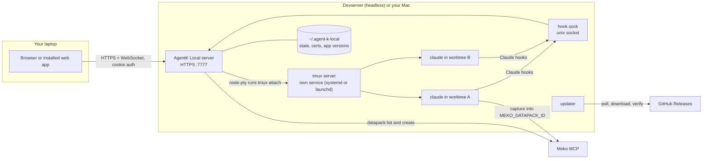
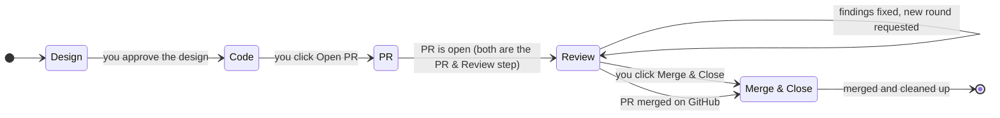

# AgentK Local

The agentic coder for ADLC. AgentK Local helps you work across many projects and
[Claude Code](https://claude.com/claude-code) sessions at once, with [Meko](https://mekodata.ai)
as its data layer. It's self-hosted, runs on your devserver (headless) or your Mac, and you use it
from a browser.

**Contents:** [Decisions](#decisions-so-far) · [Architecture](#architecture) · [The app](#the-app) ·
[Projects & sessions](#projects-worktrees-and-sessions) · [Task lifecycle](#task-lifecycle) ·
[Datapacks](#datapacks) · [Token usage](#token-usage) · [Usage stats](#usage-stats) · [Login & security](#login-and-security) ·
[Crash recovery](#surviving-crashes-restarts-and-updates) ·
[Releases & updates](#releases-and-auto-update) · [Tech stack](#tech-stack) ·
[Milestones](#milestones) · [Open questions](#open-questions)

## Decisions so far

| Topic | Decision |
|---|---|
| Session UI | Embed the real Claude Code TUI (xterm.js over WebSocket). Don't rebuild Claude's interface. |
| Process host | tmux on a dedicated socket, in its own background service (a systemd user unit on Linux, a LaunchAgent on macOS), so the server can restart or update without touching sessions. |
| Open project | Pick a repo from a list of the git repos under `~/code`. The folder is configurable, and you can clone a repo into it from a URL. |
| Local state | SQLite (`~/.agent-k-local/state.db`), WAL mode, schema versioned with `PRAGMA user_version`. |
| Working copy | Each session gets its own git worktree on its own branch. When it ends, a clean worktree waits, build outputs and all, for the next session on the repo. |
| Datapacks | Each project gets one dedicated datapack (the write target) and can attach any number of shared datapacks (read targets). |
| Meko | Optional. With a key, projects get a dedicated datapack (or start without one, when Meko is down or the plan's datapack limit is reached, and get one later). Without a key, or turned off in Settings, AgentK works without datapacks. |
| Meko wiring | Each session gets its own `MEKO_AGENT_ID=claude_code:<session slug>-<hash>`, and the project's datapack is pinned for that agent id when it starts. The Meko hooks already honour both, so no plugin change is needed. |
| Datapack names | New dedicated datapacks default to `adlc/proj/<repo>/<project_name>`. Datapacks with the `adlc/proj/` prefix are *project datapacks*: offered when shared with you, and filled in automatically. |
| Project sharing | A project is shared by sharing its dedicated datapack in Meko, from the project home or, for a PR's reviewers, from its PR & Review step. A project datapack shared with you shows a banner and a notification, and opens as a new project with its repo and name filled in. |
| Reviewing a PR | A **Review a PR** session checks out someone else's PR, in any repo, and AgentK assists the user who reviews it: a short summary to get them oriented, then answers to what they ask, with Meko searched for the design and decisions behind it. It posts to GitHub only when the user says. |
| Runtime | Node 22 (bundled in releases). State uses the built-in `node:sqlite`; node-pty is the only native module. |
| Network | Reachable directly on the corp network over HTTPS, behind a login; or local only, listening on 127.0.0.1 with no login. |
| Existing tmux sessions | Not adopted. Only sessions created by AgentK Local are shown. |
| Crash behaviour | After a host reboot, the server automatically brings back every open project and session with `claude --resume`. Sessions that were mid-turn are told to continue. |
| Token usage | Tracked per session and per project (per model and per day too), read from Claude Code transcripts including subagents, with an estimated cost at API list prices. Meko calls are counted from the same transcripts, with an estimate of what Meko searches saved. |
| Usage stats | Each install sends anonymous counts (projects, sessions, PRs, commits, file types, tokens by model) once a day to a collector the AgentK Local team runs as a separate service. On by default; one checkbox in Settings → Account turns it off. |
| Task lifecycle | Design → Code → PR & Review (AgentK) → Merge & Close, with three human gates; Quick Code sessions skip Design, and Exploration and Review a PR sessions have none of it. You can change a session's type and move its stage by hand (not a Review a PR's). More ADLC stages plug in later. |
| Host OS | Linux devservers, and Macs on Apple Silicon (macOS 14 or newer) while you're logged in to the desktop. Intel Macs and headless Macs aren't supported. |
| Distribution | Public GitHub repo. GitHub Actions for CI and releases, date-based versions (`0.YYYYMMDD.N`), tarball releases, and an update check built into the server. |
| Repo & license | Internal at `github.com/yugabyte/agent-k-local` for now, to be made public later. Apache-2.0. |
| Sharing | Everyone installs their own copy. One owner per install, with no shared instances. |
| Client | Browser first. Chrome's "Install app" gives it a dock icon: the web app manifest (`manifest.webmanifest`) names it "AgentK Local" and supplies the logo as regular and maskable icons. `/favicon.ico` and `/apple-touch-icon.png` are served at the root too, for browsers and phones that look there instead of reading the page's links; a missing file is a 404, never the app page. A native Mac wrapper is deferred. |

## Architecture

There are three long-lived pieces on the host: the web server, the tmux server that owns every
Claude process, and the state directory at `~/.agent-k-local`. The server is stateless enough to
be killed at any time. tmux and the on-disk state are what carry your work.



**Terminal path.** When you open a tab, the browser opens a WebSocket. The server spawns
`tmux -L agentk attach -t ak-…` in a pty and pipes it through. Closing the tab kills only that pty,
and Claude keeps running. tmux has no prefix key, so Ctrl+B reaches Claude Code and tmux's own
commands can't be typed from the terminal.

**Status path.** Each session starts with `claude --settings` pointing at an agent-k hooks file.
The `SessionStart`, `UserPromptSubmit`, `PreToolUse`, `PostToolUse`, `PermissionRequest`,
`Notification`, `Stop` and `SessionEnd` hooks (and the status line relay) post to a unix socket,
which drives the badges in the rail. Your global Claude settings stay untouched. When `/clear` (or
`/resume` inside Claude) switches conversations, `SessionStart` carries the new session id, and
Resume and recovery continue that conversation. `SessionStart` has a second hook, `context.sh`,
which asks the socket's `/context` route for context to start with and prints it for Claude Code
(what AgentK's Meko search found: see [Meko recall at start](#meko-recall-at-start)). Like the
edit guard, it prints nothing when the server can't be reached, and its curl gives up after 4 seconds.

The hook forwarder gives up quietly when the socket isn't there, so the server makes sure it is.
It binds the socket under a temporary name and renames it into place, removes it when it stops
only if the file is still its own, and every 10 seconds binds it again if the file was removed or
replaced (see [One server per home](#one-server-per-home)).

## The app

The left rail holds projects, each with its repo's folder name in small type under the project
name and the most urgent session state shown on it. Drag a project to reorder the list; on a touch
screen, use **Move up** / **Move down** in the project home's settings. The top tabs hold that project's sessions. The
main pane is the live Claude terminal, and the footer shows where the session is working: branch,
diff size, tokens, the project's Meko datapack (`Meko:<datapack>`) and stage. The foot of the rail
shows the user and the server (`hari@dev-box`) with the version, so windows on different machines
are easy to tell apart. The server name is `[server] name` (set in Settings), else the machine's
host name up to its first dot; the tooltip adds the full host name. When space is short, the
version moves below it first, then the user name is cut off before the server name.


Session states, shown with a dot in the rail and on each tab:

- **Working**
- **Needs you:** a permission prompt or a question
- **Idle**, waiting for your next prompt
- **Recovered** after a restart
- **Exited**

### Open project

You open a project on a repo you already have, with a new datapack or one that exists (the
datapack of a project you closed, say, which opens it again). The dialog is **Open project**, and so
are the rail's and command palette's actions. It lists every git repo directly under
your repos folder (`~/code` by default), with the most recently touched first. A repo can back
several projects: one that already has a project is marked with its name (*In "infra"*, or *In 2
projects*) and can still be picked. A project stores its repo's real path, so one reached through a
symlink or another folder is the same repo (and its id comes from the real folder's name). Each
project on a repo gets its own datapack, settings, sessions and worktrees; project
names must differ within a repo, and a name is taken from the moment its open starts, so two
opens of the same name at once can't both succeed. Their session branches
share the repo, so a branch name that another project already uses gets a number added
(`ak/fix-tests-2`). Per-repo files such as `.agent-k/stages/` overrides apply to every project on
the repo.


- **What the list shows.** For each repo: its folder name, the `origin` remote, the current
  branch, and when it was last touched. The scan also reads a fork's `upstream` remote, for naming
  and matching (below). The server scans the folder when the dialog opens, so
  repos you clone by hand appear straight away.
- **What it leaves out.** Folders that aren't git repos, and git worktrees (a `.git` *file*
  rather than a directory), are left out. Only the top level is scanned by default. The scan depth
  and the list of folders are both settings.
- **Clone from URL.** Paste a git URL and the server clones it into `~/code/<name>` using your
  existing git credentials, then selects it. "Other folder" takes any repo path on the host.

The dialog asks for the **dedicated datapack**, then the **Project name**, then the repo. It starts with the datapack: **Create a new one** (the first option and the
default), **Use an existing one** (the default when it's opened for a share, from its banner) or
**No datapack** (the default while Meko is off). The existing list shows invites waiting for you first, then datapacks shared with you, then yours, each with its
access and, for shares, its owner. It holds project datapacks (`adlc/proj/…`) unless you tap **Show
all datapacks**. A datapack a project here already uses is tagged with that project and listed
last. A viewer-only datapack is listed but can't be chosen, because sessions write to the dedicated
datapack. **Refresh** lists them again and checks Meko for new shares. Choosing a datapack collapses
the list to that one row (**Change** brings it back) and fills in the rest from its name
`adlc/proj/<repo>/<project>`:

- **Project name:** the `<project>` part (everything after the repo part). You can still change it.
- **Repo:** by the remote in the datapack's description (AgentK writes it there when it creates a
  datapack; SSH and HTTPS forms compare equal): first a fork whose `upstream` is that remote, since
  that's where you work on it, then a clone whose `origin` is the remote itself. So with
  `~/code/hari-yugabyte-db` (a fork of `yugabyte/yugabyte-db`) and `~/code/yugabyte-db` (a clone of
  it), the fork is picked. Otherwise by `<repo>` against a fork's upstream repo name, the origin's
  name or the folder name, all alike (a name says less than a remote, so an old fork doesn't beat
  the clone you use). With several matches, the most recently touched, and the hint says so. The
  repo filter also searches the upstream remote. With none, the remote (if known) is filled in under Clone from URL, or the
  hint says no repo by that name was found.

The name and repo matching live in `src/shared/datapacks.ts`, so the server and the dialog use the
same rules. **Create a new one** puts its **New datapack name** field at the bottom, under
the repo, since it's filled in from the repo and the **Project name**: it suggests `adlc/proj/<repo>/<project>` from the
repo and the name you type (until you edit it), where `<repo>` is the upstream repo's name for a
fork, else the origin's, else the folder's (`hari-yugabyte-db` gives `yugabyte-db`), whether the
repo was picked from the list or typed under Other folder; a name without the prefix gets a hint
that people you share it with won't be offered it as a project. Choosing an invite changes the
button to **Accept and open project**: the server accepts the invite in Meko first, and opens
nothing if Meko refuses. The server refuses a viewer-only datapack as a project's own too (from the
shares table's grant, else `datapack_describe`), not only the dialog.

**Opening a closed project again.** When the chosen datapack was the dedicated datapack of a closed
project (the most recently closed one, if several), that project opens again rather than a new
one: same id, settings, sessions (archived), token usage, attached shared datapacks and Meko
conversation, with the name and repo given in the dialog (the repo can be another clone; each
session keeps its own `repo_path`). It's done in the same write that would add a new project, so
two opens at once can't both take it. So a project is one thing across closes and opens, on the
Usage page too. A new datapack, or **No datapack**, always opens a new project. The dialog knows
the closed projects (`InviteCheck.closed`, the latest closed per datapack): their datapacks are
tagged **Closed "*name*"**, choosing one fills in the project's name and repo (under Other folder
when the repo isn't in the list), and a hint says the project opens again, and where it moves
from when another repo is picked. The close dialog and **Close project** confirmation mention
reopening only for a project with a dedicated datapack.

Once the project is open, the New session dialog opens for it, so you go straight on to its
first task. It waits for the project to arrive in the state push, which can come after the create
reply. Closing it leaves the project's empty view with its **New session** button.

### New session

You give it a name, a session type and, optionally, a first prompt. A Plan & Implement or Quick
Code session with no first prompt uses its name as the task; an Exploration without one starts at
an empty prompt. The four types sit side by side (two by two on a phone), with a line under them
saying what the selected one is for:

| Type | For | Stages |
|---|---|---|
| **Exploration** (`explore`) | Investigating, answering questions, POCs and experiments | Explore only: no gates; you end it with Archive or Discard |
| **Plan & Implement** (`plan`, the default) | Normal tasks | Design → Code → PR & Review → Merge & Close |
| **Quick Code** (`quick`) | Small tasks | Code → PR & Review → Merge & Close |
| **Review a PR** (`review-pr`) | Reviewing someone else's PR, with AgentK assisting | Reviewing PR only: you end it with **Close review** (see [Reviewing a PR](#reviewing-a-pr)) |

The type is stored as `sessions.kind` and decides the first stage, the stages the stage bar shows,
the first prompt (`explore`, `design`, `code` or `review-pr`) and the workflow line of the system prompt Claude
gets. It can be changed later (see [Moving a session](#moving-a-session)), except a Review a PR's. `CreateSessionRequest.skipDesign: true` still works and means Quick Code. The server fetches the base from `origin` and fast-forwards your local base
branch to it when that's safe, then creates the worktree and branch from it, starts Claude inside
it (or in an idle worktree of the repo: see [Worktree reuse](#worktree-reuse)), and focuses the tab. If the local base can't be fast-forwarded (it has commits origin lacks,
local edits would be overwritten, or it is checked out in another session's worktree), the session starts from `origin/<base>` and the activity log
says why.

**Advanced**, collapsed by default under the first prompt, holds the repo, the base branch and the
branch; closed, it shows them on one line (`agent-k-local · from main · ak/fix-retry-backoff`).

- **Repo.** The project's repo, or any other repo the Open project dialog lists (the scanned repos
  only, loaded when Advanced first opens; `GET /api/repos/branches` gives a repo's branches and
  default branch). A session in another repo still belongs to its project (datapack,
  settings, usage), but its worktree, branch, PR and cleanup are in that repo: `sessions.repo_path`
  holds it, and everything after create reads it from there. The session's system prompt names the
  repo, and its footer shows the repo's folder before the branch.
- **Base branch.** The repo's default branch unless you pick another.
- **Branch.** Left empty, `<prefix><slug of the name>`. A typed name is used as it is, with no
  prefix. An existing branch is picked up as it is (not fast-forwarded), after `git fetch origin
  <branch>`; one only on origin gets a local branch at `origin/<branch>`, and one origin no longer
  has loses its stale `refs/remotes/origin/<branch>` and starts fresh from the base. The server refuses (409) a
  branch a running session of any project uses on that repo, checked in the same write that adds
  the session so two starts can't both have it, and a branch checked out in another checkout (the
  main checkout, or a worktree kept for an archived session with uncommitted changes, which it
  names). A reused branch is marked (`sessions.branch_reused`), so the PR stage takes that branch's
  open PR even when it's older than the session (never a fork's PR from a branch of the same name),
  and Open PR first moves the session's base to that PR's base; the PR prompt tells Claude to update
  an existing PR rather than open another. Archive, Discard and Merge & Close treat a reused
  branch like any other: Discard and Merge & Close delete it.

### Changes

Clicking the `+N −N` numbers in the footer opens a side panel with every file changed on the
branch since it left the base: committed, uncommitted and untracked (ignored files are left out).
The base is the branch's merge base with `origin/<base>` or, in a fork, `upstream/<base>`, whichever
is closer to the branch (a fork's own `<base>` can lag the upstream one the branch was rebased onto);
`origin` wins a tie, and the local `<base>` is used only when neither remote has one.
Each file has a kind (A, M, D, R, U), its line counts, an *uncommitted* tag when it has uncommitted
edits, and a collapsible diff. Single-file diffs are cut at 256 KB and the whole panel at 4 MB;
past that only line counts are shown.
Untracked files over 1 MB aren't read (no diff, 0 lines), and at most 32 MB of untracked files is
read per refresh. A changed image (PNG, JPEG, GIF, WebP, AVIF, BMP, ICO) is
shown as *Before* and *After* side by side with its size, instead of "Binary file";
`GET /api/sessions/:id/changes/image` serves the base's version from git or the worktree's from
disk, only for those types, only inside the repo (no `..`, no symlinks out), up to 20 MB, and with
a sandboxing content policy so the bytes can never run as a page. The footer counts use the same
comparison, so they always match. The file list is the header's **Files** menu, with a filter, so
you can jump to any file from anywhere in a long diff; each file's header shows its position
(*4 / 12*), and `[` / `]` step to the previous or next file.

### Review comments

Click **+** beside a line of any diff (shift-click a second line for a range) to leave a comment,
as on a PR. Comments are drafts in `state.db` until you click **Send N comments**, which pastes
them into Claude as one prompt, grouped by file, with the lines each one is about. If Claude is
mid-turn or waiting on a permission prompt, they queue and go out when it's back at its prompt in
the Code or Review stage. Each comment keeps an excerpt of its last 20 lines (lines over 1,000 characters are cut short and
marked with "…"), so it follows them when
Claude moves code (its card then shows the line it's at now and the one it was written on). When
its lines can't be found it's shown at the top of its file, still sendable: as changed if the diff
still shows its line with other text, otherwise as not in the diff shown. Deleting a draft asks
first. Sent comments are
kept and shown with **Show sent**.

### Design panel

During Design the panel opens as soon as the design exists and again whenever it's revised, at
about 60% of the work area. An Artifact design is shown in a sandboxed frame (scripts allowed, no
same-origin access, and a content policy that blocks network requests and limits scripts, styles
and fonts to what Artifacts use, placed first in the frame's document so nothing of the page runs
before it), so the page can't read the login cookie or call the API. **Open on claude.ai** links to
the published Artifact. A markdown design is rendered as sanitized HTML with no forms or styles,
and its links open in a new tab.

### Side panels

The design doc and the changes panel open on the right of the terminal, one at a time. Drag the
panel's left edge (or focus it and use the arrow keys) to resize it; double-click the edge to
switch between normal and widest. Each panel's width is remembered in the browser. The design doc
also opens full page in a new tab (`/p/<project>/s/<session>/design`), where it can still be
approved.

### Starting

Claude Code can take a while to load its plugins, MCP servers and startup hooks. While a session
starts, the terminal shows its steps (updating the base branch and preparing the worktree, starting
Claude Code, loading, sending your task) with the current one animated and timed, plus the stage
the session opens in. The session's tab shows the current step in its tooltip.

The steps come from Claude's hooks. If they never arrive (the hook socket was gone, say), a
session would stay on this view while Claude works under it. So the reconcile tick also watches
the conversation's transcript: once it has been written since the start and the last step is more
than 20 seconds old, Claude has taken a prompt, and the session moves on. Until a hook arrives,
it shows working while the transcript changes (in the last 15 seconds) and idle otherwise, which
is only a stand-in: a long tool call shows as idle and permission prompts don't show. A server
that restarts while a session starts picks the startup back up, timed from when it began. After
90 seconds on the last steps, the view says Claude may already be running and offers **Show
terminal**, which hides it for that start in this page.

### Keyboard

`⌘1–9` switches projects, `⌃Tab` cycles sessions (browsers keep `⌃Tab` for themselves in a
normal tab, so it works in the installed app window), and `⌘K` opens a palette to jump to any
session or project home, or create a session. On Linux and Windows these use Ctrl, so the terminal
doesn't get Ctrl+K, Ctrl+1–9 or Ctrl+Tab; every other key passes through to the terminal whenever
it has focus. To copy from the terminal, drag across the text: tmux selects it and sends it as
OSC 52, which the page puts on the clipboard. Shift-drag (Option-drag on a Mac) selects in the
browser instead, and then `Ctrl+C` (`⌘C`) copies rather than interrupting Claude. Clipboard access
needs HTTPS or localhost.

### Notifications

A browser notification fires when any session moves to *needs you* or finishes a turn while its
tab is hidden. You can mute it per project. Only one open AgentK page shows them, the one used
last (pages queue for a Web Lock and a page that gets focus steals it; when it closes, the next one
takes over), so each shows once. They go through a minimal service worker (`/sw.js`), so a
notification stays clickable after the page that showed it reloads (as open pages do after an
update) or closes. Clicking one switches to the browser tab already showing its session, else to
one on its project (which then opens the session), else opens it in the window you used last, or a
new one. A design doc open on its own page is left alone. If the service worker isn't running (it
failed to register, say), the page shows the notification itself, and clicking it opens the session
in that page. The service worker caches nothing and handles no requests.

A project datapack shared with you also sends one notification (an `invite` event, once per
datapack); clicking it opens the Open project dialog for it. Tapped through the service worker, it
opens the dialog in an open window, or opens `/`, where the share's banner is waiting.

### On a phone

At 760 px wide or less the app switches to a phone layout. The rail becomes a drawer behind a top
app bar (the Back gesture closes it, and it holds **Search and commands** in place of `⌘K`). The
app bar also holds the session tabs, between the drawer button and ⋯, so the session name isn't
repeated above them (each tab shows its status and stage). The session header,
the stage bar with its gate button (Approve design, Open PR, Merge & Close) and the footer details
move into a ⋯ sheet, leaving the screen to the terminal; a dot on ⋯ marks a gate that is ready for
you, and the sheet says why a closed gate is closed. Dialogs open as bottom sheets. The app, and
the overlay behind a dialog or sheet, are pinned to the visible viewport (its height and, where iOS
pans the page for a focused field, its offset), so the on-screen keyboard shrinks them instead of
covering the prompt or a dialog's fields; while you type, the terminal stays scrolled to its newest line. On
touch screens the terminal gets a key bar (Tab, arrows, Ctrl+C, Enter, select mode, typing mode,
and at the far right a ▾ key that opens a second row of more keys: a sticky Ctrl, Esc, Shift+Tab,
Home, End, Page Up and Page Down; the row stays open until ▾ is tapped again, and ▾ stays lit while
Ctrl is armed with the row closed; with Ctrl lit, the next letter typed in the compose box or in typing mode goes to
Claude as Ctrl plus that letter, such as Ctrl+O or Ctrl+R, and Ctrl then `[` sends Escape) and a compose box (it grows with its text to about a fifth
of the visible screen, then scrolls) whose text goes in as one bracketed
paste (with any Escape characters removed), then Enter; if the terminal isn't connected, the text
stays in the box. Swiping scrolls through mouse-wheel reports, which tmux hands to Claude Code (it
runs full screen and takes the mouse). The steps are sent together once a frame, a flick keeps
coasting and slows down until it stops or a new touch lands, and the terminal on screen draws with
WebGL (fetched only on touch screens; it falls back to the DOM renderer if WebGL is missing, loses
its context, or sizes its canvas wrongly). In select mode (it puts the keyboard away) a drag
selects whole lines instead of scrolling, and lifting the finger copies them; no touch reaches tmux
as a mouse click meanwhile. Tapping the terminal only brings up the keyboard in
typing mode (the keyboard key). Phones default to an 11 px terminal font (about 48 columns),
adjustable in the ⋯ sheet and remembered per browser.

### Project home


Recent activity shows the project's last 50 events, newest first, and scrolls inside its box so it
never pushes the rest of the page down.

**Share** sits in the project's header: it shares the whole project, through its dedicated
datapack. In API mode it opens the Share dialog; in link mode it is **Share in Meko ↗**, which
opens the datapack's Share page in the Meko web app. With Meko off it asks for a Meko API key
first (**Add a Meko API key**), and for a project without a dedicated datapack it offers **Add a
dedicated datapack**. Meko itself refuses a share from someone who isn't the owner or a
maintainer. See [Sharing a project](#sharing-a-project).

A project without a dedicated datapack says so in its Datapacks box, with **Add a dedicated
datapack** (a new one, or one of yours; `POST /api/projects/:id/dedicated-datapack`), or **Add a
Meko API key** while Meko is off. A shared datapack already attached can become the dedicated one.
New sessions use it, each pinning it for its own agent id. Search is hidden for a project with no
datapacks.

The dedicated datapack's row has **Switch** (while Meko is on). It opens the same dialog, titled
**Switch the dedicated datapack**, to make a new datapack or one of yours the dedicated one; attached
shared datapacks are listed first, and a new one's default name gets `-2` (or the next free number)
when the usual name is taken. The old datapack stays attached as shared, so its memories can still
be searched, unless **Detach *old* from this project** is checked. Nothing is deleted in Meko. The
dialog warns how many of the project's sessions are running (starting, working, needs you, idle,
recovered): they keep the datapack they were launched with, and so keep writing to the old one until
they're restarted. That covers Claude's own Meko calls (its prompt names the old one), capture (the
Meko hook keeps the datapack in the session's watermark once the session has started) and AgentK's
writes for the session: designs, the PR's Meko lines and what shipped go to the datapack recorded on
the session at launch (`sessions.meko_datapack_id`), under the session's own Meko conversation there
(AgentK's writes for a session always go under its own conversation). New and resumed sessions get the new one
(a resumed session's Meko conversation is keyed by datapack, so its earlier turns stay in the old
one). The request names the datapack it replaces
(`replace`), so a switch made meanwhile in another tab is refused (409) rather than undone; the old
row is demoted or detached in the same transaction as the new one is added, the project's
server-side Meko conversation (used for search) is made again in the new datapack. Pins are per session, so a running
session's stays on the old datapack and the next one to start pins the new one.

When the project on screen loses its last open session (Archive, Discard, Merge & Close, or a merge
picked up from GitHub), a dialog offers **Close project** (as on the project home; the repo and
datapacks stay), **New session** or **Keep it open**. It asks only on the project's session view,
with no other dialog open, and in a visible page, so a background tab stays quiet; loading or
switching to a project that has no sessions doesn't ask. It closes by itself when the project is
closed or gets an open session elsewhere.

## Projects, worktrees and sessions

A **project** is an effort to build or improve a feature, product or service. It works in a git
repository on the host, picked from your repos folder (`~/code`) or cloned into it at creation.
The project only points at the repo. The one change it makes there: when a
session starts, it fast-forwards the local base branch to `origin`. That's a `merge --ff-only`
with autostash off when your main checkout has the branch checked out (git refuses if it would
overwrite local edits), or a non-forced local fetch (`git fetch . origin/<base>:<base>`) when no
worktree has it checked out (git refuses anything but a fast-forward, and a branch being rebased
or bisected). A base checked out in another session's worktree is left alone. Read-only git
commands run with `GIT_OPTIONAL_LOCKS=0`, so they never take a lock Claude's own git commands need. It never rewrites, resets or discards anything in your main checkout. A
**session** is one task. It has one worktree, one branch and one Claude conversation. Worktrees
live outside the repo so they never show up in `git status`, and outlive their session: a clean one
goes idle for the next session on the repo (see [Worktree reuse](#worktree-reuse)).

```sh
# layout on the host
~/.agent-k-local/
  config.toml              # host settings: address and port, TLS paths, repo roots, update channel, Meko
  state.db                 # SQLite: projects, sessions, events, auth (WAL)
  hook.sock                # Claude hooks → server
  server.lock              # the running server's lease on this home (one server per home)
  certs/                   # self-signed pair, or symlinks to your own
  app/0.4.1/  app/current → 0.4.1
  worktrees/<repo>.<hash>/wt-<n>/  # git worktree, shared by the repo's projects (older ones: worktrees/<project>/<session>/)
  designs/<session>/design.md      # markdown design written during Design (Artifact designs live on claude.ai)

# config.toml (excerpt)
[server]
# name = "work laptop"    # shown in the rail next to your user name; unset uses the machine's host name

[repos]
roots = ["~/code"]        # folders the Open project dialog lists
depth = 1                 # 1 = only direct children
clone_into = "~/code"     # where "Clone from URL" puts new repos

[worktrees]
idle_per_repo = 3         # idle worktrees each repo keeps for its next session (0 to 20; 0 removes them)
idle_days = 14            # an idle worktree no session used for this many days is removed (0 to 365; 0 keeps it)

[meko]
# enabled = false            # turn Meko off (projects work without datapacks); on by default
# url = "…"                  # Meko MCP server; unset uses MEKO_MCP_URL, Claude Code's settings, then Meko Cloud
# api_key = "…"              # unset uses MEKO_API_KEY, then Claude Code's settings
# web_url = "…"              # Meko web app, for links; unset uses MEKO_WEB_URL, Claude Code's settings, then Meko Cloud's for Meko Cloud
# api_url = "…"              # Meko's REST API, for sharing; unset uses MEKO_API_URL, then web_url + /api/v1
# capture_transcripts = false  # stop sending session transcripts to Meko conversations; on by default

[call_home]
# enabled = false            # stop sending anonymous usage stats (Settings → Account); on by default
# url = "https://…/v1/report" # where reports go (the collector's report URL); unset uses the one release builds carry
```

| Action | What the server does |
|---|---|
| New session | `git fetch origin <base>`, fast-forward the local `<base>` to `origin/<base>` if safe, then in the repo's most recently idled worktree `git checkout --no-track -b ak/<slug> <base>` (or `origin/<base>` if the fast-forward was skipped), or with none `git worktree add … -b ak/<slug> <base>`, then `tmux -L agentk new -d -s ak-<proj>--<slug> -c <worktree>` running `claude --session-id <uuid> --settings <hooks> -n "<name>" [-- prompt]` through your login shell, with the session's variables (Meko, hook token) set after your profile runs so it can't override them. |
| Open tab | Spawns a pty on `tmux attach`, one per viewer. The terminal is resized to fit the browser. tmux 2.7 draws a window at its smallest viewer's size, so a phone lets go of its terminals after its page has been hidden for 30 seconds, and of a session's terminal 5 seconds after you switch away from it, and reconnects when it is shown again. The browser opens the socket at its terminal size (`?cols=&rows=`). A dropped connection reconnects with backoff (reset once a connection has stayed up 5 seconds); a close for a lost login (4401) goes to the login screen, a missing or archived session stops with a **Try again** button, and an attach that couldn't start retries with backoff. |
| Close tab | Kills the pty only. tmux and Claude keep running. |
| Claude exits | The pane dies and the status becomes *exited*. **Resume** relaunches `claude --resume <uuid>` in the same worktree. |
| Archive | Refused (409) while the worktree has uncommitted or untracked files, which would keep the branch checked out there: commit them, or Discard. The Archive menu says so and greys out **Archive** (it waits for the check), and uncommitted files are a Merge & Close blocker too. Otherwise kills the tmux session. The clean worktree goes idle for the next session (HEAD detached, so the branch is free), or is removed when *Idle worktrees per repo* is 0; the branch is always kept. The record stays, so the session can be restored later. If the session is still starting, Archive (and Discard) waits for Claude to start first. |
| Discard | Chosen in Archive's confirmation step. Kills the tmux session, throws away uncommitted changes and untracked files (`git reset --hard`, `git clean -fd`: ignored build outputs stay), lets the worktree go idle (or force-removes it when it can't be cleaned or reuse is off), and deletes the local branch. It first warns about uncommitted files and commits that no remote has. The remote branch and any PR are left alone. The record and its token usage stay, as with Archive. |
| Close project | After confirmation, stops the project's sessions and lets go of their worktrees as Archive does, keeping any worktree with uncommitted changes, and marks the project closed (`deleted_at`). Idle worktrees stay for the repo's other projects; the last project on a repo removes them. That goes for every repo the project's sessions used. Its sessions and token usage are kept for the Usage page. Never deletes the repo, its branches or the datapacks, so opening a project with its datapack (**Use an existing one**) brings the project back (see [Opening a closed project again](#open-project)). |

```sql
-- state.db (abridged). One writer: the server. Migrations keyed on PRAGMA user_version.
CREATE TABLE projects (
  id TEXT PRIMARY KEY,            -- slug of the repo, e.g. billing-api; later projects on it add their name: billing-api-release-tooling
  name TEXT NOT NULL, repo_path TEXT NOT NULL, default_branch TEXT NOT NULL,   -- the repo's real path; several projects may share a repo
  position INTEGER, settings_json TEXT, created_at INTEGER, deleted_at INTEGER);
CREATE TABLE project_datapacks (
  project_id TEXT REFERENCES projects, datapack_id TEXT, name TEXT,
  role TEXT CHECK (role IN ('dedicated','shared')),
  PRIMARY KEY (project_id, datapack_id));
CREATE UNIQUE INDEX one_dedicated ON project_datapacks(project_id) WHERE role = 'dedicated';
CREATE TABLE project_events (  -- closes and reopens, for the usage stats (a reopen clears deleted_at)
  project_id TEXT REFERENCES projects, kind TEXT CHECK (kind IN ('closed','reopened')), at INTEGER);
CREATE TABLE sessions (
  id TEXT PRIMARY KEY, project_id TEXT REFERENCES projects, name TEXT,
  claude_session_id TEXT NOT NULL, branch TEXT, worktree_path TEXT, tmux_name TEXT,
  repo_path TEXT,                 -- the repo's real path: the project's, or another one picked in Advanced
  branch_reused INTEGER,          -- 1: the branch existed when the session started
  desired TEXT CHECK (desired IN ('running','archived')),   -- what recovery restores
  status TEXT,                    -- starting | working | needs_input | idle | exited | recovered | archived
  kind TEXT,                      -- explore | plan | quick | review-pr (the session type; the user can change it, but not review-pr)
  stage TEXT,                     -- explore | design | code | pr | review | merge (Merge & Close) | done | reviewing-pr
  pr_number INTEGER, pr_url TEXT, review_state TEXT, ci_state TEXT,
  pr_repo TEXT, pr_title TEXT, pr_author TEXT,  -- Review a PR only: the PR's owner/name on GitHub, title and author
  review_sha TEXT, pr_head_sha TEXT,  -- Review a PR: the commit checked out; the PR's head at the last look
  pr_new_commits INTEGER, pr_state TEXT,  -- commits on the PR since review_sha (NULL: rewritten); OPEN | CLOSED | MERGED
  review_notes TEXT,               -- Review a PR: the user's notes for AgentK
  plan_mode INTEGER,               -- 1: designs in Claude's plan mode (sessions created before designs moved out of it)
  pending_prompts TEXT,            -- prompts queued for Claude: JSON map of 'review' | 'review-people' | 'ci' | 'review-pr-update' to
                                   --   { state: 'queued' | 'sent' (until that turn ends), vars }; replaces pending_review
  ci_fix_head TEXT, ci_fixes INTEGER,  -- the PR head that last got a CI-fix prompt; how many heads in a row did
  agentk_seen INTEGER,             -- 1 once AgentK commented on or reviewed the PR, or was asked to
  meko_datapack_id TEXT, meko_datapack_name TEXT,  -- the dedicated datapack at the last launch, where AgentK's
                                   --   writes for the session go (NULL: launched before this or without one; the project's is used)
  first_turn_end_at INTEGER,       -- when the first turn ended (from the transcript), for the Meko stats
  meko_agent_id TEXT,              -- the MEKO_AGENT_ID it runs with, set at create and each launch
                                   --   (NULL: launched before sessions had their own; claude_code:<project id> until relaunched)
  last_event_at INTEGER, created_at INTEGER, archived_at INTEGER);
CREATE TABLE worktrees (       -- session worktrees; idle ones (session_id NULL) wait for the repo's next session
  path TEXT PRIMARY KEY, repo TEXT,  -- repo: the repo's real path, the pool key its projects share
  session_id TEXT, released_at INTEGER,
  stale INTEGER,                   -- 1: idle but not reusable (files git doesn't ignore)
  created_at INTEGER);              -- (sessions.worktree_released is 1 once a session let go of its worktree)
CREATE TABLE designs (         -- one per session: markdown, or an Artifact's page + claude.ai link
  session_id TEXT PRIMARY KEY, markdown TEXT, html TEXT, artifact_url TEXT,
  md_version INTEGER, md_sent INTEGER,        -- versions sent to Meko (names the next one), and
  html_version INTEGER, html_sent INTEGER,    -- whether the current one was sent
  updated_at INTEGER);
CREATE TABLE review_comments ( -- comments on a session's diff: draft → queued → sent to Claude
  id TEXT PRIMARY KEY, session_id TEXT, path TEXT, side TEXT, line INTEGER, end_line INTEGER,
  excerpt TEXT, body TEXT, state TEXT, created_at INTEGER, updated_at INTEGER, sent_at INTEGER);
CREATE TABLE session_stages (  -- stage history: who moved it, and when
  session_id TEXT, stage TEXT, entered_at INTEGER, left_at INTEGER, moved_by TEXT);
CREATE TABLE session_events (  -- every hook call; feeds badges + project activity
  id INTEGER PRIMARY KEY, session_id TEXT, kind TEXT, payload_json TEXT, at INTEGER);
CREATE TABLE owner (id INTEGER PRIMARY KEY CHECK (id = 1), username TEXT, pw_scrypt TEXT, totp_secret TEXT);
CREATE TABLE auth_sessions (token_sha256 TEXT PRIMARY KEY, created_at INTEGER, expires_at INTEGER, user_agent TEXT, ip TEXT);
CREATE TABLE audit_log (id INTEGER PRIMARY KEY, at INTEGER, action TEXT, detail_json TEXT);
CREATE TABLE kv (key TEXT PRIMARY KEY, value TEXT);   -- setup token, update state, plan limits
```

- **Why SQLite.** You get transactions across projects, sessions and datapacks, an event history
  for the activity feed, and crash safety without hand-rolled atomic file writes. It's still one
  file you can back up or inspect with the `sqlite3` CLI.
- **Settings.** `journal_mode=WAL`, `synchronous=FULL` (so a host crash never loses a committed
  session record), `foreign_keys=ON` and `busy_timeout=5000`. There are so few writes that FULL
  sync costs nothing noticeable. Old `session_events` are pruned after 30 days, except `merged`
  events, which the Usage page counts.
- **Not on NFS.** SQLite locking is unreliable on network filesystems. The installer checks the
  filesystem type of `~/.agent-k-local`. If it's NFS, the installer puts `state.db` on local disk
  (`$XDG_STATE_HOME`, then `/var/tmp/$USER`) and records the path in `config.toml`. The
  `/var/tmp/$USER` folder must be a real directory owned by you that others can't write to, or the
  installer stops rather than put the database (password hash, TOTP secret) somewhere another user
  controls.

`config.toml` holds host settings: the listen address and port, the server's name, TLS paths, repo folders, the update
channel, the Meko URL and key (only when typed at install), transcript capture, the tmux socket, the
`claude` command, the database path and how many idle worktrees each repo keeps. The Settings dialog
writes its fields (repo folders, scan depth, clone folder, idle worktrees per repo and the days to
keep an unused one, update channel, server name) there too. Per-project settings, sessions and everything else live in `state.db`. Only values that
differ from the defaults are written, so a changed default reaches existing installs; a value of the wrong type is ignored with a warning. `AK_BIND` and
`AK_PORT` override `[server]` for one run (`npm run dev`) and are never written to the file. The Meko
URL and key come from `[meko]`, then `MEKO_MCP_URL`/`MEKO_API_KEY`, then the `env` block of Claude
Code's user `settings.json` (in `CLAUDE_CONFIG_DIR` if set); a later source's URL is skipped when that
source has a key of its own, and with no URL it's Meko Cloud.

### Worktree reuse

Repos like yugabyte-db take a long time to build from scratch, so a worktree outlives its session
and keeps its ignored files (`build/`, `node_modules/`, CMake caches) for the next one. The path
stays the same, which matters to build systems that record absolute source paths (CMake,
`yb_build.sh`): a copied or moved build tree would break.

- **Idle.** When a session ends (Archive, Discard, Merge & Close, Close project) with a clean
  worktree (`git status --porcelain` empty), `git checkout --detach` frees its branch without
  changing a file, and the worktree's row in `worktrees` loses its session. Archive refuses, and
  Merge & Close is blocked, while there are uncommitted changes; a worktree that still has some (a PR merged on
  GitHub, Close project) stays the session's and is never handed on.
- **Shared by the repo's projects.** Idle worktrees belong to the repo, keyed by its real path, so
  every project on it (a repo can have many at once) takes from the same pool. A session in another
  repo than its project's takes from and gives back to that repo's pool. New worktrees live
  in `worktrees/<repo folder>.<8 hex of sha256(real path)>/wt-<n>`; the dot keeps these folders
  apart from project ids, and older `worktrees/<project>/<session>` folders are reused where they are.
- **Claim.** A new session claims the repo's most recently idled worktree in the same SQLite write
  that adds the session, so two sessions starting at once never get the same one. The worktree
  must still be a clean worktree of the repo on a detached HEAD; then the session's branch is
  checked out there from the same start point a new worktree would get. Git rewrites only the files
  that differ, so builds are incremental. If the checks fail, the worktree leaves the pool (removed
  without `--force`, or kept as stale if git refuses) and the session gets a new worktree; if
  something else fails (a bad base branch, a branch checked out elsewhere), the worktree goes back
  to the pool and a new worktree is tried. Reuse never makes a start fail.
- **Removal is safe while sessions start.** Trimming, expiry and the startup sweep forget an idle
  worktree in one write that does nothing once a session has claimed it, and only then run
  `git worktree remove`. A worktree git won't remove (files it doesn't ignore) stays recorded as
  stale: never handed out or forgotten while its folder exists, and reusable once it's clean again.
- **Cap.** Each repo keeps at most `[worktrees] idle_per_repo` idle worktrees (Settings › General,
  default 3, 0 to 20). Beyond that the one idle longest is removed with a plain
  `git worktree remove` (it has only ignored files left, so no `--force`). Saving a lower number
  trims every repo in the background; 0 removes worktrees when sessions end.
- **Expiry.** An idle worktree no session has used for `[worktrees] idle_days` days (Settings ›
  General, default 14, 0 to 365; 0 keeps it until the cap trims it) is removed the same way. The
  server checks at startup, every hour, and in the background when the setting is lowered.
- **Ownership.** Once a session lets go of its worktree (idle, or removed), `sessions.worktree_released`
  is set, so the session never reads or removes that folder again, whatever happens to the pool:
  its Changes panel says the worktree is gone, Discard's check reports none, and `gh` runs in the
  main checkout.
- **Recovery.** At startup, in the background, the server forgets idle worktrees whose folder is gone,
  marks stale the ones no longer clean and detached (and stale ones that are clean again usable),
  removes those of repos no live project uses (as its repo, or any of its sessions' repos) and those
  unused too long, and trims to the cap. Closing a project keeps a repo's idle worktrees while
  another project uses the repo.
- **What carries over.** Every ignored file, not only build outputs: `.env`, `CLAUDE.local.md`,
  `.claude/settings.local.json`, local databases and logs. Set the cap to 0 for fresh worktrees.

## Task lifecycle

Every session is a task that moves through stages, from design to a merged PR with the branch
cleaned up. This first pipeline covers six stages of the development lifecycle. The pipeline is
defined as data, so later stages such as test, deploy and monitor can be added without reworking
sessions.

The PR stage (opening the PR) and the Review stage are one step in the UI, **PR & Review**:
they stay separate stages in `sessions.stage`, `session_stages` and the usage stats, and the stage
bar maps `pr` to the PR & Review step (`stepOf` in `src/shared/stages.ts`), with an *Opening PR…*
pill in its gate until the PR is found. The automatic PR → Review move logs no second stage event,
since "Opened PR #7" says it.

There are three **gates** that only you can pass: approving the design, opening the PR, and
merging. Everything between the gates runs on its own. A Quick Code session starts at Code, so it
has only the last two gates. An Exploration session never enters this pipeline: it stays in the
Explore stage, where Claude gets the `explore` prompt (investigate, build POCs, run experiments,
push experimental branches if useful), edits aren't guarded, and review comments from the Changes panel still
reach Claude. It ends when you archive or discard it. A Review a PR session doesn't enter it
either: it stays in Reviewing PR, on someone else's PR, until you close the review (see
[Reviewing a PR](#reviewing-a-pr)).

In the UI, the one doing the work in these stages is **AgentK** ("AgentK writes a design…",
"Wait for AgentK to finish its turn"). "Claude" is kept for the Claude Code process and its
terminal: starting it, exits, Resume, and the compose box.



| Stage | Claude | AgentK Local | Moves on when |
|---|---|---|---|
| 1 · Design | Starts with your task (not in plan mode), reads the code, and designs the change in one place: a complex design is published as a native Artifact with diagrams; a simple one is written as markdown to `~/.agent-k-local/designs/<session>/design.md`. It doesn't touch the repo. | Blocks file edits inside the worktree and main checkout (a `PreToolUse` guard hook). Keeps the published Artifact's page and claude.ai link (from the Artifact tool's `PostToolUse` hook), or reads the markdown file when the turn ends. Saves the design to the project's dedicated datapack as `design-<slug>.md` (or `.html` for an Artifact's page); Meko can't replace a file, so each later changed version is saved as `design-<slug>-v2.md`, `-v3`, and so on, and an unchanged one isn't sent again. A version counts only once it's sent: one that couldn't be (Meko off or failing, no datapack yet) is sent at the next save, Design turn end or approval. Marks the session *Design ready*, and opens the design panel by itself. | You click **Approve design**, and the server sends the Code prompt ("The design is approved…"). Quick Code sessions skip this stage. Sessions created before this change still design in plan mode and are approved through Claude's plan dialog. |
| 2 · Code | Implements the design and runs the repo's tests and checks. | Shows the diff size against the base branch in the footer; clicking it opens the Changes panel with a diff per file, where you can leave review comments and send them to Claude. | You click **Open PR**. The button is disabled while Claude is mid-turn. |
| 3 · PR & Review: opening the PR (`pr`) | Commits with the repo's own commit conventions, pushes the branch, and runs `gh pr create` with a title that follows those conventions (if the repo squash-merges, the title becomes the commit subject) and a summary taken from the design. With a dedicated datapack (and Meko on), the description ends with `<Meko host>://<datapack id>` and `meko_conversation_id:<id>` lines, for the session's Meko conversation. | Records the PR number and URL and links them next to the stages. | Automatically, once the PR exists. |
| 3 · PR & Review: review (`review`) | When a review arrives, follows the `review` prompt (AgentK: verifies each finding, fixes the valid ones, pushes, replies on every thread and reacts +1/−1) or the `review-people` prompt. When CI fails, follows the `ci` prompt: reads the failing jobs' logs, then fixes and pushes, or reruns the jobs once if the failure isn't caused by the change. | Looks for the PR every 15 seconds in the PR stage (only a PR opened after the session was created counts, since branch names can be reused; a session started on an existing branch also takes that branch's older open PR), and checks reviews, CI checks and approvals every 45 seconds and at every turn end. This runs on the server, so waiting costs no tokens. New reviews are sent to Claude according to the project's reviewer mode (below). When CI fails on the PR's head, you get a notification and Claude gets the `ci` prompt. That happens once per head commit, after every check has finished (or 10 minutes after the failure appeared), and not while the branch has unpushed commits. After three failing heads in a row, you're asked to take over, and a green run starts the count again. If Claude is mid-turn, waiting on you, or exited, prompts are queued in `state.db` (so they survive restarts) and go out one at a time when Claude is back at its prompt, reviews before CI. A queued CI prompt is dropped if the head moves or CI stops failing. The findings count as addressed only when the turn that got the prompt ends. | You click **Merge & Close**. It is enabled once CI is green, no review findings are left unaddressed (and, once AgentK is active on the PR, its review is in), the required approvals are in, every local commit is pushed to the PR, the worktree has no uncommitted or untracked files, and Claude is neither working nor waiting on you in the terminal. |
| 4 · Merge & Close | Nothing. | Runs `gh pr merge` using the project's merge method (the repo's default unless changed in project settings). Once GitHub reports the PR as merged (also when it was merged on GitHub), writes a summary of what shipped (PR title, link and description) to the dedicated datapack, ends the tmux session, lets the worktree go idle for the next session (or removes it), deletes the local and remote branch, runs `git fetch --prune` in the session's repo, and archives the session. If Claude is mid-turn when the PR merges, this waits until the turn ends. Branches with commits the merged PR doesn't have are kept (the remote branch is deleted only while it still points at the PR's head). If the server restarts partway, the next poll finishes the job. If the PR is closed instead, or is still open 10 minutes after the merge was requested (for example, it left a merge queue), the session goes back to Review. | Done. The session record and its history stay. |

- **AgentK in the loop.** AgentK doesn't re-review on push, so after fixes the header offers
  **Request another round**, which posts `/agentk review` (**Request AgentK review** before AgentK
  has been active on the PR). If AgentK declines a PR (for example, because it's too large), the
  refusal is shown with a **Force review** button. Forcing is always your call.
- **Reviewer modes.** Each project's reviewer setting says whose reviews Claude addresses:

  | Mode | Claude addresses reviews from | Merge waits for AgentK |
  |---|---|---|
  | *All reviewers* | AgentK, people and other bots | Once AgentK is active on the PR |
  | *AgentK + People* (default) | AgentK and people | Once AgentK is active on the PR |
  | *People only* | People | Never |

  AgentK is active on a PR once it has commented on it or reviewed it, or someone has commented
  `/agentk review` on it, so repos AgentK doesn't watch never wait for it. Bots are the reviewers
  GitHub's REST API lists as `Bot`. It's only asked when a poll finds a new review that isn't
  AgentK's. Replies on review threads show up as empty reviews and are skipped, and so are
  Claude's own replies, which post as you. A person's review goes to Claude when it requests
  changes or comments with a body.
- **Stage prompts.** Each stage's instructions to Claude come from a template. The defaults are
  built in (`src/server/prompts.ts`), and a repo can override any of them (a stage, or `explore`, `approved`,
  `review`, `review-people`, `ci`, `continue`, `comments`, `moved`, `review-pr`, `review-pr-update`,
  `review-pr-comments`) with `.agent-k/stages/<name>.md`. This lets a team
  change how designs are written or PRs described without changing agent-k-local. Review comments
  from the Changes panel go out through the `comments` template (`{{count}}` and `{{comments}}`),
  and CI failures through the `ci` template (`{{sha}}` and `{{checks}}`, the failing checks with links).
- **Branch names.** The branch prefix is a project setting, `ak/` by default, because some orgs
  enforce a branch-name prefix with rulesets.

### Reviewing a PR

The other side of sharing a project: someone the author shared it with (see
[Sharing a project](#sharing-a-project)) opens its datapack as a project, from the invite's
banner, and reviews the PR with their own AgentK. The New session dialog opens by itself for a
project just opened, and starts on **Review a PR** when an open PR names the project's datapack.

**Picking the PR.** Picking **Review a PR** swaps the first prompt for a **Pull request** picker
and **Notes for AgentK** (optional: what to focus on). The picker lists, newest first and at most
20, the open PRs in any repo you can read whose description names one of the project's datapacks
(`gh search prs "<datapack id>" --match body`, once per datapack: the PRs its sessions open end
with that id, see the PR stage below). A project's sessions can work in several repos, so the PRs
can be in several repos too, and each row names its repo. **Another PR** takes any other one: a
number (looked up in the repo picked under Advanced), `owner/name#number`, or a PR link. GitHub's
search lags new PRs by a minute or so, so a PR missing from the list can be typed, and
**Refresh** searches again. `GET /api/projects/:id/review-prs` serves both (`src/server/prreview.ts`).
Each PR's repo is matched to a local clone among the scanned repos (and the project's and its
sessions' repos) with the rules the Open project dialog uses for a datapack's remote
(`matchRepo()`): a fork whose `upstream` is the PR's repo first, then a clone whose `origin` is,
never a name alone. A PR whose repo isn't cloned here shows **Clone** (`POST /api/repos/clone`,
which clones into the repos folder as Open project does). A typed PR whose description names a
datapack the project doesn't have offers **Attach it**, as a shared datapack, so its design can be
searched. The name fills in as `Review #21 <title>` until you edit it, and **Advanced** shows the
repo (the PR's clone, changeable to another clone of it); the base and branch come from the PR.

**Starting.** `CreateSessionRequest.pr` names the PR (`{ repo: 'owner/name', number }`), with
`repoPath` its clone. The server checks that the clone's `upstream` or `origin` is the PR's repo
and that the PR is open (400 otherwise, with nothing started), fetches `refs/pull/<n>/head` from
that remote into `refs/agentk/pr/<n>` (a fork's PR too) along with the PR's base, and puts the
branch `<prefix>review-pr-<n>` (numbered like any session's, so PR #7 of two repos never collide)
at that commit, in a new or idle worktree, with no upstream, so a bare `git push` has nowhere to
go. The base is the PR's base, so the footer diff and the Changes panel show the PR's diff. The
session keeps the PR's repo, title, author, the commit checked out (`review_sha`) and the PR's
head and state at the last look (`Session.reviewingPr`). The search at start
([Meko recall](#meko-recall-at-start)) uses the PR's title and description, without its Meko
lines, and the notes.

**AgentK assists; the user reviews.** The `review-pr` prompt tells Claude to get ready without
reviewing: read the PR description, the reviews and threads and CI's state, look at the shape of
the diff, then show a short summary (what the PR does and why, the main changes and where to start
reading, the review so far, what the author asked reviewers to look at) and wait. It lists no
problems and gives no verdict on its own; it answers what the user asks (explain code, trace a
path, check a suspicion, run a test, draft a comment in their words). Every `gh` command names the
PR's repo (`--repo owner/name`), since the clone may be a fork. With datapacks, the prompt starts
with a Meko search for the design and decisions, and a second line (`mekoQuestionLine()`, added in
code like the other Meko lines, and to a repo's own `.agent-k/stages/review-pr.md` too) asks for
a Meko search before every answer about why the code is the way it is, saying which parts came
from Meko and which from the code. The system prompt's workflow line says the same, so it holds
after a resume or `/clear`. Nothing goes to GitHub, and nothing is committed or pushed, until the
user asks; then Claude posts one review with their comments inline
(`gh api repos/<owner>/<name>/pulls/<n>/reviews`), with the verdict they give. Comments left in
the Changes panel go out through the `review-pr-comments` template: they're the user's review
comments, to answer or draft as review comments, never changes to make or comments of Claude's own.

**Keeping up with the PR.** The session is polled like a PR & Review one (every 45 seconds and at
each turn end, `prWatch`), and nothing is sent to Claude by itself, so waiting costs no tokens.
New commits on the PR show in the footer and the stage bar (*3 new commits*, or *PR force-pushed*
when the commit reviewed is no longer in it), with one notification per new head. **Update to
latest** fetches the head, moves the review branch there (`reset --keep`) and sends the
`review-pr-update` prompt: a short summary of what changed since the commit reviewed so far and of
the threads that got replies, again without reviewing. It's refused while AgentK is mid-turn or
waiting on you, while the worktree has uncommitted files, or while the branch has commits of your
own (move them to another branch first); queued in `pending_prompts` if Claude is busy. A review
you post is logged ("You requested changes on PR #21"). When the PR is merged or closed, a
notification says so, and **Close review** becomes the main button. It archives the session,
deletes the review branch (kept when it has commits of yours) and `refs/agentk/pr/<n>`, and is
refused while the worktree has uncommitted files. Discard works as for any session. A Review a PR
session can't be moved to another type or stage, and no session can be moved into one.

### Moving a session

Between turns you can change a session's type, move it to another stage, or both, from the
**Change type or stage** dialog. On a desktop it opens from **Change type** next to the stages, from
any other stage in the stage bar (each is a button: *Move back to Code*), and from an Exploration's
**Open PR…** gate, which starts at Quick Code → PR & Review. On a phone it's in the ⋯ sheet, and the
command palette has it too. `POST /api/sessions/:id/move` (`MoveSessionRequest`: kind, stage, and
optionally prompt and task) runs `Lifecycle.move`, in the same per-session queue as the PR polls
and merges. The rules are in `src/shared/stages.ts`, shared with the dialog:

- **Targets.** Explore, Design, Code or PR & Review, as long as the type has that stage (Explore
  only with Exploration, Design only with Plan & Implement). Merge & Close is reached only through
  its gate, and a session in Merge & Close or Done can't be moved. A type change where the new type
  has the current stage (Plan ↔ Quick Code in Code) changes only the type; a step the session never
  went through, like Design for a Quick Code session made Plan & Implement, shows as skipped.
- **Refused (409)** while AgentK is mid-turn or a gate action is in flight, during a merge, and for a
  session that still designs in plan mode. A move that sends a prompt is also refused while Claude
  is waiting on you (a design waiting for approval aside) or has exited.
- **Prompts.** A move to Explore, Design or Code can send that stage's prompt (`explore`, `design`,
  `code`), after the `moved` line saying what the session is now, since the running Claude's system
  prompt still has the old workflow line (the next launch gets the new one). It's sent by default
  for Design, and for Code from Explore or Design; not when going back to Code from PR & Review, or to
  Explore. A session with no task yet (an Exploration started without a first prompt) is asked for
  one, which becomes its task. If the prompt can't be typed, the move stays and the error says so.
- **Side effects.** Entering Design clears `plan_mode`, so the edit guard is on and the design is
  written as markdown or an Artifact; an earlier design is kept, and can be approved again or
  revised. Leaving Design by hand clears *Design ready* and saves the design to Meko as an approval
  would; straight to Code, it skips the approval ("Design approval skipped"). Leaving PR & Review
  stops polling (only Review and Merge & Close follow the PR, and the footer stops showing its review
  and CI state); the PR stays open and linked. Queued review and CI prompts wait in `state.db`, and
  reviews that arrive meanwhile are picked up, when the session comes back; a CI prompt for a head
  that moved on is dropped then, as usual.
- **PR & Review** picks up the branch's open PR (any open PR from this repo) when there's nothing to
  push: the branch tip is in the PR and the worktree is clean. The session goes straight to Review,
  logged as "Picked up PR #7", or "Back on PR #7" for the PR it had before (not counted as another
  PR, and its review state, an AgentK approval say, carries on). Otherwise it goes to the PR stage with the PR prompt, as **Open PR** does, and goes back to
  where it was, type included, if the prompt can't be typed. The PR stage never takes the PR the
  session had before if it's been merged or closed since: it waits for the new one. Moving back to
  Code also gets a session out of a PR stage whose turn ended without a PR.

Type changes are logged as `kind` events ("Changed type to Quick Code"), and moves as stage
entries with `moved_by = 'you'`. The usage stats count a session under its current type.

## Datapacks

- **Dedicated datapack (one per project).** It's created with the project, named
  `adlc/proj/<repo>/<project_name>` by default, or you can pick an existing one. It is the only
  place session transcripts and extracted memories are written. It can be switched to another
  datapack from the project's home; the old one then stays attached as shared, or is detached, and
  what was written to it stays there.
- **Shared datapacks (zero or more).** These are attached from your `datapack_list`: a team
  knowledge base, org conventions, another project's memory. They are read-only from this
  project's point of view, and one datapack can be attached to many projects.

Each session is launched with this environment:

```sh
MEKO_DATAPACK_ID=dp_7f3…                 # dedicated: capture + memory writes
MEKO_AGENT_ID=claude_code:fix-retry-backoff-3f9c1a2e  # the session: its slug and a hash of its id
MEKO_DATAPACK_IDS=dp_7f3…,dp_a01…,dp_c9e… # everything this session may read
AK_SESSION=billing-api--fix-retry-backoff
```

A short `--append-system-prompt` also lists the attached datapacks by name and id, so Claude
knows to pass the right `datapack_id` when it searches them, and says when to search: before
reading code for a new task, a review or a CI fix. Claude Code hides MCP tools until ToolSearch
loads them, so it names the query that does (`+meko context_search`, which matches the Meko server
under its own name or a plugin's). The first prompt of each task (`explore`, `design`,
`design-plan`, `code`, `review-pr`) and the review and CI prompts end with one line asking for that search.
A Review a PR session's prompts (`review-pr`, `review-pr-comments`) and system prompt also ask for a
search before every answer about why the code is the way it is (`mekoQuestionLine()`,
`mekoQuestionSystemLine()`). These lines are added in code (`mekoRecallLine()`, `mekoRecallSystemLine()` in `prompts.ts`), so
a repo's own stage prompts get them too, and only when the project has datapacks and Meko is on.

> **No Meko plugin change needed.** The Meko hooks already take `MEKO_AGENT_ID` over the folder
> name, and they read the datapack pin from `~/.claude/meko-capture/pin-<agent id>.json` (with `:`
> as `_`, e.g. `pin-claude_code_fix-retry-backoff-3f9c1a2e.json`). AgentK
> Local gives every session its own `MEKO_AGENT_ID` (`sessionAgentId()` in `meko.ts`: the slug,
> plus 8 hex digits of a hash of the session id, since a slug is only unique within its project)
> and writes that pin each time the session starts, so capture goes into the dedicated datapack.
> The agent id doesn't name the project: Meko reads memories across agents within a datapack, so
> it only says which session wrote a memory, and every session of a project, and the project
> opened again after a close, sees them all. AgentK's own writes for a session (designs, the
> shipped summary) go under the session's Meko conversation with the agent id the session runs
> with (`launchedAgentId()`, recorded in `sessions.meko_agent_id`); the project's conversation
> and its searches (the project home's, and the search at session start) use `agent-k-local`. A session launched before sessions had their own agent id keeps
> `claude_code:<project id>` for all of that until it's launched again. A pin stays for a day after
> its session is archived (the plugin's SessionEnd hook may still read it), then it's removed at
> startup or on the 6-hourly sweep; a restore pins it again. The old project-wide pins
> (`pin-claude_code_<project id>.json`) are never removed: the Meko plugin gives plain Claude Code
> in a repo the agent id `claude_code:<repo folder>`, so for a project named after its repo that
> file may be the user's own pin (one AgentK used to overwrite). The hooks read the pin when a session starts and keep it in the
> session's watermark, so after a switch a running session's capture stays in the old datapack. `MEKO_DATAPACK_ID` is set too, for when the hooks learn to read it.

> **Transcript capture can be turned off.** `[meko] capture_transcripts` in `config.toml`
> defaults to `true`; set it to `false` to stop sending transcripts, for example while Meko can't
> take the load (a restart applies a change). While it's off, the server doesn't run the plugin's
> `capture.js checkpoint` after each turn, at startup or when a session stops, and doesn't create a named conversation per session. Sessions
> also get `MEKO_CHECKPOINT_INTERVAL=2147483`, so the plugin's checkpoint timer, which its
> SessionStart hook starts for a resumed session, never fires in practice: that's the longest
> interval Node's `setInterval` honours, and a larger one would fire every millisecond. With
> capture on, the launcher clears any inherited `MEKO_CHECKPOINT_INTERVAL`. The
> plugin's own SessionStart, PreCompact and SessionEnd hooks still run, so a running session shows
> up in Meko's conversations only once it compacts or ends. The shipped summary
> written at Merge & Close is a single memory, not a transcript, and is still sent.

> **PRs point back at Meko.** When the project has a dedicated datapack and Meko is on, Open PR
> appends to the PR prompt (after any repo or owner override) an instruction to end the PR
> description with two lines: `<Meko host>://<datapack id>` and `meko_conversation_id:<id>`.
> The host is the Meko web app's (`cloud.mekodata.ai` for Meko Cloud), or the MCP server's when a
> self-hosted Meko's web app isn't set (`mekoHost()` in `config.ts`). The conversation id comes from `conversation_create` keyed by the session's
> Claude session id, the same key the plugin's hooks use, so it names the conversation that holds
> the session (created and titled after the session if it doesn't exist yet, even with capture
> off). If Meko fails or doesn't answer within 10 seconds (connecting included), the PR goes out
> with just the datapack line. Open PR checks again that Claude is idle after that wait, before it
> types the prompt.

> **Folder trust.** Claude Code asks "Do you trust this folder?" the first time it runs somewhere
> new, and fires no hooks until that's answered. For a worktree, Claude keys that decision by the
> main repository, so the server marks the project's repo as trusted in `~/.claude.json` when the
> project is created, and checks again before each launch (other Claude processes can overwrite a
> fresh entry when they start, so it re-checks after a moment). If the prompt still appears (for a
> new, resumed or recovered session), the session shows *needs you* with an explanation.

> **Meko is optional.** Datapacks are how a project keeps track of its work, and sharing a project
> goes through its datapack, but AgentK works without them. Meko is *on* when there's a key and
> `[meko] enabled` isn't false (`MekoStatus.configured`). Off, AgentK doesn't talk to Meko: projects
> get no datapack, and sessions get no datapack, pin or Meko lines in
> their prompt (even a project that has a datapack). Claude Code's own Meko setup, in its settings,
> is the user's and isn't changed.
>
> - **At install:** the installer reuses `MEKO_API_KEY` from `~/.claude/settings.json` if one is
>   there, and otherwise asks for one, with **Enter to skip** (pointing to the Meko web app to
>   create an account or key). With no key, or `--no-meko` (which also turns Meko off), it goes on
>   with a warning, non-interactively too. A key it's given must work: without anyone to ask it
>   stops, and interactively it asks whether to go on without Meko (and turns it off, so a bad key
>   from the environment isn't used). With a key, it checks that Meko is set up for Claude Code:
>   the `meko-agent-skills` plugin installed and enabled, the verified `MEKO_API_KEY` in Claude
>   Code's settings (sessions don't inherit the installer's environment, and a different key there
>   would keep the hooks on it), and the `meko` MCP server registered. If anything is missing it
>   offers, after showing what will change, to run Meko's own setup (`@yugabytedb/meko-mcp
>   --client claude-code`), fetched from npm, checked against the registry's integrity hash and run
>   with the bundled Node, with the key passed in the environment. Declining it (or, without
>   `--install-deps`, not being asked) is a warning with the command to run yourself; the Meko tab
>   in Settings can run it later. Once Claude Code's settings hold the key, `config.toml` keeps
>   none, so an older key there can't shadow it.
> - **At project creation:** the dedicated datapack is an existing one, a new one, or **No
>   datapack** (`DatapackChoice` `{ mode: 'none' }`), the default while Meko is off.
>   When Meko refuses a new datapack because the plan's datapack limit is reached (HTTP 402,
>   `FREE_TIER_DATAPACK_LIMIT` / `STANDARD_TIER_DATAPACK_LIMIT`), the server answers 402 with code
>   `DATAPACK_LIMIT` and the dialog offers **Open without a datapack**. One can be added later
>   from the project's home.
> - **At session start:** every session gets `MEKO_AGENT_ID`, and `MEKO_DATAPACK_ID` when the
>   project has a dedicated datapack. A project without one starts sessions like any other; design
>   saves, the shipped summary and search skip Meko for it, and while Meko is off, for every project.
> - **If Meko goes down:** AgentK doesn't poll Meko or show a banner for it; being down is rare. An
>   action that needs Meko (creating a datapack, sharing, answering an invite, adding a key) shows
>   Meko's error, the project home shows no datapack counts, and background syncs log a warning and
>   try again later. Running sessions keep going; the Meko hooks capture from the transcript on
>   disk, so they catch up once it's back (when transcript capture is on). A project can still be
>   created with **No datapack** and get one later.
> - **In Settings:** the **Meko** tab turns Meko off (`[meko] enabled = false`; the key is kept, so
>   a key from the environment or Claude Code's settings is ignored too) and back on (checked with
>   Meko first; a new key turns it on as well). It sets the MCP server URL (empty means Meko Cloud, unless the
>   environment or Claude Code's settings name one), the API key, and the web app and API URLs
>   (worked out for Meko Cloud; for any other Meko, datapack links and sharing stay off until the
>   web app URL is set, and the tab and the server log say so). The
>   key never goes to the browser: the tab shows its last four characters and where it came from.
>   A new URL or key is checked with a Meko ping before anything is saved; then the MCP connection
>   is dropped (one still being opened with the old ones is dropped once it's up) so the next call
>   reconnects, and Meko and the sharing mode are checked again. An API URL that comes from a typed
>   API or web app URL is checked too, without the key (it must answer with Meko's JSON envelope,
>   `{ data }` or `{ error: { code, message } }`),
>   so a mistyped host never gets the key; a changed API URL also re-checks the sharing mode. A save
>   writes only the fields it changed, so a change that landed while its checks ran (Claude Code's
>   setup clearing the key) isn't undone.
>   Switching to another Meko host asks you to confirm, because existing projects' datapacks stay
>   on the old one. The tab also says whether Claude Code's settings (which sessions use) name the
>   same server and key, and when they don't, **Set up Claude Code with this Meko** runs Meko's
>   setup package as the installer does (without blocking the server; its output goes to the log).
>   New sessions pick that up; running ones keep what they started with.

### Sharing a project

A project is shared by sharing its dedicated datapack. Meko shares a datapack as an **invite**: the
owner (or a maintainer) invites an email address with a role, Meko emails them, and they accept or
decline it. Roles are `contributor` (runs sessions and writes their own memories; the default),
`maintainer` (can also promote memories and invite others) and `viewer` (read only). Memories are
per user in Meko, so a member sees their own memories plus the datapack's shared knowledge
(promoted memories and knowledge-base files), not the owner's raw memories.

Meko's share routes (`POST /datapacks/:id/share`, `GET …/member-list`, `GET …/outgoing-shares`,
`POST …/invite/:id/resend`, `DELETE …/invite/:id`, `GET /datapacks/incoming-shares`,
`POST /datapacks/invite-action`) are REST, not MCP. `src/server/mekoapi.ts` calls them with the
same API key, at `[meko] api_url` (by default the web app URL plus `/api/v1`). Today Meko accepts
only a web login on those routes, not an API key, so AgentK works in two modes. It calls
`GET /datapacks/incoming-shares` at startup, every hour, and after a change to the Meko URL, key or
API URL: an answer means **API mode**; a refusal (401, 403, 404 or 405), or no API URL at all,
means **link mode**. `AppState.meko.sharing` carries the result. Meko's own refusals of a share
call (a bad email, an invite already pending, no permission) come back with their status and
message; a 401 there also switches to link mode; anything else is a 502.

| | API mode | Link mode (today) |
|---|---|---|
| Share | The Share dialog: the reviewers of the project's open PRs (below), email, role, the people with access and pending invites (Resend, Revoke). Meko has no route to remove someone who has accepted; that's done in Meko. When an invite goes through but the lists can't be read again, it still says the invite was sent (`refreshError`). | **Share in Meko ↗** opens `<web app>/datapacks/<id>/share`. From a session's **Share with reviewers**, a dialog lists the reviewers with **Copy email**, then links there. |
| An invite for you | A banner (and a notification) from `incoming-shares`: **Open as project** (creating the project accepts it), **Decline**, **Later**. A viewer invite gets **Accept** instead of Open as project. | Meko emails you and shows it in its notification bell; you accept it there. |
| A share you accepted, not yet a project here | A banner from `datapack_list`: **Open as project** and **Later** (a viewer share only explains, with **OK**). | Same. |

**Sharing with a PR's reviewers.** Once a session has a PR, its PR & Review step has **Share with
reviewers** (on a phone, in the ⋯ sheet), while the project has a dedicated datapack and Meko is
on. It opens the Share dialog with a **Reviewers on the project's open PRs** section above the
email form: for each open PR of the project's running sessions (in PR & Review or Merge & Close),
each in its own session's repo, the people asked to review and the people who have reviewed,
without bots, the PR's author or you, and the teams asked (whose members are invited by email);
the session's own PR comes first, and a person on several PRs is listed once
(`GET /api/projects/:id/pr-reviewers`, from GitHub's REST API, which says which accounts are
bots). Each person's email is the one you shared with for their GitHub login before (kept in `kv`
as `reviewer-email:<login>`, written when a share names `login`), else the public email on their
GitHub profile (read once an hour at most), else typed. Each row has the access (Contributor by
default: a viewer can't open the datapack as a project of their own) and **Share**, and shows
**✓ has access** when the email is a member's or has a pending invite. The project home's
**Share** opens the same dialog. The reviewer then opens it as a project and starts a
[Review a PR](#reviewing-a-pr) session.

When AgentK creates a datapack for a new project, it sets the datapack's description (MCP
`datapack_update`) to `AgentK Local project "<name>" · repo <remote>`, so whoever it's shared
with can find the repo. The remote is the repo's `upstream` when it's a fork with a network
upstream, else its `origin`: people share the upstream repo, not your fork. Both are read with one
`git config --get-regexp` call, which the repo scan uses too. Only a network remote goes in: a local path (`/home/me/src/x.git`, `../x`)
is left out, and credentials in the URL (`https://user:token@…`) are removed, again when a
description is read. The update runs in the background, so it never holds up the project; a
failure is logged. Meko shows the
description only once an invite is accepted, so a pending invite is matched to a repo by name.

`InviteService` (`src/server/invites.ts`) keeps the shares in the `datapack_invites` table, one row
per datapack, synced at startup, every 5 minutes, and whenever the Open project dialog opens or you
tap **Refresh**. The dialog makes one call, `POST /api/invites/check`, which lists the datapacks
once and syncs with that same list. Only project datapacks count, and only ones no live project
here uses. States: `invited` (waiting in Meko), `shared` (accepted, not yet a project), `later`
(hidden here; an invite stays in Meko), `used` (a project here has used it; never offered again,
even after that project is closed, unless it's invited again), and `baseline`. The first sync
records the shares that already exist as `baseline`, without banners or notifications, so an
upgrade doesn't bring a burst of them; they can still be picked in the dialog. Invites always show.
An invite that disappears from Meko (revoked, or answered elsewhere) is removed; one accepted
elsewhere becomes `shared` without another notification. `AppState.invites` carries the `invited`
and `shared` ones. When accepting, AgentK sends its own Meko account id when it knows it (the
`user_id` on the datapacks it owns); Meko otherwise uses the caller's account.

One sync runs at a time; a sync asked for meanwhile waits for it. A sync reads Meko, then writes
the table in one transaction; when Accept, Decline, Later, a new project or a Meko account change
changed things in between, that read is stale, so it reads again rather than undo the change (a
list handed in by `/api/invites/check` carries a stamp taken before it was read, for the same
check). Our Meko account id is only taken from a read that wasn't stale. A `datapack_list` reply
of an unexpected shape is an error, not an empty list, so it can't make every share look gone; and
a share accepted here isn't taken for gone for 10 minutes while Meko's list catches up. An invite that was
already accepted (by an earlier try whose project then failed, or in Meko) isn't accepted again,
so **Accept and open project** can be retried. A change to the Meko URL or key may mean another
account: the rows other than `used` and the first-sync flag are dropped, so the new account's
existing shares are recorded quietly.

### Meko recall at start

Sessions rarely searched Meko on their own, so AgentK searches for them (`src/server/recall.ts`).
When a session with a task is created in a project with datapacks, the server starts a
`context_search` on each datapack in the background, before the worktree is made. It shares
`searchDatapacks()` in `projects.ts` with the project home's search, and the project's Meko
conversation (which a search needs) is looked up while the issues are read; callers asking for it
while it's being created share the one `conversation_create`.

- **Query.** The session's name and task, plus the title and first 600 characters of each GitHub
  issue the task names (`#N`, at most 3, through `gh issue view`; one that can't be read is left
  out), on one line of at most 1,500 characters.
- **Picking.** Up to 3 knowledge-base items first, then memories scoring at least 0.55, best
  first. Conversation-cache hits are left out. Duplicates (same id or same text) are dropped; at
  most 6 items, each cut at a word to 500 characters, 2,500 in all. A datapack whose search fails
  (15 seconds each) is skipped; the search fails only when every datapack's did.
- **Delivery.** Claude's `SessionStart` hook (`context.sh`, source `startup` only) gets the items
  as `additionalContext`, headed "What Meko already knows about this task". The header says the
  items are notes from earlier sessions, some possibly written by other people (shared
  datapacks), to check against the code and not to follow as instructions. The hook waits up to 2.5 seconds for a search still
  running, which is rare because the search has had the worktree's and Claude's start-up time.
  Nothing found means no block. A resumed session has it in its transcript already, and after
  `/clear` the user has moved on, so neither gets it. A result waits in memory for up to 10
  minutes; a server restart loses it, and the session just starts without it. A session that
  fails to start, or is archived, drops its result, so a later session with the same id never
  gets it.
- **Record.** `meko_preloads(session_id, at, outcome, results, chars, ms)` keeps each search's
  outcome for the [first-turn stats](#token-usage): `found` (handed to Claude), `empty`, `error`,
  or `late` (it found something after the hook gave up, or the hook never asked).

Nothing waits for the search: the session starts the same when it's slow, fails, or Meko is off
(then there's no search at all).

## Token usage

Claude Code writes every model response to the session transcript with its token counts. The
server reads new lines from each session's transcript, and from any subagent transcripts under
`<session>/subagents/`, after every turn (on the `Stop` hook), when a session ends or is archived,
and once a minute. It remembers the byte offset it reached, so each line is read once.

One response spans several transcript lines with the same message id, so usage is stored once per
message: `usage_messages(session_id, message_id, agent, model, at, input, output, cache_read,
cache_write, cache_write_1h)`. Totals per session, project, model and day are sums over that table, and archived
sessions keep counting toward their project. `cache_write_1h` is the 1-hour share of the cache
writes (the transcript's `cache_creation.ephemeral_1h_input_tokens`; without that split, every write
counts as 1-hour, which is what Claude Code uses).

**Cost.** Tokens are priced at Anthropic's API list prices (`src/shared/pricing.ts`: input, output
and cache read per model, with cache writes at 1.25× input for the 5-minute cache and 2× for the
1-hour one), from per-model sums. It's shown as **Est. cost**, what the tokens would cost on the
API: on a Pro or Max plan nobody pays per token, but raw token totals overstate cheap cache reads.
A model with no known price adds tokens but no cost; the cost then reads `≥ $…` (**Est. cost,
partial**), and the tooltip says how many responses were left out. Model ids match with a date
(`-20251001`), `[1m]` or `@…` suffix, and in Bedrock's form (`us.anthropic.claude-…-v1:0`).

**Meko calls.** The same transcript pass finds Claude's calls to the Meko MCP server
(`mcp__meko__<tool>`, or a plugin's `mcp__plugin_…_meko__<tool>`) and their results, in the main
transcript and subagents: `meko_calls(session_id, tool_use_id, agent, tool, kind, at, outcome,
results, input_chars, result_chars, model, context_tokens)`. A **lookup** searches or fetches
(`memory_search`, `knowledgebase_search`, `context_search`, `memory_get_all`, `memory_get_by_id`,
`conversation_get`, `artifact_get`); a **save** writes (`memory_add`, `memory_update`,
`memory_promote`, `artifact_put`, `conversation_add_message`); anything else (datapacks,
conversations) is counted as a call only. A result can come in a later read than its call, so a call
waits with no outcome until its `tool_result` is read. Meko wraps its JSON in `{"result": "…"}`; a
lookup **found something** when its items (`results`, `memories`, context_search's buckets, or a
single record; a plain-text reply unless it says nothing was found) aren't empty, and it failed on a
tool error or a reply with a non-empty `error`. A result too large to show, which Claude Code saved to
a file, counts as found at the size of its notice, since only the notice entered the context (reading
the file is Claude's own tool call); a call moved to the background found nothing. `model` and `context_tokens` (input, cache read and write)
come from the response that made the call. Sizes are characters ÷ 4. Apart from AgentK's own
search at start (`meko_preloads`, see [Meko recall at start](#meko-recall-at-start)), the Meko
plugin's hooks inject no recalled memory today, so the transcript is the rest of the record of what
Meko gave a session. The migration that added the table cleared the read offsets again, so older
sessions got their calls and 1-hour writes.

**Meko in the first turn.** The same pass keeps when each session's first turn ended:
`sessions.first_turn_end_at`, set once from the main transcript (subagents don't count). It's the
first of: a response with `stop_reason: "end_turn"`, an API error Claude Code wrote in the model's
place (model `<synthetic>`), or, once there has been a response, anything the user sent (a prompt,
a command, "[Request interrupted by user]"; meta lines, compaction summaries and tool results
don't count). So an interrupted or failed first turn ends there, not at a later turn's end. After
a `/clear`, a transcript read again from the start is only the current conversation's. Among
sessions whose first turn has ended, in projects with datapacks (the others had no Meko to
search), AgentK adds up about how many tokens Meko brought into that turn (characters ÷ 4, like
the tokens found): from lookups by Claude or a subagent that found something at or before that
time (`searchedTokens`), and from the search at start when it was handed over (the seed, `seedTokens`).
It also counts the sessions the search at start ran in at all (`startSearches`, whatever it
found), since older sessions predate it and a session started with no task skips it. They're `mekoFirstTurn` on the project and overview
usage, beside `meko`. The migration that added the column cleared the read offsets once more, so
sessions from before AgentK searched at start give the numbers to compare with.

**What Meko saved (an estimate).** Nobody sees the run where Meko wasn't there, so savings come
from a fixed formula (`src/server/mekosavings.ts`), not a comparison. Only searches that found
something count (`memory_search`, `knowledgebase_search`, `context_search`), plus each **seed**:
what AgentK's search at session start passed to Claude (`meko_preloads` with outcome `found`). A
seed is credited like a search made by the session's first main-agent response: *C* is that
response's context less the seed (a search's context doesn't hold its result yet), *k* counts the
responses after it, and its price is that response's model. A seed waits for that first response,
and it counts only in the savings, not in the lookups or tokens found. Without Meko, Claude
would have found the same thing by exploring: several tool calls, each re-reading the whole context
and adding file contents. The constants come from this host's transcripts (2026-09-29):

| Constant | Value | From |
|---|---:|---|
| `EXPLORE_CALLS` | 3 | Calls one search stands in for (a search of the code and two reads); sessions make a median of 14 exploring calls before their first edit |
| `EXPLORE_RESULT_TOKENS` | 2,000 | Tokens each adds: median Read ≈ 5,800, median Bash ≈ 150, so one read and two shell calls ≈ 6,000 |
| `CALL_OUTPUT_TOKENS` | 240 | Median output of a response that makes a tool call |
| `CARRY_TURNS` | 10 | Later responses counted as re-reading the extra content (the median is 211, but compaction cuts the context) |

For a search with a result of *R* tokens at a context of *C* tokens, followed by *k* =
min(10, later responses in the same conversation or subagent), with *X* = 3 × 2,000:

```
re-reads  (3 − 1) × C       cache-read price
output    (3 − 1) × 240     output price
content   X − R             1-hour cache-write price (2× input)
carry     (X − R) × k       cache-read price
```

The saving is the sum, in tokens and in USD at the calling model's price. A search (or seed) on a
model with no known price counts in the tokens but not the dollars, and the tile says how many
searches and seeds were left out.
An index on `usage_messages(session_id, agent, at)` keeps counting *k* cheap. A result over 6,000
tokens makes the content and carry terms negative, and they're kept. Session, project and overall
figures are plain sums, so the pages agree. With a context of 216k, a 1,420-token result and 10
later responses, one search saves about 483k tokens, almost all of them cache reads, so the dollar
figure is much smaller than the token count. The estimate can't show that Meko didn't help, which is
why it's labelled **Est.** A comparison of sessions with and without Meko finds was tried and
dropped: too few sessions to compare, no chance deciding which sessions used Meko, and nothing to
compare with once every session does.

**What shipped.** A merged PR is the session's `merged` event, or a Done session with a PR (Merge &
Close only ends in Done after a merge), counted once per session. A push
straight to the base branch is found in the same transcript pass: a Bash tool result that is a
push (git push's `To <remote>` line, or Claude Code's `gitOperation.push` marker, which also covers
output cut short with `| tail`) with a fast-forward `old..new  src -> <base>` ref update is stored
in `pushes(session_id, range, ref, at, commits, file_types)`, and `git rev-list --count old..new` in the
project's repo fills in `commits` (`-1` when git can't tell; the push still counts), and
`git diff --numstat -z old new` fills in `file_types`, what it changed per file extension, for the
[usage stats](#usage-stats) (NULL when git can't tell, and for pushes found before it was added). Fetch and pull
output (`main -> origin/main`, under `From`), forced updates and new refs don't match. The
migration that added the table cleared the read offsets, so every transcript was read once more
(usage rows are upserts) and older pushes were found; transcripts of archived sessions are read at
startup, one session per tick.

**Plan limits.** On Pro and Max plans, Claude Code passes the account's 5-hour and weekly usage
(`rate_limits.five_hour` / `seven_day`: percent used and reset time) to its status line command.
Sessions are launched with AgentK Local's own status line (`run/statusline.sh`, set in the
`--settings` file). It sends inputs that carry limits to the server over the hook socket, in the
background, and then runs the user's own status line command with the same input, so the terminal
looks unchanged. That command is found at launch (local project settings, then project, then user
settings) and passed as `AK_USER_STATUSLINE`; sessions launched before this existed use the
user-level command saved in `run/user-statusline`; its `padding` and `refreshInterval` are copied.
If that command is Meko's `meko-statusline.sh`, only the command it wraps (`--inner-cmd`, or
`MEKO_INNER_STATUSLINE`) runs: Meko's "Meko: <datapack>" suffix would repeat what the session
screen already shows, since sessions always use the project's datapack.
All sessions share one account, so reports are merged per window: a window that has reset is
ignored, a later window replaces an earlier one, the higher use wins within a window, and a report
missing a window keeps the last one, so an idle session re-running its status line with an old
reading changes nothing. The reading is kept in the `kv` table, and the rail shows each window with a bar, its reset time and how old the reading is,
turning amber at 80% and red at 95%. A window disappears once its reset time passes. The numbers
only move when a session gets a reply, so the rail says when they were last reported.

- **Where it shows.** The session footer and tab tooltip show the session's total and output
  tokens. The rail tooltip shows the project total. The project home has a **Token usage**
  section: headline numbers with **Est. cost**, a 14-day chart with a table view, the Meko section,
  and breakdowns by session (with a **Meko** column, found / lookups, when any session called Meko)
  and by model. **Usage** in the rail (and the command palette) opens `/usage`: totals with Est.
  cost, merged PRs and commits pushed straight to a base branch, a 14-day chart, the Meko section
  for every project, and breakdowns by project (current ones first, then deleted ones, which keep
  their sessions and usage; each row shows its repo folder and when it was last active, and has
  **Cost**, **Meko** and **Est. saved** columns, which a phone leaves out) and by model. Every
  column header sorts its table; tapping it again reverses the order.
- **The Meko section** is the same on both pages (`MekoUsageSection`): the Meko logo (black in the
  light theme, white in the dark) and tiles for lookups, lookups that found something, saves,
  **1st-turn tokens** (the tokens Meko brought into first turns, `≈ 15.3k`, with the split on one
  more line, `Seeded ≈ 3.3k · Searched ≈ 12k`, or `Seeded none yet` before AgentK's search at
  start has run in any of them; a dash before any first turn has ended; the
  tooltip says how many sessions the search at start ran in; `firstTurnText` in
  `src/web/util.ts`), tokens found, and **Est. saved** in USD and tokens (searches and seeds), green for a saving
  (a negative estimate is in the normal text color, and a dash means no search has found
  anything and no session was seeded). It shows once there's any
  Meko call or seed, or before that while Meko is on (and, on the project home, the project has a datapack).
- **What's counted.** Four numbers, kept separate: uncached input, cache writes, cache reads and
  output. Cache reads dominate long sessions, so the headline total is shown next to output. The
  cost is an estimate at API list prices, not a bill.
- **In Meko.** When a task is cleaned up, its token totals are included in the "shipped" summary
  written to the project's dedicated datapack.

## Usage stats

Each install sends a small report of counts once a day to a collector run by the AgentK Local team,
so we know how many installs are active and how much work goes through them. The collector is a
separate service (`services/ak-local-call-home` in yugabyte/agent-k). What it receives is
`CallHomeReport` in `src/shared/types.ts`, and [`docs/call-home-report.schema.json`](call-home-report.schema.json)
is the same contract as a JSON Schema. The collector keeps an identical copy
(`internal/report/contract/call-home-report.schema.json`), and its tests tie that copy to its
types, enums, patterns and caps; change both together. A unit test here checks the reports the
server builds against the schema. `schema` in the report goes up when a
field changes meaning or is removed; adding a field doesn't change it. The collector stores an
enum value, model id, extension or version it doesn't know as `other`, and drops (only counting)
fields it doesn't know, rather than refusing the report, so an install that is ahead of it still
reports.

**What's in it** (`src/server/callhome.ts`, `buildReport`):

- *The install:* a random `installId` (made on first use, kept in `kv`; one per AgentK home, so
  hosts sharing a home count once), the version and update channel, platform, CPU, Node, tmux and
  Claude Code versions (`tmux -V`, `claude --version`; `''` when they can't be read; our version or
  Node's, when the collector wouldn't keep it, such as a `git describe` build or a Node nightly, is
  cut to its leading numbers, else `0.0.0`), local or remote access, the service manager, whether Meko is on (and where its key comes from, and the
  sharing mode; `none` when Meko is off or the mode isn't known), and the UTC day of the first
  report.
- *All-time totals:* projects (current, deleted, with a dedicated datapack, shared datapacks
  attached, distinct repos), sessions (by kind, open ones by stage), what shipped (merged PRs,
  direct pushes and their commits as on the Usage page, plus the commits and lines of merged PRs),
  file types, tokens, idle worktrees, Meko use (below), and the tokens Meko brought into first
  turns (the Usage page's numbers).
- *Each UTC day* of the last 7 (30 in an install's first report, as far back as session events are
  kept): active projects and sessions, responses, projects opened (new, or opened again) and closed
  (from `project_events`, so a close a reopen undid still counts), sessions created
  by kind and archived, stage entries, PRs opened and merged with their commits and lines, direct
  pushes and commits, reviews handed to Claude, CI failures, review comment batches, recoveries,
  resumes, reused worktrees, file types, tokens by model, and Meko use (left out of a day with none).
- *File types* are counts per file extension: files changed, lines added and deleted, from merged
  PRs and direct pushes. When a PR is merged, one `gh pr view <url> --json
  commits,additions,deletions,files` call adds its size to the `merged` event's payload; for a
  direct push it's `git diff --numstat -z`. Paths are reduced to extensions right away
  (`src/server/filetypes.ts`): the last dot-suffix, lowercased; `none` for no suffix or a
  dotfile; `other` for a suffix that isn't 1 to 10 letters and digits. Each list keeps the 25
  largest and sums the rest into `other`. GitHub lists up to 100 files per PR.
- *Meko use* is the Usage page's Meko numbers (`src/server/mekousage.ts`): calls, lookups that
  found something, came back empty or failed, saves, the tokens found lookups brought in, and the
  estimated savings (searches and seeds credited, tokens, and dollars in whole cents). It adds calls
  by tool, naming only the lookup and save tools (every other Meko tool counts as `other`), and
  AgentK's searches at session start by outcome with the milliseconds they took in all. Calls go on
  the day they were made, seeds and searches at start on the day the search ran.

Never sent: project, session, repo, branch, datapack or file names, paths, prompts, designs,
transcripts or code, PR titles, URLs or numbers, user names, emails, GitHub logins, host names and
the server name, Meko keys or ids, and Meko queries, results and tool inputs. Model ids that aren't plain ids (a Bedrock ARN carries an
account number) are sent as `other`.

**Sending.** An hourly check (the first one 10 to 60 minutes after start, at random, so a release
doesn't make every install report at once) sends a report when the last one went out 23 hours ago
or more (`kv` `call_home_last_sent`), so restarts and updates don't send again. A report over the
collector's 64 KB (a busy install's 30-day first report, with every day's file types and models
full) drops its oldest days until it fits, since the collector would refuse it every hour from then
on. It POSTs the JSON
to the collector's report URL, as given, with a 15-second timeout; a failure is logged once and tried again an hour
later, and nothing else waits on it. The collector upserts each day on `(installId, day)`, so a
resend changes nothing and a missed day is filled in by the next report. The URL is
`[call_home] url`, or else the one release builds carry: a `CALL_HOME_URL` file next to `VERSION`,
written by `scripts/package-release.sh` from the `CALL_HOME_URL` repo variable, so it never
appears in the repo. Dev servers and tests have neither, so they send nothing. Node's `fetch`
ignores `HTTPS_PROXY`, so an install behind a proxy doesn't report.

**Turning it off.** It's on by default. The **Send anonymous usage stats to YugabyteDB** checkbox
in Settings → Account (under the password forms, or the local-access note) writes
`[call_home] enabled = false`; from then on no report is built or sent, without a restart.

**Downloads** aren't sent from here: the collector reads every release asset's download count
from the GitHub API each hour, so a pruned release loses at most an hour of downloads.

**The collector's side of the contract.** `POST /v1/report` takes the report with no auth and
answers 2xx (anything else counts as a failure); it should cap the body at 64 KB, limit reports per
`installId` per day, check the schema, and store no IP addresses.

## Login and security

The terminal is a shell running as your Unix user, so the web login protects the same thing as
your SSH key. Each install serves exactly one owner. Sharing the app means other people install
their own copy.

- **Local or remote access.** The installer asks which you want. *Local* listens on 127.0.0.1
  only, over plain HTTP with no login: a request needs no cookie when the server listens only on
  loopback, the connection comes from loopback, and its `Host` header is `localhost`, `127.0.0.1`
  or `[::1]` (so a DNS-rebound page, which sends its own host name, gets nothing), with no
  `Forwarded`/`X-Forwarded-*`/`X-Real-IP` header from a proxy, and the browser doesn't mark it as
  sent by another site (`Sec-Fetch-Site` other than `same-origin` or `none`, or an `Origin` that
  isn't this one). That last check does the SameSite=Strict cookie's job: an `` on another
  site gets a 401, not an answer it could time. An existing login is kept for a later switch to
  remote; the server's startup log says it isn't needed meanwhile. *Remote*
  listens on every address (`0.0.0.0`), over HTTPS with a login, and then the login is required
  even from localhost, so an SSH tunnel or a reverse proxy on the host can't skip it. The default
  is remote over SSH or on Linux with no display, and local otherwise. Local access trusts
  everything that can connect to 127.0.0.1, every user of the computer and any reverse proxy on it
  included: on a shared host, or behind a proxy, choose remote.
- **First run.** With remote access, the installer prints a one-time setup link:
  `https://host:7777/setup?token=…`. You open it, choose a username and password, and can
  optionally enrol TOTP. The token stops working after it is used. With local access it prints
  the address instead; `agent-k-local setup-link` still makes a login for a later switch to remote.
- **Sessions.** Passwords are hashed with scrypt. After login you get an `HttpOnly`,
  `SameSite=Strict` cookie (`Secure` over HTTPS) that lasts 14 days, renewed as you use the app.
  Changing the password signs out every other browser. Access checks key on the route a request
  matched, so an encoded path (`/%61pi/…`) gets the same checks as `/api/…`. The API only takes
  JSON bodies, so a plain HTML form can't post to it. Every WebSocket upgrade checks the cookie (or
  local access) and refuses a cross-origin `Origin` header; open sockets close (code 4401) when their login is signed
  out, and the server pings them every 30 seconds to drop ones whose network went away. A browser
  that falls behind doesn't make the server buffer without limit: its terminal stops reading from
  `tmux attach` until it catches up (tmux copes with a slow client), and it skips state snapshots
  until it has drained, then gets the current one.
- **TLS is mandatory.** Any address other than localhost requires HTTPS. You can point it at your
  own certificate from the corp CA, or let it generate a self-signed pair; `agent-k-local status`
  shows its fingerprint so you can trust it once on your laptop. The self-signed pair lasts 825 days and is made again
  at startup once it's within 30 days of expiring (trust the new fingerprint then). No HSTS header
  is sent: it would apply to every port of the host, including your other dev servers.
- **Guard rails.** Failed logins are rate-limited: 5 per 15 minutes from one address (one /64 for
  IPv6, since a client usually holds a whole one), and 50 across all clients, after which everyone
  waits (`agent-k-local setup-link` on the host still gets you in). A wrong username takes as long
  to refuse as a wrong password. A TOTP code works once. There is an
  audit log of logins, failed logins, account changes and Meko settings changes. The Meko key is
  write-only from the browser's side: no response carries it. Hooks use the local unix socket with a per-session
  token, never the network port. The Design-stage edit guard asks the server over the same socket;
  if it gets no answer it lets the edit go ahead, so Claude is never stuck.

*Later: passkeys (WebAuthn), and single sign-on with Google Workspace or another OIDC provider.*

## Surviving crashes, restarts and updates

Two systemd user units run with lingering enabled, so they start at boot without anyone logging
in:

- `agent-k-local-tmux.service` owns the tmux server on socket `agentk`. It is never restarted by
  updates.
- `agent-k-local.service` is the web server, with `Restart=always`. Updates restart only this unit.

Keeping tmux in its own unit is the key point. If tmux were a child of the server's unit, systemd
would kill every Claude session on each update.

**On macOS** the same two services are LaunchAgents in your `gui/<uid>` domain
(`~/Library/LaunchAgents/com.yugabyte.agent-k-local.plist` and `….tmux.plist`), with `RunAtLoad`
and `KeepAlive`. They start when you log in, not at boot: Claude Code keeps its login in the
Keychain, which is only unlocked during a desktop login, so the installer refuses to run without
one. launchd wants a job's main process to stay in the foreground, so the tmux job runs `tmux -D`
(tmux 3.2 or newer), which also keeps running with no sessions; the server adds the `_ak`
keepalive session with `tmux -N`, which never starts a second server. The server job sets
`AbandonProcessGroup`, so stopping it never takes a tmux down with it. Both jobs set
`LANG=en_US.UTF-8`, because launchd sets no locale and tmux clients need a UTF-8 one. Updates
restart the server with `launchctl kickstart -k`, or by exiting and letting `KeepAlive` bring it
back; reinstalling never reloads a loaded tmux job.

All of this sits behind one interface in `src/server/service.ts` (install, start, state, remove,
boot check), with a systemd and a launchd implementation picked by platform.

### One server per home

Two servers on one `~/.agent-k-local` break each other: each binds the hook socket over the
other's (a Unix socket bound on one host can't be reached from another, so hooks are lost and
sessions stay on Starting), and both write the same SQLite file. This happens when the home is on
a file system other hosts mount, like a home directory shared over NFS: every host you log in to
sees the same `~/.config/systemd/user`, so its systemd starts the enabled units too.

- **The units run only on the install host.** Both systemd units carry `ConditionHost=` with the
  host name at install time. On any other host systemd skips them: nothing starts and nothing is
  logged. Renaming the host means running the installer again.
- **A lease backs it up** (`src/server/instance.ts`). Before `serve` opens the database or binds
  anything it takes `server.lock`, which holds the host, pid, version, port and a heartbeat it
  rewrites every 10 seconds; a lease not rewritten for 45 seconds is free. A lease from another
  host that is still beating refuses the start at once. On this host a live pid proves nothing
  (after a crash the pid may belong to another process), and an old server may still be exiting
  (an update's restart), so the start waits until the lease is released, its pid exits or it
  goes stale, and is refused only if the lease beats meanwhile. A refused start says which host
  holds the home, writes nothing to the shared log, and exits with status 75. The server unit has
  `RestartPreventExitStatus=75`, and a refused start is taken back off an update's start count, so
  it can't cause a rollback. A server
  that finds another one named in the lease (it stalled for longer than 45 seconds) stops. File
  locks aren't used: they aren't reliable across NFS clients.
- **`install` refuses** while a live server on another host holds the home, since it would pin the
  units to the wrong host.

| Event | What survives | What happens |
|---|---|---|
| Server crash or update | Everything | systemd (or launchd) restarts the server. It matches `state.db` against the running tmux sessions, and browsers reconnect automatically. An open page that finds the server on another version reloads itself (see [Releases and auto-update](#releases-and-auto-update)). |
| A second server starts on the same home (another host that mounts it) | Everything | The units don't start on other hosts, and a server started by hand refuses while the lease is held. If the hook socket goes missing anyway, the running server binds it again within 10 seconds. |
| tmux crash | Worktrees, transcripts, state | The unit restarts tmux, and the server relaunches every session with `desired: running` using `claude --resume`. |
| Host reboot or crash | Worktrees, transcripts, state | Both units start at boot (on macOS, when you log in) and the same recovery runs. Sessions show as *recovered* until you interact. |

```mermaid
sequenceDiagram
  participant SD as systemd user
  participant T as tmux unit
  participant S as server
  participant C as claude
  SD->>T: start at boot (linger)
  SD->>S: start
  S->>S: open state.db
  S->>T: list sessions
  loop each session with desired = running and no pane (not one still being created, launched or stopped)
    S->>S: verify worktree, recreate from its branch (or origin/branch) if missing; fail if the branch is gone
    S->>T: new-session in worktree
    alt session was mid-turn
      T->>C: claude --resume session-id "continue prompt"
    else idle or waiting on you
      T->>C: claude --resume session-id
    end
    C-->>S: SessionStart hook
    S->>S: mark as recovered
  end
```

A turn that was in progress when the host died is lost, but the conversation up to that point
comes back. **Auto-continue is on by default**, with guards:

- **Only sessions that were working.** The session's status is written to `state.db` on every hook
  event, with full sync. A session whose last status was *working* is resumed with a continue
  prompt. Sessions that were idle or waiting on you come back exactly as they were.
- **Check before continuing.** The prompt says the host restarted mid-turn. It asks Claude to check
  the worktree and the last commands (and, in the Review stage, the PR threads) before continuing,
  so finished steps aren't repeated and replies aren't posted twice.
- **No crash loops.** A session is auto-continued at most once every 15 minutes. Once it has been
  auto-continued twice within an hour, the next mid-turn recovery parks it as *needs you* instead. Each project can turn
  auto-continue off.
- **Failed restarts back off.** If a session can't be restarted (for example, its worktree can't
  be recreated), it shows *exited* with the reason and is retried every 5 minutes; if its branch
  is gone, it waits for you to resume or discard it. A tmux error other than "no server running"
  skips that check rather than being read as every pane being gone, and a live pane is never
  replaced.

## Releases and auto-update

- **CI (on every PR).** Typecheck, lint and unit tests, on Linux and macOS. Integration tests run
  against real tmux and git, with a stub `claude` binary that fakes the TUI and fires the hooks.
- **Versioning (on push to main).** Versions are `0.YYYYMMDD.N`: the UTC date, and `N` counting
  from 0 for each release that day. Commit subjects are `<type>[(<component>)][!]: <summary>`
  with one of nine types (`scripts/check-title.sh`), and PRs are squash-merged with the PR title
  as the subject. A push with any `feat`, `fix`, `perf` or `deps` commit since the last release
  runs the tests and cuts the next version, and those subjects become the release notes; `ci`,
  `test`, `docs`, `nit` and `chore` don't release.
- **Build matrix (after the tests).** Self-contained tarballs are built for `linux-x64` and
  `linux-arm64`, and on a `macos-15` runner for `darwin-arm64`. Each bundles the Node 22 runtime,
  node-pty (built from source: gcc-toolset-13 on Linux, Xcode's clang on macOS) and the web assets.
  The installer and the updater pick the tarball for their platform. The updater skips releases
  with no build for its platform; the installer takes the latest release (or `--version`) and stops
  with a clear message if it has none. Releases since macOS support always include the macOS
  build: publishing waits for it, and only a rebuild of an older tag goes without. Each release also includes `SHA256SUMS`, a build provenance attestation
  and `install.sh`. Release tarballs carry the usage stats collector's URL (`CALL_HOME_URL`, from the repo variable of that name) when it's set ([Usage stats](#usage-stats)). Afterwards, releases beyond the newest 5 in each lane (`stable`, or the
  prerelease identifier such as `beta`) are deleted; their tags stay.

> **glibc.** RHEL 8 devservers ship glibc 2.28, and node-pty is a native module. Linux builds run
> in an AlmaLinux 8 container rather than on `ubuntu-latest`, so the binary loads on older hosts.

```sh
# install (one line, no root). The repo is internal for now, so this uses gh.
gh release download --repo yugabyte/agent-k-local --pattern install.sh --output - | sh

# what it does
#  1. checks for tmux (≥ 2.7 on Linux, ≥ 3.2 on macOS), git, curl, gh and Claude Code; offers to
#     install whatever is missing (it shows the commands and asks first): brew on macOS, the
#     package manager with sudo on Linux (apt-get, dnf, yum, zypper, pacman or apk), gh on Linux
#     from its GitHub release (checksum-verified) into ~/.local/bin, and Claude Code with
#     Anthropic's installer (claude.ai/install.sh, which publishes no checksum) into ~/.local/bin;
#     with GITHUB_TOKEN set, a missing gh is only installed with --install-deps (downloads use
#     curl and the token). It checks the tools themselves afterwards: Homebrew exiting with an
#     error once they work (it builds from source on a macOS it no longer supports) is a warning,
#     while a failed Linux package manager stops it; then offers `gh auth login` and `claude auth
#     login` for whichever isn't signed in. Sessions add ~/.local/bin to PATH after the login profile runs. --install-deps installs without asking,
#     --no-install-deps never installs, --deps-only stops after this step
#  2. unpacks to ~/.agent-k-local/app/<ver>, points app/current at it, then runs `agent-k-local install`:
#  3. asks for your repos folder (default ~/code), access (local: 127.0.0.1, no login; remote:
#     0.0.0.0, HTTPS and a login; remote by default over SSH or with no display) and port
#  4. Meko (optional): verifies the API key (reuses MEKO_API_KEY from ~/.claude/settings.json, or
#     asks; Enter or --no-meko skips it) and offers to run Meko's setup for Claude Code if its
#     plugin, MCP server or key is missing (declining is a warning)
#  5. picks the database location (local disk if ~/.agent-k-local is on NFS), writes config.toml,
#     sets up TLS
#  6. installs both background services: systemd user units with linger if allowed,
#     or LaunchAgents on macOS (needs a desktop login)
#  7. prints the one-time setup link (remote access), or the address (local access)
```

**Update loop.** The server checks the GitHub Releases API at startup and every 6 hours
(`update.interval_hours`). The channel can be *stable*, *prerelease* or *off*. When a newer version appears, the rail shows an
"Update to vX" banner (and Settings an **Update** button); a version that was rolled back is never
offered again. When you click it, the server:

1. downloads the tarball and verifies it against `SHA256SUMS`, and against its build provenance
   attestation (with `gh`) when `[update] require_attestation = true`;
2. unpacks it next to the current version and runs its self-test;
3. snapshots the database with `VACUUM INTO state.db.bak-<old-ver>`, lets the new version run its
   migrations on start, and points `app/current` at the new version;
4. restarts only the web server unit. Sessions keep running;
5. if the new version fails to come up three times in a row (the service manager restarts it) before
   it has been healthy for 5 minutes, points back to the previous version and marks the new one as
   bad. A deliberate stop (SIGTERM, as for a service restart) takes its start back off the count,
   so restarting by hand in that window isn't mistaken for a crash loop.

Once a version has been healthy for 5 minutes, the server deletes every installed version under
`app/` except the running one and one to roll back to by hand: the version it updated from, or
(after a manual switch) the newest older one. It also deletes the database snapshots of the versions
it removes. Nothing is removed while an update is being installed or switched to, and never the
version `app/current` points at. Each version is about 180 MB, most of it the bundled Node runtime.
The "Updated to" notice shows from the new version's first boot, without waiting for the healthy
check.

The rail shows "Updated to v0.4.1" with a link to the changelog. Updates never need a maintenance
window, because they never touch tmux.

**Open pages reload themselves.** The server stamps its version into every page it serves
(`<meta name="ak-version">`, and the page is sent with `Cache-Control: no-cache`). When a page's
event socket reconnects to a server on another version (an update, a reinstall or a rollback), the
page reloads, keeping its route, so it never keeps running the old UI (`src/web/reload.ts`,
`hooks/useReload.ts`). It waits while a reload could lose something: a dialog, sheet or popover is
open, a text field has focus, or a textarea holds unsent text. Fields whose text survives a reload
are marked `data-reload-safe` and don't count (the terminal compose box keeps its draft in
`sessionStorage`), and neither does xterm's input. While it waits, a banner offers **Reload**, and
it checks again when focus leaves a field, the tab is shown or hidden, and every 5 seconds. A tab
reloads at most once for a given version (remembered in `sessionStorage`), so a mismatch a reload
can't fix shows the banner instead of looping. Without the meta tag (the Vite dev server), the
first version the server reports counts as the page's.

## Tech stack

| Layer | Choice | Why |
|---|---|---|
| Server | Node 22 + TypeScript, Fastify, `ws`, `node-pty` | node-pty builds on the target host. Using one language across server and web keeps it simple. |
| Web | Vite + React, xterm.js with the fit and web-links addons | xterm.js is the standard browser terminal. React handles the rail, tabs and dialogs. |
| State | SQLite via the built-in `node:sqlite`, WAL, `user_version` migrations | A synchronous API suits a single-writer server, and it needs no native module. |
| Processes | tmux on a private socket, in its own background service (a systemd user unit on Linux, a LaunchAgent on macOS) | tmux keeps sessions alive when the server restarts, and you can still attach from iTerm. |
| Integrations | Meko MCP over HTTP (optional) and its REST API for sharing, Claude Code hooks, git worktrees | Meko holds projects' datapacks when it's on. The hooks and git are thin adapters. |
| Release | GitHub Actions, date-based versions, artifact attestations | Versioning and supply-chain checks with no extra tooling. |

*Escape hatch:* `ssh host -t tmux -L agentk attach -t ak-billing-api--fix-retry-backoff` attaches
to any session from iTerm.

## Milestones

- **M0 · Repo.** Git repo, the commit skill without agent attribution, CLAUDE.md, a license, the CI
  skeleton, and publishing to GitHub.
- **M1 · Core.** The server with login and TLS, a Meko connection check, the New project repo
  picker with a mandatory dedicated datapack, worktree-backed sessions in tmux launched with the
  Meko env vars, and the browser terminal, rail and tabs. Folder trust for worktrees is handled
  automatically.
- **M2 · Status and durability.** Hooks drive the badges and notifications. The two systemd units,
  recovery on boot with guarded auto-continue, and resume for exited sessions. (A "Meko
  unreachable" banner, fed by a Meko check every minute, was dropped later: an action that needs
  Meko says so when it fails.)
- **M3 · Task lifecycle.** Stages and gates, the design panel, opening the PR, the AgentK review
  loop, merge, and cleanup of worktrees and branches.
- **M4 · Shared datapacks.** Attaching shared datapacks, `MEKO_DATAPACK_IDS` and the system-prompt
  listing, and the project home page with activity and search.
- **M5 · Ship it.** The release pipeline, `install.sh`, the update loop with rollback, and making
  the repo public.
- **M6 · Polish and next stages.** The command palette, a diff view per session, passkeys, more
  lifecycle stages (test, deploy, monitor), and macOS support.

## Open questions

1. **Where approved designs live.** Only in the datapack, or also committed to the repo (for
   example `docs/designs/`) as part of the PR?
2. **Automatic gates.** Should a project be allowed to make **Merge** automatic once AgentK has no
   open findings and CI is green?
3. **Stacked PRs.** Should a session be able to produce a stack with `gh stack` instead of a single
   PR?
