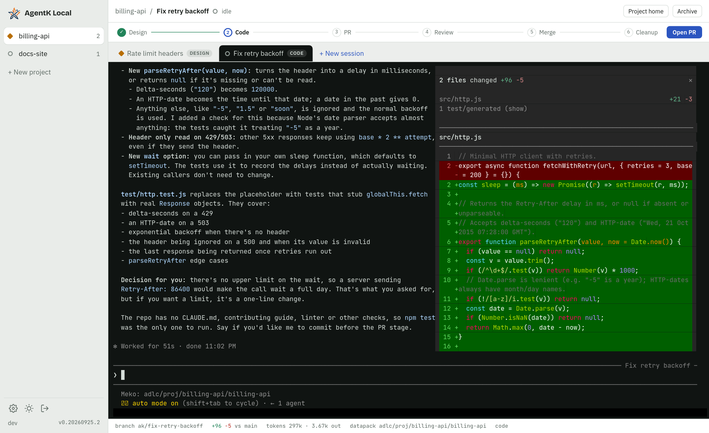

# The app

Part of the [AgentK Local design](../design.md).

The left rail holds projects, each with its repo's folder name in small type under the project
name and the most urgent session state shown on it. Drag a project to reorder the list; on a touch
screen, use **Move up** / **Move down** in the project home's settings. The top tabs hold that project's sessions. The
main pane is the live Claude terminal, and the footer shows where the session is working: branch,
diff size, tokens, the project's Meko datapack (`Meko:<datapack>`) and stage. On a desktop, clicking
the branch copies the full path of the session's worktree (its tooltip shows the path, and the label
reads `path copied` for a moment), once a start has made the worktree. A copy the browser blocks shows
the path in a toast, which stays while the pointer is on it and doesn't close on a click that selects
its text. The foot of the rail
shows the user and the server (`hari@dev-box`) with the version, so windows on different machines
are easy to tell apart. The server name is `[server] name` (set in Settings), else the machine's
host name up to its first dot; the tooltip adds the full host name. When space is short, the
version moves below it first, then the user name is cut off before the server name.

Session states, shown with a dot in the rail and on each tab:

- **Working:** the dot's halo blinks
- **Needs you:** a permission prompt or a question. The diamond knocks three times short and once
  long, then pauses
- **Idle**, waiting for your next prompt
- **Recovered** after a restart
- **Exited**
- **Learning:** AgentK is saving what the session learned to Meko (the
  [learn step](recall-and-learn.md#the-learn-step), `Session.learning`). The dot becomes a ring of dots turning around
  Meko's m. It shows over idle, recovered and working (a learn step through the mod leaves the
  status idle; without the mod it's a working turn), never over needs you, exited or starting
  (`dotState()` in `src/web/util.ts`). The rail ranks it like working.
- **Calling Meko:** Claude is running a Meko tool call. The working dot gets Meko's m, in white,
  and its halo blinks on (*Meko in the dot*, below).
- **Queued:** a gate is queued (`Session.queued`: Merge when ready, waiting on CI or the AgentK
  review, or Open PR) while Claude is between turns. The idle ring, with its top quarter open,
  turns once every 3 s. It shows over idle and recovered only; a learn step wins over it
  (`dotState()`). The tab's tooltip says what the gate waits on (a merge's from `queuedText()`;
  an Open PR is going now), then the status detail as for any dot; the palette says *queued*. The rail ranks it above idle and recovered, under working.

The working and needs-you signals run on one 100 ms clock (`src/web/blink.ts`), played on every
dot with the Web Animations API, pinned to the page's timeline. Each dot starts at its own point
in the signal, a whole number of units set by a hash of its session's id (the project's for the
rail's dot, `blinkOffsetMs()`), so different sessions blink out of step, a session's tab and
palette dots blink together, and a dot shown again picks up where its signal is. With reduced
motion the dots are still.

**Meko in the dot.** While Claude runs a Meko tool call, `Session.mekoCall` is true and a working
session's dot shows Meko's m. AgentK's mod reports each call (`/mod/meko`, a start and an end per
`tool_use_id`), so sessions without the mod never show it. The server keeps the calls in flight in
memory (`ModLinks.mekoCall()` in `modlink.ts`) and pushes a change only when the first starts and
when the last ends. It forgets them at the turn's end (`Stop`, a plan approval's too, or an
interrupted turn's `/mod/turn`) and on a reset
(a relaunch or `SessionEnd`), in case an end never got through.

- **Where it shows:** only over working; a learn step's dot wins (`dotState()`). The rail ranks it
  above working, starting and learning, under exited and needs you, so the project's dot shows the
  m whenever one of its sessions is calling Meko.
- **How it looks:** the working dot drawn at 12 px (10 px in the layout, with `margin: -1px`, so the
  tab keeps its width as calls start and end), with `/meko-m.png` as an 8 px white mask. It keeps
  the working blink. The tab's tooltip and the palette say *calling Meko*.
- **Why the mod and not command hooks:** AgentK's hooks see the end of every tool call
  (`PostToolUse`) but the start of only a few. A `PreToolUse` matcher would add a process per call
  and leave a failed or interrupted call to a guess. The mod brackets each call exactly.

**Renaming a session.** Double-click its tab (on a phone, **Rename session** in the ⋯ sheet; or
**Rename** in the `⌘K` palette) to give it a new name (`PATCH /api/sessions/:id`). Only the name
changes: the branch, worktree, pane and Meko agent id were named from it once, at the start,
and stay. The name is trimmed, its line breaks and runs of spaces made one space, and it can't be
empty, longer than 100 characters or hold control characters. The project's activity notes the
rename, the session's Meko conversation is retitled in the background (`conversation_update`, in
the datapack the session was launched with, as its other Meko writes; Meko off or failing, it
keeps the old title), and Claude reads the new name in its system prompt
the next time it's launched, and at the head of the task in any later prompt that names it. A task
that was its name (started with no first prompt) takes the new name too, so the
task never carries both. Claude Code's own name for the conversation (`--name`, given at the
first launch) stays. An archived session can't be renamed.

## Changes

Clicking the `+N −N` numbers in the footer opens a side panel with every file changed on the
branch since it left the base: committed, uncommitted and untracked (ignored files are left out).
The base is the branch's merge base with `origin/<base>` or, in a fork, `upstream/<base>`, whichever
is closer to the branch (a fork's own `<base>` can lag the upstream one the branch was rebased onto);
`origin` wins a tie, and the local `<base>` is used only when neither remote has one.
Each file has a kind (A, M, D, R, U), its line counts, an *uncommitted* tag when it has uncommitted
edits, and a collapsible diff. Single-file diffs are cut at 256 KB and the whole panel at 4 MB;
past that only line counts are shown.
Untracked files over 1 MB aren't read (no diff, 0 lines), and at most 32 MB of untracked files is
read per refresh. A changed image (PNG, JPEG, GIF, WebP, AVIF, BMP, ICO) is
shown as *Before* and *After* side by side with its size, instead of "Binary file";
`GET /api/sessions/:id/changes/image` serves the base's version from git or the worktree's from
disk, only for those types, only inside the repo (no `..`, no symlinks out), up to 20 MB, and with
a sandboxing content policy so the bytes can never run as a page. The footer counts use the same
comparison, so they always match. The file list is the header's **Files** menu, with a filter, so
you can jump to any file from anywhere in a long diff; each file's header shows its position
(*4 / 12*), and `[` / `]` step to the previous or next file.

## Review comments

Click **+** beside a line of any diff (shift-click a second line for a range) to leave a comment,
as on a PR. Comments are drafts in `state.db` until you click **Send N comments**, which sends
them to Claude as one prompt (through [AgentK's mod](mod.md), or pasted into the
terminal), grouped by file, with the lines each one is about. If Claude is
mid-turn or waiting on a permission prompt, they queue and go out when it's back at its prompt in
the Code or Review stage. Each comment keeps an excerpt of its last 20 lines (lines over 1,000 characters are cut short and
marked with "…"), so it follows them when
Claude moves code (its card then shows the line it's at now and the one it was written on). When
its lines can't be found it's shown at the top of its file, still sendable: as changed if the diff
still shows its line with other text, otherwise as not in the diff shown. Deleting a draft asks
first. Sent comments are
kept and shown with **Show sent**.

## Side panels

The design doc and the changes panel open on the right of the terminal, one at a time. Drag the
panel's left edge (or focus it and use the arrow keys) to resize it; double-click the edge to
switch between normal and widest. Each panel's width is remembered in the browser. The design doc
also opens full page in a new tab (`/p/<project>/s/<session>/design`), where it can still be
approved.

## Starting

Claude Code can take a while to load its plugins, MCP servers and startup hooks. While a session
starts, the terminal shows its steps (updating the base branch and preparing the worktree, or for a
Review a PR fetching the PR and preparing the worktree, starting Claude Code, loading, sending your
task) with the current one animated and timed, plus the stage the session opens in. The session's
tab shows the current step in its tooltip. The view shows up as soon as the New session dialog
closes, before the worktree is made; after 10 seconds on that step it says a big repo can take a
few minutes and that you can switch to other sessions meanwhile.

The steps come from Claude's hooks. If they never arrive (the hook socket was gone, say), a
session would stay on this view while Claude works under it. So the reconcile tick also watches
the conversation's transcript: once it has been written since the start and the last step is more
than 20 seconds old, Claude has taken a prompt, and the session moves on. Until a hook arrives,
it shows working while the transcript changes (in the last 15 seconds) and idle otherwise, which
is only a stand-in: a long tool call shows as idle and permission prompts don't show. A server
that restarts while a session starts picks the startup back up, timed from when it began. After
90 seconds on the last steps, the view says Claude may already be running and offers **Show
terminal**, which hides it for that start in this page.

## Keyboard

`⌘1–9` switches projects, `⌃Tab` cycles sessions (browsers keep `⌃Tab` for themselves in a
normal tab, so it works in the installed app window), and `⌘K` opens a palette to jump to any
session or project home, create a session, or move or rename the one on screen (or, with a GitHub
PR or issue pasted, start a session on it: see [Starting from a GitHub link](palette.md#starting-from-a-github-link);
or ask in plain words: see [Ask AgentK](palette.md#ask-agentk); or find a session by what it's about: see
[Finding a session](palette.md#finding-a-session)).
The search bar at the top of the rail (the AgentK logo, "Ask AgentK" and the shortcut)
opens it too; either way it opens over that bar, at the top left. In the palette, session names show
in the accent colour and project names in bold, so they don't read as commands. On Linux and Windows
these use Ctrl, so the terminal doesn't get Ctrl+K, Ctrl+1–9 or Ctrl+Tab; every other key passes
through to the terminal whenever it has focus. To copy from the terminal, drag across the text and
press `Ctrl+C` (`⌘C`), which
copies rather than interrupting Claude while text is selected. While Claude has the mouse (it runs
full screen), a plain drag goes to Claude; Shift-drag (Option-drag on a Mac) selects in the browser
instead. Text a program copies itself (OSC 52) goes on the clipboard too. Clipboard access
needs HTTPS or localhost.

In a dialog, `Ctrl+Enter` (`⌘Enter`) presses its main button, as a click would (nothing while it's
disabled): Start session, Move to…, Save and the like (`submitButton()` in `common.tsx`). In a form
with a submit button, that's the submit button if it's primary and nothing otherwise (Turn off
two-factor); else the dialog footer's primary button; else, outside a form and footer, a primary
button marked `data-submit` (Answer, in AgentK is asking). A field that takes Enter itself keeps it:
in the Another PR box, `Ctrl+Enter` is Find, as Enter is, so a session can't start on the PR picked
before.

To give Claude an image, paste it into the terminal (`⌘V`, or `Ctrl+V` / `Ctrl+Shift+V` on Linux and
Windows) or drop image files on it. Claude Code's own `Ctrl+V` reads the clipboard of the host it
runs on, which is the browser's only when both are on one computer, so the page uploads each image
(`POST /api/sessions/:id/images`, the image as the body) and pastes the path the server saved it at;
Claude Code reads a pasted path to an image as that image and shows `[Image #1]`. The paths wait
until you send: each image shows in a strip of thumbnails under the terminal (above the compose box
on touch screens) while it uploads and after, with ✕ to take it out, and the next Enter typed into
the terminal (or the key bar's ⏎, or the compose box's Send) pastes the held paths one at a time,
200 ms apart, after anything you typed, then sends Enter, so `fix this [Image #1]` goes as one
message (`heldImages.ts`, `flush()` in `terminals.ts`). Keys typed while that runs, sticky-Ctrl
letters included, are queued and follow it; Enter waits for uploads still running, and Esc or
`Ctrl+C` meanwhile calls the send off (✕ on a stalled image also ends the wait). Pasted text and
Option+Enter (a new line in Claude Code) don't send held images. If the terminal isn't connected,
or an upload failed, nothing is sent and the images stay held. If the connection drops partway,
what went out isn't sent again (each image leaves the strip once its path is out, and the compose
box doesn't get its text back), and a notice says to check Claude's prompt. An image taken out of
the strip stays on the host until the session's pastes are removed. Held images live in the page,
on each session's terminal, so an update's reload waits while any session holds some (see Releases
and auto-update). The server takes
PNG, JPEG, GIF and WebP, checked by their bytes, up to 20 MB each, and saves them owner-only under
`~/.agent-k-local/pastes/<session>/`; they're removed when the session is archived or its project
closed. A paste that carries text as well as an image (a spreadsheet's cells come with a picture of
them) pastes the text, unless the text is only the copied files' names. The page can't tell whether
Claude Code shares its computer (a tunnel to a remote host is localhost too), so `Ctrl+V` works the
same either way. On Linux and Windows it's the browser's paste, so it pastes text as well, where it
used to send `Ctrl+V` to Claude. On a Mac, `Ctrl+V` reads the clipboard through the async Clipboard
API (Chrome asks once, Safari before each read): an image is held the same way, and otherwise
Claude gets `Ctrl+V` as before. On a phone, an image pasted into the compose box is held too (text
still pastes into the box), and the image key at the end of the key bar's ▾ row picks images to
hold.

Images can go with a session's first prompt too: paste them into the New session dialog's First
prompt field (a review's Notes), drop them on it, or pick them with the image button under it. There's no
session yet, so each one uploads to the project as it's added (`POST /api/projects/:id/images`,
the same checks), is saved owner-only under `~/.agent-k-local/pastes/.new/<project>/`, and the
dialog holds the id the server gave it (the file's name), with the same strip of thumbnails.
**Start session** waits for uploads still running, then names the images in
`CreateSessionRequest.images`, at most 20. The server takes only ids of that project's staged
images, checked with the other quick checks, so a refused start leaves them in the dialog; once
the session's row is in, it moves them to the session's `pastes/<session>/` and keeps the paths of
the ones that got there (`sessions.start_images`). One gone by then (swept, or taken by another
start) is left out, and the session's activity log says to paste it into the terminal. The first
prompt reaches Claude on its command line, where a path isn't taken as an attached image, so
every prompt that names the task (a review's notes) adds the paths with a line asking Claude to
open each with its Read tool: the first prompt, a move that gives the session its task, a relaunch without resume.
The hooks settings file allows `Read` on the pastes folder, so that doesn't stop for a permission
prompt. The images aren't the task: with no text, the name is the task, as for any session started
with no first prompt. AgentK's Meko search at start uses the task's text alone. Staged images no session started with
are removed after a day (at startup and hourly), and a project's when it's closed.

Opening a project (`⌘1–9`, the rail, Back from its home, the app's start page, or a link that
names no session) reopens the session last open there in this browser, kept in `localStorage`.
When that session is closed, or none was open there yet, it opens the one with the most recent
activity.

## Notifications

A browser notification fires when any session moves to *needs you* or finishes a turn while its
tab is hidden. You can mute it per project. Only one open AgentK page shows them, the one used
last (pages queue for a Web Lock and a page that gets focus steals it; when it closes, the next one
takes over), so each shows once. They go through a minimal service worker (`/sw.js`), so a
notification stays clickable after the page that showed it reloads (as open pages do after an
update) or closes. Clicking one switches to the browser tab already showing its session, else to
one on its project (which then opens the session), else opens it in the window you used last, or a
new one. A design doc open on its own page is left alone. If the service worker isn't running (it
failed to register, say), the page shows the notification itself, and clicking it opens the session
in that page. The service worker caches nothing and handles no requests.

A project datapack shared with you also sends one notification (an `invite` event, once per
datapack); clicking it opens the Open project dialog for it. Tapped through the service worker, it
opens the dialog in an open window, or opens `/`, where the share's banner is waiting.

## On a phone

At 760 px wide or less the app switches to a phone layout. The rail becomes a drawer behind a top
app bar (the Back gesture closes it, and its search bar at the top opens the palette, across the
top of the screen, in place of `⌘K`). The app bar also holds the session tabs, between the drawer
button and ⋯, so the session name isn't repeated above them (each tab shows its status and stage). The session header,
the stage bar with its gate button (Approve design, Open PR, Merge & Close) and the footer details
move into a ⋯ sheet, leaving the screen to the terminal; a dot on ⋯ marks a gate that is ready for
you, and the sheet says why a closed gate is closed. The sheet closes with the × at its top right, a
tap outside it, or Escape. Dialogs open as bottom sheets, with tabs in a
header (Settings) on their own row under the title and its × (focus still goes from the tabs to the
×, as on a desktop). The app, the
overlay behind a dialog or sheet, and the sign-in and setup screens are pinned to the visible
viewport (its height and, where iOS pans the page for a focused field, its offset), so the on-screen
keyboard shrinks them instead of covering the prompt or a dialog's fields. The sign-in screens
scroll inside themselves and bring the field being typed in back into view once the keyboard is up
(`keepFocusInView`); the page itself never scrolls, since the app puts its scroll back at the top.
While you type, the terminal stays scrolled to its newest line. On
touch screens the terminal gets a key bar (Tab, arrows, Ctrl+C, Enter, select mode, typing mode,
and at the far right a ▾ key that opens a second row of more keys: a sticky Ctrl, Esc, Shift+Tab,
Home, End, Page Up and Page Down; the row stays open until ▾ is tapped again, and ▾ stays lit while
Ctrl is armed with the row closed; with Ctrl lit, the next letter typed in the compose box or in typing mode goes to
Claude as Ctrl plus that letter, such as Ctrl+O or Ctrl+R, and Ctrl then `[` sends Escape; last in
the row, an image key picks images for Claude and closes the row once they're picked), and a compose
box (it grows with its text to about a fifth of the visible screen, then scrolls) whose text goes
in as one bracketed paste (with any Escape characters removed), then any held images (see
Keyboard; images pasted into the box are held above it), then Enter; Send works with images alone,
and if the terminal isn't connected, the text and images stay. Swiping scrolls through mouse-wheel reports to Claude Code while it has the mouse
(it runs full screen), and through the terminal's own scrollback otherwise. The steps are sent together once a frame, a flick keeps
coasting and slows down until it stops or a new touch lands, and the terminal on screen draws with
WebGL (fetched only on touch screens; it falls back to the DOM renderer if WebGL is missing, loses
its context, or sizes its canvas wrongly). In select mode (it puts the keyboard away) a drag
selects whole lines instead of scrolling, and lifting the finger copies them; no touch reaches Claude
as a mouse click meanwhile. Tapping the terminal only brings up the keyboard in
typing mode (the keyboard key). Phones default to an 11 px terminal font (about 48 columns),
adjustable in the ⋯ sheet and remembered per browser.
