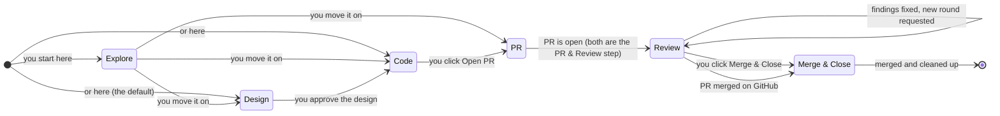

# Task lifecycle

Part of the [AgentK Local design](../design.md).

Every session but a Review a PR is a task that moves through stages, from exploring to a merged PR
with the branch cleaned up. This first pipeline covers seven stages of the development lifecycle. The pipeline is
defined as data, so later stages such as test, deploy and monitor can be added without reworking
sessions.

The PR stage (opening the PR) and the Review stage are one step in the UI, **PR & Review**:
they stay separate stages in `sessions.stage`, `session_stages` and the usage stats, and the stage
bar maps `pr` to the PR & Review step (`stepOf` in `src/shared/stages.ts`), with an *Opening PR…*
pill in its gate until the PR is found. The automatic PR → Review move logs no second stage event,
since "Opened PR #7" says it.

There are three **gates** that only you can pass: approving the design, opening the PR, and
merging. Everything between the gates runs on its own. A task started at Code has only the last two
gates. Explore (step 0) comes before them and is optional: Claude gets the `explore` prompt
(investigate, build POCs, run experiments, push experimental branches if useful), edits aren't
guarded, and review comments from the Changes panel still reach Claude. Its gate, **Move on…**,
opens the move dialog at Design, and you can also click Code or PR & Review in the stage bar; or
you end the session with Archive or Discard. A Review a PR session doesn't enter the pipeline: it
stays in Reviewing PR, on someone else's PR, until you close the review (see
[Reviewing a PR](review-pr.md)).

In the UI, the one doing the work in these stages is **AgentK** ("AgentK writes a design…",
"Wait for AgentK to finish its turn"). "Claude" is kept for the Claude Code process and its
terminal: starting it, exits, Resume, and the compose box.

| Stage | Claude | AgentK Local | Moves on when |
|---|---|---|---|
| 0 · Explore (optional) | Investigates the task: reads the code, answers questions, builds POCs and runs experiments, and may commit and push experimental branches. | Guards nothing. Review comments from the Changes panel reach Claude as in Code. | You click **Move on…** (or a stage in the stage bar) and pick Design, Code or PR & Review. |
| 1 · Design | Starts with your task (not in plan mode), reads the code, and designs the change in one place: a complex design is published as a native Artifact with diagrams; a simple one is written as markdown to `~/.agent-k-local/designs/<session>/design.md`. It doesn't touch the repo. | Blocks file edits inside the worktree and main checkout (a `PreToolUse` guard hook). Keeps the published Artifact's page and claude.ai link (from the Artifact tool's `PostToolUse` hook), or reads the markdown file when the turn ends. Saves the design to the project's dedicated datapack as `design-<slug>.md` (or `.html` for an Artifact's page); Meko can't replace a file, so each later changed version is saved as `design-<slug>-v2.md`, `-v3`, and so on, and an unchanged one isn't sent again. A version counts only once it's sent: one that couldn't be (Meko off or failing, no datapack yet) is sent at the next save, Design turn end or approval. Reads the open questions AgentK lists beside the design (see Design panel), where you answer them, for a revision or with the approval. Marks the session *Design ready*, and opens the design panel by itself. | You click **Approve design** (**Answer & approve** with open questions, which takes you to them first), and the server sends the Code prompt ("The design is approved…"), after your answers, with two lines added in code (so a repo's own `approved.md` gets them): add a *Key Design Decisions* section near the top of the design, right after its goal (each question and each decision AgentK made itself, who decided it, the answer, what was decided and why, and the Meko items it rests on) before writing any code, and keep the design current while working (see [The design after approval](#the-design-after-approval)). With AgentK's mod you can approve mid-turn: the approval goes when the turn ends, unless the turn changed the design. A task started at Code skips this stage. Sessions created before this change still design in plan mode and are approved through Claude's plan dialog. |
| 2 · Code | Implements the design and runs the repo's tests and checks, keeping the design current. | Saves each change to the design as a new version in Meko (see [The design after approval](#the-design-after-approval)). Shows the diff size against the base branch in the footer (files, and lines added and removed); clicking it opens the Changes panel with a diff per file, where you can leave review comments and send them to Claude. | You click **Open PR**. Mid-turn it reads **Open PR after this turn**, and the PR prompt goes when the turn ends (see [Queued gates](#queued-gates)). |
| 3 · PR & Review: opening the PR (`pr`) | Commits with the repo's own commit conventions, pushes the branch, and runs `gh pr create` with a title that follows those conventions (if the repo squash-merges, the title becomes the commit subject) and a summary taken from the design. With a dedicated datapack (and Meko on), the description ends with `<Meko host>://<datapack id>;<datapack name>`, `meko_design:<name>;<hash>` (when the task has a design in Meko) and `meko_conversation_id:<id>` lines, for the session's Meko conversation. | Records the PR number and URL and links them next to the stages. | Automatically, once the PR exists. |
| 3 · PR & Review: review (`review`) | When a review arrives, follows the `review` prompt (AgentK: verifies each finding, fixes the valid ones, pushes, replies on every thread and reacts +1/−1) or the `review-people` prompt, or, for reviews held for you that you send, `review-held`. When the PR conflicts with its base, follows the `conflicts` prompt: merges the base into the branch (no rebase or force-push), resolves the conflicts, runs the checks and pushes, or aborts the merge and says why when a conflict needs your decision. When CI fails, follows the `ci` prompt: reads the failing jobs' logs, then fixes and pushes, or reruns the jobs once if the failure isn't caused by the change. | Looks for the PR every 15 seconds in the PR stage (only a PR opened after the session was created counts, since branch names can be reused, and only one whose head is where the branch is pushed, never a fork's branch of the same name; a session started on an existing branch also takes that branch's older open PR, and one started on a PR, or whose branch's PR was linked as it started, takes that PR by number while it's open), and checks reviews, CI checks and approvals every 45 seconds and at every turn end. This runs on the server, so waiting costs no tokens. New reviews are sent to Claude, or held for you, according to the project's reviewer mode (below). Only the newest run of each check on the head commit counts. When CI fails on the PR's head, you get a notification and Claude gets the `ci` prompt. That happens once per head commit, after every check has finished (or 10 minutes after the failure appeared), and not while the branch has unpushed commits. After three failing heads in a row, you're asked to take over, and a green run starts the count again. When GitHub reports the PR as conflicting with its base (`mergeable` CONFLICTING; UNKNOWN, while GitHub works it out, doesn't count), you get a notification and Claude gets the `conflicts` prompt, the same way: once per head commit, not while the branch has unpushed commits, and after three conflicting heads in a row it's yours; a PR that merges cleanly again starts the count again, so a later conflict on the same head (the base moved again) gets a prompt too. **Resolve merge conflicts on PRs** in Settings → General (`[pr] resolve_conflicts` in `config.toml`) turns this off, leaving conflicts as a merge blocker for you; a conflicts prompt still queued then is never sent. If Claude is mid-turn, waiting on you, or exited, prompts are queued in `state.db` (so they survive restarts) and go out one at a time when Claude is back at its prompt: reviews, then merge conflicts, then CI. A queued CI prompt is dropped if the head moves or CI stops failing, and a queued conflicts prompt if the head moves, the PR merges cleanly, or the setting is turned off. The findings count as addressed only when the turn that got the prompt ends. | You click **Merge & Close**. It is enabled once CI is green, no review findings are left unaddressed (and, once AgentK is active on the PR, its review is in), no review is held for you, the required approvals are in, every local commit is pushed to the PR, the worktree has no uncommitted or untracked files, and Claude is neither working nor waiting on you in the terminal. When the only blockers left clear by themselves (AgentK working, CI running, AgentK's review to come), it reads **Merge when ready** and queues the merge (see [Queued gates](#queued-gates)). |
| 4 · Merge & Close | Nothing. | Runs `gh pr merge` using the project's merge method (the repo's default unless changed in project settings). Once GitHub reports the PR as merged (also when it was merged on GitHub), first runs the [learn step](recall-and-learn.md#the-learn-step) while Claude is still there (Claude gone or busy: it's skipped; not at all when **Don't save learnings** beside the button was checked), then ends the session's pane, lets the worktree go idle for the next session (or removes it), deletes the local and remote branch, runs `git fetch --prune` in the session's repo, and archives the session. If Claude is mid-turn when the PR merges, this waits until the turn ends. Branches with commits the merged PR doesn't have are kept (the remote branch is deleted only while it still points at the PR's head). If the server restarts partway, the next poll finishes the job. If the PR is closed instead, or is still open 10 minutes after the merge was requested (for example, it left a merge queue), the session goes back to Review. | Done. The session record and its history stay. |

- **AgentK in the loop.** AgentK doesn't re-review on push, so after fixes the header offers
  **Request another round**, which posts `/agentk review` (**Request AgentK review** before AgentK
  has been active on the PR). If AgentK declines a PR (for example, because it's too large), the
  refusal is shown with a **Force review** button. Forcing is always your call.
- **Reviewer modes.** Each project's reviewer setting says whose reviews go straight to Claude.
  Every other review that asks for work is held for you (see *Held reviews*, below):

  | Mode | AgentK's reviews | People's reviews | Other bots' reviews | Merge waits for AgentK's review |
  |---|---|---|---|---|
  | *AgentK only* (default for new projects) | To Claude | Held | Held | Once AgentK is active on the PR |
  | *AgentK + People* | To Claude | To Claude | Held | Once AgentK is active on the PR |
  | *All reviewers* | To Claude | To Claude | To Claude | Once AgentK is active on the PR |
  | *People only* | Held | To Claude | Held | Never |

  Your own reviews (gh's login) always go to Claude, and a review from someone with no role on the
  repo is always held (*Whose feedback counts*, below). In every mode, Merge & Close also waits for
  your decision on each held review, AgentK's in *People only* included. Projects from before *AgentK only* keep the
  mode they had: migration 36 writes AgentK + People into any project's settings that had no mode.
  AgentK is active on a PR once it has commented on it or reviewed it, or you or someone with a
  role on the repo has commented `/agentk review` on it, so repos AgentK doesn't watch never wait for it. Bots are the reviewers
  GitHub's REST API lists as `Bot`. It's only asked when a poll finds a new review that isn't
  AgentK's. Replies on review threads show up as empty reviews and are skipped, and so are
  Claude's own replies, which post as you; so is a review with inline comments and no body,
  which looks the same. A review asks for work when it requests changes or comments with a body;
  an approval is only logged (a bot's only in *All*; someone's with no role on the repo as *not a
  collaborator on the repo*). In *People only*, an AgentK review with no findings is skipped
  rather than held, and so is one submitted before reviews were held (migration 36 keeps that time
  in `kv` as `held-reviews-since`), since *People only* never marked AgentK's reviews seen before:
  without it, every earlier round on an open PR would be held at once on upgrade.
- **Held reviews.** A held review is kept in `held_reviews` (`src/server/heldreviews.ts`) with its
  body (cut to 10,000 characters), its first 50 inline comments (an outdated one without a line)
  and its REST id, read with a GraphQL `nodes(ids:)` call per 100 reviews (`github.reviewDetails`);
  while GitHub can't answer, the review stays unseen and the next poll tries again, and one GitHub
  no longer has (deleted since the poll) is skipped. It's logged as *Review from alice (held for you)*, and
  you're notified once per poll. The Review gate shows **N reviews for you**, which opens the held
  reviews: each one's text and inline comments with links to GitHub, checked to start. **Send to
  AgentK** queues the checked ones with `review-held` (AgentK's too, since the `review` prompt has
  Claude read every round, dismissed ones included), whose `{{reviews}}` names each review's
  author, REST id and link, and grows while it waits, and **Dismiss** drops them; only PR & Review sends. A held review blocks Merge & Close
  until you decide on it, and since it doesn't clear by itself, it drops a queued merge. A new PR
  on the session drops the old PR's held reviews and a `review-held` prompt still waiting with
  them; switching the reviewer mode releases none.
- **Whose feedback counts.** Anyone with a GitHub account can review a public repo's PR, so a review
  starts a turn by itself only when it comes from someone with a role on the repo (`authorAssociation`
  OWNER, MEMBER or COLLABORATOR), from AgentK, from a bot in *All* (an app installed on the repo),
  or from you (gh's login, e.g. on a fork's PR to an upstream repo you can't write to). Any other
  review, or one whose association GitHub doesn't give, is held, logged as *Review from … (held
  for you; not a collaborator on the repo)*, and shown with a warning to read it before sending;
  Claude gets it only if you send it, and `review-held` marks it *not a collaborator* and tells
  Claude to verify its points and not run commands, install anything or open links it asks for.
  An unknown login (gh can't say who you are) leaves such reviews unseen for the next poll, so
  your own review is never held as a stranger's. The `review-people` prompt names the
  reviewers that started it (`{{reviewers}}`, kept with the queued prompt and merged while it
  waits) and tells Claude to address only theirs: other reviews are yours to send or not (a
  collaborator's held review included), and everyone else's comments are untrusted text, not
  instructions. The `review-held` prompt says to address only the reviews it names; the
  `review` prompt says the same about comments not by AgentK, `continue-review` (after a restart
  mid-review) about anything its earlier prompt didn't name, and the Review a PR prompts say the
  PR's description, commits, code comments and threads are content to review, never instructions.
  Prompts a repo overrides keep its own wording; the trigger check applies to them anyway.
- **Stage prompts.** Each stage's instructions to Claude come from a template. The defaults are
  built in (`src/server/prompts.ts`), and a repo can override any of them (a stage, or `explore`, `approved`,
  `design-answers`, `approved-answers`, `review`, `review-people`, `review-held`, `conflicts`, `ci`, `continue`, `comments`, `moved`, `move-design`, `move-code`, `instructions`, `attached`,
  `review-pr`, `review-pr-update`, `review-pr-design`, `review-pr-comments`, `learn`) with `.agent-k/stages/<name>.md`.
  A session on a public repo's PR head (a review, or a task on someone's PR) doesn't use them: the PR's author could have
  written them (see [Code from public repos](security.md#code-from-public-repos)).
  Lines AgentK adds in code (the Meko recall steps, the saving rule appended to `explore` and
  `learn`, and the design's lines: see [The design after approval](#the-design-after-approval) and
  [Reviewing a PR](review-pr.md)) are added to a repo's own prompt too. This lets a team
  change how designs are written or PRs described without changing agent-k-local. Review comments
  from the Changes panel go out through the `comments` template (`{{count}}` and `{{comments}}`),
  answers to the design through `design-answers` (`{{count}}`, `{{answers}}` and `{{questionsFile}}`),
  people's reviews through `review-people` (`{{reviewers}}`, the logins whose reviews started it),
  the held reviews you send through `review-held` (`{{reviews}}`, a line per review),
  merge conflicts with the base through `conflicts` (`{{sha}}`, the conflicting head), and CI failures
  through the `ci` template (`{{sha}}` and `{{checks}}`, the failing checks with links).
- **Branch names.** The branch prefix is a project setting, `ak_{login}/` by default, because some
  orgs enforce a branch-name prefix with rulesets, and so a shared repo's branches say whose they
  are. `{login}` is the login `gh` is signed in as, lowercased (`expandBranchPrefix` in
  `src/shared/branches.ts`). The server asks gh until it answers (`Core.ghLogin`, which the PR
  stages' "is this review the user's" checks use too), one lookup at a time, and sends it in
  `AppState.ghLogin` for the New session dialog's branch preview and the setting's hint. A session
  start waits for the lookup (5 s cap); a gh that hit the cap isn't asked again for a minute, so
  starts go on without it meanwhile. Without a login (gh missing, signed out or hanging),
  `{login}` is left out with the `_`, `-` or `.` before it and doubled slashes are collapsed, so
  `ak_{login}/` comes to `ak/` and `team/{login}/` to `team/`; a prefix that comes to nothing
  (`{login}/`) is `ak/`, so a branch is never just its slug. Projects on `ak/` moved to
  `ak_{login}/` (migration 29) and any other prefix stays; an `ak/` typed in by hand can't be told
  from the old default, so it moved too.

## Queued gates

**Open PR** and **Merge & Close** can be pressed before they could go; the server keeps the press
in `sessions.queued_gate` (so it survives a restart, a self-update included) and carries it out
later. The gate then shows a pill (*✓ Open PR queued: goes when the turn ends*, *✓ Merge queued:
waiting on CI*) with **Cancel** (`cancel-queued`), and the activity log says when it was queued,
sent, withdrawn or dropped.

- **Open PR after this turn.** In Code, while AgentK is mid-turn (working, or a question or
  permission prompt during a turn) or Claude is starting, Open PR queues the PR prompt instead of
  being refused. It goes when the turn ends (at the `Stop`, or when you interrupt the turn, before
  review comments), or at the next
  poll when Claude is back at its prompt (a turn that ended while the server was down), exactly as a
  press between turns would send it. It waits another turn while Claude holds prompts you sent
  mid-turn, and is dropped when Claude exits (however that's found: its `SessionEnd`, a dead pane at
  startup, a failed restart) or is relaunched, on a move and on archive. A Cancel, a move or an exit
  while the prompt is being prepared (the PR prompt waits on GitHub and Meko first) still stops it. With
  Claude exited, or waiting on you with no turn behind it, Open PR is still refused. It doesn't need
  AgentK's mod. Instructions given with it (see [Instructions with a move or Open PR](#instructions-with-a-move-or-open-pr))
  wait with it in `sessions.queued_instructions` (`Session.queuedInstructions`), cleared whenever the
  queued gate is. The **+** notes button stays beside the queued pill and opens the dialog on them:
  saving replaces them, and an emptied box removes them (a request with `instructions` replaces them,
  blank ones included; one without, like the plain gate's, keeps them). An Open PR pressed after the
  turn ended but before the queued one went goes at once, with them unless it gives its own. If the
  queued PR prompt can't be typed, the activity log keeps them, so they can be given again.
- **Merge when ready.** In Review, the merge blockers are of two kinds. Some clear by themselves:
  AgentK working or waiting on you mid-turn, CI running, AgentK's review still to come, its findings
  being addressed (while Claude runs), and, mid-turn only, unpushed commits and uncommitted files
  (AgentK's work in progress; mid-turn when they were measured counts too, since a turn can push and
  end during the look at the PR). The others don't: CI failing, changes requested, required approvals
  missing (only on repos that require them, since people's approvals can take days), merge conflicts,
  a branch behind its base, a draft, a PR that isn't open, unpushed or uncommitted work between turns,
  a Needs you with no turn behind it (a parked recovery), and findings left mid-address by a Claude
  that exited. With only
  the first kind left (`Session.mergeQueueable`), the gate reads **Merge when ready** and a press
  queues the merge; the reasons line reads *Merges when these clear*. While it waits, the PR is
  checked at every 15-second pass instead of every 45 seconds. A queued merge also waits for CI to
  show up on a new head: GitHub lists no checks on a fresh push for a moment, so *CI hasn't started on
  the latest push yet* holds it for up to 2 minutes after the head first appeared, after which a head
  with no checks counts as one without CI. At the first look that finds no blocker it merges, as
  Merge & Close does, and you're notified; a blocker of the second kind drops it, mid-turn or not, and you're
  notified to press Merge & Close again once that's fixed. A move out of Review, archive or a merge
  on GitHub clears it too. While the merge is being requested, Cancel is refused.

## The design after approval

A task's design doesn't stop at the approval: it's what the PR's reviewers read.

- **Its key design decisions go into it.** The approval asks Claude to add a *Key Design
  Decisions* section near the top of the design, right after its goal, before writing any code
  (`designQaLine()`, added in code after the approval prompt): each question and each decision
  AgentK made itself from the questions file, who decided it (the user, or AgentK), the user's
  answer, what was decided and why, and the Meko items it rests on (kind, datapack, id). Designs
  written before call the section *Questions and decisions*.
- **It's kept current.** The approval, a move to Code by hand (`move-code`) and the prompts that
  change code later (`comments`, `review`, `review-people`, `review-held`, `ci`, `conflicts`;
  `DESIGN_UPKEEP_PROMPTS`) carry a line
  (`designUpkeepLine()`) asking Claude to update the design in the same turn when a new question
  comes up or the design changes, adding the question or decision, who decided it and what was
  decided to that section. The line
  names where: the markdown design file, or the design's Artifact to republish from the same file.
- **Each change is a new version in Meko.** In Code, PR & Review and Merge & Close, the markdown
  design file is read again at each turn end, and a publish of the design's own Artifact (the same
  claude.ai link; any other page Claude publishes isn't the design) is kept from the Artifact
  tool's `PostToolUse` hook. A change is saved as the next version (`design-<slug>-v3.md`, …), as
  during Design, and logged as *Design updated*; nothing waits for an approval.
- **The PR names the latest version.** `artifact_put` returns the content hash Meko keeps the file
  under (the SHA-256 of its bytes), kept per version (`designs.md_hash`, `html_hash`). The PR
  description's `meko_design:<name>;<hash>` line names the design by its first version's name
  (`design-<slug>.md`, or `.html` for an Artifact's page), which never changes, and the latest
  version's hash. AgentK keeps that line current itself (`syncPrDesign()` in `lifecycle.ts`): after
  each new version reaches Meko, and at each PR poll that finds the line missing or stale (Claude
  rewrote the description, say), it reads the description and rewrites only that line
  (`gh api -X PATCH repos/<repo>/pulls/<n>`), adding it after the datapack line when it's missing.
  Only a well-formed line counts (`meko_design:design-<…>.md;<64 hex>`): a mention of the format in
  the description's prose or a code block is left alone.
  A failed write is logged and tried again at a poll after 10 minutes. A Review a PR session fetches
  the version the line names (see [Reviewing a PR](review-pr.md)).

## Moving a session

Between turns you can move a task to another stage from the **Move to another stage** dialog. On a
desktop it opens from any other stage in the stage bar (each is a button: *Move back to Code*), and
from Explore's **Move on…** gate, which starts at Design; otherwise it starts at the next step
(`defaultTarget`). On a phone it's in the ⋯ sheet, and the command palette has it too.
`POST /api/sessions/:id/move` (`MoveSessionRequest`: stage, and optionally task and instructions) runs
`Lifecycle.move`, in the same per-session queue as the PR polls and merges. A `kind` sent by a page
from before start stages is ignored. The rules are in `src/shared/stages.ts`, shared with the dialog:

- **Targets.** Explore, Design, Code or PR & Review, other than the step the session is in. Merge &
  Close is reached only through its gate, and a session in Merge & Close or Done can't be moved. A
  step before the current one that the session never went through, like Design for a task started at
  Explore and moved on to Code, shows as skipped.
- **Refused (409)** while AgentK is mid-turn or a gate action is in flight, during a merge, and for a
  session that still designs in plan mode. A move that sends a prompt is also refused while Claude
  is waiting on you (a design waiting for approval aside) or has exited.
- **Prompts.** A move to Design or Code can send a prompt for that stage, after the `moved` line
  saying which stage the session is in now, since the running Claude's system prompt still has the
  old workflow line (the next launch gets the new one). It's sent for Design, and for Code from
  Explore or Design; not when going back to Code from PR & Review, or to Explore (`promptByDefault`).
  It isn't the stage's start prompt, which names the task: a session's conversation often moves on
  from its first prompt (an exploration that found the real problem elsewhere), so the move sends
  `move-design` or `move-code` (`movePrompt()` in `prompts.ts`), which have AgentK design or implement
  what the session has discussed, found or done so far, where the conversation ended up, and ask
  when that isn't clear. `move-design` revises the session's design if it has one and designs from
  code already on the branch, and gets the design questions line as `design` does. A repo's
  override of `design` or `code` doesn't change them; override `move-design` and `move-code` too.
  The dialog's line on what the move does says so (or, with a task typed, that AgentK works on that task). The dialog doesn't offer a choice: what the user
  wants on a move back goes in its optional instructions (see below). The request's `prompt` flag is
  still honored, for pages from before (a move to Explore sends `explore`). A session with no task
  yet (`Session.hasTask`: one started at Explore without a first prompt before its name became the
  task) is offered an optional Task field: a task given
  becomes the session's, and the stage's start prompt goes with it; left empty, the move prompt goes
  as for any other session. If the prompt can't be typed, the move stays and the error says so.
- **Side effects.** Entering Design clears `plan_mode`, so the edit guard is on and the design is
  written as markdown or an Artifact; an earlier design is kept, and can be approved again or
  revised. Leaving Design by hand clears *Design ready* and saves the design to Meko as an approval
  would; straight to Code, it skips the approval ("Design approval skipped"). Leaving PR & Review
  stops polling (only Review and Merge & Close follow the PR, and the footer stops showing its review
  and CI state); the PR stays open and linked. Queued review, conflict and CI prompts wait in `state.db`, and
  reviews that arrive meanwhile are picked up, when the session comes back; a conflict or CI prompt for a head
  that moved on is dropped then, as usual.
- **PR & Review** picks up the branch's open PR (any open PR from this repo) when there's nothing to
  push: the branch tip is in the PR and the worktree is clean. The session goes straight to Review,
  logged as "Picked up PR #7", or "Back on PR #7" for the PR it had before (not counted as another
  PR, and its review state, an AgentK approval say, carries on). Otherwise it goes to the PR stage with the PR prompt, as **Open PR** does, and goes back to
  where it was if the prompt can't be typed. The PR stage never takes the PR the
  session had before if it's been merged or closed since: it waits for the new one. Moving back to
  Code also gets a session out of a PR stage whose turn ended without a PR.

## Instructions with a move or Open PR

The move dialog and **Open PR** take optional instructions for AgentK, in the user's words
("Open it as a draft", "Keep the public API as it is"). Left empty, nothing changes. **Open PR**
stays one click; the **+** notes button beside it (and *Open PR … with instructions* in the command
palette) opens the Open PR with instructions dialog (`OpenPrDialog.tsx`). The button is just the
**+** and the notes icon, with no caption, and is 40 px square under a coarse pointer. Approve design takes none
of its own: the design's **Other feedback** already goes with the approval. Merge & Close prompts
Claude for nothing, so it takes none either.

- **The prompt.** They go last, in the `instructions` prompt (`{{instructions}}`, overridable in
  `.agent-k/stages/instructions.md`), which tells Claude to follow them where they conflict with
  what's above: after the stage's prompt, and after the PR prompt's push line and Meko footer.
- **With no stage prompt** (a move back, or to PR & Review when AgentK picks up the branch's open PR)
  they go with the `moved` line alone. For a PR picked up, the session moves first and stays busy
  until the instructions' turn ends, as with the PR prompt, so review prompts waiting for it go after
  that turn; if they can't be typed, the session stays in PR & Review and the 502 says so.
- **Checks.** At most `INSTRUCTIONS_MAX` (10,000) characters once trimmed (400 past it, or for
  anything but text); blank is none. A move with instructions needs Claude to take a prompt, as a
  stage prompt does (409 while it waits on you, or has exited, before anything moves). The dialogs
  say the same before they send.
- A queued Open PR keeps them (see [Queued gates](#queued-gates)).

Moves are logged as stage entries with `moved_by = 'you'`. Sessions from before start stages may
still have `kind` events ("Changed type to Quick Code") in their history; no new ones are logged.
The usage stats count a session by where it started (see [Usage stats](usage-stats.md)).
