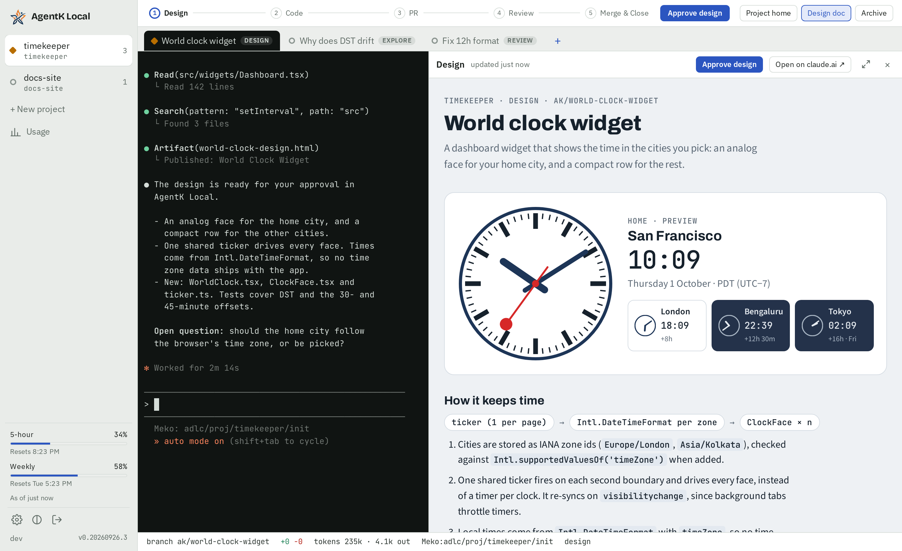
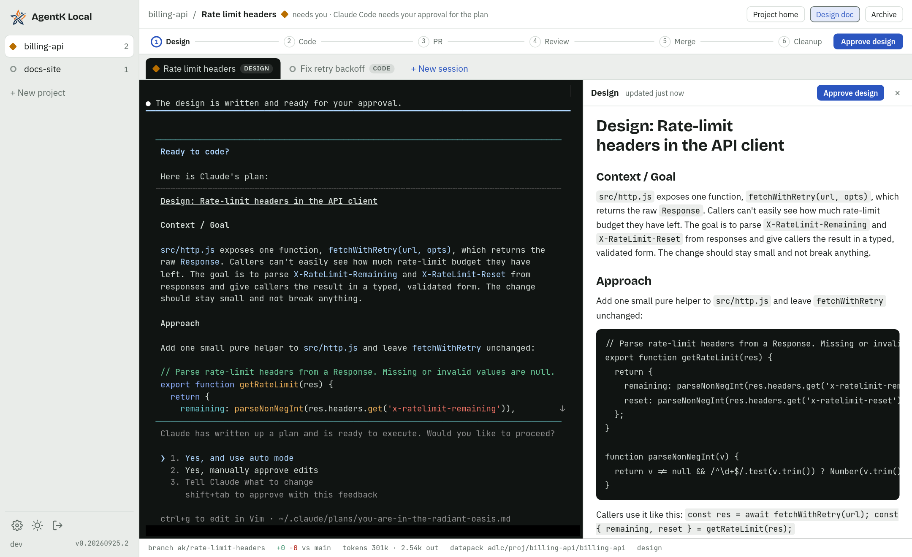
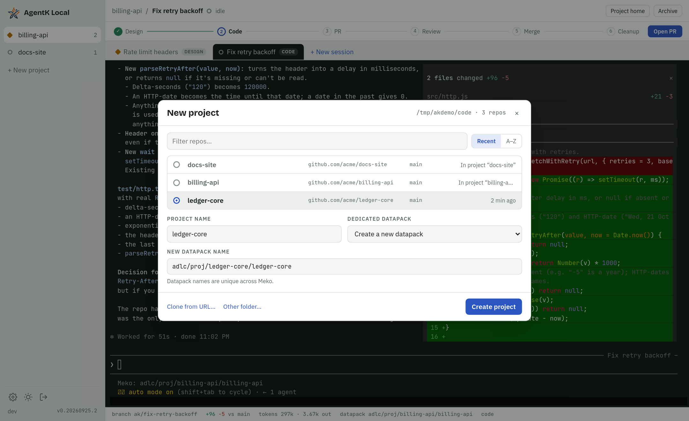
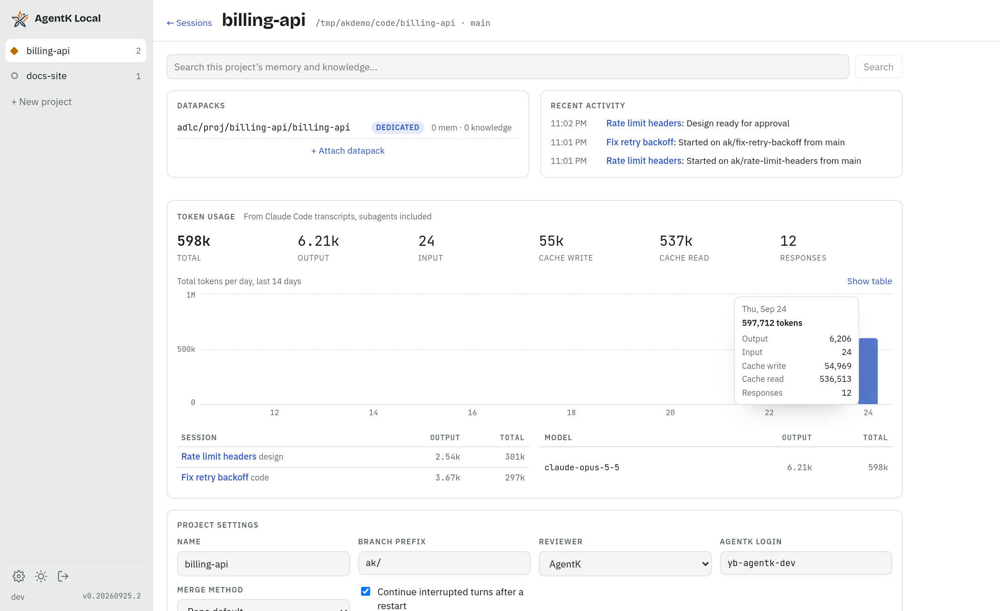
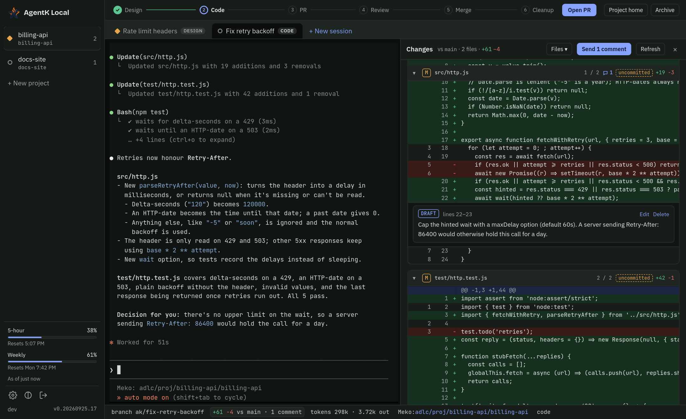
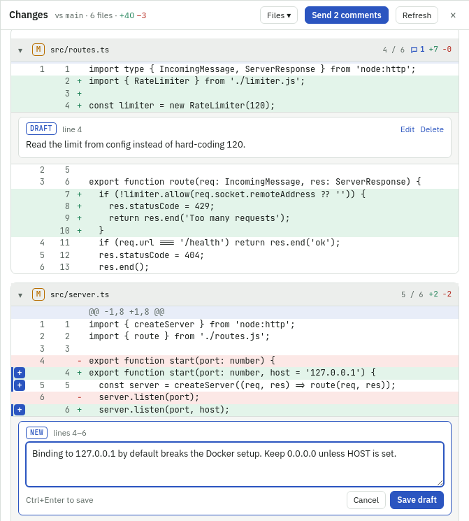
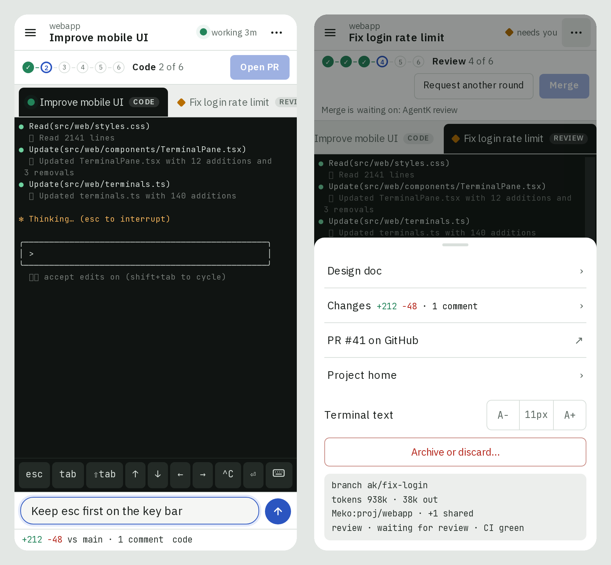
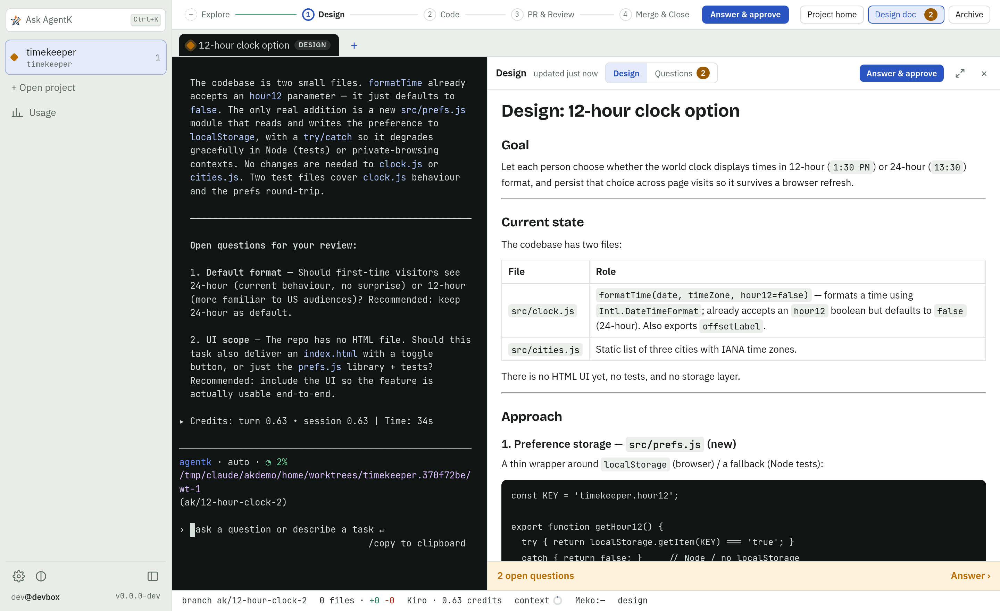

<p align="center"></p>

<p align="center">
  <a href="https://mekodata.ai">
    <picture>
      <source media="(prefers-color-scheme: dark)" srcset="../../backend/assets/badges/meko-context-dark.svg">
      
    </picture>
  </a>
</p>

# AgentK

The agentic coder for ADLC. AgentK lets you manage many projects and [Claude Code](https://claude.com/claude-code),
[OpenCode](https://opencode.ai) or [Kiro CLI](https://kiro.dev/cli/) sessions at once, with [Meko](https://mekodata.ai) as the shared context layer so designs, transcripts, and what each session learned flow into 
datapacks your whole team and their agents can build on.

It's self-hosted on your devserver (headless), your Mac or a Mac mini, and you use it from a browser or
your phone.



<table>
  <tr>
    <td width="50%"><br><sub><b>Design review.</b> Claude's plan, rendered next to the terminal, waiting for your approval.</sub></td>
    <td width="50%"><br><sub><b>Open project.</b> Pick a repo from your repos folder; a dedicated Meko datapack is created with it.</sub></td>
  </tr>
  <tr>
    <td width="50%"><br><sub><b>Project home.</b> Datapacks, memory search, activity, token usage by day, session and model, and settings.</sub></td>
    <td width="50%"><br><sub><b>Dark theme.</b> Follows your system, or pick one.</sub></td>
  </tr>
  <tr>
    <td width="50%"><br><sub><b>Review comments.</b> Comment on lines of the diff, then send them all to Claude at once.</sub></td>
    <td width="50%"><br><sub><b>On a phone.</b> The terminal with a key bar and a compose box, and the stage gate in reach.</sub></td>
  </tr>
  <tr>
    <td colspan="2"><br><sub><b>Sessions on Kiro.</b> The same stages, gates and design review with Kiro CLI as the agent; the footer shows the credits it billed.</sub></td>
  </tr>
</table>

## Install

You need Linux (x64 or arm64) or macOS 14 or newer on Apple Silicon, and a coding agent:
[Claude Code](https://claude.com/claude-code), [OpenCode](https://opencode.ai) 2.0.0 or later,
[Kiro CLI](https://kiro.dev/cli/) 2.32 or later, or more than one.
You also need [Meko](https://mekodata.ai) on this computer: it serves AgentK to your browser, at
`/ext/agentk/` on its own port (7777), and decides who can reach it. Meko also gives projects datapacks (shared
memory) and lets you share projects. For datapacks, AgentK uses Meko Cloud once you link it in Meko's
web UI (Settings › Meko Cloud, which links to Meko Cloud's sign-up and login pages to make a key; or
`meko cloud_link` on a computer without a browser), and otherwise the Meko on this computer. Install Meko, and then Meko installs AgentK:

```sh
curl -fsSL https://mekodata.ai/install.sh | sh
meko extension install agentk
```

(or **Install** on Meko's Extensions page). Meko downloads AgentK's newest release, checks it and
unpacks it into its data folder, then runs AgentK's setup, which offers to install anything that's
missing (git, gh, and Claude Code, OpenCode or Kiro CLI when none is there: it asks which, or pass
`meko extension install agentk -- --agent opencode` or `-- --agent kiro`) and to set up Meko for
each agent, asking first. Then it prints the address to open.

Who can open it is Meko's setting (`[web] access`: chosen when Meko was installed, in its
`web.toml`, and `config.toml` can override it): **local** (this computer only) or **remote** (other
devices too, like your phone, over HTTPS); remote is the default over SSH or on a machine with no
display. Neither has a login: with remote access, anyone who can reach the port can open AgentK and
its terminals, so pick it only where that's who you mean. `meko ui stop` on the host turns the web
UI off, AgentK's page with it, until `meko ui start`.
An AgentK that served browsers itself (on port 7777, before Meko did) hands its port, access and
certificate over to Meko by itself; its address moves to `/ext/agentk/` on the same port.

Meko installs AgentK's updates too: on its own when it finds one (each extension has an **Update
automatically** switch on Meko's Extensions page and in AgentK's Settings › Updates, on by
default), or when you click **Update** (the banner in AgentK, Settings › Updates, or Meko's
Extensions page) or run `meko update` (Meko, then every extension). An update restarts only
AgentK's web server, so sessions keep running, and Meko rolls back a version that fails to start.
To change AgentK's setup (repos folder, Meko) or set up its services again, run `me_koder install`,
or `meko extension install agentk` again (`--version <v>` installs another release).
`meko extension delete agentk` removes AgentK (it stops, ending its sessions) and keeps its home;
`--purge` deletes that too.

AgentK keeps its data in Meko's data folder, under `extensions/agentk`: `~/.meko/extensions/agentk`,
or under `MEKO_HOME` when you set that for Meko. You don't pick another place. If your home directory
is on a network filesystem (NFS, say), Meko's data folder, and AgentK's with it, is on a local disk
instead: `$XDG_STATE_HOME/meko` when that's local, else `/var/tmp/<you>/meko`. Many Linux systems
clean `/var/tmp` by age, so set `XDG_STATE_HOME` to a local folder there (AgentK warns when it's in
`/var/tmp`). AgentK runs only on the host you installed it on.

An install from before this kept its data in `~/.agent-k-local`. It moves into Meko's data folder by
itself right after updating to a release that brings the move (and Meko updates it from then on): every session ends and resumes there,
and `~/.agent-k-local` becomes a link to the new place. If the Meko installed here is older than
the one whose `meko destroy` keeps AgentK's data, the move waits until you update it (`meko update`).

If your home is under `/net` (the automounter's `/net/<host>/...`), Claude Code 2.1.292 and later
asks before every file it reads or edits there, even in auto mode. When the home is this host's
own folder, AgentK starts Claude in it without the `/net/<host>` prefix (with `HOME` to
match), so sessions don't stop for that. In plain Claude Code, open your repos by that path too.

On a Mac, install while you're logged in to the desktop (in person or with Screen Sharing): Claude
Code keeps its login in your Keychain, so AgentK runs while you're logged in. For a Mac mini
that stays on, turn on automatic login and stop it sleeping (System Settings > Energy). With the
macOS firewall on, allow incoming connections for `~/.meko/extensions/agentk/app/current/node/bin/me_koder` so
your phone can connect.

## Features

- **Projects** in a left rail you can widen by dragging its edge, or hide (with each one's open sessions listed under it, if you turn that on in Settings): each is an effort to build or improve a feature, product or service,
  worked on in a git repo picked from your repos folder (`~/code` by default), cloned into it, or
  started there as a new repo (git init and a first commit). A repo with no commits yet, or an
  empty folder, gets the same empty first commit, so sessions have a base to branch from; a repo
  with no commits but files in it is refused until you commit them.
  A repo can back several projects, each with its own datapack, settings and sessions.
  **Open project** starts one; **Close project** stops its sessions when you're done. The repo,
  branches and datapack stay: opening its datapack again brings the same project back, with its
  sessions, settings and usage.
  New sessions start from the base branch after it's fast-forwarded to `origin`, on a branch
  named `ak_<your GitHub login>/<task>` (the prefix is a project setting). Under
  **Advanced** a session can work in another of your repos, on a new branch you name, or pick up
  existing work: an **existing branch** (its open PR is linked), or one of your open **pull
  requests**, a fork's included when the fork is one of the repo's remotes. AgentK then builds on
  what's there instead of branching from it, and picks the PR up at Review & PR.
  The foot of the rail shows who you are and which server you're on (`you@dev-box`), so windows
  on different machines are easy to tell apart; give the server your own name in Settings.
- **Meko, the shared context layer:** every project has a dedicated datapack plus any number of
  shared ones. Designs, what each session learned and a summary of each merged PR are saved there,
  so the whole team, and its agents, start from the same context. (Session transcripts are kept
  out for now; `[meko] capture_transcripts = true` in `config.toml` sends them.) **Switch** on the project's home
  moves the project to another dedicated datapack; the old one stays attached to search, or is
  detached. When a session starts, AgentK searches the project's datapacks for its task (and the
  GitHub issues it names) and gives Claude what Meko already knows, and the prompts ask Claude to
  search Meko before reading code.
- **What sessions learn goes to the team's datapack.** When a PR merges or a session is discarded,
  before the session closes, AgentK asks the session what it learned about the product and repo (how things work, decisions
  and why, root causes, gotchas, measured numbers) and saves each new fact, after checking it
  against what the datapack already has: known facts are skipped, and ones that correct a memory
  replace it. Claude is told to leave out anything about your machine or one person's
  preferences. With AgentK's mod it runs out of sight (one cached look at the session, plus a small
  model for the duplicate check), and AgentK also drops any fact that names a local path; without
  the mod, AgentK asks Claude in a turn of its own and Claude saves under the same rule. **Save learnings to Meko** in the
  session's ⋯ menu, or `/agentk_learn` in the terminal, does it any time. **Merge & Close without
  saving learnings** in the ⋯ menu, or **Don't save learnings** in Discard's confirmation, closes a
  session without it.
- **Learn the project to seed a new datapack.** When you open a project on a new datapack (or one
  with nothing in it yet), the New session dialog starts on **Learn the project**: say what the
  project is about, where its files are, and how many months of PRs to read (24 by default). The
  session reads those files and the PRs merged in that time that touch them (descriptions and review
  threads), and saves what a teammate would want to know before working on it: how the parts fit,
  how it's built and tested, its traps, and from the PRs the decisions and why. It changes no files,
  and when it's done it writes a summary to its timeline and closes by itself. While the datapack
  is empty and no learn session is open on it (after a switch to a new datapack, say, or a learn
  session that saved nothing), the project's home offers it again; a plain New session doesn't.
  Before you start, the dialog says about how many merged PRs and files that covers, and warns when
  it's a lot (over 200 PRs or 5,000 files), since reading them all can take hours and millions of
  tokens: name the folders to learn, or read fewer months.
- **Share a project** by sharing its dedicated datapack with someone, by email or with its share
  link: turn the link on in the Share dialog with the role it gives, copy it, and post it where your
  team is. A project datapack shared with you shows a banner and a notification, and opens as a new
  project with the repo and name filled in; a share link pasted into Ask AgentK joins it and opens
  it the same way. The Meko server and key are Meko's, linked in its web UI (Settings › Meko Cloud),
  for your own Meko server too; AgentK's Settings › General links there (and, behind an older Meko that still has a login, to its account page).
  When Claude Code isn't connected to Meko, is set up for another Meko server, or holds a token
  that can't see the projects' datapacks there, a banner says so and offers to set Claude Code up
  with AgentK's Meko (Settings › Harness shows each agent's Meko);
  AgentK never changes Claude Code's setup unless you ask.
  Once a session has a PR, **Share with reviewers** in its ⋯ menu lists the reviewers of the project's open PRs
  (in every repo its sessions work in) with their emails, to share with in one click. The Share
  dialog suggests the people you share with most, in any project, to add with a tap.
- **Review someone else's PR with AgentK:** a *Review a PR* session lists the open PRs, in any repo,
  of a project shared with you, checks one out on a branch a plain `git push` refuses, and has AgentK sum
  it up for you, with the author's design (named in the PR, fetched from Meko, with its questions and
  decisions) open beside the terminal and the decisions behind it from Meko. Then AgentK waits and helps with
  what you ask; it posts your review on GitHub only when you say. **Update to latest** checks out
  the author's new commits and sums up what changed.
- **Ask AgentK in plain words:** type an instruction into **Ask AgentK** (`⌘K`), such as "start a
  design task in meko to add dark mode to the Usage page" or "which sessions need me?".
  AgentK asks the default agent (one quick call with no tools) and offers what to do: start a task at
  Explore, Design or Code with a prompt, start sessions on GitHub issues or PRs (`#5` is the project's
  repo's), go to a session, move one to another stage, open its PR, or open a project. Nothing runs
  until you pick it, a single "go to" included, and you can reply to refine it. For several steps at
  once ("open sessions for #1, #5 and #6 and move the ABC session to Code"), **Do all** runs them in order.
- **Sessions that manage sessions:** ask the agent in any session, on Claude Code, OpenCode or Kiro, to open a
  project, start sessions (from a task or from GitHub issues and PRs), move a session to another stage
  or open another session's PR. Every session gets AgentK's session tools (an MCP server) and a skill
  that says how to use them; the agent asks before each change, as for its other tools, and you can
  turn them off in Settings → General.
- **A work queue across projects:** keep what you're working on in one ordered list (**Work queue** in
  the rail): add items by hand with their GitHub, Jira and Slack links, drag them into order (or move
  them from each item's menu on a phone), and dismiss them when done (or all at once). Turn on
  **Sync** in Settings › Work queue (it's off until you do) and it pulls in, when you press it and
  every 15 minutes, the PRs waiting for your review and, through your agent's Slack connector, the
  messages on a Slack list of yours, marked **New** until you give them their place. Each item has one session,
  whose status shows on it; **Start session** opens New session with the item filled in. Paste a
  GitHub, Jira or Slack link into `⌘K` to jump to the session working on it.
- **Find a session by what it's about:** type a few words into Ask AgentK (`⌘K`), such as "totp
  login". Besides names, it searches each session's task, PR title, branch and design, closed sessions
  included, in the project you're on (every project from elsewhere), and lists the best matches with
  the text that matched. Picking one goes to it, or opens its PR when it's closed.
- **Paste a GitHub link to start:** paste a PR or issue link into Ask AgentK (`⌘K`). A PR
  gets a Review a PR session, an issue a task that fixes or implements it (from Design, or straight
  to Code), in the project it belongs to: the one whose datapack its description names, else the
  project you're on when it's on that repo, else the first one on the repo; the other projects on the
  repo are offered too. If there's none, AgentK opens a project for it and clones the repo if needed.
- **One git worktree and one Claude session per task.** The real Claude Code terminal UI is shown
  in the browser, and sessions run in AgentK's own session host (no tmux needed), so they keep
  running when you disconnect or the server updates. You can still attach from iTerm:
  `me_koder attach <session>` (`Ctrl+\` detaches).
- **Claude Code, OpenCode or Kiro, per session.** New sessions start on the default agent
  (Settings → Harness), or pick **Agent** under **Advanced** in New session once more than one of
  Claude Code, [OpenCode](https://opencode.ai) 2.0.0 or later (signed in to a model provider with
  `opencode auth login`) and [Kiro CLI](https://kiro.dev/cli/) 2.32 or later (`kiro-cli login`) is
  installed and connected to Meko (Meko owns that connection: **Connect to Meko** in Settings ›
  Harness, or `meko agent connect <agent>`; one Meko doesn't find, or a Meko too old to list agents,
  isn't held back). Any one
  alone is enough: with only Kiro, every session runs on Kiro. Settings › Harness
  has a bar that picks an agent (Claude Code, OpenCode, Kiro) and shows its settings, and can stop
  offering an agent you have installed but don't want (**Offer … for new sessions**). An OpenCode
  session loads AgentK's own OpenCode plugin (nothing is written to your OpenCode config), which
  tells AgentK when it works, needs you for a permission, or ends a turn, and gets this Meko as its
  `meko` MCP server unless OpenCode has one already. A Kiro session runs as `agentk`, an
  agent AgentK builds from your default Kiro agent (Meko's, after **Set up Kiro with this Meko**)
  with its hooks added, and goes through the same stages, gates, design review, PR flow, recovery
  and Resume. What only Claude Code does stays with it: designs as Artifacts, AgentK's mod
  (answering Claude's questions in AgentK, prompts sent mid-turn) and its 5-hour and weekly limits;
  the rail shows Kiro's own plan instead (credits used of the plan, read hourly and, while Kiro is in
  use, at most every 10 min when a turn ends). Kiro writes its
  designs as markdown, AgentK types its prompts into its terminal, and since Kiro says nothing while
  it waits for a permission answer, the session shows as working until you answer in the terminal
  (or turn on **Let Kiro run any tool**). OpenCode works like Kiro there, but says when it needs
  you. While your open sessions run on more than one agent, each session's tab
  and row in the rail shows its agent's logo (turn that off in Settings › Harness).
- **One screen at a time.** A session is live in one browser tab or device at a time. Open it on
  another and that screen offers **Move to this screen**; it moves there by itself once the first
  screen has gone 10 seconds without being used, or right away if that screen isn't showing it.
- **Find in the terminal:** `⌘F` (`Ctrl+Shift+F` on Linux and Windows) in a session's terminal
  searches all of it, scrollback included, highlighting each match, with match case, whole word
  and regex. **Find in terminal** is also in the session's ⋯ menu (the ⋯ sheet on a phone) and the command palette.
- **Multi-line prompts:** Shift+Enter starts a new line in a session's terminal, and Enter sends
  the prompt. On a Mac, ⌘← and ⌘→ go to the start and end of the line, ⌥← and ⌥→ move by a word,
  and ⌘⌫ deletes to the start of the line. On Linux and Windows, Ctrl+Backspace deletes a word.
- **Light or dark terminal:** the terminals are dark by default; Settings → General → Terminal
  colors makes them light or has them follow the app's theme, remembered per browser.
- **Builds carry over between sessions.** When a session ends, its worktree waits for the next
  session on the same repo (from any project on it) with its ignored build outputs intact, so
  repos that take long to build start incremental. Each repo keeps up to 3 idle worktrees, and one
  no session has used for 14 days is removed; change both in Settings (0 idle worktrees removes
  worktrees when sessions end).
- **Changes panel:** click the `N files · +N −N` diff size in a session's footer to see every changed file
  (committed, uncommitted and untracked) with a diff per file. Jump between files with the
  **Files** menu (its filter takes a regex too) or `[` / `]`, and leave review comments on lines (drag the **+** to cover a range) that go to Claude as one prompt. The
  **All changes ▾** menu shows one of the branch's commits alone instead (read-only).
  Compare with another branch (a release branch for a backport, say) from the base in its header;
  when the branch has clearly moved onto another branch, the panel offers to switch.
- **Paste images and files for Claude:** paste a screenshot or a file into the terminal, or drop
  files on it, and Claude gets them with your next message, even when AgentK runs on another
  machine. Images pasted into the New session dialog's first prompt go with it when the session starts.
- **Add documents to the knowledge base:** with a PDF, Markdown, text, JSON, CSV, XML or HTML file
  waiting under the terminal, **Upload to Meko** adds it to the project datapack's knowledge base
  once you confirm, and AgentK tells you when it's indexed.
- **Works from your phone:** a drawer for projects, a key bar (Tab, arrows, Ctrl+C, a ▾ row
  of more keys with a sticky Ctrl for Ctrl+letter shortcuts, Esc, Shift+Tab and an attach key, and a select mode that copies the lines you drag over), a compose box that takes pasted images and files too, swipe to scroll back, tap a link to open it (the whole URL, even over wrapped rows), and the stages and their gates
  in the ⋯ menu.
- **Install it as an app:** AgentK offers to install itself the first time you open it, for its own
  window and an icon in your dock or on your home screen (on an iPhone, Share › Add to Home Screen,
  which notifications need there).
- **Status at a glance:** see which sessions are working, which need you (a permission prompt or a
  question), and which are idle, with browser notifications.
- **AgentK's mod in Claude:** with Claude Code 2.1.287 or later, each session loads a small Claude
  Code mod that takes AgentK's prompts and comments. Claude takes them when it's next idle, so they
  never land in a permission dialog or a running turn. When Claude asks you something
  (`AskUserQuestion`), the question shows in AgentK too, on a phone as well: answer it there or
  in the terminal, whichever comes first. During Design you can send answers or approve while AgentK
  is still working: the answers wait in Claude for the turn to end, and the approval goes when the
  turn ends if it left the design alone. AgentK gives you its design questions through a tool, so
  they show as soon as it has them. After each turn a ring in the footer shows how full
  Claude's context window is. Turn it off with `[claude] mod = false` in `config.toml` and restart
  the server (the file is read at startup): AgentK then types its prompts into the terminal, running
  sessions included, though those keep the mod loaded until they're relaunched
  ([details](docs/design/mod.md)). Claude Code's mods are early
  access, and its own rollout decides whether they load; when they don't, AgentK types its prompts.
  When the host's Claude Code is too old for the mod, a banner says so and can update it.
- **Start where you want:** every task runs on one pipeline, Explore → Design → Code → Review & PR →
  Merge & Close, and a new session asks where to start: *Explore* for investigating, POCs and
  experiments, *Design* (the default) for the full lifecycle below, or *Code* for small tasks that
  go straight to code. Or pick *Review a PR* (above). A task moves between stages, forward or back,
  at any point between turns: an exploration that should ship moves on to Code or opens a PR with
  **Move on…**, and a session in review can go back to Code or Design. A move carries on from what the
  session has discussed or done, not its first prompt. A move, and **Open PR with instructions** in the
  session's ⋯ menu, take optional instructions for AgentK, sent after the stage's prompt. Rename a session any time
  (double-click its tab, or its row in the rail): its branch and worktree keep their names.
- **Task lifecycle:** (Explore →) Design → Code → Review & PR (AgentK) → Merge & Close. Complex designs are
  published as native Artifacts with diagrams and shown right next to the terminal; simple ones are
  markdown, with Mermaid diagrams drawn (zoom them with − and +). The design's open questions are listed beside it, each
  with AgentK's options and recommendation picked to start: pick another, or write a custom answer, then send them for
  AgentK to revise the design, or approve with them. The stage bar's **Design Review** opens the design
  (on its questions while any are open), and you approve from the design panel. Beside them are the design's key design decisions: the questions you answered and the decisions
  AgentK made itself, each saying who decided it, with **Change this** on AgentK's; a decision that rests on something
  AgentK found in Meko carries Meko's mark, the words it relied on and the item's id.
  Once it's approved, AgentK writes the key design decisions into the design and keeps it current
  while it codes and addresses reviews; each version goes to Meko, and the PR names the latest one.
  Before a PR opens, AgentK has the task write the PR's title and description, with its Meko lines,
  which the review checks the change against and the PR opens with; meanwhile, and while the review
  runs, the task shows in Review & PR. Then AgentK reviews the change on your computer with the cloud reviewer's algorithm
  (Sagittarius 3.0: five specialist passes and a scorer per finding; or the quicker Sirius 1.0), in a
  review session shown as a magnifier on the task's tab, which opens the review's terminal while its passes run and its findings once they wait on you, the task is fixing them or the review is done. The findings also open by themselves beside the task's terminal while the review runs or they wait on you, and once the review reads LGTM the magnifier goes (the session's ⋯ menu still opens its findings). Each round's findings wait for you first: add a note to any of them, or dismiss some with a note, then **Send to AgentK**, and the task fixes the rest (with Run to merge on, or **Check the findings first** set to No, they go to it at once). The PR
  says how it went (`me_ak_review:2 blockers,1 major addressed;Sagittarius3.0`, or `me_ak_review:LGTM;Sirius1.0`); findings you dismissed aren't counted. Strategy,
  re-review rounds, depth and Check the findings first are in Settings, the project's settings and each session's own.
  You can also run the review whenever you like, in Code or on the open PR in Review & PR: with
  **Run code review** in the session's ⋯ menu (the ⋯ sheet on a phone), from the command palette,
  or with **Review again** on its findings (which also has Cancel and Retry for it). One run in Code is the one Open PR uses, so the PR
  opens without reviewing again.
  You approve the design, opening the PR, and Merge & Close, which merges the PR and
  cleans up the branches, leaving the worktree for the next session. Pressed early, they wait:
  **Open PR after this turn** goes when AgentK's turn ends, and **Merge when ready** merges once CI
  has passed and nothing else blocks it. Or check **Run to merge** (when you start a task at Code, beside
  Approve design, or beside Open PR or Merge & Close) and AgentK passes both gates by itself: it opens
  the PR when the coding turn ends and merges once nothing blocks it. It notifies you only when it's
  done or needs you: a question, or something only you can clear (a held review, missing approvals)
  holding it up. Unchecking it, cancelling its gate,
  interrupting AgentK (Claude Code with AgentK's mod, or OpenCode) or moving the session gives the
  gates back to you. While it's on, a » follows the session's stage in the rail, its tab, the stage
  bar and the footer. The server watches the PR and hands reviews (only yours by default; also people's
  with a role on the repo in *People*, and bots' too in *All reviewers*), merge conflicts with the base (unless
  you turn that off in Settings → General) and CI failures to Claude. Every other review, and
  any review from someone without a role on the repo, is held for you: you read it in AgentK and
  send it to AgentK or dismiss it, and Merge & Close waits until you decide. Your own reviews
  always go to Claude.
- **Token usage** per session and per project (by model and by day), read from Claude Code transcripts,
  subagents included, with its cost at API list prices (OpenCode sessions' tokens too, from AgentK's
  plugin); Kiro sessions count the credits Kiro billed,
  beside the cost and never added to it, with a Credits column by session and model and a credits
  bar beside each day's tokens. Each day's bar stacks the tokens code reviews spent, and a
  **Code Reviews** section counts the reviews, the issues they found, the ones fixed and the PRs opened
  after them. **Usage** in the left panel adds it up across every project, closed ones
  too, with what shipped: merged PRs and commits pushed straight to the base branch.
- **Context Gaps:** Meko keeps the searches it couldn't answer, on each datapack's
  **Context Gaps** tab in its web UI (Meko Cloud's datapacks' too, as their searches pass through
  it). With the Meko on this computer, the project home says how many
  are open for the project's datapack and opens that tab (a learn session's searches while it seeds,
  which check before each save, are forgotten). When AgentK saves what a session learned through
  its mod in Claude, it also answers the open questions that session found out, its own and other
  sessions'.
- **Meko usage**: the Meko lookups and saves each session made, how many sessions had something
  from Meko in their first turn, and what the learn step saved (memories added and corrected) and
  the tokens it used, on the project home and the Usage page, whose table by project also estimates
  what Meko searches saved. On Pro and Max plans, the rail also shows your Claude 5-hour and weekly usage limits
  and when they reset, and once you've run a session on Kiro, the Kiro credits your plan has used.
- **Usage stats:** once a day (hourly in its first day) AgentK sends anonymous counts to YugabyteDB: how many
  projects, sessions, PRs, commits and tokens (by model) it handled, which file types changed, and
  how its code reviews went (reviews, issues found and fixed, tokens and cost).
  It never sends names, paths, prompts, code, or who you are. Turn it off in Settings › General
  (details in [docs/design/usage-stats.md](docs/design/usage-stats.md)).
- **Survives restarts:** after a host reboot, every open session is brought back with
  `claude --resume`, and sessions that were mid-turn are told to continue. A session whose agent
  was stopped for sitting idle stays stopped until it's needed.
- **Stops idle agents:** a session's agent idle for 24 hours is stopped to free its memory; the
  session, its worktree and conversation stay. It starts again with `--resume` when you resume it,
  type in its terminal, take an action that sends it a prompt, or AgentK has work for it. Change
  the hours, or turn it off with 0, in Settings › General.
- **Updates through Meko** from GitHub Releases, automatic or one click, without interrupting running
  sessions, and rollback if a new version won't start.

Design: [`docs/design.md`](docs/design.md), an index with one file per area under `docs/design/`.

## Commands

| Command | What it does |
|---|---|
| `me_koder ui` | Open AgentK in your browser through Meko (`open` on macOS, `xdg-open` on Linux); with no display to open it on, such as over SSH, it prints the URL |
| `me_koder status` | Services, the URL Meko serves it at, sessions, and whether the server answers; exits 3 when no server runs this home |
| `me_koder stop` / `start` | Stop the server and the session host, ending every session, and start them again (sessions resume). The services also start again at the next login |
| `me_koder restart` | Restart the web server only (sessions keep running), and wait until it answers; Meko runs it after installing an update |
| `me_koder logs -f` | Follow the server log (`logs/server.log` in AgentK's home) |
| `me_koder uninstall [--purge [--delete-worktrees]]` | Remove the services; `--purge` also deletes AgentK's home (in Meko's data folder) except session worktrees and designs, which only `--delete-worktrees` removes (after reporting uncommitted changes). Branches are always kept. |
| `me_koder attach [session]` | Show a session's terminal in yours (`Ctrl+\` detaches; Claude keeps running); with no name, list the sessions |
| `me_koder host restart` | Restart the session host (its sessions resume); with the server stopped, `host stop` ends every session until the server starts |

The command is `me_koder`, so a process list, `~/.local/bin` and the services say AgentK is a Meko
extension. It was `agentk` before, and `agent-k-local` before the rename to AgentK. An install from
then gets `me_koder` when Meko next starts, and the old commands go; its services keep their old
names (`agentk.service`, `com.yugabyte.agentk`, or `agent-k-local…`) until you run `me_koder
install`, which renames the server's at once and the session host's once the host isn't running.

## Develop

See the repo's [CONTRIBUTING.md](../../CONTRIBUTING.md), and [AGENTS.md](AGENTS.md) for AgentK's
commands and map.

## License

[Apache-2.0](../../LICENSE)

The Claude Code, OpenCode and Kiro logos in `src/web/public/` are their owners' marks, used to show
which agent a session runs on. The Claude Code mascot is drawn from
[dashboard-icons](https://github.com/homarr-labs/dashboard-icons) (Apache-2.0), and OpenCode's is its
favicon from [its repo](https://github.com/anomalyco/opencode) (MIT).
