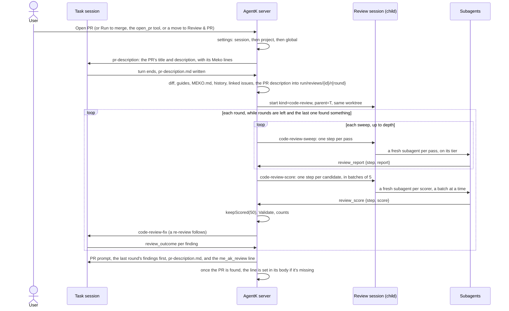

# Local code review

Part of the [AgentK design](../design.md).

Before a task's PR opens, AgentK reviews the change on this computer with the agent-k reviewer's
algorithm (its `pkg/agenticreview`, the cloud AgentK's Golum 1.0), so the task fixes what the review
finds before anyone else reads the PR. The PR description then says how it went, on one line:

```
me_ak_review:4 blockers,4 major addressed
me_ak_review:1 blocker,2 major,3 minor addressed
me_ak_review:LGTM
```

The code is in `src/server/review/` (the algorithm, ported) and `src/shared/codereview.ts` (the
settings, the line, the tab's label); the UI is the magnifier joined to the task's tab.

## Settings

Three settings, each set globally (`[code_review]` in config.toml, Settings › Code review), overridden
per project (`ProjectSettings.codeReview`, the project's settings) and again per session
(`sessions.review_json`: the New session dialog's Advanced, the session's ⋯ sheet, Open PR with
instructions, and the `review` argument of the `start_sessions` tool, so "start a code session with
3 deep reviews" asks for `depth: 3`). A value left out keeps the next level's (`resolveReview`).

| Setting | Global default | What it does |
|---|---|---|
| `strategy` | `sagittarius-3.0` | Which algorithm runs: `off` for no review, `sirius-1.0`, or `sagittarius-3.0`. |
| `depth` | `1` | Sweeps in each round, 1 to 5: the number of times a review runs before AgentK gets the findings to fix. More than one sweep makes it a deep review: each sweep after the first is told what the earlier ones found and looks elsewhere, and the sweeps run up to this count, but from the second sweep on, one that finds nothing new ends it ([how a review runs](#how-a-review-runs)). Costs more tokens. |
| `rounds` | `0` | Re-review rounds, 0 to 5: the number of times the code review runs again after AgentK fixes the last review's findings, before the PR opens. A review that finds nothing ends it early. |

`[code_review.models.<harness>]` sets the model each tier of step runs on (`large`, `mid`,
`small`): Claude Code's are `opus`, `sonnet` and `haiku`; OpenCode's and Kiro's are empty, which
runs a step on the session's own model, since their model ids depend on the user's providers and
plans.

## Strategies

A strategy is a named, versioned bundle of what a review does, stamped on each review and never
reused (the cloud's `Strategy`); an unknown id resolves to the default.

| Id | Passes | Scoring |
|---|---|---|
| `sirius-1.0` | One mid-tier pass whose mandate covers all five | None: every candidate goes to Validate |
| `sagittarius-3.0` | guide (large), diff (small), dependents (large, with its state ledger), history (large), claims (large, with its claims ledger): the cloud's mandates word for word | A small-tier scorer for each candidate |

The cloud AgentK isn't changed: its strategy keeps its own name, and only this registry calls the
algorithm Sagittarius 3.0.

## How a review runs



`openPr()` (and `takeQueuedPr()`, so a queued Open PR and Run to merge go through it too) asks
`CodeReviews.openPr()` first: while it returns true, a review holds the PR and sends the PR prompt
itself when it's done (`Lifecycle.sendReviewedPr`). A move to Review & PR by hand with work to push
(`moveToReview`, from Explore, Design or Code) does the same when a review applies
(`CodeReviews.applies`): the session goes to Code (`reviewBeforePr`), since the review's checks, its
gate and its cancelling are all Code's, and the review sends the PR prompt as for Open PR. From
Explore or Design, the `moved` line (Claude's system prompt still names the old stage, and
Explore's says no PR) waits on the review (`code_reviews.lead`) and goes before its first prompt to
the task, the ask for the PR description. A move that only picks up the branch's open PR runs no review. The PR prompt itself doesn't ask the task
to review its diff: the review session has.

**The PR description.** Before the first round the review is `describing`: AgentK asks the task
(`pr-description`, `Lifecycle.sendPrDescription`) to write the PR's title (the first line) and
description to `pr-description.md` beside its design (`designs/<task>/`, outside the repo, which
every session may write), ending with the Meko lines the PR prompt asks for (`prFooter`: the
datapack, the design and the conversation), so the passes check the change against the author's
account of it, as the cloud's check a PR's, and see where its Meko context is. An earlier review's
file is removed first, so a turn that writes none leaves the passes the task alone. The ask calls an
open PR's existing text untrusted. The task's turn end starts round 1 (`CodeReviews.onTurnEnd`). An
interrupted one waits, as a fix turn does, for the next turn's end or Open PR (the gate's **Review
now**); so does an ask the agent exited before taking (sessions.submit's `lost`), and there Open PR
asks again. The review keeps why it waits in its `detail` (`DESCRIBE_INTERRUPTED`, `DESCRIBE_LOST`),
so a restart leaves it waiting; otherwise `recover()` starts round 1 once the task is idle (not while
its turn runs or asks something). A Retry before round 1 had a description asks again. The task is
busy from the ask until its turn ends, so an Open PR or a move while AgentK looks up the Meko lines
is refused rather than taken for a press past an interrupted turn. The passes get the file, title
and all, quoted, as data to check the change against and never instructions (an open PR's text it
starts from may be anyone's), clipped before its trailing Meko lines, which are kept (at most six,
each clipped: `clipDescription`). Each later round reads the file again: the fix prompt asks the task to
keep it true (`prDescriptionFixLine`), and the PR prompt to open the PR with it, brought up to date
(`prDescriptionUseLine`).

**The review session** is a session of kind `code-review` (`Session.parentId` is its task), held by
the session host like any other, so it survives restarts. It works in its task's worktree without
owning it (`worktree_released`), so archiving it never frees the worktree or deletes the branch. It
is archived as soon as the review is done (`finish()`: the findings stay with the review), when the
user cancels it, when another review replaces it, and with its task; a failed review keeps it for
Retry. Its Meko call log (the passes' gotcha searches, with Log Meko calls on) stays until its task
is archived, so a done review's calls can still be read. Its edit guard denies every
edit in the repo, and on Claude Code `--disallowedTools` takes Bash and the edit and web tools away
from it and its subagents; OpenCode's session config denies them. Its first prompt is the first
sweep's, and AgentK sends each later step's prompt as the turn before ends.

**Steps.** The main thread only starts steps. Each pass and each scorer runs with a fresh context,
as the cloud's separate processes do (`HARNESS_CAPS.reviewSteps`):

- `subagents` (Claude Code, OpenCode): the session is launched with a subagent per tier
  (`agentk-review-large`, `-mid`, `-small`: Claude Code's `--agents`, OpenCode's `agent` config),
  and one prompt lists the steps, each in its subagent with the prompt "Read {file} and do what it
  says." A sweep's passes start all at once, in one message, as the cloud runs them; the scorers
  run in batches of 5 (`SCORE_BATCH`), since a round can have dozens: AgentK numbers the batches
  in the prompt (`stepList`), and each batch starts in one message once the one before has
  finished. Asking again for missing scores batches only the missing ones. The runner doesn't
  depend on the order: reports are keyed by step. The turn's end is the sweep's end, so the
  subagents must run inside it: Claude Code backgrounds a subagent by default, which ends the turn
  before any step reports, so a Claude Code review session launches with
  `CLAUDE_CODE_DISABLE_BACKGROUND_TASKS=1`.
- `turns` (Kiro): each step is a prompt of its own, after `/clear` and, when the tier has a model,
  `/model`. Kiro's sessions share one agent file, which has AgentK's MCP server only while
  `[tools] enabled` is on, so a Kiro review needs the session tools on; without them no step can
  report, and the review fails for Retry or Open anyway.

Each step's file is the shared base prompt (the same for every pass, so a prompt cache serves it),
the sweep context, then its mandate and how to report: AgentK's `review_report` or `review_score`
tool (in the `agentk_sessions` MCP server, pre-allowed, answered whatever `[tools] enabled` says),
called with the step id and a report its schema checks (`checkReport`, `checkScore`). An error names
what to fix, and the step calls again. A required ledger is a field the model can't skip.

**After a turn** of the review session (`CodeReviews.onTurnEnd`): a step that didn't report is
asked for once more (`asked`), then the review goes on without it. A sweep merges its reports into
the round's candidates (`mergeSweep`: on file and line, more passes on one line are
corroboration, the worst severity and the longer comment win). Another sweep follows while the
depth allows and, from MinSweeps (min(2, depth)) on, the last sweep added something new. Then the
scorers, then `keepScored` (refuted only with a refutation and something read, confirmed kept,
unverified kept at 50 or more, unscored kept) and Validate (the file must be in the change and the
line in a hunk, at most 100). No pass reporting in the first sweep fails the review.

**Rounds.** A round that keeps findings, with rounds left, sends the task `code-review-fix` (fix
or decline each, don't commit yet), and the task reports what it did with each by its key with
`review_outcome`. The task's next turn end starts the next round, whose passes are told the
earlier rounds' findings and what the task did with them (prior rounds). The last round's
findings lead the PR prompt (`code-review-findings`).

**The line** (`meAkReviewLine`) adds up every round's kept findings, by severity in the order
blocker, major, minor; `LGTM` when no round kept one. AgentK writes it into the PR's description
after `adoptPr` when Claude left it out (`syncReviewLine`).

**Stopping.** A failed review (no pass reported, or an error) or one the user cancelled holds the
PR: Open PR answers 409, Run to merge waits, and the task offers **Retry** (the round again from
the step it stopped at, reusing every step already reported, from `code_review_steps`) and **Open
anyway** (the PR prompt with no line). A move out of Code (or a move to Review & PR that finds
the task outside Code) cancels its review, running or stopped, with the detail `the task left Code`
(`REVIEW_LEFT_CODE`, `CodeReviews.leftCode`; `taskMovedOn` catches one the review session's turn
end finds there): that one doesn't hold the PR (`reviewHolds`), since Retry and Open anyway are
Code's, so the next Open PR, or a move to Review & PR, starts a new review on the change as it is.
A move to Review & PR checks what Open PR does, whether the review is on or off: the user's
prompts go first, and a stopped review in Code answers 409. Open PR, or a move, while a review
waits for fixes whose turn was interrupted moves it on to the next round.

**The PR prompt.** A done review's `finished_at` says its PR prompt went. Open PR (or a move to
Review & PR) on a done review without it sends the PR prompt with the findings and the line, and
starts no new review. It's set when the prompt is sent, and cleared again (`markUnsent`) when
Claude exits before taking it: the task goes back to Code, and the prompt goes again once Claude
is back ([AgentK's mod](mod.md)).

**Recovery.** `code_reviews` and `code_review_steps` keep a review's state and every step's
report. After a restart, `CodeReviews.recover()` asks an idle review session again for the steps
still missing; a review whose session is gone fails, for Retry.

## Context the passes get

The base prompt follows the cloud's `BuildPrompt`, for a change rather than a PR: the branch
against its base (origin's copy when there is one), the PR title and description the task wrote,
its first prompt and where its design is, `git log` of its commits, the change from the merge-base to the working tree (untracked
files included, since nothing is committed before the PR prompt), the review guides (REVIEW.md at
the root and in each ancestor folder of a changed file), the history of the rewritten lines
(`git blame` and recent commits, since the passes have no git), the task's linked issues (its work
item's GitHub issues fetched into the run folder; other links by name), and earlier rounds. Secret
files, deleted files and generated files are withheld (`withhold.go`, `generated.go`). A diff over
256 KiB is written one patch per file instead of inline. The description is the PR title and
description the task wrote, quoted, followed by the task it was written for; with none, the
task alone. Left out: the cloud's injection screen and budget caps (the change is the user's own, on
their own account), and the PR description's skip patterns.

Every absolute path the prompts give (the working directory, the run folder, the per-file patches,
the linked issues, the design and each step's prompt file) is in the spelling the review session
runs in, `claudePath()`, as its cwd and `--add-dir`s are. Each is converted as the prompt is
rendered: `ReviewContext` and `context.json` keep AgentK's own (the design as its own field,
`ReviewContext.design`, beside the task's first prompt). For a home under `/net/<this host>`, Claude Code asks before every read under `/net`,
and a pass that builds a path from a `/net` working directory would wait on a prompt nobody sees.
The pass prompts' base is written once per round (`base.md`), so a round started before a change
here keeps its old text through Retry; the scorers' base is rendered again at each send.

**Meko.** In a trusted repo, AgentK reads the `MEKO.md` files that apply (the root's and each
changed file's ancestors': a table of Datapack, ID and What's in it, `src/shared/mekomd.ts`) and
lists their datapacks in the base prompt. The passes search the gotchas datapack (its name ends in
`/gotchas`, as the cloud's miner names them) themselves with `knowledgebase_search` and its id, and
may search the others with `context_search`; a finding credits a gotcha (`MG-<n>`) only with the
sentence it instantiates, and AgentK drops a credit without one. With no `MEKO.md` the review runs
without Meko. Retired gotchas aren't filtered: the cloud's roster of them isn't in Meko.

## In the UI

The review is never a tab or a rail row of its own: it's a part joined to its task's tab and rail
row (`ReviewSegment`), a blue magnifier whose lens pulses while the review works and shows Meko's
"m" while the review session is in a Meko call (`CodeReviewSummary.mekoCall`), then `…` while the
task writes the PR description (describing) or the review prepares, then how far it
has got (`reviewSteps()`: each pass of a sweep, then scoring as one step, so Sagittarius 3.0 counts
`1/6` to `6/6` and Sirius 1.0, unscored, `1/1`, moving on as each pass reports, whether the passes
run at once, on Claude Code and OpenCode, or one after another, on Kiro; with depth > 1 the passes
count again for each sweep; the tooltip says how many passes have reported, and names the sweep,
and while scoring how many candidates have been scored, since a batch of scorers runs at once),
`R1` while the task fixes round 1's findings, the result (`2·1`,
blockers·majors, until the task has said what it did with every kept finding, every round's,
through `review_outcome`: `CodeReviewSummary.addressed`; then, or with none, `LGTM`) or a red `!`.
A task that answers in its reply instead (tools off, or an untrusted PR head) records no outcomes,
so its counts stay. While the review session waits on the user in its terminal (a permission prompt
or a question, while its steps run: `CodeReviewSummary.waiting`), the magnifier takes the needs-you color and its lens
knocks, since that session has no tab to show it. Clicking it (in the tab, the rail or the ⋯ sheet)
follows `reviewOpens()` in `src/web/util.ts`: while the review has a running session and isn't
waiting for the task's fixes (preparing, sweeping, scoring, or failed, which keeps its session for
Retry), it opens the review's own screen, its terminal with the findings beside it on a desktop;
otherwise (describing, which has no review session yet, fixing, done, cancelled) the findings panel beside the task's terminal (`ReviewFindings`:
the MEKO.md files' datapacks, each by name with the gotchas one tagged; every candidate by round and sweep, with its passes, verdict, confidence, kept or why dropped,
credited gotchas and what the task did), whose **Terminal** button goes to the review's screen while
it has one. While the review holds the PR, the stage bar and the task's chip show the task in Review & PR
(`shownStep()` in `src/web/util.ts`), though it stays in Code, and its gate shows the review, with Cancel, or Retry and
Open anyway, and **Local review waits on you** with **Open terminal** while it waits. While the task
writes the PR description the gate says so, with Cancel and **Review now** (Open PR: past an
interrupted turn it starts round 1 with the description as it is, past a lost ask it asks again);
while the task fixes a round's findings it offers **Review now** too, which starts the next round
past an interrupted fix turn. Both are off while the task's turn runs. The step the stage bar shows
isn't a move target then, and neither is Code, the session's own stage.

The Usage page and the project home count reviews in their **Code Reviews** section, and stack the
review sessions' tokens on the Token usage chart ([Token usage](token-usage.md)); the usage report
sends the same counts each day, with the candidates the passes raised and the review sessions' cost
([Usage stats](usage-stats.md), `codeReview`).
