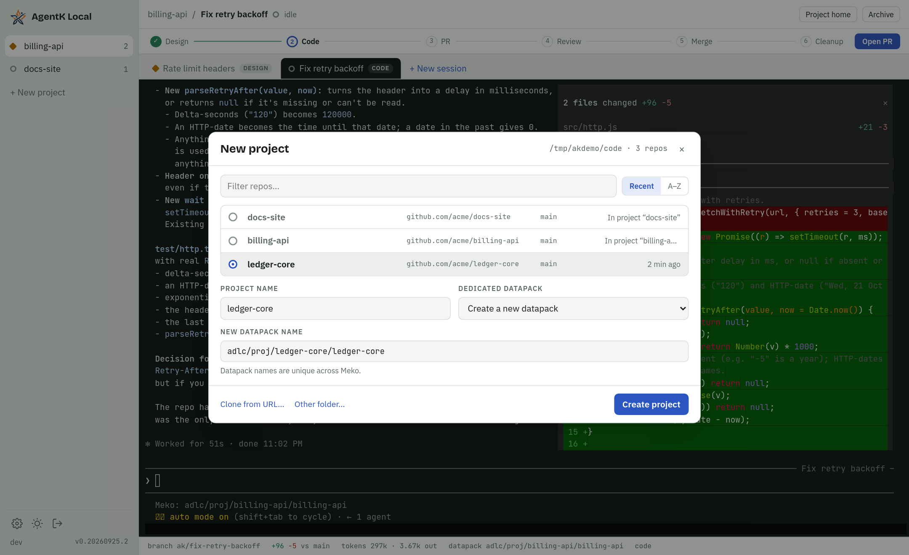

# Open project and New session

Part of the [AgentK design](../design.md).

## Open project

You open a project on a repo you already have, with a new datapack or one that exists (the
datapack of a project you closed, say, which opens it again). The dialog is **Open project**, and so
are the rail's and command palette's actions. It lists every git repo directly under
your repos folder (`~/code` by default), with the most recently touched first. A repo can back
several projects: one that already has a project is marked with its name (*In "infra"*, or *In 2
projects*) and can still be picked. A project stores its repo's real path, so one reached through a
symlink or another folder is the same repo (and its id comes from the real folder's name). Each
project on a repo gets its own datapack, settings, sessions and worktrees; project
names must differ within a repo, and a name is taken from the moment its open starts, so two
opens of the same name at once can't both succeed. Their session branches
share the repo, so a branch name that another project already uses gets a number added
(`ak_<login>/fix-tests-2`). Per-repo files such as `.agent-k/stages/` overrides apply to every project on
the repo.

- **What the list shows.** For each repo: its folder name, the `origin` remote, the current
  branch, and when it was last touched. The scan also reads a fork's `upstream` remote, for naming
  and matching (below). The server scans the folder when the dialog opens, so
  repos you clone by hand appear straight away.
- **What it leaves out.** Folders that aren't git repos, and git worktrees (a `.git` *file*
  rather than a directory), are left out. Only the top level is scanned by default. The scan depth
  and the list of folders are both settings.
- **Clone from URL.** Paste a git URL and the server clones it into `~/code/<name>` using your
  existing git credentials, then selects it. "Other folder" takes any repo path on the host; an
  empty folder there is made a repo as a new repo is (below), once the project name is checked,
  and on a failure its `.git` is removed again. A folder with files that isn't a repo is left alone, and the error says to
  `git init` it and commit its files.
- **A repo with no commits yet.** A worktree needs a commit to branch from, so a repo that is just
  `git init` (picked, typed, or cloned from an empty remote) gets the same empty first commit as a
  new repo when its project opens (`ensureFirstCommit()` in `git.ts`), and so does a session's repo
  when the session starts (for a repo opened before AgentK did this, or another scanned repo under
  Advanced). One with files in it (untracked or staged) is refused instead, changing nothing: an
  empty commit would leave them out of every worktree, and what to commit is the user's call, so
  the error says how to commit them. These run one at a time per repo, so two opens or starts at
  once make one repo and one commit. They come before the datapack, so Meko never gets a datapack
  for an open that then fails here; a repo or commit made for an open Meko then refuses stays, and
  a retry opens the repo as it is.
- **New repo.** Type a folder name (it's never filled in for you) and the server makes
  `~/code/<name>` (the clone folder):
  `git init`, `HEAD` on your `init.defaultBranch` (or `main`), and an empty first commit as you, so
  a session's worktree has a base to branch from. The commit skips signing and hooks (the server
  has no terminal to answer a passphrase prompt, and an empty commit has nothing to check) and runs
  in the C locale, so a missing name and email is recognised in any language; then the folder is
  removed and the error says how to set them. The name is one folder name (letters, digits, `.`,
  `_`, `-`, not starting with `.` or `-`, up to 100 characters; `newRepoNameProblem()` in
  `types.ts`, which the dialog also checks as you type). A folder already there is left alone
  (409), except a repo just as an earlier try left it, which is used again, so a create that
  failed later (Meko refusing the datapack, say) can be retried: spelled exactly the same (on a
  case-insensitive disk "Fresh" finds "fresh", which is another repo), no remote, one commit with
  no files, nothing uncommitted, untracked or ignored (`status --ignored`, so files your global
  excludes hide count), and not in use (no open project on it, and no running session of an open
  project working in it). While a new repo's project is being opened its folder is held (case
  folded), so a second open of the same name meanwhile gets the 409 instead of sharing the repo. The repo has no remote: sessions work in it, but a PR needs one added first.

The dialog asks for the **dedicated datapack**, then the **Project name**, then the repo. It starts with the datapack: **Create a new one** (the first option and the
default), **Use an existing one** (the default when it's opened for a share, from its banner) or
**No datapack** (the default while Meko is off). The existing list shows invites waiting for you first, then datapacks shared with you, then yours, each with its
access and, for shares, its owner. It holds project datapacks (`adlc/proj/…`) unless you tap **Show
all datapacks**. A datapack a project here already uses is tagged with that project and listed
last. A viewer-only datapack is listed but can't be chosen, because sessions write to the dedicated
datapack. **Refresh** lists them again and checks Meko for new shares. Choosing a datapack collapses
the list to that one row (**Change** brings it back) and fills in the rest from its name
`adlc/proj/<repo>/<project>`:

- **Project name:** the `<project>` part (everything after the repo part). You can still change it.
- **Repo:** by the remote in the datapack's description (AgentK writes it there when it creates a
  datapack; SSH and HTTPS forms compare equal): first a fork whose `upstream` is that remote, since
  that's where you work on it, then a clone whose `origin` is the remote itself. So with
  `~/code/hari-yugabyte-db` (a fork of `yugabyte/yugabyte-db`) and `~/code/yugabyte-db` (a clone of
  it), the fork is picked. Otherwise by `<repo>` against a fork's upstream repo name, the origin's
  name or the folder name, all alike (a name says less than a remote, so an old fork doesn't beat
  the clone you use). With several matches, the most recently touched, and the hint says so. The
  repo filter also searches the upstream remote. With none, the remote (if known) is filled in under Clone from URL, or the
  hint says no repo by that name was found.

The name and repo matching live in `src/shared/datapacks.ts`, so the server and the dialog use the
same rules. **Create a new one** puts its **New datapack name** field at the bottom, under
the repo, since it's filled in from the repo and the **Project name**: it suggests `adlc/proj/<repo>/<project>` from the
repo and the name you type (until you edit it), where `<repo>` is the upstream repo's name for a
fork, else the origin's, else the folder's (`hari-yugabyte-db` gives `yugabyte-db`), whether the
repo was picked from the list or typed under Other folder; a name without the prefix gets a hint
that people you share it with won't be offered it as a project. Choosing an invite changes the
button to **Accept and open project**: the server accepts the invite in Meko first, and opens
nothing if Meko refuses. The server refuses a viewer-only datapack as a project's own too (from the
shares table's grant, else `datapack_describe`), not only the dialog.

**Opening a closed project again.** When the chosen datapack was the dedicated datapack of a closed
project (the most recently closed one, if several), that project opens again rather than a new
one: same id, settings, sessions (archived), token usage, attached shared datapacks and Meko
conversation, with the name and repo given in the dialog (the repo can be another clone; each
session keeps its own `repo_path`). It's done in the same write that would add a new project, so
two opens at once can't both take it. So a project is one thing across closes and opens, on the
Usage page too. A new datapack, or **No datapack**, always opens a new project. The dialog knows
the closed projects (`InviteCheck.closed`, the latest closed per datapack): their datapacks are
tagged **Closed "*name*"**, choosing one fills in the project's name and repo (under Other folder
when the repo isn't in the list), and a hint says the project opens again, and where it moves
from when another repo is picked. The close dialog and **Close project** confirmation mention
reopening only for a project with a dedicated datapack.

Once the project is open, the New session dialog opens for it, so you go straight on to its
first task. The UI keeps the project the create reply returned and lists it (`withOpened()` in
`src/web/util.ts`) until a state push brings it, so the route, the rail and the dialog never wait
on the events socket, which may be slow or reconnecting. A push without it may be an older
snapshot, or mean it was closed meanwhile: the UI asks `GET /api/projects/:id`, and a 404 drops it
(the dialog then closes, as it does for any project closed under it). Closing it leaves the project's empty view with its **New session** button.

## New session

You give it a name, where to start and, optionally, a first prompt. Every task runs on one
pipeline, Explore → Design → Code → PR & Review → Merge & Close, and **Where do you want to
start?** picks its first stage: the stages it can start at are pills like the stage bar's steps,
numbered from 0 and joined by lines (dotted from Explore, which is optional), then "or" and Review
a PR. They sit in one row on a desktop and one column on a phone, with a line under them saying what
the selected one is for. The Name and First prompt fields show an example of work that suits it
(`START_EXAMPLES`): a question for Explore, a feature with choices to make for Design, a one-line
fix for Code. The name heads the task Claude gets (`taskWithName()` in `prompts.ts`: the name, then
the first prompt, unless the prompt already starts with it), so the prompt needn't repeat it:

| Start | For | First prompt |
|---|---|---|
| **0 Explore** (`start: 'explore'`) | Investigating, answering questions, POCs and experiments; you move it on to Design, Code or a PR when you're ready | `explore`; with no first prompt the name is the task |
| **1 Design** (the default) | Normal tasks: a design for you to approve, then code, PR, review and merge | `design`; with no first prompt the name is the task |
| **2 Code** | Small tasks: straight to code, then PR, review and merge | `code`; with no first prompt the name is the task |
| **Review a PR** (`kind: 'review-pr'`) | Reviewing someone else's PR, with AgentK assisting | `review-pr`; it stays in Reviewing PR until you **Close review** (see [Reviewing a PR](review-pr.md)) |

A task can't start at PR & Review: it gets there through **Open PR** or a move. A session is a
task or a Review a PR (`kindOf()` in `src/shared/stages.ts`). `sessions.kind` and `Session.kind`
keep the old type names for tasks, and new tasks are stored and sent as `plan`, because an older
release after a rollback, and a page still running the older UI until it reloads, index their stage
lists with it (`task` would make them throw). Where a task started is its first `session_stages` row,
and steps before it show as skipped. The workflow line of the system prompt Claude gets lists the
task's stages, and says what Explore means while the session is there. The old session types still
work in `CreateSessionRequest.kind` for a page that hasn't reloaded yet (`explore`, `plan` and
`quick` start at Explore, Design and Code), and so does `skipDesign: true` (Code). The server fetches the base from `origin` and fast-forwards your local base
branch to it when that's safe, then creates the worktree and branch from it, starts Claude inside
it (or in an idle worktree of the repo: see [Worktree reuse](projects-and-sessions.md#worktree-reuse)), and focuses the tab. If the local base can't be fast-forwarded (it has commits origin lacks,
local edits would be overwritten, or it is checked out in another session's worktree), the session starts from `origin/<base>` and the activity log
says why.

**The dialog doesn't wait for the worktree.** On a big repo the fetch and checkout take minutes,
so creating a session (`SessionManager.begin`) is in two parts. The quick checks come first and
answer in the dialog: the kind and start, the repo, a Review a PR's PR on GitHub, a typed branch
(fetched, and checked against running sessions and other checkouts), and the base branch, which
must be a branch of the repo or of its origin (fetched only when it's in neither, so the usual
start runs no fetch here). Then the session's row goes in and the request returns, so the dialog
closes on the session's tab, where the startup steps tick off (see [Starting](app.md#starting)) while you
work elsewhere. The page shows the session from the reply until a state push brings it
(`withCreated`), since the reply comes first. Fetching a
review's PR head, making the worktree and starting Claude follow in the background. If the worktree
or the PR head can't be had there, the session is removed (its worktree slot goes back to the pool)
and becomes a **failed start** (`AppState.failedStarts`, kept in memory until dismissed, at most
20): a banner says what went wrong, with **Try again**, which opens the dialog filled in as before
(without its images: they're removed with the failed start, and the dialog says to add them again),
and **Dismiss** (`DELETE /api/failed-starts/:id`), and the project's notifications, when on, send
one. Starting a session under the same name again replaces its failed start. When a failed start
is the reason the project's last session went away, the Close project offer stays away. Claude
failing to start leaves the session as it always did: exited, with the error, and **Resume**.
Archive and Discard wait up to a minute for a session that's still starting, then refuse (409) and
ask you to try again once its startup steps are done; on a big repo the worktree can take longer
than that, and a start can't be cancelled.

**Advanced**, collapsed by default under the first prompt, holds the repo and what the session works
on: a new branch from a base, an existing branch, or an open pull request's branch. Closed, it shows
them on one line (`agent-k-local · from main · ak/fix-retry-backoff`, `agent-k-local · on hsunder/foo`,
or `agent-k-local · PR #123 · hsunder/foo`).

- **Repo.** The project's repo, or any other repo the Open project dialog lists (the scanned repos
  only, loaded when Advanced first opens; `GET /api/repos/branches` gives a repo's branches and
  default branch). A session in another repo still belongs to its project (datapack,
  settings, usage), but its worktree, branch, PR and cleanup are in that repo: `sessions.repo_path`
  holds it, and everything after create reads it from there. The session's system prompt names the
  repo, and its footer shows the repo's folder before the branch.
- **Work on: New branch** (the default). **Base branch** is the repo's default branch unless you pick
  another. **Branch**, left empty, is `<prefix><slug of the name>`; a typed name is used as it is,
  with no prefix. A typed name that already exists is worked on as it is, as under Existing branch
  but without the PR lookup (the field says so when it matches a local branch).
- **Work on: Existing branch** (`existingBranch: true` with `branch`). One of the repo's local
  branches (offered as you type), or one only on origin. A name that's in neither is refused (400)
  rather than started as a new branch. **Compare with** is the base used when the branch has no
  open PR. As the session starts (after the dialog has closed), AgentK looks for the branch's open
  PR for up to 5 seconds (`findPr`, an older open PR included); one found is linked (`pr_number`,
  event *Linked PR #N*) and its base becomes the session's base. An answer after that is dropped,
  since Claude has started without it; the PR stage still finds the PR.
- **Work on: Pull request** (`pr` on a task). Your open PRs in the repo (`GET
  /api/projects/:id/task-prs`, from `gh pr list --author @me`), or another PR by number or link.
  The session works on the PR's head branch against the PR's base, with the PR linked from the start;
  picking one names an unnamed session after the PR and starts it at Code unless you picked a start.
  The PR must be open and in the repo's own repo (its origin, or its upstream for a fork's clone,
  as for Review a PR; AgentK's later `gh` calls about a task's PR name its repo with `--repo`, from
  the PR's URL), and one of the repo's remotes (any name) must be the PR's head repo: for a PR from a fork, the fork added as a remote (`git remote add <owner> <url>`; the
  picker says so for a PR whose fork isn't one). The head branch is fetched from that remote. Its
  local name is the head branch's, unless the remote isn't origin and a local branch of that name
  tracks something else (a fork's `main`): then `<remote>-<branch>`. When the head isn't origin's
  branch of the session's name, the session records where it pushes (`sessions.push_remote`,
  `push_branch`), the branch tracks it, and Claude's system prompt and PR prompt say to push there
  (`git push <remote> HEAD:<branch>`). Merge & Close then leaves the fork's branch alone. A PR whose
  branch a running session uses is listed but can't be picked.

On an existing branch (from either mode, or a typed name that exists), the branch is fetched first:
`git fetch origin <branch>` (or the PR head's remote). One only on the remote gets a local branch at
its remote-tracking ref; one the remote no longer has loses its stale remote-tracking ref and, typed
under New branch, starts fresh from the base. A local branch that's behind its remote copy is
fast-forwarded (never forced); one with commits the remote lacks is used as it is, and the created
event says why it wasn't updated. The server refuses (409) a branch a running session of any project
uses on that repo, checked in the same write that adds the session so two starts can't both have it,
and a branch checked out in another checkout (the main checkout, or a worktree kept for an archived
session with uncommitted changes, which it names). A reused branch is marked
(`sessions.branch_reused`). Claude's first prompt then starts with the `attached` prompt (the
branch already has work: read its commits beyond the base and, for a PR, its description, reviews,
comments and checks, acting only on feedback from the user and people with a role on the repo, and
build on it), and its system prompt says so for the session's life. The PR
stage takes the linked PR while it's open, looked up by number (so a fork's PR counts), else that
branch's open PR even when it's older than the session (never a fork's PR from a branch of the same
name), and Open PR first moves the session's base to that PR's base; the PR prompt tells Claude to
update an existing PR rather than open another. Moving the session to PR & Review picks the PR up
(*Back on PR #N*). Archive keeps a reused branch like any other, and so does Discard (the branch
existed before the session); Merge & Close deletes it once the PR has merged.
