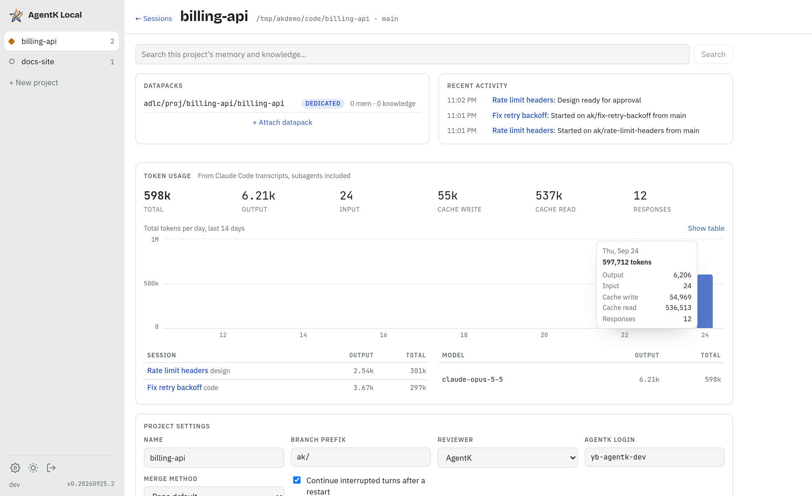

# Project home

Part of the [AgentK design](../design.md).

Recent activity shows the project's last 50 events, newest first, and scrolls inside its box so it
never pushes the rest of the page down. Token usage's table by session scrolls the same way past about 10 rows,
the most recently used first (see [Token usage](token-usage.md)). Its chart stacks each day's local
code review tokens on the bar, and once a review has run, a **Code Reviews** section follows the Meko
stats.

**Share** sits in the project's header: it shares the whole project, through its dedicated
datapack, and opens the Share dialog. While AgentK can't share (`MekoStatus.sharing` false) it
opens a dialog instead (`MekoLinkDialog` with `sharing`). On the Meko on this computer, which has no
share routes, that's **Share through Meko Cloud**, with **Sign up for Meko Cloud ↗** (Meko Cloud's sign-up
in a new tab, as Meko's own Invite points to Meko Cloud) and **Link Meko Cloud** (Meko's Meko Cloud
page). On another Meko whose API URL isn't known (a self-hosted Meko with no web app or API URL set),
that's **Set Meko's web app URL**, which links to the same page. This check comes before the
datapack's, since a datapack added there couldn't be shared either. With no Meko it says how to set
one up first (**Set up Meko**, which links to Meko's Meko Cloud page), and for a project without a
dedicated datapack it offers **Add a dedicated datapack**. Meko itself refuses a share from someone who isn't the owner or a
maintainer. See [Sharing a project](sharing.md).

A project without a dedicated datapack says so in its Datapacks box, with **Add a dedicated
datapack** (a new one, or one of yours; `POST /api/projects/:id/dedicated-datapack`), or **Add a
Meko API key** while Meko is off. A shared datapack already attached can become the dedicated one.
New sessions use it, each pinning it for its own agent id. Search is hidden for a project with no
datapacks.

While the dedicated datapack has no memories and no knowledge (its counts from Meko, so not while
Meko is off or doesn't answer) and no learn session is open on it (one launched on a datapack since
switched away from doesn't count), the box says the
datapack is empty, with **Learn the project**, which opens the New session dialog on that choice
(see [Learn sessions](recall-and-learn.md#learn-sessions)).

The dedicated datapack's row has **Switch** (while Meko is on). It opens the same dialog, titled
**Switch the dedicated datapack**, to make a new datapack or one of yours the dedicated one; attached
shared datapacks are listed first, and a new one's default name gets `-2` (or the next free number)
when the usual name is taken. The old datapack stays attached as shared, so its memories can still
be searched, unless **Detach *old* from this project** is checked. Nothing is deleted in Meko. The
dialog warns how many of the project's sessions are running (starting, working, needs you, idle,
recovered): they keep the datapack they were launched with, and so keep writing to the old one until
they're restarted. That covers Claude's own Meko calls (its prompt names the old one), capture (the
Meko hook keeps the datapack in the session's watermark once the session has started) and AgentK's
writes for the session: designs, the PR's Meko lines and the learn step's facts go to the datapack
recorded on the session at launch (`sessions.meko_datapack_id`), under the session's own Meko conversation there
(AgentK's writes for a session always go under its own conversation). New and resumed sessions get the new one
(a resumed session's Meko conversation is keyed by datapack, so its earlier turns stay in the old
one). The request names the datapack it replaces
(`replace`), so a switch made meanwhile in another tab is refused (409) rather than undone; the old
row is demoted or detached in the same transaction as the new one is added, the project's
server-side Meko conversation (used for search) is made again in the new datapack. Pins are per session, so a running
session's stays on the old datapack and the next one to start pins the new one.

**Log Meko calls** (Project settings, off by default; shown while Meko is on, or while it's on for
the project so it can be turned off) keeps, for each of the project's sessions, every Meko call
AgentK makes for it and every one Claude makes in it, with what was sent and what came back, in
`<home>/designs/<session>/meko-calls.jsonl`. Claude in that session can read the file
(the folder is one of its `--add-dir`s). These are the session's recall at start, its Meko
conversation (created and renamed), design uploads, and the learn step's searches and writes:
the call sites wrap their work in `withMekoScope(session)`, an AsyncLocalStorage that
`MekoClient.call()` reads for its `onTrace` listener (`mekolog.ts`). The
scope names the session's id and when that start of it was made: Try again reuses a failed start's
id, and a call the failed start still had in flight is dropped rather than logged as the new
start's. Calls
that belong to no session (the project home's search and Datapacks box, sharing, the invite sync,
Settings → Meko's checks) aren't kept, nor are transcript capture runs (their failures go to
`server.log`).

Claude's calls come from AgentK's mod, whose hook on every Meko `tool.call` already tells the server
when one starts and ends (for the session's dot). The server answers its `start` with `{ log: true }`
while the project has the setting on, and then the `end` carries the call: the tool, what Claude
sent (the input without the engine's own keys), the reply as Claude read it, whether it failed
(the reply was an error, the call was refused, or it threw or was interrupted) and why, how long it
took (from just before it ran, a permission prompt included), and whether a subagent made it. A
call too large for the hook socket (over about 3.5 MB) is sent without its reply, then without its
args too, and says so in its error. When Claude read only Claude Code's notice that a reply was too
large for its context ("…Output has been saved to `<path>`"), the server reads the reply from that
file, but only from the transcript's own session's `tool-results` folder
(`<transcripts>/<claude session>/tool-results/` for `<claude session>.jsonl`), and keeps the notice beside it; a file it can't
read leaves the notice as the reply. Without a live mod (Claude Code older than the mod needs, or
`[claude] mod = false`), Claude's calls aren't logged: there's no fallback to the `PostToolUse`
hook, which misses failed calls.

Kiro's and OpenCode's calls, which have no mod, come from the usage read of their own files, the
read that records them in `meko_calls` (see [Token usage](token-usage.md#meko-calls)): Kiro's
session log (`<conversation>.jsonl`, the call's input and reply, but not how long it took) and the
`meko` lines AgentK's OpenCode plugin adds to the session's `messages.jsonl` (with the time it
took). `readUsage` hands back the calls it recorded for the first time (`UsageRead.mekoCalls`), and
`SessionManager.ingestUsage` writes them to the log with `recordAgent`, so a file read again from
the start never logs a call twice. They're logged as `by: 'claude'`, which names the session's
agent whichever it is: the page labels them with the session's agent (`MekoLogInfo.harness`,
`agentName()`), and a Kiro call shows no time.

Each line holds the tool (Claude's without its MCP server's prefix), who made it (`by`: `agentk`
or `claude`, the session's agent; lines from before Claude's calls were logged have none and are
AgentK's), its args and its reply (parsed, or its text), the error, how long it took (null for
Kiro's calls), the tries (2 when it was sent again
after a transport failure: a read, or a write that surely never reached Meko; always 1 for
Claude's), the learn step that made it, and for Claude's whether a subagent made it and the notice
Claude read. Lines are in the order the server heard of the calls ending: while one of Claude's
waits for its saved reply to be read, the session's later lines, AgentK's included, wait behind it
(a queue per session in `MekoCallLog`), so the page's newest first holds. The
summary's keys come first, before `args`. Nothing is cut and the
file has no cap: it's deleted when the session is archived, when its start fails and when the
project is closed. A line a crash cut short is skipped when the file is read, and the next line
written starts on a line of its own. The API key
is never in it: it's only ever in a header. The file is the owner's alone (`0600`).

**View calls**, beside the setting, opens the **Meko calls** page (`/p/<project>/meko`, or
`/p/<project>/meko/<session>` from the session's ⋯ sheet or the command palette, both offered while
the setting is on). It shows one session at a time (the one written to last unless one is named),
newest first, 50 at a time with **Load older**, filtered by tool, by who made the call (**AgentK**,
**Claude**, each call tagged with it) or **Failed only**. The server reads
the file backwards from the end in 64 KB chunks, asynchronously so it never holds up other requests
(`GET /api/sessions/:id/meko-calls?before=`, the byte offset the page stopped at), parsing only each
line's summary. An unfiltered page reads only as far back as its own calls; a filter that matches
few calls may read the whole file. A call opens to **Sent** and **Got
back** by the offset its line starts at, checked against its id (and **Claude read**, the notice, for
a reply too large for Claude). **Copy call**, **Download** (the
file) and **Clear** (deletes it) are there too. With the setting off, the page says so and offers
**Turn on**.

**What Meko doesn't know** (`/p/<project>/meko-gaps`) lists the project's Meko searches that found
nothing or nothing relevant, grouped by question, with **Teach Meko**, **Copy** and **Dismiss**. The
line under the Meko stats in the project home's Token usage section links to it while any question
is open. How it's recorded, the rules and teaching are in [What Meko doesn't
know](recall-and-learn.md#what-meko-doesnt-know).

When the project on screen loses its last open session (Archive, Discard, Merge & Close, or a merge
picked up from GitHub), a dialog offers **Close project** (as on the project home; the repo and
datapacks stay), **New session** or **Keep it open**. It asks only on the project's session view,
with no other dialog open, and in a visible page, so a background tab stays quiet; loading or
switching to a project that has no sessions doesn't ask. It closes by itself when the project is
closed or gets an open session elsewhere.
