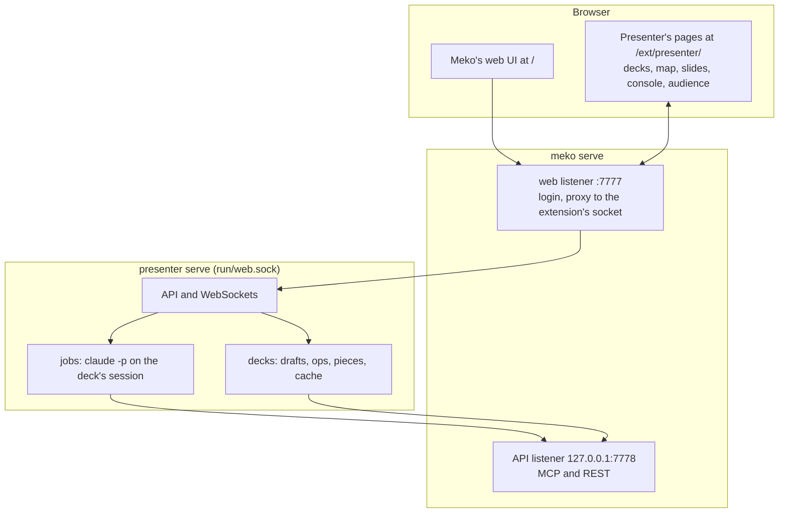

# Presenter: design

Presenter turns Meko datapacks into presentations that change during the talk. This is the design
as built; the decisions behind it, with the alternatives weighed, are in the "Decisions" table.

## Shape

## The deck

A deck (`src/shared/deck.ts`) is a graph of **scenes**, each a linear run of slides, joined by
**edges**: `next`, `choice` (from a fork scene, with a label and a key 1 to 9) and `return` (back
to a hub). A **detour** scene has no incoming edge; the presenter jumps to it and comes back. Every
scene but a detour is reachable from the start. A **slide** has a layout, a variant per deck
variant (the first, `overview`, is required; `deep` goes further), notes, sources, and blocks:
heading, text (Markdown), bullets (optionally one at a time), metric, quote, table, image, video,
diagram (Mermaid), animation (a reference into an animation datapack) and code. Images and videos
name **assets**: files kept by SHA-256, at most 100 MiB each and 1 GiB a deck.

Every change is a list of typed operations (`src/shared/ops.ts`). `applyOps` applies them to a copy
and `deckProblems` checks the result; a change that breaks the deck is refused. Ids are looked up
among the deck's own keys only (`own`), never names every object inherits (`constructor`), and
the fields the pages show as text (notes, a quote's `by`, captions, sources) must be text. The editor's hand
edits, Claude's answers and change sets all go through it, and share one undo history.

## Building with Claude

Each deck has one Claude Code session, kept in the deck's folder (`decks/<id>/work`). Jobs on a
deck run one at a time: the first starts the session (`--session-id`, recorded as started as soon
as Claude names it, so a run cut short is resumed), later ones resume it (`--resume`). A build runs
up to three scenes at once, each on a fork of the session (`--fork-session`), so each starts from
what the map step read; with no deck session yet, or one Claude Code no longer has, a scene runs on
a session of its own. A scene's retry resumes its own session, and never replaces the deck's. Claude runs headless with the
user's own setup (all its tools, the user's MCP servers) plus Meko under the name `presenter_meko`,
`--permission-mode bypassPermissions`, hooks off, and answers in a JSON schema: a summary, a list of
operations, and files it made under `./assets`. Presenter checks the operations against the deck as
it is now; a bad answer is sent back once with what was wrong. Claude doesn't add assets itself
(`addAsset`): Presenter adds the files it lists, since only those have their bytes here.

- **Map** drafts or redraws the story map. **Build** fills scenes' slides. **Ask** changes a block,
  a slide, a scene or the deck from an instruction.
- A map or build that touches no hand-edited slide lands at once (Undo takes it back). An ask, or
  anything that would rewrite a hand-edited slide (a new file under the name of an asset one shows
  included), comes back as a **change set**: each operation with a tick, hand-edited ones unticked,
  applied in full or in part.
- Cancel stops a job whether or not Claude has started; stopping Presenter cancels its jobs.
- Every slide names its sources; the editor and console flag a slide without any.
- Timeouts: map and build 10 minutes a scene; an ask about a block or slide 3 minutes, larger 10.

## Storing a deck

A deck lives in its own datapack, `presenter/deck/<slug>`, as pieces (`src/shared/manifest.ts`,
`src/server/pieces.ts`), because Meko keeps an artifact to 5 MiB and can't delete one:

| Artifact | Holds |
|---|---|
| `deck.json` | The manifest: everything the map needs, and every other piece's hash and size. The newest is the current version. Over 1 MiB, it goes up in parts and `deck.json` points at them. |
| `scenes/<id>.json` | A scene's slides. |
| `assets/<name>` | A file of 4 MiB or less. |
| `parts/<sha256>.<n>` | 4 MiB parts of anything bigger, listed in order in the manifest. |

A save uploads only pieces whose hash the datapack doesn't have (Presenter keeps the hashes the last
loaded or saved version stands on, and every piece uploaded since, even by a save that failed), four
at a time, and `deck.json` last, so a save that stops partway leaves the previous version the
newest. Each manifest carries its save time, so its bytes always differ and the newest artifact is
the latest save. Loading reads the newest `deck.json` from the artifact list route, then its scenes;
assets come when a slide shows them, served from the cache in byte ranges (Safari plays video only
that way) with their hash as the ETag. A save that fails partway stops starting uploads and waits
for the ones under way before it reports, so the deck is never left marked as saving. Every piece fetched is checked against its hash, fetched again
once, then reported. A deck's working draft is kept in its folder after every change.

## Presenting

A run is a room on the server (`src/server/runs.ts`) that the console and the audience window both
join on `/ws/runs/<id>`. The server holds the position (`src/shared/run.ts`): scene, slide, build
step, the trail back from jumps and detours, the scenes shown, the variant, and whether the screen
is blanked. Runs are kept on disk, so a restart resumes them, and a deck edited mid-talk (by hand or by
Claude: the runs hear every change the deck store makes) moves the position, the way back from
jumps and Back's steps to the nearest places left. Back out of a jump forgets it. A window fits
the run to the deck it has, so it never shows a position in a scene it doesn't have, and a page
that throws says so instead of going blank. The audience window shows only the slide (with a fork's
options, and a small mark on a detour); keys work in both windows.

## Releases

Presenter releases on its own train (`.github/workflows/presenter-release.yml`, tags
`presenter-v<version>`, `scripts/release/*.sh --product presenter`). It has no native modules, so
one job builds it once and packages `presenter-<version>-<os>-<arch>.tar.gz` for linux-x64,
linux-arm64 and darwin-arm64 (`scripts/package-release.sh`), each with its own Node; a release
carries those and `SHA256SUMS`, and no installer.

Meko installs and updates them (`meko install_extension presenter`, `meko update_extension
presenter`, the Extensions page): it unpacks a release into `<home>/app/<version>`, checks that
`bin/presenter version --json` names it, and points `app/current` and `~/.local/bin/presenter` at
it. `bin/presenter` is the launcher (`packaging/presenter`): it runs the bundled Node on
`lib/dist/server/cli.js`, with `PRESENTER_APP_DIR` naming the release's folder and
`PRESENTER_LAUNCHER` itself, and `presenter start` runs `serve` through it.

An update is on probation until it has served for 5 minutes. Meko writes `app/update-pending.json`
(`from`, `to`, `attempts`) as it switches `app/current`; the launcher counts each `serve` of the new
version, and on the start after three failed ones points `app/current` back at the old version,
adds the new one to `app/bad-versions` (which Meko skips) and runs the old one. The server clears
the record once it has served for 5 minutes, and a SIGTERM takes its start off the count, so only
crashes count (`src/server/probation.ts`). These are Meko's rules for its own releases, on the same
files. A build from source has no launcher and no record, and Meko never updates it.

## Decisions

| Decision | Why | Weighed |
|---|---|---|
| A Meko extension with its own pages at `/ext/presenter/`, on a unix socket, as AgentK | One port and one login for everything Meko runs; one package, one release train | Pages in Meko's web UI (two apps on two trains); its own port (a second login) |
| A graph of scenes, linear inside | One model for linear, tree and graph decks, readable on a map | A graph of single slides; linked decks |
| Structured blocks, never model-written HTML | On-brand, editable by hand, safe to render | Free HTML per slide |
| Content from any datapack; names only for Presenter's own | Teams keep content where they already do | `presenter/story/...` datapacks |
| Two stages (map, then slides) with any tool Claude wants | Fix the shape before paying for slides; Claude reads, browses and draws | Meko's read tools only; one pass |
| One persisted session per deck, driven headless | Claude keeps what it read and the editing conversation; answers stay checked JSON | A fresh `claude -p` per call; a live terminal session |
| Typed operations for every edit, change sets for asks | One undo history, one set of rules, nothing unreviewed over hand edits | Rewriting the deck each time |
| Pieces under Meko's artifact limit | Decks of any size; only changes go up; never half-saved | One `deck.json`; knowledge files (indexed for search) |
| Meko installs and updates the releases; no installer or updater of Presenter's | Meko already stages, checks, switches and rolls back its own releases (`internal/update`); one place does it | An `install.sh` per release and a `presenter update` |
| AgentK's launcher rollback, on Meko's records | A release that can't start goes back to the one before by itself, and Meko never offers it again | No rollback; Meko watching the start itself |
| One build job packages every platform | No native modules: only the bundled Node differs | AgentK's per-platform builds (needed for node-pty) |

## Not built yet

- Templates and animations from their datapacks, and the animation player (slides name an
  animation; the built-in template draws every deck).
- **Prepare** for an offline talk (fetching every piece ahead), live and prepared detours made
  during a talk, and run logs saved to the deck's datapack.
- A phone layout for the console, audience voting, and a PDF of the path taken.
