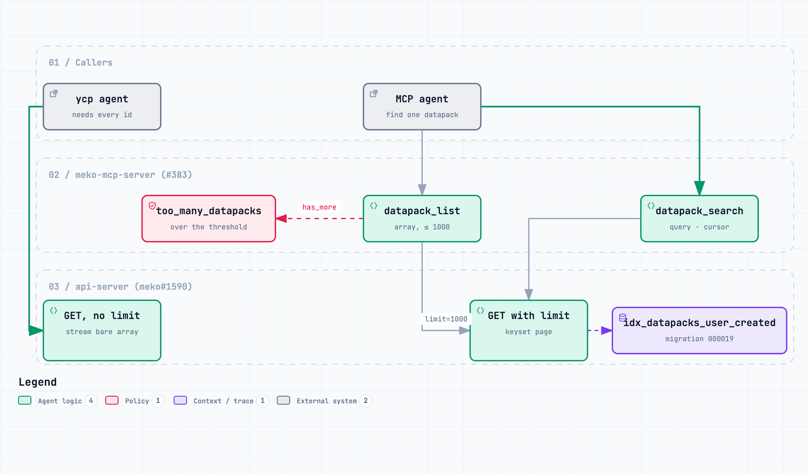
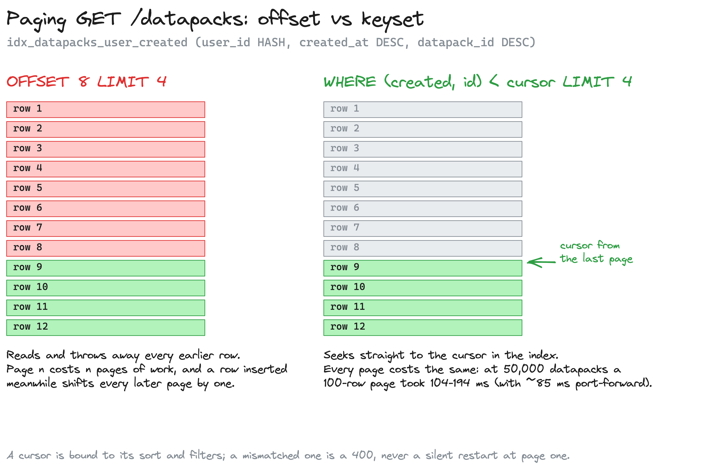

# Listing datapacks at 1M

**PRs:** [meko#1590](https://github.com/yugabyte/meko/pull/1590) (draft), [meko-mcp-server#383](https://github.com/yugabyte/meko-mcp-server/pull/383), [meko-skills#25](https://github.com/yugabyte/meko-skills/pull/25), [meko-cli#2](https://github.com/yugabyte/meko-cli/pull/2) · **Ticket:** [MEKO-781](https://yugabyte.atlassian.net/browse/MEKO-781)

`GET /api/v1/datapacks` built the account's whole list in memory. For an
account with 1M datapacks the query alone took 13.3 s, and building the response
OOM-killed a 2 GiB api-server replica. The `meko-select-datapack` skill called
it through `datapack_list` on every run.

The fix keeps the old response for callers that need every row, streams it, and
adds a paged mode for everyone else.

## 1. Two modes on one route

**Without `limit`**, the response is the same bare array as before,
`{"data":[...]}`, newest first, now written row by row. That stays the default
because the ycp reconcile agent garbage-collects any datapack the array leaves
out, and BYOC agents upgrade on the customer's schedule. If the server fails
after the first byte it aborts the connection, so no client can mistake a short
list for a complete one.

**With `limit`**, the route returns one keyset page:
`{items, has_more, next_cursor, limit, total?}`.

- Parameters: `limit` (1-1000, clamped), `cursor`, `sort` (`created` or `name`),
  `q` (case-insensitive substring), `name` (exact), `grant` (`owner` or `shared`),
  `fields` (`summary` or `full`), `include_total`.
- A cursor is bound to its sort and filters. A bad or mismatched cursor is a
  400, never a silent restart at page one, because a client paging to the end
  would loop.
- `GET /api/v1/datapacks/count` returns `{owned, shared, total}`.

A datapack shared under several agents or invites used to appear once per
share. It now appears once in both modes, with the strongest invite role.

## 2. Keyset paging

Migration 000019 adds `idx_datapacks_user_created (user_id HASH, created_at DESC,
datapack_id DESC)` and 000020 adds `idx_invites_recipient_status`, one index per
file: in a multi-statement file YugabyteDB builds the index non-concurrently.
A page seeks to the cursor in the index. On a live database, the owned-page SQL
1,200 rows deep scanned 54 index rows and 51 table rows for a 51-row page, in
both sorts.

## 3. Callers

| Caller | Uses |
|---|---|
| ycp `mekoclient.ListDatapacks` | the streamed full list: paging 1M rows would spend the per-PAT rate limit. If a server answers with a page envelope, it follows the pages to the end, and any error fails the whole list |
| MCP `datapack_search` (new) | paged: `query`, `name`, `limit` (1-100, default 20), `cursor`, `grant`, `sort`, `include_total` |
| MCP `datapack_list` | the old array, up to `DATAPACK_LIST_MAX_UNFILTERED` (default 1000) unfiltered rows. Above that it returns `too_many_datapacks` and points to `datapack_search`. It detects the threshold from `has_more` |
| `meko datapack list` | one page (default 50) and the command for the next; `--all` for everything |
| select-datapack skills, installer | `datapack_search`; the installer falls back to a `datapack_list` scan when the server lacks it |
| collection scope, `/me/token-savings` | SQL over the collection's placements or the visible set, instead of the full list |

The UI still reads the full list. It is a follow-up, as are two gaps the work
found: list visibility requires an accepted invite while access checks don't,
and list tiles show counts the list never fills.

## 4. Measured

`listbench.py` against the #1590 build at 1.05M datapacks. Every call includes
about 85 ms of laptop port-forward.

| Request | 50,000 datapacks | 18,118 | 18 |
|---|---|---|---|
| One page of 100 (newest, by name, `q`, `name`, `include_total`) | 104-194 ms | 92-148 ms | 87-116 ms |
| `/datapacks/count` | 144-160 ms | 104-143 ms | 89-97 ms |
| Unpaged stream | 1.8 s, 30.8 MB | 0.6-0.8 s | 87 ms |
| Every page at `limit=1000` | 6.9-7.8 s (50 pages) | 2.5-3.6 s | 0.1 s |

Before #1590, the unpaged list at 1M on one account took 13.3 s in SQL and
OOM-killed the api-server. The stream's memory use and the index backfill time
on the 1M database haven't been measured yet; #1590 stays a draft until
they are.

## 5. Upgrade safety

- **Old clients, new server:** a request without `limit` gets the same array.
  The one difference is that a datapack shared more than once appears once.
- **New clients, old server:** an old server ignores `limit` and returns the
  array. The new CLI and ycp treat a bare array anywhere in a paging loop as the
  complete set, which also covers a cursor from a new replica reaching an old
  one mid-rollout. `datapack_search` filters on the client and returns no cursor.
- **Downgrade floor:** 000019 and 000020 raise the system floor to 20.
- **Rollout order:** api-server, then ycp, meko-mcp-server, CLI, skills and
  docs, then the UI.
