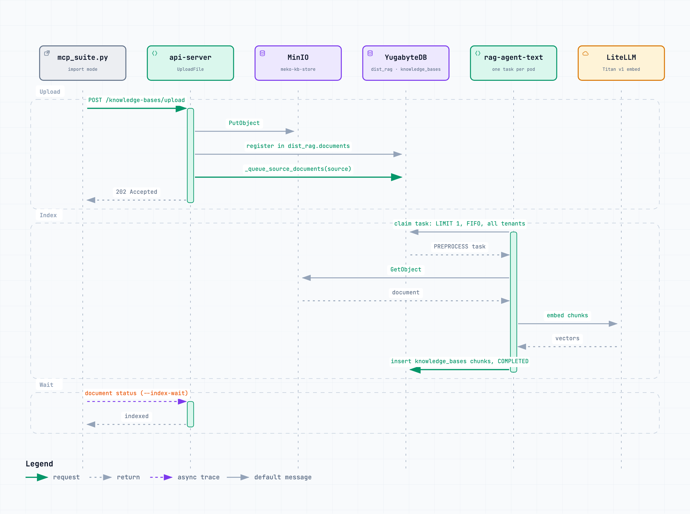

# Creating datapacks and importing documents at scale

**PRs:** [meko#1610](https://github.com/yugabyte/meko/pull/1610) ([MEKO-787](https://yugabyte.atlassian.net/browse/MEKO-787)), [meko#1611](https://github.com/yugabyte/meko/pull/1611) ([MEKO-788](https://yugabyte.atlassian.net/browse/MEKO-788))

The harness's `import` mode onboards datapacks the way a new customer would:
create one, open a conversation, add memories, upload text documents. It found
two bugs, one on each side of that flow.

## 1. Concurrent creates on one universe (MEKO-787)

`AssignUniverse` picked the universe row with `FOR UPDATE SKIP LOCKED`. With one
universe, a create that arrived while another held the row lock skipped the only
row, found nothing, and failed with "no available universe with capacity (all
have reached their configured max_datapacks)", though the universe had room.

meko#1610 drops `SKIP LOCKED`, so the create waits. The lock covers only the one
autocommit `UPDATE ... RETURNING`, so the wait is one statement long.

Measured through MCP, 16 creates in flight against one universe:

| Build | Failed creates | Throughput |
|---|---|---|
| Before | 12 of 50 | successes 1.5 s p50 |
| After, one account | 0 of 200 | 227/min; create p50 991 ms, p95 2.4 s |
| After, 20 accounts | 0 of 200 | 192/min; create p50 1.2 s, p95 8.7 s |

The "after" runs added 3 memories per datapack and no documents. This stack has
no per-PAT rate limit (the limiter is wired only into the Cognito routes), so a
Cognito deployment would import one account's datapacks more slowly.

## 2. Every upload re-queued every pending document (MEKO-788)

`UploadFile` stores the document in S3, registers it in `dist_rag.documents`,
and queues it for indexing. It queued by calling `dist_rag.build_index` on the
one shared KB index. `build_index` loops over every source mapped to that
index (one per datapack, across all accounts) and inserts a PREPROCESS task for
each document that isn't PROCESSING or COMPLETED, including documents that
already have a queued task. Every upload therefore added a duplicate task for
every pending document, and the queue grew quadratically with the backlog.

A 1,000-datapack import left 657,782 queued tasks for 5,690 documents, about 116
per document. At 4 workers the queue drained about 18 tasks/s, most of them
duplicates, and a small tenant's document waited about 5 minutes behind the
import.

meko#1611 queues only the uploaded source through
`dist_rag._queue_source_documents(source, index)`, the per-source step
`build_index` already delegates to. `build_index` stays for callers that mean the
whole index (the `meko` CLI). During a rollout, old pods still call
`build_index`. A queue that is already flooded drains on its own, slowly: the
workers skip a task whose document is COMPLETED.

### Import runs before the fix

One account, one datapack at a time: create, conversation, 3 `memory_add`, one
text document.

| RAG workers | Load time | create p50 | `memory_add` p50 | Memories found | Documents indexed 30 min later |
|---|---|---|---|---|---|
| 1 | 35.9 min | 305 ms | 251 ms | 2,991 of 3,000 | 0 of 1,000 |
| 2 | 25.5 min | 365 ms | 235 ms | 3,000 of 3,000 | 320 of 1,000 |
| 4 | 25.4 min | 314 ms | 287 ms | 2,994 of 3,000 | 520 of 1,000 |

The indexing column is confounded by MEKO-788 and does not measure worker
throughput: the queue is FIFO, each run started behind the previous run's
backlog, and every upload re-queued all of it. A comparison with #1611 applied
is running; its numbers are not in yet.

## 3. The RAG worker

Read from the worker's source (`python/ai/rag_agent` in yugabyte-db):

- One task at a time per pod. A claim is `LIMIT 1`, FIFO across every tenant,
  so one tenant's bulk import delays everyone else's documents.
- No lease reaper exists, only comments that mention one. There are no retries,
  PREPROCESS never renews its lease, and the SIGTERM handler does nothing.
- The meko chart hard-codes one replica for the text and the PDF worker; the
  harness overrides it with `RAG_REPLICAS`.

Embedding through LangChain likely makes one Bedrock call per chunk. That is
inferred from the library source, not measured.

A branch adding `WORKER_CONCURRENCY` threads to the worker exists
(yugabyte-db `amiramm/rag-agent-worker-concurrency`), with no ticket or PR yet.

## 4. Also found

- `pg_dist_rag` 0.0.1 gained `documents.document_details` in place (MEKO-146)
  with no version bump. A database created from an older 0.0.1 fails every
  upload with "failed to register document". No ticket yet.
