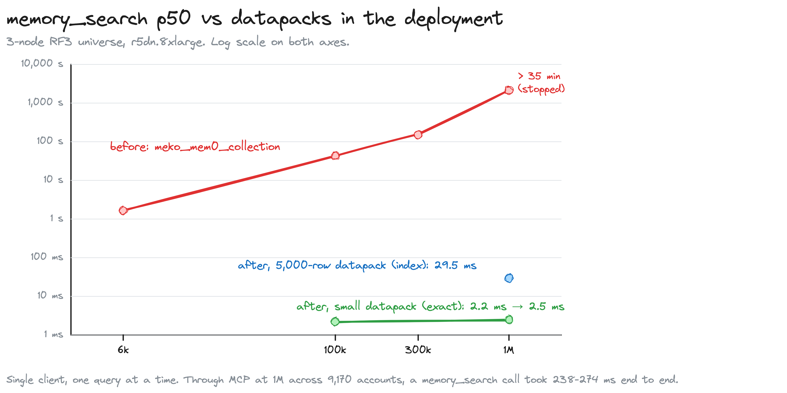
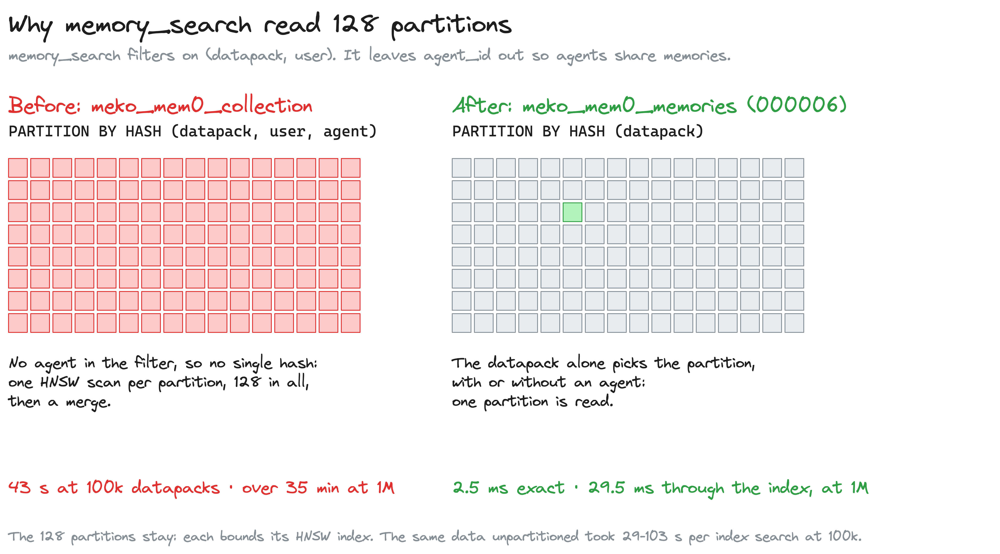
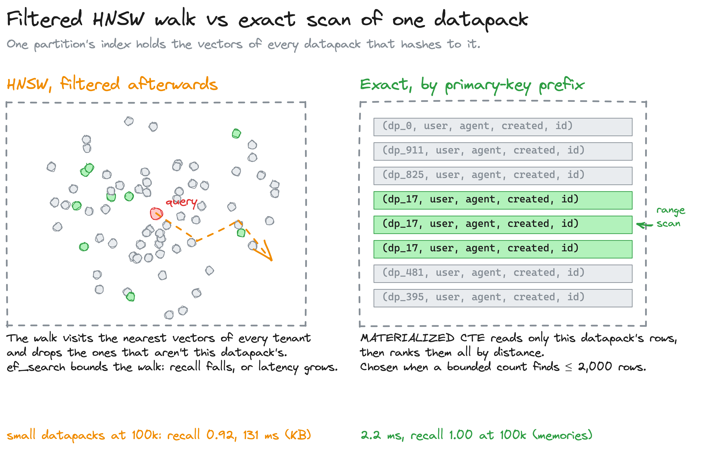
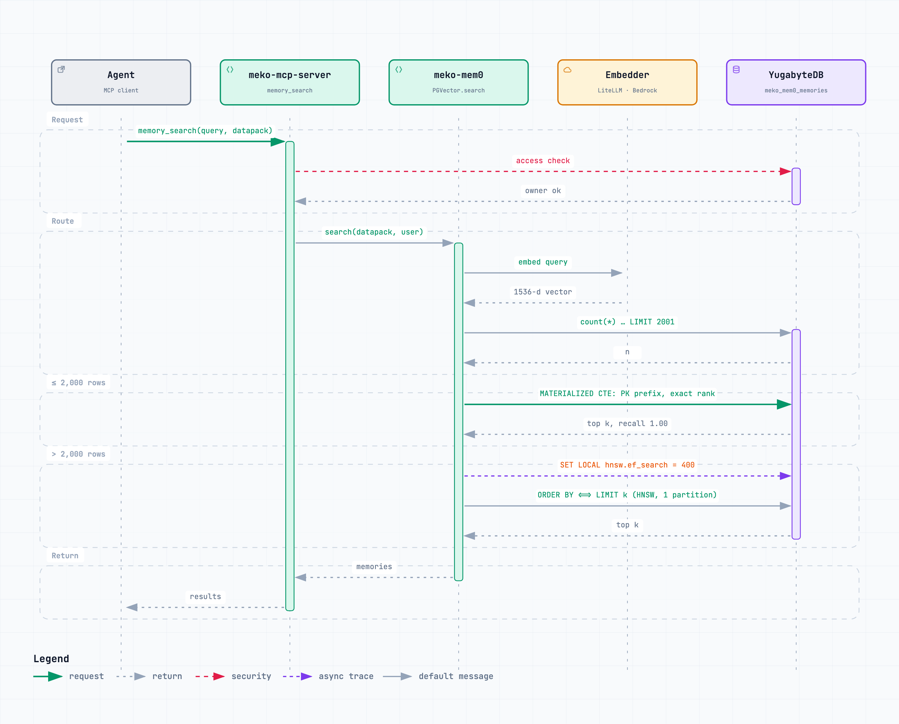
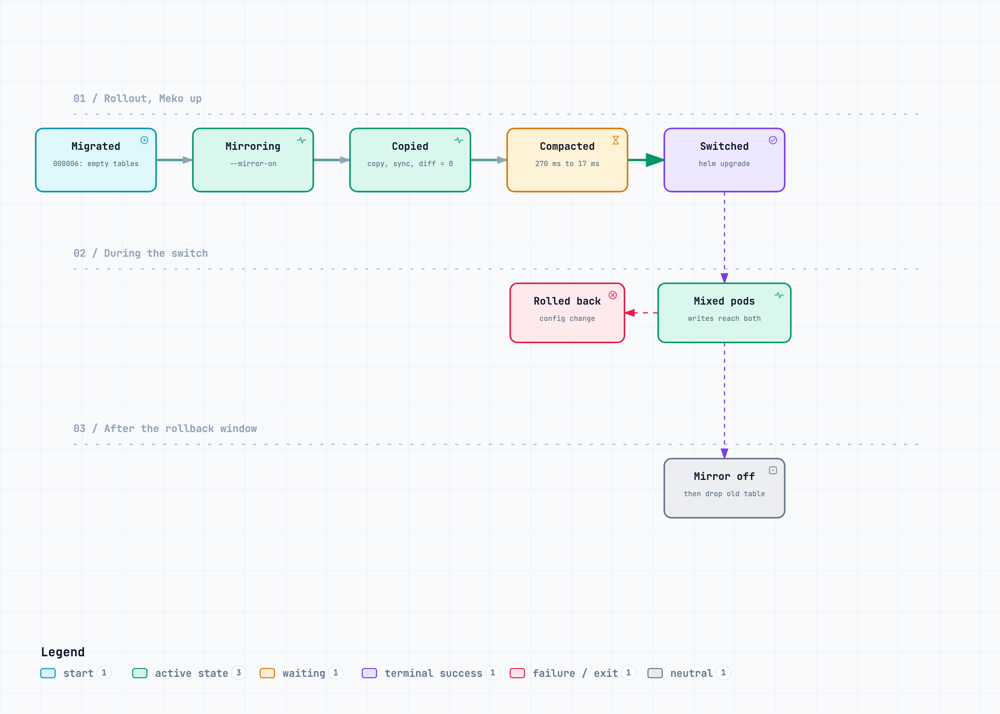

# Memory and KB search at 1M datapacks

**PRs:** [meko#1591](https://github.com/yugabyte/meko/pull/1591), [meko-mem0#25](https://github.com/yugabyte/meko-mem0/pull/25), [meko-mcp-server#384](https://github.com/yugabyte/meko-mcp-server/pull/384) · **Ticket:** [MEKO-784](https://yugabyte.atlassian.net/browse/MEKO-784)

`memory_search` got slower with every datapack in the deployment, not just with
the caller's own data. At 1M datapacks one search took over 35 minutes. The fix
partitions memories by datapack alone and ranks a small datapack's rows exactly
instead of through the vector index. At 1M it answers in 2.5 ms (exact) or
29.5 ms (index).

## 1. Why every search read 128 partitions

`meko_mem0_collection` is hash-partitioned 128 ways on
`(meko_datapack_id, meko_user_id, meko_agent_id)`. `memory_search` leaves the
agent out on purpose, so that agents share memories within a datapack. Without
all three columns the planner can't compute the hash, so it runs one HNSW scan
in every partition and merges 128 result sets.

Data migration 000006 adds `datapacks.meko_mem0_memories` and `_entities` with
the same columns and primary key, partitioned on `meko_datapack_id` alone. A
search by datapack and user then reads one partition, whether or not it names
an agent.

The 128 partitions stay because each one bounds its HNSW index. The same data
in one unpartitioned table took 29-103 s per index search at 100k datapacks;
one partition in 128 took 16 ms.

## 2. Exact search for small datapacks

A partition's HNSW index still holds the vectors of every datapack that hashes
to it. A filtered search walks the index from the query, visiting the nearest
vectors of all tenants and dropping the ones that aren't the caller's. For a
small datapack most of what it visits belongs to someone else. It either stops
early and misses rows (recall 0.92 for small KB datapacks at 100k), or walks
further and gets slow (3.0 s at `ef_search` 400 for small datapacks at 1M).

A small datapack is cheaper to rank exhaustively. Its rows share a primary-key
prefix, so a range scan reads only them, and ranking a few thousand vectors by
distance is fast: 2.2 ms with recall 1.00 at 100k, 2.5 ms at 1M.

`PGVector.search` in meko-mem0 2.0.14.5 routes each search:

1. If the search is filtered by `meko_datapack_id`, count the matching rows with
   `SELECT count(*) FROM (... LIMIT max + 1)`. The count stops at the threshold,
   so a large datapack costs one bounded range scan.
2. **At most `exact_search_max_rows`:** rank exactly. The rows come through a
   `MATERIALIZED` CTE, which stops the planner from pushing
   `ORDER BY <=> LIMIT` into the vector index.
3. **Above it:** `SET LOCAL hnsw.ef_search`, then the usual index query.
   On YugabyteDB `hnsw.ef_search` exists only once the vector library has
   loaded in the session. A `SET` before that creates a placeholder the library
   ignores, so the code runs a throwaway `'[1]'::vector <=> '[1]'::vector` first.

`ef_search` 400 raised recall on 5,000-row datapacks from 0.56 to 0.94 for
memories and from 0.78 to 0.97 for KB chunks. On large datapacks at 1M, recall
plateaued at 0.91-0.94.

KB search in meko-mcp-server does the same (`hybrid_search._semantic`). Its
exact path uses `knowledge_bases_tenant_document_idx`, which 000006 also creates.
The chunk store's primary key is `((tenant_id, id) HASH)`, so without that index
a tenant-only filter scans the whole partition. The old copy of that index sat
in `migrations/000005_kb_document_id_index.up.sql`, outside `migrations/data/`,
and was never applied. #1591 removes it.

### Settings

| Variable | Service | Default | Deployed in the test |
|---|---|---|---|
| `MEM0_COLLECTION_NAME` | api-server and meko-mcp-server | `meko_mem0_collection` | `meko_mem0_memories` |
| `MEM0_EXACT_SEARCH_MAX_ROWS` | meko-mcp-server | unset (off) | 2000 |
| `MEM0_HNSW_EF_SEARCH` | meko-mcp-server | unset (server default 40) | 400 |
| `KB_EXACT_SEARCH_MAX_ROWS` | meko-mcp-server | 0 (off) | 2000 |
| `KB_HNSW_EF_SEARCH` | meko-mcp-server | 0 (server default 40) | 400 |

In the chart, `memory.collectionName` feeds `MEM0_COLLECTION_NAME` to both
Deployments; `memory.exactSearchMaxRows`, `hnswEfSearch`, `kbExactSearchMaxRows`
and `kbHnswEfSearch` set the other four on MCP. Each is rendered only when set,
because a meko-mem0 older than 2.0.14.5 rejects the options they turn on.

The api-server reads the memory table directly (memory lists, promotion,
Langfuse and datapack metrics), so it takes the same collection name
(`internal/memtable`). An api-server left on the old table misses every memory
written after MCP switches.

## 3. Rollout

Meko stays up throughout. The steps and commands are in
[`meko/scripts/migrate-mem0-collection/README.md`](../../scripts/migrate-mem0-collection/README.md).

1. **Migrate.** 000006 creates empty tables and the KB index. Nothing reads them
   yet. It took 86 s on the 1M universe, most of it building the KB index.
2. **Release the libraries:** meko-mem0 2.0.14.5 and a meko-mcp-server that uses it.
3. **Mirror:** `sync.py --mirror-on` installs triggers that apply each insert,
   update and delete on either table to the other in the same transaction.
4. **Copy:** `--copy`, then `--sync` for rows a write changed mid-copy, then
   `--diff`. Repeat `--sync` and `--diff` until `--diff` reports none.
5. **Compact** the new tables before any reads move to them. A freshly copied
   index answered in 270 ms p50, against 17 ms once compacted.
6. **Switch:** set `memory.collectionName=meko_mem0_memories` and the search
   options. During the rolling upgrade, writes from old and new pods reach both
   tables, so neither service misses a memory.
7. **Stop mirroring** with `--mirror-off` once rollback is no longer needed.
8. **Later release:** drop the old table.

While mirroring, each memory write cost about 2-3 ms more on the scale-test
universe, and reads were unaffected. The old table's trigger runs after the
write and the new table's before it, so a write through either table locks the
old row first: with both after, two writes to one memory through different
tables deadlocked.

## 4. Upgrade safety

- **Expand only.** Old pods keep reading and writing `meko_mem0_collection`
  until step 6. The new tables are unused until then.
- **Downgrade floor.** 000006 raises the data-plane floor to 6. A build without
  it cannot start against a database that has run it.
- **Rollback of step 6:** while the triggers are on, the old table is current,
  so set `memory.collectionName` back. After `--mirror-off`, run
  `sync.py --sync --reverse` first.

## 5. Open questions

- The 553 ms KB search on a large datapack, measured in SQL at 1M on one account,
  is unexplained.
- `ef_search` 400 is a fixed trade. Whether a per-datapack value (from the
  bounded count) would lift the 0.91-0.94 recall plateau on large datapacks has
  not been measured.
