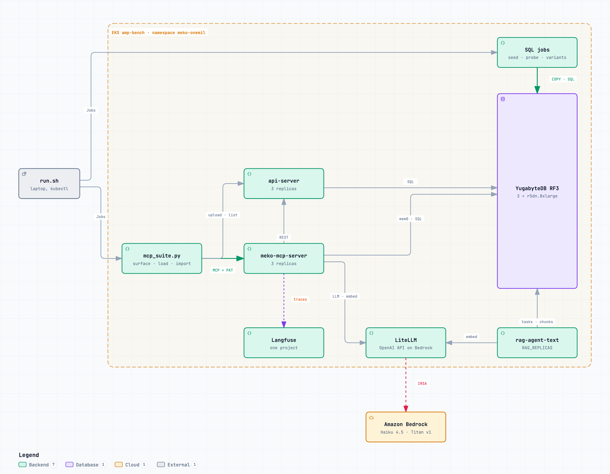
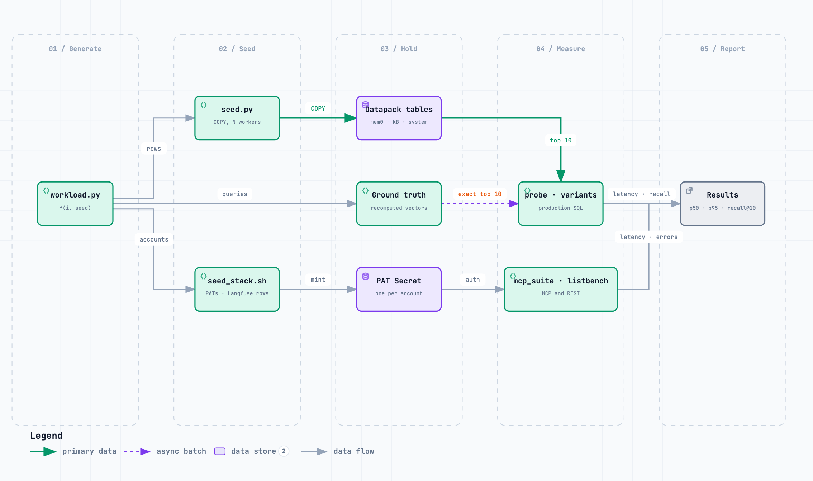

# Scale-test harness

**PR:** [meko#1592](https://github.com/yugabyte/meko/pull/1592) · **Ticket:** [MEKO-785](https://yugabyte.atlassian.net/browse/MEKO-785) · **Code:** [`meko/test/scale/`](../../test/scale/) (its README has the commands)

The harness measures Meko with 1M or more datapacks at two levels. The SQL layer
seeds synthetic datapacks straight into the tables and runs the production
queries against them, with recall checked against exact search. The MCP layer
stands up the real services next to that data and drives every MCP tool with
one PAT per account.

## 1. Where it runs

Everything runs in namespace `meko-onemil` on the amp-bench EKS cluster, on
nodegroups tainted `dedicated=meko-onemil` so the amp benchmarks sharing the
cluster are not disturbed (`infra/nodegroups.yaml`).

- **Universe:** YugabyteDB RF3 on 3 x r5dn.8xlarge (32 vCPU, 256 GiB each),
  from the Meko image, which carries `vector`, `pg_dist_rag` and `mage`
  (`infra/yugabyte-values.yaml`). At 1.05M datapacks each tserver held about 930 GB.
- **SQL jobs:** `run.sh` ships the Python files as a ConfigMap and runs them as
  Kubernetes Jobs beside the database.
- **Stack** (`stack/`): api-server and meko-mcp-server (3 replicas each), the RAG
  text worker (`RAG_REPLICAS`, default 1), LiteLLM (2), Redis, MinIO and Langfuse.
  - LiteLLM serves an OpenAI API backed by Bedrock (Haiku 4.5, Titan v1
    embeddings) through the `litellm` service account's IAM role
    (`infra/litellm-irsa.yaml`).
  - Images are built on the cluster with Kaniko (`stack/build-images.sh`,
    `infra/builder-irsa.yaml`). `deploy.sh released` runs the released images;
    `deploy.sh branch` runs the MEKO-784 branches with the settings below.

| Setting (`deploy.sh branch`) | Value |
|---|---|
| `MEM0_COLLECTION_NAME` (api-server and MCP) | `meko_mem0_memories` |
| `MEM0_EXACT_SEARCH_MAX_ROWS`, `KB_EXACT_SEARCH_MAX_ROWS` | 2000 |
| `MEM0_HNSW_EF_SEARCH`, `KB_HNSW_EF_SEARCH` | 400 |
| api-server flag | `--dev-auth-accept-pats` |

With Cognito off, the api-server maps every request to its `dev-local` account.
`--dev-auth-accept-pats` makes a Meko PAT resolve to its own account instead,
which is what lets one stack serve thousands of accounts. The released
api-server has no such flag.

## 2. Synthetic data

`workload.py` derives everything about datapack `i` from `i` and a fixed seed:
its account, size, topics, vectors and queries. The probes recompute a datapack's
vectors instead of reading them back, so the database under test is never its
own ground truth.

| Property | Value |
|---|---|
| Accounts | `SCALE_ACCOUNTS` (default 10,000), lognormal weights (sigma 2.0) |
| Extra account | 50,000 datapacks, seeded from its own index range (5,000,000 up) |
| Active datapacks | 20%; the rest hold 0-5 memories and no KB chunks |
| Small active (99% of active) | lognormal, median 50 memories and 20 KB chunks, capped at 2,000 each |
| Large active (1% of active) | 5,000 memories and 5,000 KB chunks |
| Vectors | 1536 dimensions, unit length, from 2,000 shared topic centroids, 3 per datapack, expected cosine 0.89 to the centroid |
| Text | placeholders; nothing here tests keyword search or embedding quality |

Shared topics keep the search realistic. Uniform random vectors in 1536
dimensions are nearly orthogonal, which makes nearest-neighbour search
unrealistically hard. With
shared topics, other datapacks' vectors sit close to every query, which is the
case a vector index filtered by tenant gets wrong.

Seeded and counted on the cluster: 1,050,000 datapacks over 9,170 accounts
(830 of the 10,000 got none). The median account holds 18 datapacks, 172
accounts hold 1,000 or more, and the largest regular account holds 18,118. In all:
30.0M memories and 17.5M KB chunks, 47.5M vectors and about 290 GB of raw
embeddings. The main range took 124 min to seed and the 50k account 6.5 min.

## 3. What it runs

### SQL layer

One client, one query at a time, no think time: these are single-query service
times, not behaviour under load. Every query is a fresh draw from the probed
datapack's own topics, never a stored vector. Recall@10 compares the database's
top 10 with an exact search over that datapack's vectors. The same datapacks are
probed at every seed size (6k, 100k, 300k, 1M), so results compare across sizes.

| Query | Source (run verbatim) | Per run |
|---|---|---|
| KB search | meko-mcp-server `hybrid_search._SEMANTIC_SQL` | 5 queries on each of 90 small and 10 large datapacks |
| Memory search | meko-mem0 `PGVector.search`, filtered by datapack and user | the same 5 x 100 |
| Access check | meko-mcp-server `_has_datapack_access` | 50 |
| Datapack list | api-server `GET /datapacks` query | 1, with `--list` |

`variants.py` runs rewrites of the two searches on 10 small and 5 large
datapacks: with and without the agent filter, exact ranking through a
`MATERIALIZED` CTE, `hnsw.ef_search` of 100, 400 and 1000, and the 000006 tables.

### MCP layer

`mcp_suite.py` has three modes. Each call gets a hard deadline (`--timeout`,
default 30 s).

- **`surface`** calls every tool once per datapack with checks, each datapack
  through its owner's PAT.
- **`load`** runs N agents, each with its own PAT. An agent opens a conversation
  on an active datapack (Zipf-weighted, so a few are hot), makes 3-8 calls, pauses
  `--think` seconds (0.5) between them, then moves on. The mix is 30%
  `memory_search`, 15% `memory_add`, 12% `context_search`, 12%
  `conversation_add_message` and 10% `knowledgebase_search`; the rest are reads
  and `track_token_usage`.
- **`import`** creates datapacks as a new customer would: create, open a
  conversation, `memory_add` N times, upload M text documents, then optionally
  wait for indexing (`--index-wait`). `--concurrency` sets creates in flight and
  `--accounts` spreads them over accounts. A 429 is retried with backoff.

`listbench.py` times `GET /datapacks` for the 50k account, the largest regular
one and a median one ([datapack-listing.md](datapack-listing.md)).

## 4. Results through MCP

Measured at 1.05M datapacks over many accounts on the branch stack. The laptop
port-forward adds about 85 ms to every REST call in `listbench.py`; the MCP
numbers are from inside the cluster.

| Tool (single calls, two passes) | Time |
|---|---|
| `memory_search` | 238-274 ms |
| `knowledgebase_search`, warm | 0.65-0.9 s |
| `context_search` | 0.47-1.4 s |
| `datapack_list` | 120 ms |
| `datapack_create` | 286-963 ms |
| `conversation_delete` | 2.9-15.4 s |

Load on the 50k account (MCP: 3 pods, 2 CPU and 6 GiB limit, 0.5 CPU request;
production runs 3 x 4 vCPU and 8 GB):

| Agents | Calls/s | Median | `memory_search` p95 | Errors |
|---|---|---|---|---|
| 10 | 13.5 | 183 ms | 254 ms | 0.4% |
| 50 | 47.8 | 250 ms | 1.3 s | 0.4% |

No pod restarted during these runs. MCP pods grew from 131 MiB to 3.4-3.8 GiB. The errors are
`conversation_get` returning not_found (MEKO-452, MEKO-750). The earlier
single-account run leveled off near 23 calls/s at 50 agents; why this run
didn't is not established. The 24-hour soak has not run.

Tools still broken at this scale: `memory_get_by_id`, `memory_update` and
`memory_delete_all` time out, and `memory_delete_by_id` fails with "UUID is not
JSON serializable".

## 5. Operating the harness

- **Compact after a bulk load.** A freshly backfilled vector index answered
  270 ms against 17 ms p50 once compacted (`run.sh compact`). At 1.05M,
  compaction took 36 min for memories, 18 min for KB chunks and 29 min for the
  collection table.
- **The first call on a new MCP pod is slow.** `memory_search` took about 4 s
  (spaCy loads) and KB search about 5 s (the reranker downloads from Hugging
  Face Hub). Warm up before measuring. An air-gapped BYOC install presumably
  can't download the reranker. Not tested, and no ticket yet.
- **A cold large datapack is slow.** KB search on a 5,000-chunk datapack took
  29.7 s on the first pass after compaction and 810 ms on the second.
- **Abandoned calls keep running.** A server can keep a slow call's stream alive
  past any client timeout, which is why each call has a hard deadline. The call
  keeps its mem0 connection until it finishes, so restart meko-mcp-server between
  runs on the released images.
- **PATs go in a file.** `seed_stack.sh` mints one PAT per account and applies
  them as a Secret server-side; `mcp_suite.py` reads them from `MCP_PATS_FILE`.
  The list for 10,000 accounts is 780 KB, over Linux's 128 KiB limit for a
  single environment string.
- **Every datapack needs a Langfuse mapping row.** MCP fails every tool call for
  a datapack without one. `seed_stack.sh` maps all of them to one project.
- **Never point this at real data.** The seeder raises
  `yb_universes.max_datapacks` and writes a million `meko_system.datapacks` rows.

## 6. What it doesn't cover

- Keyword search and embedding quality: the text is placeholder text.
- Concurrency in the SQL layer: one client, one query at a time.
- A Cognito deployment: there is no per-PAT rate limit on this stack, because the
  limiter is wired only into the Cognito routes.
- The PDF RAG worker, which needs a GPU.
