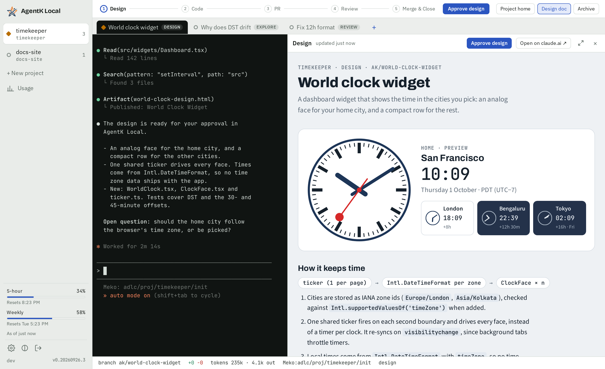

# The app

Part of the [Kode design](../design.md).

The left rail holds projects, each with its repo's folder name in small type under the project
name and the most urgent session state shown on it. Drag a project to reorder the list; on a touch
screen, use **Move up** / **Move down** in the project home's settings. The tabs above the stage bar
hold the project's sessions; when there are more than fit, they scroll sideways with no scrollbar
(one drawn over the tabs, as macOS and phones do, hid their names): swipe, Shift with the wheel, or the
plain mouse wheel (`sidewaysWheel()`), and the selected tab is always scrolled into view. With **List sessions in the projects pane** ticked in Settings › General
(off by default; kept in this browser, `ak-rail-sessions`), each project's open sessions are listed
under it in the rail instead of the tabs, one row each with its status dot, its full name
(wrapped, not cut off) and its stage (with a » after it while [Run to merge](lifecycle.md#run-to-merge)
is on, as on the tabs) at the right of the name's first line, so many show at once and any can be
opened with one click, in any project. A task's [code review](code-review.md) is never a tab or a row of its own: it's
a part joined to its task's tab and rail row, a blue magnifier (its lens pulses while the review
works, and shows Meko's "m" during a Meko call) and how far it has got (`3/6`: each pass, then
scoring as one step, moving on as each pass reports), its result (`2·1·4` blockers·majors·minors until the task has said what it did with each
finding) or a red `!`. Once the review reads `LGTM` (it kept nothing, or the task has said what it
did with every finding) it's settled, and its part leaves the tab and the row (`reviewBadge()`):
the task looks like one with no review, and its findings open from the ⋯ menu's or sheet's review
row. While the review works and its session waits on you in its
terminal, the magnifier takes the needs-you color and its lens knocks. Clicking it opens the
review's own screen (its terminal, its findings beside it) while its passes run (or it failed),
and its findings beside the task's terminal while they wait on you, while the task fixes them and
once the review is done (the review session stops then). The findings also open by themselves
beside the task's terminal, as the design does in Design: whenever the task comes on screen while
the review runs or its findings wait on you, and again as they come to wait or a new review starts
(`findingsAutoOpen()`). With them open, a click on the task's part closes them. In the rail, the magnifier sits under the stage chip, their right edges lined up, with no divider,
so the name keeps one column; it's drawn smaller there (13 px, on touch screens too), so a task's
row grows by a short line. The tabs and the rail list a project's sessions in the same order, kept on the server
(`sessions.position`) so every browser sees it: a new session goes first, and **Move to top** puts
any other there, to keep the work that matters most at the top as priorities change. It's the ↑ that
takes a rail row's stage chip's place on hover (the first line only), and is in the session's ⋯ menu (the ⋯ sheet on a phone) and the command palette (where
touch screens find it). Each takes one below the project's lowest position, so no other row is
renumbered. The session on screen is highlighted (its project's name turns bold instead), and
**+ New session** follows each project's list (the project on screen shows it even with no
sessions). The ▾ at the right of a project's row folds its list away and ▸ brings it back; a folded
project keeps its dot and count, and takes the highlight when the session on screen is in it. Which
projects are folded is kept in this browser (`ak-rail-collapsed`). The rail is 248 px wide by default so the
names have room, and dragging its right edge makes it wider or narrower (see
[The projects pane's width](#keyboard)). The main pane is the live Claude terminal, and the footer shows where the session is working: branch,
diff size, tokens, the project's Meko datapack (`Meko:<datapack>`) and stage. On a desktop, clicking
the branch copies the full path of the session's worktree (its tooltip shows the path, and the label
reads `path copied` for a moment), once a start has made the worktree. A copy the browser blocks shows
the path in a toast, which stays while the pointer is on it and doesn't close on a click that selects
its text. The foot of the rail
shows the user and the server (`hari@dev-box`) with the version, so windows on different machines
are easy to tell apart. The server name is `[server] name` (set in Settings), else the machine's
host name up to its first dot; the tooltip adds the full host name. When space is short, the
version moves below it first, then the user name is cut off before the server name.

**The stage bar and the session's ⋯.** On a desktop, under the tabs, one row holds the session's
stages (each one it can move to is a button; a task's are 0 Explore to 5 Merge & Close, with Code
Review, never a move target, between Code and Pull Request, and a skipped step, Code Review too
when no review runs before the PR, drawn as – in a dashed circle; the lines between the steps
are all the same length, the room the names leave split equally between them; when the row is
still too narrow after the ⋯ wraps below and the lines are at their shortest, the longest names
shorten with an ellipsis first, and the current one's never) and its gate: **Run to merge** and the next-stage
button (Move on…, Open PR or **Review Changes** when the press starts the code review
first, Merge & Close; none in Design, where **Design doc** opens the panel that approves; a Review a PR session's Update to latest
and Close review), or the state that stands in for it (a queued gate with Cancel, an approval
waiting for the turn's end, Opening PR, Closing, Done, or a code review holding Open PR with its own
buttons). Beside it stay only what needs you: **N reviews for you**, **Resume** while the agent has
exited, **Design doc** in Design (with its open questions' count), and a discard waiting on
its learn step. Everything else is in the ⋯ menu at the row's right end: the task's code review,
**Run code review**, **Code review settings** (a dialog), the design, the PR on GitHub, **Open PR
with instructions** (**Review Changes with instructions**, as the gate reads), **Merge & Close without saving learnings**, **Share with reviewers**, **Save
learnings to Meko**, **Move to another stage**, **Find in terminal**, **Rename session**, **Move to
top**, the work item, **Project home**, and **Archive or discard…**, which opens
Archive's confirmation in the row. One list says which actions a session has, when, and why one
waits (`sessionActions()` in `src/web/sessionactions.ts`), and the menu (`SessionMenu.tsx`), the
phone's ⋯ sheet and the command palette each show their part of it. The menu is a standard menu
button: Enter, Space or ↓ opens it on its first item, ↑ on its last; the arrows, Home and End move
between items, skipping the disabled ones, which say why they wait; Escape closes it and gives focus
back; a click outside closes it. `⌘.` (`Ctrl+.` elsewhere) opens it from anywhere on the session's
screen, the terminal included, and gives focus back to the terminal when it closes.

The app follows the system's light or dark theme, or the one picked with the theme button at the
foot of the rail. The terminals have their own colors: dark by default, whatever the app's theme,
or light, or the same as the app, picked under **Terminal colors** in Settings → General. The choice
is kept in this browser (`localStorage`, like the app theme and the terminal font size) and applies
at once to every open terminal, in every tab of this browser (other tabs get a `storage` event), and
to what sits on it (the selected tab, the phone key bar); `termtheme.ts` sets
`data-term-theme="light"` on `<html>` for the CSS, and `index.html` sets it before first paint. On
light, xterm.js raises any color with less than 4.5:1 contrast against the background
(`minimumContrastRatio`), since Claude Code picks some colors from its own theme (`/theme` in
Claude Code switches it).

A session's CLI picks its own theme once, at its start, often before any browser is watching, so
each terminal also tells the server its colors: as it connects (`theme=` on `/ws/term/:id`) and
when they change (a `theme` message). The server keeps the latest (`state.db`'s kv `term-theme`,
`Core.termTheme`, dark before any browser reported), and sessions start with those colors: the session
host answers a program's color queries (OSC 10/11) with them, and Kiro is told them
(`KIRO_TERMINAL_THEME`). With several browsers on different colors, the last to report wins. A
change applies to sessions started (or resumed) after it.

Session states, shown with a dot on each session (on its tab, or in the rail) and on its project:

- **Working:** the dot's halo blinks
- **Needs you:** a permission prompt or a question. The diamond knocks three times short and once
  long, then pauses. It also shows in Pull Request while a merge blocker only you can clear stands
  (`Session.waitsOnYou`: a held review, CI or merge conflicts Kode handed over, or with Run to
  merge any blocker that doesn't clear by itself; see *Waiting on you* in
  [the task lifecycle](lifecycle.md)), and in Code or Pull Request while a code review's findings
  wait on you ([Findings that wait on you](code-review.md#findings-that-wait-on-you)), over idle, recovered and working, and over learning, queued,
  Meko and running in the background (`dotState()`); the tab's tooltip names what to clear
- **Idle**, waiting for your next prompt
- **Recovered** after a restart
- **Exited**
- **Agent stopped while idle:** Kode stopped the session's agent after `[sessions] idle_stop_hours`
  idle to free its memory (`Session.idleStoppedAt`; [Stopping idle agents](recovery.md#stopping-idle-agents)).
  A thin grey ring with a pause sign (‖) inside, still: the rail ranks it under idle. Needs you shows over it while
  something only you can clear waits (`Session.waitsOnYou`). The terminal says so, with
  **Resume**; opening the session doesn't start the agent, but Resume, a key typed into the terminal
  (the phone's key bar and compose box too),
  an action that sends it a prompt or Kode's own work for it does, so the gates don't block on it.
- **Learning:** Kode is saving what the session learned to Meko (the
  [learn step](recall-and-learn.md#the-learn-step), `Session.learning`). The dot becomes a ring of dots turning around
  Meko's m. It shows over idle, recovered and working (a learn step through the mod leaves the
  status idle; without the mod it's a working turn), never over needs you, exited or starting
  (`dotState()` in `src/web/util.ts`). The rail ranks it like working.
- **Calling Meko:** the session's agent (Claude, Kiro or OpenCode) is running a Meko tool call. The working dot gets Meko's m, in white,
  and its halo blinks on (*Meko in the dot*, below).
- **Queued:** a gate is queued (`Session.queued`: Merge when ready, waiting on CI or the Kode
  review, or Open PR) while Claude is between turns. The idle ring, with its top quarter open,
  turns once every 3 s. It shows over idle and recovered only; a learn step wins over it
  (`dotState()`). The session's tooltip says what the gate waits on (a merge's from `queuedText()`;
  an Open PR is going now), then the status detail as for any dot; the palette says *queued*. The rail ranks it above idle and recovered, under working.
- **Running in the background:** the agent is between turns with work it left running in the
  background, which wakes it again when it's done (`Session.background`: Claude Code's background
  shells, subagents and monitors, from its `Stop` hook's `background_tasks`, less the watch it
  keeps on each Artifact the agent publishes, a monitor that never ends (`backgroundTasks()`);
  OpenCode's background shells and subagents, from Kode's plugin; never Kiro's, see
  [Harnesses](harnesses.md)). The
  same turning ring as queued. It shows over idle and recovered only; a learn step and a queued
  gate win over it (`dotState()`). The tooltip and the palette name what's running ("running in
  the background: npm test", up to three, then how many more: `backgroundText()`). The rail ranks
  it like queued. The server keeps the list in memory (`SessionManager.background`), replaced at
  each turn's end (`endTurn`): a turn end without the field (a `Stop` from a Claude Code too old to
  send it, or a turn you interrupted, which the mod reports with no list) empties it, so the dot
  never keeps a ring nothing will update. It's dropped when the agent exits or relaunches, so after a server restart it shows again only
  from the next turn's end. Claude Code fires no hook when a background task ends or is stopped
  between turns: its list holds until the turn the task's end wakes Claude for ends.

The working and needs-you signals run on one 100 ms clock (`src/web/blink.ts`), played on every
dot with the Web Animations API, pinned to the page's timeline. Each dot starts at its own point
in the signal, a whole number of units set by a hash of its session's id (the project's for the
rail's dot, `blinkOffsetMs()`), so different sessions blink out of step, a session's tab and
palette dots blink together, and a dot shown again picks up where its signal is. With reduced
motion the dots are still.

**Meko in the dot.** While the session's agent runs a Meko tool call, `Session.mekoCall` is true
and a working session's dot shows Meko's m. Claude's calls come from Kode's mod (`/mod/meko`, a
start and an end per `tool_use_id`), kept in memory by `ModLinks.mekoCall()` in `modlink.ts`, which
pushes a change only when the first starts and when the last ends; a Claude Code session without the
mod never shows it. Kiro's and OpenCode's come from their hooks (see
[Harnesses](harnesses.md)): a Meko tool's `PreToolUse` opens a call and its `PostToolUse` closes it,
matched by the key the adapter's `mekoTool()` gives, in `MekoCalls` (`mekocalls.ts`), separate from
`ModLinks` because a mod's report marks the mod live. Kiro's calls have no id, so the key is the tool
and a key open twice is counted. Both are forgotten at the turn's end (`Stop`, a plan approval's too,
or an interrupted turn's `/mod/turn`) and on a reset (a relaunch or `SessionEnd`), in case an end
never got through: Kiro runs `preToolUse` before it asks the user, so a call they refuse has no end,
and its m stays until the turn ends.

A call against a local Meko often takes less than the 100 ms the server waits before it pushes
state, so its start and end would go out in one push and the m would never show. So each call's
start (either source's) also starts a hold, `MekoHold` in `mekocalls.ts`: `Session.mekoCall` stays
true for at least `MEKO_MIN_SHOW_MS` (1.5 s) from the start, and a call that runs longer shows until
it ends, as before. A later start moves the hold's end on, so quick calls in a row read as one m;
when it runs out, a change is pushed. It's on the server because the browser never hears of a call
that short. A Claude call's hold starts only while `[claude] mod` is on, as its m shows only then: a
session launched before the mod was turned off keeps it, and its calls, until it's relaunched. The
turn's end and a reset clear it with the rest.

- **Where it shows:** only over working; a learn step's dot wins (`dotState()`). The rail ranks it
  above working, starting and learning, under exited and needs you, so the project's dot shows the
  m whenever one of its sessions is calling Meko.
- **How it looks:** the working dot drawn at 12 px (10 px in the layout, with `margin: -1px`, so the
  tab keeps its width as calls start and end), with `/meko-m.png` as an 8 px white mask. It keeps
  the working blink. The session's tooltip and the palette say *calling Meko*.
- **Why the mod and not command hooks:** Kode's hooks see the end of every tool call
  (`PostToolUse`) but the start of only a few. A `PreToolUse` matcher would add a process per call
  and leave a failed or interrupted call to a guess. The mod brackets each call exactly.

**Renaming a session.** Double-click its tab or its row in the rail (or **Rename session** in the session's ⋯ menu, the ⋯ sheet on a phone; or
**Rename** in the `⌘K` palette) to give it a new name (`PATCH /api/sessions/:id`). Only the name
changes: the branch, worktree, pane and Meko agent id were named from it once, at the start,
and stay. The name is trimmed, its line breaks and runs of spaces made one space, and it can't be
empty, longer than 100 characters or hold control characters. The project's activity notes the
rename, the session's Meko conversation is retitled in the background (`conversation_update`, in
the datapack the session was launched with, as its other Meko writes; Meko off or failing, it
keeps the old title), and Claude reads the new name in its system prompt
the next time it's launched, and at the head of the task in any later prompt that names it. A task
that was its name (started with no first prompt) takes the new name too, so the
task never carries both. Claude Code's own name for the conversation (`--name`, given at the
first launch) stays. An archived session can't be renamed.

## Changes

Clicking the `N files · +N −N` numbers in the footer (`+N −N` on a phone, where the footer is
tight) opens a side panel with every file changed on the
branch since it left the base: committed, uncommitted and untracked (ignored files are left out).
The base is the branch's merge base with `origin/<base>` or, in a fork, `upstream/<base>`, whichever
is closer to the branch (a fork's own `<base>` can lag the upstream one the branch was rebased onto);
`origin` wins a tie, and the local `<base>` is used only when neither remote has one.
Each file has a kind (A, M, D, R, U), its line counts, an *uncommitted* tag when it has uncommitted
edits, and a collapsible diff, which scrolls sideways in its own box (where scrollbars are drawn over
content, macOS's and phones', a diff wider than the panel leaves room under its last row for it:
`markOverlayScrollbars()`, `watchSideways()`), or wraps its long lines while the header's **Wrap
lines** is on (off by default, kept in this browser: `diffWrapToggle` in `src/web/toggle.ts`; it
only sets a class on the panel's body, so no row is drawn again). Single-file diffs are cut at 256 KB and the whole panel at 4 MB;
past that only line counts are shown.
Each hunk's row also holds arrows for the unchanged lines git left out above it, as on GitHub, and a
row after the last hunk does the same for the lines below it, unless that hunk reaches the end of
the file (its context after the changes is shorter than before them, or it ends with git's
no-newline note): ↓ shows the next 20 lines under the change above, ↑ the 20 over the change below,
and ↕ the rest of a gap with 20 or fewer left (`GAP_STEP`). The first click on a file fetches its
new side once (`GET /api/sessions/:id/changes/file`, `changedText()` in `changes.ts`: the worktree's
copy, or in a commit's view the commit's), and every later click is drawn in the browser. Only a
file the diff shown changes is served (not an unchanged, untracked or gitignored one), inside the
repo, text only, up to 1 MB. The server diffs the file again as it reads it and sends that patch
too: when it isn't the patch on screen, the file changed since its diff was read, so the panel says
so and fetches the diff again. The text is used only when every unchanged and added row is its line
there (`fitText()`, which takes a CRLF file's lines without their `\r`, since git diffs the
worktree after its clean conversion). `expandRows()` in `src/web/diff.ts` merges the shown lines
into the file's rows as unchanged lines numbered on both sides (the old number from the hunk's
offset), splits a gap around them, and drops a hunk's row once its gap is all shown, so comments and
ranges work on them like any other line. Shown lines belong to the patch, and the view, they were
opened on: a new patch for the file starts it over. A comment that ends on a line only an opening
showed opens it again by itself (after a reload, say), from where the comment or its gap starts. Added, untracked, deleted and binary files, and diffs cut
at 256 KB, have no arrows. Opened lines don't count in the row budget below, so opening lines in one
file never closes another, and a large diff still waiting on **Show diff** stays so.
The panel lists at most 1,000 files (`MAX_FILES`, `capFiles()` in `changes.ts`): the files with
review comments, so no comment loses its file, then the first by path. The header's file count and
line counts still cover every file, and a note says how many are listed (*Showing 1,000 of 52,341
changed files*).
Big diffs aren't drawn until asked for, so a big branch can't freeze the page (`defaultOpen()` in
`src/web/diff.ts`). Files open by default while their rows fit a 2,000-row budget, and files with
comments always open. A deleted file without comments starts closed, since its diff is only
removed lines, and leaves its rows in the budget to the files after it; one with comments opens,
and its rows count like any open file's. A diff of more than 1,000 rows opens to *Large diff: N
lines* and **Show diff**, which draws 2,000 rows per click, with **Show more** under them;
comments on rows not drawn yet are listed under that button. A phone lays rows out several times
slower, so at the phone width those numbers are 1,000, 500 and 500 (`DESKTOP_BUDGET`,
`PHONE_BUDGET`). The panel picks them once, when it opens, so turning a phone sideways or resizing
the window doesn't open or close diffs.
Drawing stays cheap in two more ways. Each file is a memoized `FileSection` given only its own
data, with handlers that never change (read through a ref). On a refetch, a file whose fields are
all the same keeps its object (`keepUnchanged()`) and its parsed rows (`reparse()`), its comment
threads keep their maps while they hold the same comments, and only an image gets the fetch time
its previews reload with. So a state push, which comes as often as every 100 ms while the agent
works, and a refetch draw again only the files that changed. Files also
have `content-visibility: auto`, so the browser lays out and paints a file only once it comes near
the screen, assuming the height of the rows it will draw until then. Every file stays in the DOM,
so jumps, `[` / `]`, find in page and comment threads work as before. A JS virtual list was
rejected for that reason. The page sets `text-size-adjust: 100%`: iOS enlarges small text in wide
blocks such as a diff's long rows when it lays them out again, so without it the code grew each time
a file scrolled back into view. Measured in Chromium at phone size with the CPU slowed 6×, about 1,000
rows over several files open in about 0.7 s (2,000 rows took 2.2–2.5 s before), a push takes
4–5 ms (60–110 ms before), and a refetch that changes nothing 18–25 ms of script (66–99 ms before).
Untracked files over 1 MB aren't read (no diff, 0 lines), and at most 32 MB of untracked files is
read per refresh. A changed image (PNG, JPEG, GIF, WebP, AVIF, BMP, ICO) is
shown as *Before* and *After* side by side with its size, instead of "Binary file";
`GET /api/sessions/:id/changes/image` serves the base's version from git or the worktree's from
disk (in a commit's view, its parent's and its own, from git), only for those types, only inside the repo (no `..`, no symlinks out), up to 20 MB, and with
a sandboxing content policy so the bytes can never run as a page. The footer counts use the same
comparison, so they always match. The file list is the header's **Files** menu, with a filter, so
you can jump to any file from anywhere in a long diff; each file's header shows its position
(*4 / 12*), and `[` / `]` step to the previous or next file. The filter keeps a file whose path or
old path holds what's typed as plain text or matches it as a regular expression, both ignoring case
(`pathFilter()` in `src/web/diff.ts`), so `\.tsx?$` or `^src/web/` work, and a name with regex
characters in it (`[id].tsx`, `page (1).tsx`) is still found as typed. While what's typed isn't a
valid expression (a group typed partway, `src/(`), the longest start of it that is one filters
instead (`src/`), so the list doesn't go blank before the `)`. The commit and base menus match plain
text.

The header's commit menu (**All changes ▾**) shows either that whole comparison or one of the
branch's commits alone: the commits since the merge base, newest first (at most 200,
`MAX_COMMITS`, `branchCommits()` in `changes.ts`), with short sha, subject and age, filtered by
typing. A commit is compared with its first parent (git's empty tree for a root commit), without
uncommitted or untracked files. Only a commit that menu lists is accepted (`?commit=<full sha>` on
`/changes`, `/changes/image` and `/changes/file`), so nothing typed reaches git; one that's gone (amended or
rebased) is a 404, and the panel goes back to All changes with a note. A commit's view takes no
comments, since a comment's sides are the base and the worktree: its rows have no **+**, its
comments aren't shown, and a comment being written stays open above the files, to finish or cancel.

### Changing the base

The base is the session's base branch, set when it started (or by its PR). Claude can move the
branch onto another one, such as a release branch for a backport, and then everything since the
old base shows as changed. The base in the panel's header is a menu of the branches the session
can be compared with (`GET /api/sessions/:id/base-branches`: local, origin's and upstream's, by
name, newest commit first). Picking one (`PATCH /api/sessions/:id` with `baseBranch`) makes it the
session's base everywhere: the footer and the panel, the PR's target and the prompts that name the
base, the unpushed count, and Claude's system prompt at its next launch. The session's activity
notes the change (*Base changed from master to 2026.1*). The branch must be here, on origin or on
upstream, with history in common with the session's, and not the session's own branch. A review's
base, and a session's with a PR, is its PR's and can't be changed; there the base is plain text.
When Kode finds the session's PR, the PR's base becomes the session's if they differ (the base
may have changed after the PR prompt went out). The menu says under its filter that the pick
becomes the session's base, and the PR goes there; long branch names are cut short.

Kode also suggests a base when the branch is far past its own (`suggestBase()` in `changes.ts`,
at least 50 commits, `SUGGEST_MIN_AHEAD`): of origin's and upstream's branches whose tips are in
the branch's history (`git for-each-ref --merged HEAD`, the 50 newest), less the branch's own
copies and the base itself, the one the fewest commits behind it, when that's fewer. A bar under the
header says so (*This branch is 1,246 commits ahead of master, but only 2 commits ahead of 2026.1.
Comparing with 2026.1 makes it this session's base, and the PR goes there.*) with **Compare with
2026.1**; nothing changes until it's clicked. The suggestion is worked out only
when the panel loads, never in the footer's refresh. Below the floor it's ordinary work on a branch,
and a branch stacked on another uses the menu.

## Review comments

Click **+** beside a line of any diff to leave a comment, as on a PR. For a range, drag the **+** up or
down (on a touch screen, hold it first, so a swipe that starts on one still scrolls), shift-click a
second line, or on touch tap **+** on another line before typing. A range stays on one side (removed
lines, or added and unchanged ones) and stops at the edge of its hunk; a range of removed lines
leaves out the unchanged lines between them. While you drag, and while you write its comment, a
range shows a bar beside each of its lines and a single **+**, on its last line. Comments are
drafts in `state.db` until you click **Send N comments**, which sends
them to Claude as one prompt (through [Kode's mod](mod.md), or pasted into the
terminal), grouped by file, with the lines each one is about. If Claude is
mid-turn or waiting on a permission prompt, they queue and go out when it's back at its prompt in
the Code or Review stage. Each comment keeps an excerpt of its last 20 lines (lines over 1,000 characters are cut short and
marked with "…"), so it follows them when
Claude moves code (its card then shows the line it's at now and the one it was written on). When
its lines can't be found it's shown at the top of its file, still sendable: as changed if the diff
still shows its line with other text, otherwise as not in the diff shown. Deleting a draft asks
first. Sent comments are
kept and shown with **Show sent**.

## Side panels

The design doc and the changes panel open on the right of the terminal, one at a time. Drag the
panel's left edge (or focus it and use the arrow keys) to resize it; double-click the edge to
switch between normal and widest. Each panel's width is remembered in the browser. The design doc
also opens full page in a new tab (`/p/<project>/s/<session>/design`), where it can still be
approved.

## Starting

Claude Code can take a while to load its plugins, MCP servers and startup hooks. While a session
starts, the terminal shows its steps (updating the base branch and preparing the worktree, or for a
Review a PR fetching the PR and preparing the worktree, starting the session's agent by name, Claude
Code, OpenCode or Kiro, loading, sending your task; `startupSteps()` in `src/shared/stages.ts`) with the current one animated and timed, plus the stage the session opens in. The session's
tab shows the current step in its tooltip. The view shows up as soon as the New session dialog
closes, before the worktree is made; after 10 seconds on that step it says a big repo can take a
few minutes and that you can switch to other sessions meanwhile.

The steps come from Claude's hooks. If they never arrive (the hook socket was gone, say), a
session would stay on this view while Claude works under it. So the reconcile tick also watches
the conversation's transcript: once it has been written since the start and the last step is more
than 20 seconds old, Claude has taken a prompt, and the session moves on. Until a hook arrives,
it shows working while the transcript changes (in the last 15 seconds) and idle otherwise, which
is only a stand-in: a long tool call shows as idle and permission prompts don't show. A server
that restarts while a session starts picks the startup back up, timed from when it began. After
90 seconds on the last steps, the view says Claude may already be running and offers **Show
terminal**, which hides it for that start in this page.

## Keyboard

`⌘1–9` switches projects, `⌃Tab` cycles sessions (browsers keep `⌃Tab` for themselves in a
normal tab, so it works in the installed app window), `⌘.` (`Ctrl+.` elsewhere) opens the session's
⋯ menu (the ⋯ sheet on a phone; the terminal never gets the key, and an input method that takes
`Ctrl+.` itself, such as some Linux emoji pickers, keeps it from Kode), and `⌘K` opens a palette to jump to any
session or project home, create a session, or move or rename the one on screen (or, with a GitHub
PR or issue pasted, start a session on it: see [Starting from a GitHub link](palette.md#starting-from-a-github-link);
or ask in plain words: see [Ask Kode](palette.md#ask-kode); or find a session by what it's about: see
[Finding a session](palette.md#finding-a-session)).
The search bar at the top of the rail (the Kode logo, "Ask Kode" and the shortcut)
opens it too; either way it opens over that bar, at the top left. In the palette, session names show
in the accent colour and project names in bold, so they don't read as commands. On Linux and Windows
these use Ctrl, so the terminal doesn't get Ctrl+K, Ctrl+1–9 or Ctrl+Tab; every other key passes
through to the terminal whenever it has focus, except the find shortcut and the editing keys below. To copy from the terminal, drag across the text and
press `Ctrl+C` (`⌘C`), which
copies rather than interrupting Claude while text is selected. While Claude has the mouse (it runs
full screen), a plain drag goes to Claude; Shift-drag (Option-drag on a Mac) selects in the browser
instead. Text a program copies itself (OSC 52) goes on the clipboard too. Clipboard access
needs HTTPS or localhost.

**Editing keys.** Shift+Enter starts a new line in the agent's prompt, and Enter sends it. xterm.js
sends a carriage return for both, so the terminal sends Shift+Enter as `ESC CR` itself: the bytes
Option+Enter (Alt+Enter) already sends, and the ones Claude Code's `/terminal-setup` writes for VS
Code. Claude Code, OpenCode and Kiro CLI all read it as a new line. It isn't Enter, so it doesn't
send the images held for Claude; the next Enter does. On a Mac, ⌘← and ⌘→ go to the start and end
of the line (Ctrl+A, Ctrl+E; xterm.js sends nothing for them), ⌥← and ⌥→ move by a word (`ESC b`,
`ESC f`, as Terminal.app sends) and ⌘⌫ deletes to the start of the line (Ctrl+U), as in iTerm2's
Natural Text Editing. On Linux and Windows, Ctrl+Backspace deletes the word before the cursor
(`ESC DEL`, as Alt+Backspace sends). `editKeySequence()` in `keys.ts` maps the keys, and leaves a
key that's part of an input method's composition to xterm. Every program in the terminal gets these
bytes, not only the agent: in vim's insert mode, Shift+Enter is Esc then Enter.

**Finding text in the terminal.** With the terminal focused, `⌘F` (`Ctrl+Shift+F` on Linux and
Windows, so `Ctrl+F` still reaches the agent) opens a find bar over its top right (`TermFind.tsx`);
anywhere else on the page the browser's own find works as usual, which can't see the terminal's
scrollback (xterm draws only the rows on screen, and WebGL on touch screens). **Find in terminal**
in the session's ⋯ menu (the ⋯ sheet on a phone) opens it, as does **Find in ‹session›'s terminal** in the palette. It
searches the screen and the 10,000 lines of scrollback with xterm's search addon, highlights every
match and the current one in colors for the terminal's theme (`termfind.ts`), and says where you
are ("3 of 12"; past 1,000 matches only the oldest 1,000 are highlighted and it says "More than
1,000"). The first match is the newest; Enter (or ↑) steps to older ones and Shift+Enter (or ↓) to
newer ones, scrolling the terminal to each. **Aa**, **ab** and **.\*** turn on match case, whole word
and regex (a broken regex says "Invalid pattern"). Text you selected on one line becomes the query,
and the search starts there; with no selection it starts at the bottom (a longer selection is
dropped). While the bar is open, new output is searched again once it pauses (200 ms), without
moving the view, and the search selects each match it lands on: `Ctrl+C` in the terminal still
interrupts Claude rather than copying that match (`findLive` in `terminals.ts`), and ⌘F doesn't take
it as a new query. Selecting text yourself (a drag, a double-click, or the key bar's select mode)
pauses the search, so new output doesn't take your selection back: the highlights and the count go
until you step or change the query, which searches on from your selection. Esc in the field, or ×,
closes the bar, clears the highlights and the selection, and focuses the terminal, except when the
session is on another screen (focusing it would ask for the session) or on a touch screen outside
typing mode (it would bring up the keyboard); Esc in the terminal still goes to Claude. A toast shown
while the bar is open (Copied, a notice) goes just under the bar, clear of the overlay at the
bottom. The bar's state is the terminal's, so it survives switching sessions, and clicks on it
never reach the terminal, so searching a session open on another screen doesn't move it here.
While the agent runs full screen (the alternate buffer: OpenCode, Claude Code's full-screen mode)
there's no scrollback, and the bar says it searches only the screen. A phrase across a line break
Claude Code made itself isn't found.

**The projects pane's width, and hiding it.** In the wide layout, dragging the pane's right edge
(or the arrow keys on it) sets its width, from 180 to 480 px; a double-click on the edge goes back
to 248 px. The pane button at the right of the rail's foot shrinks the rail to a strip holding a
button that shows it again. While it's hidden, the session tabs show above the stage bar even when
the rail lists the sessions. Its width and whether it's hidden are kept in this browser
(`ak-rail-width`, `ak-rail-hidden`; `src/web/rail.ts`).

In a dialog, `Ctrl+Enter` (`⌘Enter`) presses its main button, as a click would (nothing while it's
disabled): Start session, Move to…, Save and the like (`submitButton()` in `common.tsx`). In a form
with a submit button, that's the submit button if it's primary and nothing otherwise (Turn off
two-factor); else the dialog footer's primary button; else, outside a form and footer, a primary
button marked `data-submit` (Answer, in Kode is asking). A field that takes Enter itself keeps it:
in the Another PR box, `Ctrl+Enter` is Find, as Enter is, so a session can't start on the PR picked
before. The design's Questions view does the same with **Approve with answers** ([Design
panel](design-panel.md)).

To give Claude an image or any other file, paste it into the terminal (`⌘V`, or `Ctrl+V` /
`Ctrl+Shift+V` on Linux and Windows) or drop it on it. Claude Code's own `Ctrl+V` reads the
clipboard of the host it runs on, which is the browser's only when both are on one computer, so
the page uploads each one and pastes the path the server saved it at: a PNG, JPEG, GIF or WebP
image to `POST /api/sessions/:id/images` (the image as the body), which Claude Code reads as that
image and shows as `[Image #1]`; any other file to `POST /api/sessions/:id/files?name=`, which
Claude opens by its path (Claude's settings allow `Read` on the pastes folder). The paths wait
until you send: each one shows in a strip under the terminal (above the compose box on touch
screens), an image as a thumbnail and another file as a tile with its extension, while it uploads
and after, with ✕ to take it out, and the next Enter typed into
the terminal (or the key bar's ⏎, or the compose box's Send) pastes the held paths one at a time,
200 ms apart, after anything you typed, then sends Enter, so `fix this [Image #1]` goes as one
message (`heldImages.ts`, `flush()` in `terminals.ts`). Keys typed while that runs, sticky-Ctrl
letters included, are queued and follow it; Enter waits for uploads still running, and Esc or
`Ctrl+C` meanwhile calls the send off (✕ on a stalled image also ends the wait). Pasted text and
Option+Enter (a new line in Claude Code) don't send held images. If the terminal isn't connected,
or an upload failed, nothing is sent and the images stay held. If the connection drops partway,
what went out isn't sent again (each image leaves the strip once its path is out, and the compose
box doesn't get its text back), and a notice says to check Claude's prompt. An image taken out of
the strip stays on the host until the session's pastes are removed. Held images live in the page,
on each session's terminal, so an update's reload waits while any session holds some (see Releases
and auto-update). The server takes
PNG, JPEG, GIF and WebP images, checked by their bytes, and files of any type, up to 20 MB each,
and saves them owner-only under `<home>/pastes/<session>/` with names it picks (a file's
keeps the safe part of its own name, so Claude sees what it was); they're removed when the session
is archived or its project closed. A paste that carries text as well as an image (a spreadsheet's cells come with a picture of
them) pastes the text, unless the text is only the copied files' names. The page can't tell whether
Claude Code shares its computer (a tunnel to a remote host is localhost too), so `Ctrl+V` works the
same either way. On Linux and Windows it's the browser's paste, so it pastes text as well, where it
used to send `Ctrl+V` to Claude. On a Mac, `Ctrl+V` reads the clipboard through the async Clipboard
API (Chrome asks once, Safari before each read): an image is held the same way (the Clipboard API
gives no copied files: `⌘V` pastes those), and otherwise Claude gets `Ctrl+V` as before. On a phone,
an image or file pasted into the compose box is held too (text still pastes into the box), and the
attach key at the end of the key bar's ▾ row picks files of any type to hold; on a desktop,
**Attach files to …** in the command palette does. While the strip holds a PDF, Markdown, text or
another type Meko's knowledge base takes, it offers **Upload to Meko**: see
[Adding files to the knowledge base](datapacks.md#adding-files-to-the-knowledge-base).

Images can go with a session's first prompt too: paste them into the New session dialog's First
prompt field (a review's Notes), drop them on it, or pick them with the image button under it. There's no
session yet, so each one uploads to the project as it's added (`POST /api/projects/:id/images`,
the same checks), is saved owner-only under `<home>/pastes/.new/<project>/`, and the
dialog holds the id the server gave it (the file's name), with the same strip of thumbnails.
**Start session** waits for uploads still running, then names the images in
`CreateSessionRequest.images`, at most 20. The server takes only ids of that project's staged
images, checked with the other quick checks, so a refused start leaves them in the dialog; once
the session's row is in, it moves them to the session's `pastes/<session>/` and keeps the paths of
the ones that got there (`sessions.start_images`). One gone by then (swept, or taken by another
start) is left out, and the session's activity log says to paste it into the terminal. The first
prompt reaches Claude on its command line, where a path isn't taken as an attached image, so
every prompt that names the task (a review's notes) adds the paths with a line asking Claude to
open each with its Read tool: the first prompt, a move that gives the session its task, a relaunch without resume.
The hooks settings file allows `Read` on the pastes folder, so that doesn't stop for a permission
prompt. The images aren't the task: with no text, the name is the task, as for any session started
with no first prompt. Kode's Meko search at start uses the task's text alone. Staged images no session started with
are removed after a day (at startup and hourly), and a project's when it's closed.

Opening a project (`⌘1–9`, the rail, Back from its home, the app's start page, or a link that
names no session) reopens the session last open there in this browser, kept in `localStorage`.
When that session is closed, or none was open there yet, it opens the one with the most recent
activity.

## Notifications

A browser notification fires when any session moves to *needs you*, and for the gates and the
PR's news (a review arrived, CI failed, a merge) unless the session's tab is open in front of you.
A session on [Run to merge](lifecycle.md#run-to-merge) notifies only when it's done or needs you. You
can mute them per project. Only one open Kode page shows them, the one used
last (pages queue for a Web Lock and a page that gets focus steals it; when it closes, the next one
takes over), so each shows once. They go through a minimal service worker (`/sw.js`), so a
notification stays clickable after the page that showed it reloads (as open pages do after an
update) or closes. Clicking one switches to the browser tab already showing its session, else to
one on its project (which then opens the session), else opens it in the window you used last, or a
new one. A design doc open on its own page is left alone. If the service worker isn't running (it
failed to register, say), the page shows the notification itself, and clicking it opens the session
in that page. The service worker caches nothing and handles no requests.

A project datapack shared with you also sends one notification (an `invite` event, once per
datapack); clicking it opens the Open project dialog for it. Tapped through the service worker, it
opens the dialog in an open window, or opens `/`, where the share's banner is waiting.

## Installing the app

Kode is a web app you can install: the manifest and the service worker above meet the browsers'
rules (the service worker still caches nothing). The first time you open it in a browser that can
install it, a banner offers to: **Install** opens the browser's own install dialog, and **Not now**
hides the offer in that browser for good (`localStorage`, as the other banners do; installing is
per browser and device, so the server doesn't keep it). The page catches the browser's
`beforeinstallprompt` as it loads and holds it, so Android Chrome doesn't show its own install bar
as well (`src/web/installapp.ts`). The banner doesn't show in the installed app, once the app is
installed (Chrome stops making the offer in its tabs), or before a sign-in on a Meko that has one. While the browser can
still install it, **Install Kode as an app** is in the `⌘K` palette too, even after Not now.
Tapping Install doesn't also ask for notification permission (the first-click ask waits for the
next click), so one tap never brings up two prompts.

An iPhone or iPad makes no offer, so there the banner says to tap Share, then Add to Home Screen;
iOS shows notifications only for Home Screen web apps. Safari can't tell that Kode is on the Home
Screen already (it has no `appinstalled`, and the Home Screen app keeps its storage apart), so in a
Safari tab only Not now hides these steps; the Home Screen app itself never shows them. Firefox and Safari on a Mac get no banner.
Chrome offers nothing for a page whose certificate it doesn't trust, so with Meko's self-signed
certificate (remote access), trust its fingerprint (`meko status`) first. Chrome may also wait until you've used
the page a little before it offers, so the banner can appear a moment after the page loads.

## On a phone

At 760 px wide or less the app switches to a phone layout. The rail becomes a drawer behind a top
app bar (the Back gesture closes it, and its search bar at the top opens the palette, across the
top of the screen, in place of `⌘K`), and, with the setting on, lists the sessions under their projects as on a desktop.
With the setting off, the app bar holds the project's sessions as tabs, between the drawer button and ⋯, so a phone
can switch sessions without opening the drawer (each tab shows its status and stage; a swipe scrolls them, with no scrollbar); with it on, the drawer
lists them instead and the app bar names the session and its project, with the session's status dot, and puts
a dot on the drawer button while another session in the project needs you. The stage bar
with its gate button (Open PR, Merge & Close), the actions of the desktop's ⋯ menu
(from the same list, as rows) and the footer details move into a ⋯ sheet, leaving the screen to the
terminal; a dot on ⋯ marks a gate that is ready for you, and the sheet says why a closed gate is
closed. The sheet closes with the × at its top right, a
tap outside it, or Escape. Dialogs open as bottom sheets, with tabs in a
header (Settings) on their own row under the title and its × (focus still goes from the tabs to the
×, as on a desktop). The app and the
overlay behind a dialog or sheet are pinned to the visible viewport (its height and, where iOS pans
the page for a focused field, its offset), so the on-screen keyboard shrinks them instead of
covering the prompt or a dialog's fields. On a touch screen the keyboard comes up only when you tap
a field: opening a dialog (New project, New session, Open PR) or the Changes panel's Files, commit
and base menus doesn't focus a text field. The page itself never scrolls, since the app puts its
scroll back at the top. (Signing in, on a Meko that has a login, is Meko's page.)
While you type, the terminal stays scrolled to its newest line. On
touch screens the terminal gets a key bar (Tab, arrows, Ctrl+C, Enter, select mode, typing mode,
and at the far right a ▾ key that opens a second row of more keys: a sticky Ctrl, Esc, Shift+Tab,
Home, End, Page Up and Page Down; the row stays open until ▾ is tapped again, and ▾ stays lit while
Ctrl is armed with the row closed; with Ctrl lit, the next letter typed in the compose box or in typing mode goes to
Claude as Ctrl plus that letter, such as Ctrl+O or Ctrl+R, and Ctrl then `[` sends Escape; last in
the row, an attach key picks images and files for Claude and closes the row once they're picked), and a compose
box (it grows with its text to about a fifth of the visible screen, then scrolls) whose text goes
in as one bracketed paste (with any Escape characters removed), then any held images and files (see
Keyboard; those pasted into the box are held above it), then Enter; Send works with them alone,
and if the terminal isn't connected, the text and the held files stay. Swiping scrolls through mouse-wheel reports to Claude Code while it has the mouse
(it runs full screen), and through the terminal's own scrollback otherwise. The steps are sent together once a frame, a flick keeps
coasting and slows down until it stops or a new touch lands, and the terminal on screen draws with
WebGL (fetched only on touch screens; it falls back to the DOM renderer if WebGL is missing, loses
its context, or sizes its canvas wrongly). In select mode (it puts the keyboard away) a drag
selects whole lines instead of scrolling, and lifting the finger copies them; no touch reaches Claude
as a mouse click meanwhile. Tapping a link opens it in a new tab, the whole URL even when Claude
Code broke it over rows itself (`linkAt()` in `src/web/termlinks.ts`). Claude wraps with wrap-ansi,
which breaks a word only when it's longer than the text's width and carries the rest on exactly at
the text's margin. So the next row carries a URL on only when the URL runs into the row's last cell,
the next row starts exactly at the row above's margin (past a bullet or list marker), and its part
reaches past the column where the URL started. A word that only follows a URL filling the row comes
down with its space in front, one column past the margin, so it isn't joined. The tap opens the
link straight from the touch handler and is cancelled, so it doesn't also reach Claude as a click,
open the link a second time through the mouse path, or do what a tap on the terminal does otherwise
(ask for a session open on another screen, or focus it in typing mode). A tap is a finger that
moves less than 8 px and lifts within half a second without flicking; a short, quick flick still
scrolls. A mouse click on a link goes through xterm's web-links addon, which only joins rows xterm
wrapped itself. Tapping the
terminal only brings up the keyboard in typing mode (the keyboard key). Phones default to an 11 px terminal font (about 48 columns),
adjustable in the ⋯ sheet and remembered per browser.
