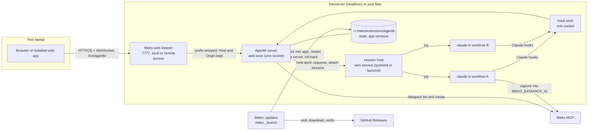

# Architecture

Part of the [AgentK design](../design.md).

There are three long-lived pieces on the host: the web server, the session host that owns every
Claude process, and AgentK's home, the state directory in Meko's data folder
(`~/.meko/extensions/agentk` by default; [where it lives](projects-and-sessions.md#where-agentk-lives)). The server is stateless enough to
be killed at any time. The session host and the on-disk state are what carry your work.

**Terminal path.** When you open a tab, the browser opens a WebSocket, and the server attaches
it to the session's pane in the session host over `host.sock`. The host sends the screen as it is
now first (a full reset, then the screen, its scrollback and the terminal modes, from a headless
xterm it keeps for every pane), then the output as it comes. Closing the tab ends only that
attach, and Claude keeps running. The host interprets no keys: everything typed, Ctrl+B included,
reaches Claude Code.

**The session host** (`src/server/host/`) runs each session's launcher in a pty with node-pty
(`TERM=xterm-256color`, `COLORTERM=truecolor`), and keeps a pane whose process exited, with its
exit status, until it is started again or ended. It answers the program's terminal queries
(device attributes, cursor position) itself from its headless xterm, and its color queries (OSC 10
foreground, 11 background, which the headless xterm doesn't answer) with the colors the server
started it with (`spawn`'s `colors`: the terminal colors a browser last reported, `Core.termTheme`;
a host from before them ignores the field and answers none), so Claude gets one
answer whether or not anyone is watching; the viewers' own answers are dropped (a browser's, and a
real terminal's with `me_koder attach`). Sessions don't inherit this install's `AK_HOME`,
`AK_APP_DIR` or `AK_VERSION`, so a checkout run inside one never takes them as its own. A pane counts
as live only once its program has started. It listens only on
`host.sock` (beside `hook.sock`, owner-only, bound under a temporary name and renamed into place),
one JSON request per connection: `hello`, `list`, `spawn` (never over a live pane), `kill`,
`write`, `paste` (a bracketed paste when Claude turned that on, then Enter after 300 ms; pastes to
one pane go one at a time), `capture` (the visible screen as text), `stop`, and `attach`, which
turns the connection into frames both ways (`src/server/host/protocol.ts`). One host runs per home:
it holds the home's host lease, `host.lock`, for as long as it runs (beaten every 10 seconds, as
`server.lock` is for the server), so a second host refuses to start (exit 75) even when the first is
only slow to answer; one that lost its lease (it stalled for longer than 45 seconds) ends its panes
and exits. On the server's side, only "nothing listening on the socket" means no host: a timeout or
a garbled answer skips that reconcile tick instead, and starts of a host never run two at once. It
writes `run/host.json` (pid, version, app directory, protocol) when it starts.

**Homes under /net.** Claude Code (2.1.292 and later) asks before every read or edit of a path
under `/net`, the automounter's `-hosts` map, even in auto mode, and no permission rule,
`--add-dir` or setting lifts that. A home there (`/net/<host>/data/you`) would stop a session on
every file in its worktree, its design file, its pasted images and its own `~/.claude`. When the
machine is that host, the same folder is mounted locally without the prefix (`/data/you`), so
everything AgentK hands Claude goes through `claudePath()` (`src/server/paths.ts`), which drops
the prefix when the two are the same folder (the same device and inode of the export root; only
this machine's own `/net/<host>` is checked, by host name, since a stat into another host's
mount can hang while that host is down):
the launcher's `cd`, `--settings`, `--add-dir` and `--plugin-dir`, `HOME`, `AK_HOOK_SOCK`
(Claude Code refuses a mod's `$.http.fetch` to a socket under `/net`, "a network location is not
reached from here", so the mod would never reach AgentK), the allow rules in the hooks settings
file, the design file, questions file and image paths in prompts, and the worktree and folder a
code review's steps are told (one Read through `/net` stops the review at a permission prompt). What
AgentK stores (worktree and repo paths, repo keys, the worktree pool) keeps its own spelling,
so the Design guard checks an edit against both, the learn step leaves out a fact that names
either (a path counts only whole, so a short local spelling such as `/data` doesn't catch
`src/database.ts`), and a session's transcript is looked up under both (a session started before
keeps its transcript: a resume from the local spelling finds it). Started by the local spelling,
a worktree isn't tied back to its repo for folder trust (its `.git` file names the stored
spelling), so AgentK also trusts that exact folder in `~/.claude.json` before launching.
The project's main checkout keeps its path, and paths on other hosts stay under `/net`.

**Sizing.** A pane has one size: the active viewer's. A viewer is active when it has just
attached, or it was used (typed in or focused). The host resizes the pty to it and tells every
viewer the size; the others show the pane at that size (a margin or a clipped edge) until they are
used themselves. When the active viewer leaves, the one used most recently before it takes over.
Any input counts as use, mouse and focus reports included, since Claude Code turns both on.

**One screen per session.** Two browsers taking a session's size from each other made the pane
bounce between their heights, and Claude Code repaints on every resize, so the terminal flickered.
So a session is live on one screen (a browser tab, window or phone; one page load) at a time, and
the server decides which (`ScreenBoard` in `src/server/screens.ts`, wired in by `terminal.ts`).
Only the screen that has the session holds an attach stream, at its size; any other screen's
socket stays open but gets no output and its input is dropped, and the browser shows its last
picture dimmed with **Move to this screen**. A new stream opens only once the one the session moved
away from is closed, an attach still in flight included, so the pane ends at the new screen's size.
Nobody has a session until a screen that shows it asks. A screen asks when it shows the session
(opened or switched to, the page shown again, the terminal clicked, tapped or focused, or a
reconnect while on screen unless it had lost the session; a socket still connecting asks as it
opens). It gets the session at once when the screen that has it isn't showing it (another session
or tab in front, the page hidden) or hasn't been used for 10 s (`SCREEN_IDLE_MS`); otherwise it
waits with a countdown, and each use of the other screen restarts it. When the screen that has it
closes, a waiting screen gets it at once; a screen that is only showing it asks 3 s later
(`RECLAIM_MS` in `terminals.ts`), so a page that just lost its connection reconnects and keeps it.
Use is any input but mouse motion with no button held and focus reports (`isPassiveReport`), so
moving the pointer across a window doesn't hold the session (a drag does). The screen that has the
session gets a notice when another one asks. **Move to this screen** moves it at once, and a screen
that lost the session doesn't ask again until it shows it again, so two idle screens never trade
it. Screens are told apart by a page id the browser makes per page load (a reconnect keeps the
session), and another tab of the same browser by a browser id in `localStorage`; the other screen
is named by its browser and system from the user agent. The board lives in the server's memory:
after a restart, the first screen to reconnect and ask gets the session. `me_koder attach`
talks to the host directly and is not part of this: it still takes the size when used. The server
log has each terminal socket's attach (its address and browser) and close, numbered, and one line
per move with its reason.

**From a terminal.** `me_koder attach <name>` shows a session's terminal in the one you run it
in, alongside any browser (the name is the pane's, `ak-<project>--<slug>`, or just the slug; with no
name it lists them). `Ctrl+\` detaches, and Claude keeps running.

**Status path.** Each session starts with `claude --settings` pointing at an agent-k hooks file
(a Kiro session as the `agentk` agent, whose inline hooks run the same scripts; an OpenCode session
with AgentK's plugin, loaded through `OPENCODE_CONFIG_CONTENT`, which posts to the same socket; their
events are mapped onto Claude Code's by their adapters: see [Agents](harnesses.md)).
The `SessionStart`, `UserPromptSubmit`, `PreToolUse`, `PostToolUse`, `PermissionRequest`,
`Notification`, `Stop` and `SessionEnd` hooks (and the status line relay) post to a unix socket,
which drives the badges in the rail. Your global Claude settings stay untouched. When `/clear` (or
`/resume` inside Claude) switches conversations, `SessionStart` carries the new session id, and
Resume and recovery continue that conversation. `SessionStart` has a second hook, `context.sh`,
which asks the socket's `/context` route for context to start with and prints it for Claude Code
(what AgentK's Meko search found: see [Meko recall at start](recall-and-learn.md#meko-recall-at-start)). Like the
edit guard, it prints nothing when the server can't be reached, and its curl gives up after 4 seconds.

The hook forwarder gives up quietly when the socket isn't there, so the server makes sure it is.
It binds the socket under a temporary name and renames it into place, removes it when it stops
only if the file is still its own, and every 10 seconds binds it again if the file was removed or
replaced (see [One server per home](recovery.md#one-server-per-home)). The server handles a hook
event after answering it, so a server that is stopping waits up to 5 seconds for turn ends still
being handled (what they await: the diff refresh, a PR poll's git calls, a prompt they send) and
for the sessions' lifecycle steps queued or running (`serial`: a PR poll started without waiting
for it, such as the one sending a code review's findings starts, or a queued prompt's delivery),
until neither is left, since each can start the other. Not the PR poll's sync of the PR's design
line, which it leaves running.

**Interrupted turns.** Claude Code fires no `Stop` hook for a turn you interrupt (Ctrl+C or Esc), so
AgentK's mod reports it (`/mod/turn`) and the server ends the turn as a `Stop` would
(`SessionManager.endTurn`): the session is idle again, the activity log says *You interrupted the
turn*, and what waited for the turn's end goes at once (review comments, a queued Open PR or
approval, review prompts). It isn't a turn Claude died in, so it's never continued by itself
(`interrupted` stays 0). It didn't do what it was sent for either: in Pull Request a review, CI or
conflicts prompt the turn got stays sent, and the findings stay *addressing* (so a queued merge
waits), until the next turn ends; a Review a PR session's update summary stays sent the same way.
Without the mod, the session shows as working until the next turn ends.
