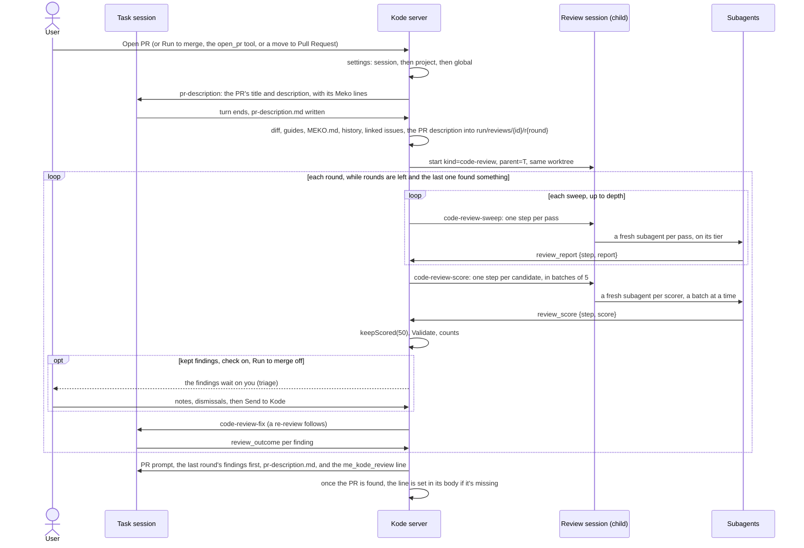

# Code review

Part of the [Kode design](../design.md).

Before a task's PR opens, Kode reviews the change on this computer with the agent-k reviewer's
algorithm (its `pkg/agenticreview`, the cloud Kode's Golum 1.0), so the task fixes what the review
finds before anyone else reads the PR. The PR description then says how it went, on one line:

```
me_kode_review:4 blockers,4 major addressed;Sagittarius3.0
me_kode_review:1 blocker,2 major,3 minor addressed;Sirius1.0
me_kode_review:LGTM;Sagittarius3.0
```

The code is in `src/server/review/` (the algorithm, ported) and `src/shared/codereview.ts` (the
settings, the line, the tab's label); the UI is the magnifier joined to the task's tab.

## Settings

Four settings, each set globally (`[code_review]` in config.toml, Settings › Code review), overridden
per project (`ProjectSettings.codeReview`, the project's settings) and again per session
(`sessions.review_json`: the New session dialog's Advanced, the session's ⋯ menu and sheet, Open PR with
instructions, and the `review` argument of the `start_sessions` tool, so "start a code session with
3 deep reviews" asks for `depth: 3`). A value left out keeps the next level's (`resolveReview`).

| Setting | Global default | What it does |
|---|---|---|
| `strategy` | `sagittarius-3.0` | Which algorithm runs: `off` for no review, `sirius-1.0`, or `sagittarius-3.0`. |
| `depth` | `1` | Sweeps in each round, 1 to 5: the number of times a review runs before Kode gets the findings to fix. More than one sweep makes it a deep review: each sweep after the first is told what the earlier ones found and looks elsewhere, and the sweeps run up to this count, but from the second sweep on, one that finds nothing new ends it ([how a review runs](#how-a-review-runs)). Costs more tokens. |
| `rounds` | `0` | Re-review rounds, 0 to 5: the number of times the code review runs again after Kode fixes the last review's findings, before the PR opens. A review that finds nothing ends it early. |
| `check` | `true` | Check the findings first: each round's kept findings wait for the user to add notes or dismiss some before they go to the task ([Findings that wait on you](#findings-that-wait-on-you)). Off, they go at once. Run to merge never waits. Read when each round ends, not stored on the review, so a change applies at the review's next round. |

`[code_review.models.<harness>]` sets the model each tier of step runs on (`large`, `mid`,
`small`): Claude Code's are `opus`, `sonnet` and `haiku`; OpenCode's and Kiro's are empty, which
runs a step on the session's own model, since their model ids depend on the user's providers and
plans.

## Strategies

A strategy is a named, versioned bundle of what a review does, stamped on each review and never
reused (the cloud's `Strategy`); an unknown id resolves to the default.

| Id | Passes | Scoring |
|---|---|---|
| `sirius-1.0` | One mid-tier pass whose mandate covers all five | None: every candidate goes to Validate |
| `sagittarius-3.0` | guide (large), diff (small), dependents (large, with its state ledger), history (large), claims (large, with its claims ledger): the cloud's mandates word for word | A small-tier scorer for each candidate |

The cloud Kode isn't changed: its strategy keeps its own name, and only this registry calls the
algorithm Sagittarius 3.0.

## How a review runs



`openPr()` (and `takeQueuedPr()`, so a queued Open PR and Run to merge go through it too) asks
`CodeReviews.openPr()` first: while it returns true, a review holds the PR and sends the PR prompt
itself when it's done (`Lifecycle.sendReviewedPr`). A move to Pull Request by hand with work to push
(`moveToReview`, from Explore, Design or Code) does the same when a review applies
(`CodeReviews.applies`): the session goes to Code (`reviewBeforePr`), since the review's checks, its
gate and its cancelling are all Code's, and the review sends the PR prompt as for Open PR. From
Explore or Design, the `moved` line (Claude's system prompt still names the old stage, and
Explore's says no PR) waits on the review (`code_reviews.lead`) and goes before its first prompt to
the task, the ask for the PR description. A move that only picks up the branch's open PR runs no review. The PR prompt itself doesn't ask the task
to review its diff: the review session has.

The page is told what Open PR will do before it's pressed: `CodeReviews.openPrReview()` makes the
test `openPr()` makes before `start()` (`Session.openPrReview`: `new`, `off` when only the strategy
being Off stops it, or null while a review runs, holds the PR or is done and goes out with it), and
the Code gate reads **Review Changes** on `new` (`openPrGate()` in `src/web/util.ts`), as does Open
PR with instructions, which follows its own Code review fields (`openPrReviews()`).
`CodeReviews.stepSkipped()` marks the stage bar's Code Review step skipped (`Session.skippedStages`):
on `off` before the PR, and once the latest PR prompt went with no done Code review whose
`finished_at` is set since the task last entered Code (Open anyway sets it on a stopped one, and a
review from an earlier PR prompt, before a move back to Code, isn't this one's), unless the latest review is
done, not stale and with no `finished_at` yet (`unsent`): its PR prompt is still being typed, since
`Lifecycle.sendPr` moves the stage to Pull Request first and `markSent` writes `finished_at` once
the prompt went. Only the latest counts there, since `stale` is set on it alone.
Both are read only for the state, not in `runtime()`.

**The PR description.** Before the first round the review is `describing`: Kode asks the task
(`pr-description`, `Lifecycle.sendPrDescription`) to write the PR's title (the first line) and
description to `pr-description.md` beside its design (`designs/<task>/`, outside the repo, which
every session may write), ending with the Meko lines the PR prompt asks for (`prFooter`: the
datapack, the design and the conversation), so the passes check the change against the author's
account of it, as the cloud's check a PR's, and see where its Meko context is. An earlier review's
file is removed first, so a turn that writes none leaves the passes the task alone. The ask calls an
open PR's existing text untrusted. The task's turn end starts round 1 (`CodeReviews.onTurnEnd`). An
interrupted one waits, as a fix turn does, for the next turn's end or Open PR (the gate's **Review
now**); so does an ask the agent exited before taking (sessions.submit's `lost`), and there Open PR
asks again. The review keeps why it waits in its `detail` (`DESCRIBE_INTERRUPTED`, `DESCRIBE_LOST`),
so a restart leaves it waiting; otherwise `recover()` starts round 1 once the task is idle (not while
its turn runs or asks something). A Retry before round 1 had a description asks again. The task is
busy from the ask until its turn ends, so an Open PR or a move while Kode looks up the Meko lines
is refused rather than taken for a press past an interrupted turn. The passes get the file, title
and all, quoted, as data to check the change against and never instructions (an open PR's text it
starts from may be anyone's), clipped before its trailing Meko lines, which are kept (at most six,
each clipped: `clipDescription`). Each later round reads the file again: the fix prompt asks the task to
keep it true (`prDescriptionFixLine`), and the PR prompt to open the PR with it, brought up to date
(`prDescriptionUseLine`).

**The review session** is a session of kind `code-review` (`Session.parentId` is its task), held by
the session host like any other, so it survives restarts. It works in its task's worktree without
owning it (`worktree_released`), so archiving it never frees the worktree or deletes the branch. It
is archived as soon as the review is done (`finish()`: the findings stay with the review), when the
user cancels it, when another review replaces it, and with its task; a failed review keeps it for
Retry. Its edit guard denies every
edit in the repo, and on Claude Code `--disallowedTools` takes Bash and the edit and web tools away
from it and its subagents; OpenCode's session config denies them. Its first prompt is the first
sweep's, and Kode sends each later step's prompt as the turn before ends.

**Steps.** The main thread only starts steps. Each pass and each scorer runs with a fresh context,
as the cloud's separate processes do (`HARNESS_CAPS.reviewSteps`):

- `subagents` (Claude Code, OpenCode): the session is launched with a subagent per tier
  (`kode-review-large`, `-mid`, `-small`: Claude Code's `--agents`, OpenCode's `agent` config),
  and one prompt lists the steps, each in its subagent with the prompt "Read {file} and do what it
  says." A sweep's passes start all at once, in one message, as the cloud runs them; the scorers
  run in batches of 5 (`SCORE_BATCH`), since a round can have dozens: Kode numbers the batches
  in the prompt (`stepList`), and each batch starts in one message once the one before has
  finished. Asking again for missing scores batches only the missing ones. The runner doesn't
  depend on the order: reports are keyed by step. The turn's end is the sweep's end, so the
  subagents must run inside it: Claude Code backgrounds a subagent by default, which ends the turn
  before any step reports, so a Claude Code review session launches with
  `CLAUDE_CODE_DISABLE_BACKGROUND_TASKS=1`.
- `turns` (Kiro): each step is a turn of its own. The first starts the review session (on its
  tier's model, when one is set); each later one goes when the turn before ends, after `/clear`
  and, when the tier has a model, `/model`. Those are Kiro's own commands, which start no turn and
  fire no hook, so Kode types them with `SessionManager.command`, which doesn't mark the session
  working: sent as prompts, they left it working with no turn to end, and the step's prompt after
  them was refused as busy (#467). The steps still to send are kept in memory (`CodeReviews.queued`);
  the runner checks for missing reports, and asks again once for them, only after the last step's
  turn. An interrupt drops the steps still to send, and the review waits. A restart loses them too.
  So when a review session's turn ends with no steps kept for it (the next turn after an interrupt,
  or any turn after a restart; `recover` does it at once for an idle session), Kode sends the
  steps that haven't reported, as a Retry does (`sendUnreported`), without counting that as the one
  ask again, since some of those steps were never sent. Kiro's sessions share one agent file, which has Kode's MCP server only while
  `[tools] enabled` is on, so a Kiro review needs the session tools on; without them no step can
  report, and the review fails for Retry or Open anyway.

Each step's file is the shared base prompt (the same for every pass, so a prompt cache serves it),
the sweep context, then its mandate and how to report: Kode's `review_report` or `review_score`
tool (in the `kode_sessions` MCP server, pre-allowed, answered whatever `[tools] enabled` says),
called with the step id and a report its schema checks (`checkReport`, `checkScore`). An error names
what to fix, and the step calls again. A required ledger is a field the model can't skip.

**After a turn** of the review session (`CodeReviews.onTurnEnd`): a step that didn't report is
asked for once more (`asked`), then the review goes on without it. A sweep merges its reports into
the round's candidates (`mergeSweep`: on file and line, more passes on one line are
corroboration, the worst severity and the longer comment win). Another sweep follows while the
depth allows and, from MinSweeps (min(2, depth)) on, the last sweep added something new. Then the
scorers, then `keepScored` (refuted only with a refutation and something read, confirmed kept,
unverified kept at 50 or more, unscored kept) and Validate (the file must be in the change and the
line in a hunk, at most 100). No pass reporting in the first sweep fails the review.

**Rounds.** A round that keeps findings, with rounds left, sends the task `code-review-fix` (fix
or decline each, don't commit yet), once the user has checked them when they wait on the user
([below](#findings-that-wait-on-you)), and the task reports what it did with each by its key with
`review_outcome`. The task's next turn end starts the next round, whose passes are told the
earlier rounds' findings and what the task did with them (prior rounds). The last round's
findings lead the PR prompt (`code-review-findings`).

**The line** (`meAkReviewLine`) adds up every round's kept findings, by severity in the order
blocker, major, minor; `LGTM` when no round kept one. A finding the user dismissed isn't kept, as
one the scorer refuted isn't. After a `;` it names the strategy that ran,
its name without spaces (`strategyTag`: `Sagittarius3.0`, `Sirius1.0`); `parseMeAkReviewLine` still
reads a line from before it did. Kode writes it into the PR's description after `adoptPr` when
Claude left it out or it differs (`syncReviewLine`).

**Stopping.** A failed review (no pass reported, or an error) or one the user cancelled holds the
PR: Open PR answers 409, Run to merge waits, and the task offers **Retry** (the round again from
the step it stopped at, reusing every step already reported, from `code_review_steps`) and **Open
anyway** (the PR prompt with no line). A move out of Code (or a move to Pull Request that finds
the task outside Code) cancels its review, running or stopped, with the detail `the task left Code`
(`REVIEW_LEFT_CODE`, `CodeReviews.leftStage`; `taskMovedOn` catches one the review session's turn
end finds there): that one doesn't hold the PR (`reviewHolds`), since Retry and Open anyway are
Code's, so the next Open PR, or a move to Pull Request, starts a new review on the change as it is.
A move to Pull Request checks what Open PR does, whether the review is on or off: the user's
prompts go first, and a stopped review in Code answers 409. Open PR, or a move, while a review
waits for fixes whose turn was interrupted moves it on to the next round.

**The PR prompt.** A done review's `finished_at` says its PR prompt went. Open PR (or a move to
Pull Request) on a done review without it sends the PR prompt with the findings and the line, and
starts no new review. It's set when the prompt is sent, and cleared again (`markUnsent`) when
Claude exits before taking it: the task goes back to Code, and the prompt goes again once Claude
is back ([Kode's mod](mod.md)). A review that finishes while the task's turn runs (a prompt of
the user's went meanwhile) queues Open PR (Run to merge's, when the review was, and only while Run to merge is still on), so
its PR prompt goes when that turn ends ([Queued gates](lifecycle.md#queued-gates)). The queued Open PR's step
sends it from inside the session's serial queue (`Lifecycle.serial`), as a move to Pull Request's
does: a step's own call to `serial` for its session runs right away, as part of the step, since
queued it would wait for the step that waits for it. `serial` can't tell that call from work the
step started without waiting for it, so such work that reaches `serial` while the step still runs
runs alongside it too, and a step mustn't leave any running; once the step is done, it queues as
usual. A Cancel of that queued Open PR, or Run to merge stopping, while the PR prompt waits on
GitHub and Meko still stops it, as for any queued Open PR.

**Recovery.** `code_reviews` and `code_review_steps` keep a review's state and every step's
report. After a restart, `CodeReviews.recover()` asks an idle review session again for the steps
still missing; a review whose session is gone fails, for Retry.

## Findings that wait on you

A round that keeps findings doesn't hand them to the task at once: unless the task's `check`
setting is off or Run to merge is on (`sessions.auto_run`, read when the round ends, never
`code_reviews.by`, which stays `auto` after Run to merge stops: `checksFindings`), the review goes
to `triage` and waits for the user. This is every hand-off of kept findings: a fix prompt before a
re-review, the last round's findings with the PR prompt, and the last round of a review the user
ran, in Code and in Pull Request (`finishRound`, then `handOff` when they go). The activity log says
so, and the user is notified once.

While it waits, the user can give each of that round's kept findings a note for the task, or
dismiss it, with an optional note as the reason (`CodeReviewFinding.you`, kept in `findings_json`
as each choice is made: `PATCH /api/sessions/:id/code-review/findings/:key`, `setFinding`, where a
field left out keeps its value), and then sends them (`review-send`, `CodeReviews.send`). The panel's
Send waits for choices still being saved and is refused past one that failed, so a note is never
dropped unseen. A dismissed finding is dropped (`kept: false`,
`dropped: 'dismissed by you'`), so it leaves the prompt and the counts, the line included. A note
goes in the finding's line of `{{findings}}` (`- The user's note: …`), not a placeholder of its own,
so a repo's own `code-review-fix` or `code-review-findings` carries it too. The next round's passes
are told of both: a dismissal as a finding the author never had, not to raise again at that place,
and a note beside what the author did (`priorRounds`). With every finding dismissed, the round ends
as one that found nothing: no fix prompt and no re-review, and the PR prompt (or, in Pull Request,
the push of earlier rounds' fixes) goes as for an LGTM round. The PR prompt then goes as the user's
(`by = 'you'`), since they sent it.

Sent from `triage`, a fix prompt always goes through the task's prompt queue as `local-review`, in
Code too (`sendReviewFix`'s `queued`), since the user may have been working with the task while the
review waited: it goes once Kode is between turns, and the end of the turn that takes it starts
the next round. For an Open PR's review in Code, an interrupted fix turn doesn't
(`codeReviewTurnEnded`): the review waits in `fixing` for the next turn's end or **Review now**,
as it does when its fix prompt goes straight to the task. `triage` is a running state (`RUNNING`): it holds Open PR, and Open PR, a move to
Pull Request or a queued Open PR leaves it waiting (`openPr` changes nothing); Cancel stops it,
leaving the stage cancels it as for `fixing`, `review-run` is refused, and `recover()` leaves it
alone, so it waits through a restart. Turning Run to merge on sends the findings as they stand
(`autoSend`, from `setAutoRun`, before the gates it arms). In Pull Request, its findings waiting is a
merge blocker only the user clears (*The code review's findings wait on you: send them to Kode or
dismiss them.*, in `mergeInfo()`'s `hard` and `yours`, in place of *The code review is still
running.*), so a queued Merge when ready is dropped and the session shows Needs you; entering it, and
leaving it by Send, Cancel or a failure reads the PR again (`Lifecycle.codeReviewWaitsChanged`);
leaving the stage needs no look, since the blocker is only read in Pull Request, and the next move
back there reads the PR. A Retry of a review
cancelled in `triage` scores the round again and replaces its findings, so the notes go.

## On demand

The user can run the review at any time in Code, or in Pull Request once the PR is found: the
`review-run` action (`CodeReviews.runNow`): **Run code review** in the task's ⋯ menu (the ⋯
sheet on a phone), **Run the code review of …** in the command palette and, once the task has a
review, **Review again** in the findings panel's header (the magnifier opens it). While Kode
can't take it, each of these says why (after its turn, answer it in the terminal, resume the
session), and the server's refusal says so again. A [workshop's](workshops.md) level runs one by
itself on the level's session as soon as its worktree is made, first as a **first look** whose
findings stay with the review (`handOff: false`, `code_reviews.hand_off = 0`, shown as First look in
the findings header), then, on the user's go, again once its gotchas are in Meko (`runNow(task, 'auto', { describe:
false })`: `by = 'auto'`, "Kode ran the code review", with no PR description first, so it needn't
wait for the task's turn), and the demo's Code gate offers **Run code review** in place of Open PR, which
skips the PR description too. For
a review the user ran, the findings header also has **Cancel** while it runs and **Retry** once it
stopped, in its own stage (`onDemandControls`), as the ⋯ menu and sheet do: the Code gate
doesn't show it. A stopped review it replaces passes on the Open PR instructions and a move's
`moved` line it held. It's refused (409) mid-turn,
while Kode waits on the user or has exited, while a review runs, outside those two stages, and in
Pull Request while the last one's fix or push prompt hasn't been taken. With the strategy Off it runs
the default one (Sagittarius 3.0), with the resolved depth and rounds. It's an ordinary review row
with `purpose = 'demand'` and the `stage` it runs in (`code_reviews.purpose`, `.stage`), not a state
of its own: the states are listed by hand in many places (the runner, `recover`, the UI's helpers,
the usage counts), and nothing flags one left out.

It runs as Open PR's review does, rounds and fix prompts included, but sends no PR prompt. Its last
round's findings go to the task as a fix prompt too (`code-review-fix` ending "Don't open the PR
yet", `FixAfter`), since no PR prompt carries them. Its fix (and push) prompts go through the task's
prompt queue as `local-review` (the review's old name, kept since `sessions.pending_prompts` stores it
and a release rolled back to reads it), in Code as in Pull Request, since the user may be working with the
task meanwhile: one goes only once Kode is between turns, never into a turn or a question in the
terminal, and the end of the turn that took it starts the next round, interrupted or not (there's
no Review now for it; Cancel stops it). A prompt Claude loses before its turn starts (it exits
first) goes back to queued and is sent again when Claude is back (`claudeBack`, or the next look
at the PR), and Open PR on a finished review whose last fix prompt was never taken sends those
findings with the PR prompt instead, so the line never says they were addressed when the task
never saw them. A stopped one holds nothing (`reviewHolds` is false
for `CodeReviewSummary.onDemand`): it offers Retry, not Open anyway, and Open PR starts a review of
its own (and a queued Open PR stays queued: `reviewStopped`). Leaving the stage it runs in cancels
it, running or stopped (`leftStage`, `taskMovedOn`; `the task left Pull Request` for one there), so
its Retry stays in that stage, and `retry` refuses it elsewhere.

**In Code**, the task writes its PR description first, as for Open PR. Once it's done, Open PR (a
move to Pull Request, Run to merge's queued Open PR) sends the PR with its line and starts no review,
through `openPr`'s path for a done review whose PR prompt didn't go, even with the strategy Off
(`applies` is true then, and while one runs); the PR prompt has no findings block, since they went
as a fix prompt. Leaving Code (a move, or one to Pull Request that picks up the branch's open PR)
marks such a review stale (`code_reviews.stale`): Open PR then reviews again, or, with the strategy
Off, opens the PR with no line (`prLine` ignores a stale review). Open PR while one runs takes it
over: its `purpose` becomes `pr` and it sends the PR prompt when it's done (not past a fix prompt still queued: the turn that takes it moves the
review on). So does an Open PR
queued during its fix turn (the user's, or Run to merge's), at that turn's end (`takeOver`), rather
than being dropped as one queued during an Open PR review's turn is.

**In Pull Request**, there's no describing turn: the passes read the open PR's own title and
description (`Lifecycle.prText`), quoted like the task's. Its fix prompts go through the stage's
prompt queue as `local-review` (after the people's review prompts, before conflicts and CI), so
they never collide with a GitHub review, conflict or CI prompt, and the next round starts when the
turn that took the prompt ends (`codeReviewTurnEnded`), not at whichever turn ends first. The fixes
are pushed once, after the last round: a fix prompt with a re-review to follow says not to commit or
push yet, the last round's says to commit and push, and a re-review that finds nothing after
earlier fixes sends `code-review-push` when the worktree has changes not on the PR (uncommitted
files, or a branch tip the PR's head doesn't contain, read from the PR's own repo:
`Lifecycle.unpushedToPr`). When it's done,
Kode puts its line in the PR's description (`syncReviewLine`). While it runs, or its prompt waits
in the queue, the merge waits on "The code review is still running." (a blocker that clears by
itself, so Merge & Close and Run to merge queue behind it), and the uncommitted-files and
unpushed-commits blockers wait too, as they do mid-turn. Only while Claude is there to take the
prompts: once it has exited, they're blockers only the user clears, and a queued merge is dropped
with a notice. Cancelling or leaving the review drops its prompt, queued or out.

## From the command line

`meko kode review` runs the review on the change in the folder it's run in, from a terminal, with
no task, session or server: a person, a plain Claude Code session or a script can run it on any
checkout (`src/server/reviewcli.ts`). It reads the change from where it left its base to the working
tree, uncommitted and untracked files included, as a task's review does, prints what it kept and
exits 0; it exits 1 when it couldn't review (bad options, not a git folder, no Claude Code, no base,
a `--pr` gh can't read, no pass reporting, or Ctrl+C). It only reports: one round, no fix prompt,
no triage, no PR, no line. Whoever ran it fixes what it found and runs it again.

```
meko kode review [--base <branch>] [--pr <pr> | --description <text>] [--depth 1-5] [--strategy <id>] [--json]
```

- **What it reviews against.** `--base`, origin's copy of the branch first (as `baseRefIn` reads a
  task's), else `--pr`'s base branch, else the branch `origin/HEAD` names, else `main`, then
  `master` (`pickBase`).
- **The author's account.** `--pr` (a number, `owner/name#n` or a link) reads that PR's title and
  description with gh; `--description` takes text. One or the other: with neither, the passes
  have the diff alone. Either reaches them as the PR description does in Pull Request, quoted and
  clipped as data, never instructions. The folder is still what's reviewed: when its HEAD isn't
  the PR's head commit, it says so on stderr and goes on, since a branch ahead of its PR is the
  usual case before a push.
- **Whose work it is.** Without `--pr` the folder is taken as the user's own work, as a task on
  its own branch is, and its `MEKO.md` datapacks go to the passes. With `--pr` on a public repo (or
  one whose visibility gh can't say), anyone can have written it, so its `MEKO.md` could point the
  passes, with the user's Meko token, at datapacks of its author's choosing: the review runs
  without them and says so (`untrustedPr`), as Kode runs a session on such a PR's head without the
  repo's config ([Code from public repos](security.md#code-from-public-repos)).
- **Settings.** Strategy and depth are `[code_review]`'s, or `--strategy` and `--depth`; strategy
  Off runs the default, as **Run code review** does. Re-review rounds and the check don't apply.
- **Output.** stdout gets the kept findings, worst first, each with its comment (and **Caught with
  Meko** with the gotchas it credits), the passes' notes, then one line: the counts or `LGTM`, how
  long it took and what Claude Code says it cost. `--json` gives `{ repo, branch, base, head,
  strategy, depth, files, counts, findings: [{ key, file, line, severity, comment, confidence,
  passes, credits }], notes, seconds, costUsd }` instead (with `files: 0` and no findings when
  nothing changed). stderr gets what it's reviewing and its
  progress (one line redrawn on a terminal, a line per phase elsewhere) and any error.

**How it runs** (`src/server/review/headless.ts`, `HeadlessReview`). It runs headless in the CLI's
own process, not through the server, whose runner is keyed on a task row and its stages, and which
may not be running. Both drivers share the algorithm: `review/context.ts` reads the change and
its context (`readChange`), and `merge.ts` has the sweep rule (`moreSweeps`), merging, scoring and
keeping (`judgeRound`), so the CLI's review is the task's review, one round long. Each pass and
each scorer is its own `claude -p` on its tier's model (`[code_review.models.claude]`), its prompt
on stdin ("Read {file} and do what it says.", the same step files a task's review writes): a
process is a fresh context and its exit is the step's end, so none of the subagent and turn-end
machinery above is needed. A sweep's passes start at once, the scorers 5 at a time (`SCORE_BATCH`),
and the steps that didn't report run once more (`ASK_AGAIN`), then the review goes on without them;
no pass reporting in the first sweep fails it. A step gets 20 minutes. Claude Code missing or signed
out stops the review at once (`StepOutcome.fatal`, read only from Claude Code's own sign-in
messages, never from a step's text): the rest of that step's batch is stopped and waited for, so
the run's record counts what they spent. Claude Code only for now: OpenCode and Kiro
need a headless launch and tool wiring of their own.

A step's launch (`reviewStepArgs` in `src/server/claude.ts`): print mode, `--output-format json`
(its tokens and cost), only Read, Grep and Glob of its own tools, `--strict-mcp-config` with the run's
`mcp.json`, `--allowedTools` the two report tools and Meko's `knowledgebase_search` and
`context_search` in the default permission mode (in `-p` anything else that asks is denied, so a
step never hangs on a prompt), the run folder by `--add-dir`, and no session kept. It reads no
settings file, the user's or the repo's (`--setting-sources ''`): only the sign-in part of the
user's (`signInSettings`: `env`, `apiKeyHelper`, as the work queue's Slack read takes), with every
hook off, so nothing the user pre-allowed (an MCP server's writes, `bypassPermissions`) runs while a
step reads a diff someone else may have written. Its working folder is the reviewed folder in the
spelling Claude is given every other path in (`claudePath()`). Its environment is the caller's
without any session's markers or any `KODE_*`, `AK_*` or `MEKO_*` variable (`stepEnv`), so a
review run from inside a Kode session never reports into it.

Steps report through the same `review_report` and `review_score` tools, checked against the same
schemas: the run's `mcp.json` (owner-only) starts `me_kode mcp` pointed at a private socket the CLI
answers (`serveTools`, `KODE_HOOK_SOCK` and a one-time token), listing only those two tools
(`KODE_TOOLS`). It names Meko's server (its URL and token from `meko token --json`, the way Kode
reads them) only when the change's `MEKO.md` files list datapacks and Meko is running. The run's
folder (`run/cli-reviews/<id>/`: the base prompt, step files, patches, `mcp.json`) is removed when
it ends, however it ends; one a killed run left behind is removed by the next run once it's a day
old.

**Counted with the other reviews** (`src/server/review/clirecords.ts`). Every run that got as far as
reading the change leaves one owner-only JSON record in `run/cli-reviews/` (counts, sweeps and
candidates so far, tokens and cost; never a finding's text or a description: its repo's checkout
path, branch and why it failed stay on this computer, and the usage report sends only counts), and the server
takes the records into `cli_reviews` at its start and every minute, deleting each file once its
row is in (by id, so a record read twice is one row). The CLI never opens `state.db`: it could
migrate it under a server still on an older version, skip the copy kept before migrating, and be a
second writer on a home shared over NFS. A run's project is the open project on its repo (its main
checkout's real path), else the open one whose sessions worked there last, else the closed one on it
closed last (the Usage page still lists it); none for a repo no project, open or closed, has used. Records nobody took in for 30 days are deleted by the next run. The Usage page's and project
home's **Code Reviews** count them (`reviewRuns`, `CodeReviewCounts.cli`), as does the usage report's
`codeReview`, with their tokens; they're not in the token chart or the totals, which come from
transcripts.

## Context the passes get

The base prompt follows the cloud's `BuildPrompt`, for a change rather than a PR: the branch
against its base (origin's copy when there is one), the PR title and description the task wrote,
its first prompt and where its design is, `git log` of its commits, the change from the merge-base to the working tree (untracked
files included, since nothing is committed before the PR prompt), the review guides (REVIEW.md at
the root and in each ancestor folder of a changed file), the history of the rewritten lines
(`git blame` and recent commits, since the passes have no git), the task's linked issues (its work
item's GitHub issues fetched into the run folder; other links by name), and earlier rounds. Secret
files, deleted files and generated files are withheld (`withhold.go`, `generated.go`). A diff over
256 KiB is written one patch per file instead of inline. The description is the PR title and
description the task wrote, quoted, followed by the task it was written for; with none, the
task alone. Left out: the cloud's injection screen and budget caps (the change is the user's own, on
their own account), and the PR description's skip patterns.

Every absolute path the prompts give (the working directory, the run folder, the per-file patches,
the linked issues, the design and each step's prompt file) is in the spelling the review session
runs in, `claudePath()`, as its cwd and `--add-dir`s are. Each is converted as the prompt is
rendered: `ReviewContext` and `context.json` keep Kode's own (the design as its own field,
`ReviewContext.design`, beside the task's first prompt). For a home under `/net/<this host>`, Claude Code asks before every read under `/net`,
and a pass that builds a path from a `/net` working directory would wait on a prompt nobody sees.
The pass prompts' base is written once per round (`base.md`), so a round started before a change
here keeps its old text through Retry; the scorers' base is rendered again at each send.

**Meko.** In a trusted repo, Kode reads the `MEKO.md` files that apply (the root's and each
changed file's ancestors': a table of Datapack, ID and What's in it, `src/shared/mekomd.ts`) and
lists their datapacks in the base prompt. The passes search the gotchas datapack (its name ends in
`/gotchas`, as the cloud's miner names them) themselves with `knowledgebase_search` and its id, and
may search the others with `context_search`; a finding credits a gotcha (`MG-<n>`) only with the
sentence it instantiates, and Kode drops a credit without one. A credit keeps that sentence
(`Finding.quotes`, `CodeReviewFinding.credits`; a review from before has ids only), and the review's
done event counts the kept findings that credit one: `Code review done: 1 major, 1 caught with Meko
(MG-2)` (`caughtWithMeko`); each round's event
(`Code review, round 1: 1 major, 1 caught with Meko (MG-2)`) counts that round's the same way. With no `MEKO.md` the review runs
without Meko. Retired gotchas aren't filtered: the cloud's roster of them isn't in Meko.

## In the UI

The review is never a tab or a rail row of its own: it's a part joined to its task's tab and rail
row (`ReviewSegment`), a blue magnifier whose lens pulses while the review works and shows Meko's
"m" while the review session is in a Meko call (`CodeReviewSummary.mekoCall`), then `…` while the
task writes the PR description (describing) or the review prepares, then how far it
has got (`reviewSteps()`: each pass of a sweep, then scoring as one step, so Sagittarius 3.0 counts
`1/6` to `6/6` and Sirius 1.0, unscored, `1/1`, moving on as each pass reports, whether the passes
run at once, on Claude Code and OpenCode, or one after another, on Kiro; with depth > 1 the passes
count again for each sweep; the tooltip says how many passes have reported, and names the sweep,
and while scoring how many candidates have been scored, since a batch of scorers runs at once),
the counts (`2·1·4`) in the needs-you color with its lens knocking while the round's findings wait on
the user (`triage`, `reviewWaitsOnYou()`), `R1` while the task fixes round 1's findings, the result (`2·1·4`,
blockers·majors·minors, until the task has said what it did with every kept finding, every round's,
through `review_outcome`: `CodeReviewSummary.addressed`; then, or with none, `LGTM`) or a red `!`.
Once it reads `LGTM` the review is settled (`reviewSettled()`), and the tab and the rail row leave its part
out (`reviewBadge()` in `src/web/util.ts`): the task looks like one with no review, and its findings
open from the ⋯ menu's or sheet's review row.
A task that answers in its reply instead (tools off, or an untrusted PR head) records no outcomes,
so its counts stay. While the review session waits on the user in its terminal (a permission prompt
or a question, while its steps run: `CodeReviewSummary.waiting`), the magnifier takes the needs-you color and its lens
knocks, since that session has no tab to show it. Clicking it (in the tab, the rail, or the ⋯ menu or sheet)
follows `reviewOpens()` in `src/web/util.ts`: while the review has a running session and isn't
waiting for the user's check or the task's fixes (preparing, sweeping, scoring, or failed, which keeps its session for
Retry), it opens the review's own screen, its terminal with the findings beside it on a desktop;
otherwise (describing, which has no review session yet, triage, fixing, done, cancelled) the findings panel beside the task's terminal (`ReviewFindings`:
the MEKO.md files' datapacks, each by name with the gotchas one tagged; every candidate by round and sweep, the dropped ones under **Dismissed** below the kept ones and the running round's candidates, which the server marks `pending`, with its passes, verdict, confidence, kept, pending or why dropped,
credited gotchas, each marked **Caught with Meko** with the gotcha's sentence under the comment, the user's note and what the task did; while the round's findings wait on the user, a **Waits on you** bar under its
header with **Send N to Kode** (**Finish review** with every one dismissed, waiting for notes still being saved), and on each of that
round's kept findings **Add a note** and **Dismiss** (or **Restore**, under Dismissed), each saved as it's made; while the review runs or the task writes the PR description,
`findingsReviewing()`, it reads **Reviewing** under the findings so far, with a bar along its header
and no counts), whose **Terminal** button goes to the review's screen while it has one. Each
finding's `file:line` opens the task's Changes panel in the findings' place (also from the review's
own screen, which shares the task's worktree), on All changes, scrolled to that new-side line and lit
for a moment (`revealRow` in `src/web/diff.ts`: its row, or the unchanged lines around it opened
when git left it out; the line is matched by number, since a finding keeps no text, so after fixes
it can land on a moved line), with a note saying why when it can't show the line (the file or the
line is no longer in the diff, the file is shown without its diff, or the lines around it couldn't
be opened; a file that changed while its text was read is tried again on its new diff);
**← Findings** in its header, which a phone's back button reads too, brings the findings back where
they were scrolled. The click waits for a note still being saved, and while a save has failed
the places aren't buttons, so the findings shown again never lose it. The findings
also open by themselves beside the task's terminal, on a desktop and a phone, as the design does in
Design (`findingsAutoOpen()` in `src/web/util.ts`, run by `ProjectView`): whenever the task comes on
screen while they read Reviewing or wait on the user (`triage`), and again as a review moves into
`triage` or a new one starts, but not at each step, in `fixing` or once the review is over. While the review holds the PR, the stage bar and the task's chip show the task in Code Review, the
stage bar's step 3 between Code and Pull Request
(`shownStep()` in `src/web/util.ts`), though it stays in Code, and its gate shows the review, with Cancel, or Retry and
Open anyway, **Code review waits on you** with **Open terminal** while it waits, and **Findings wait
on you** with Show findings, Cancel and **Send to Kode** while its findings wait (the ⋯ sheet on a phone
and the command palette have **Send the findings to Kode**, as the ⋯ menu does whenever no gate
shows Send: in Pull Request and for a review the user ran). The dot shows Needs you then, in Code too (`dotState()`). While the task
writes the PR description the gate says so, with Cancel and **Review now** (Open PR: past an
interrupted turn it starts round 1 with the description as it is, past a lost ask it asks again);
while the task fixes a round's findings it offers **Review now** too, which starts the next round
past an interrupted fix turn. Both are off while the task's turn runs. The step the stage bar shows
isn't a move target then, and neither is Code, the session's own stage. A review the user ran
(`onDemand`) holds no PR, so none of this applies to it: the task shows in Code with its Open PR
gate, and its findings header and the session's ⋯ menu (the ⋯ sheet on a phone) offer Cancel and Retry, and Send while its
findings wait.

The Usage page and the project home count reviews in their **Code Reviews** section, and stack the
review sessions' tokens on the Token usage chart ([Token usage](token-usage.md)); the usage report
sends the same counts each day, with the candidates the passes raised and the review sessions' cost
([Usage stats](usage-stats.md), `codeReview`).
