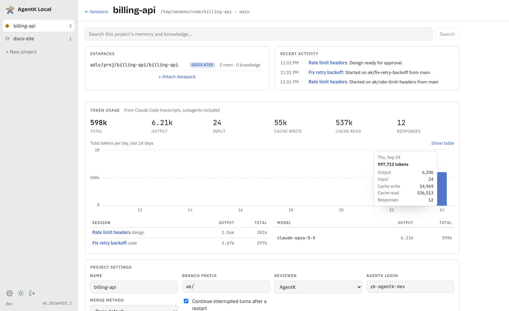

# Project home

Part of the [AgentK design](../design.md).

Recent activity shows the project's last 50 events, newest first, and scrolls inside its box so it
never pushes the rest of the page down. Token usage's table by session scrolls the same way past about 10 rows,
the most recently used first (see [Token usage](token-usage.md)). Its chart stacks each day's code review tokens on the bar, and once a review has run, a **Code Reviews** section follows the Meko
stats.

**Share** sits in the project's header: it shares the whole project, through its dedicated
datapack, and opens the Share dialog whenever there's a Meko; a Meko that doesn't share (one not
linked to Meko Cloud) says so in the dialog, in its own words. With no Meko it says how to set
one up first (**Set up Meko**, which says what's wrong with the Meko on this computer), and for a project without a
dedicated datapack it offers **Add a dedicated datapack**. Meko itself refuses a share from someone who isn't the owner or a
maintainer. See [Sharing a project](sharing.md).

A project without a dedicated datapack says so in its Datapacks box, with **Add a dedicated
datapack** (a new one, or one of yours; `POST /api/projects/:id/dedicated-datapack`), or **Add a
Meko API key** while Meko is off. A shared datapack already attached can become the dedicated one.
New sessions use it, each pinning it for its own agent id. Search is hidden for a project with no
datapacks.

While the dedicated datapack has no memories and no knowledge (its counts from Meko, so not while
Meko is off or doesn't answer) and no learn session is open on it (one launched on a datapack since
switched away from doesn't count), the box says the
datapack is empty, with **Learn the project**, which opens the New session dialog on that choice
(see [Learn sessions](recall-and-learn.md#learn-sessions)).

The dedicated datapack's row has **Switch** (while Meko is on). It opens the same dialog, titled
**Switch the dedicated datapack**, to make a new datapack or one of yours the dedicated one; attached
shared datapacks are listed first, and a new one's default name gets `-2` (or the next free number)
when the usual name is taken. The old datapack stays attached as shared, so its memories can still
be searched, unless **Detach *old* from this project** is checked. Nothing is deleted in Meko. The
dialog warns how many of the project's sessions are running (starting, working, needs you, idle,
recovered): they keep the datapack they were launched with, and so keep writing to the old one until
they're restarted. That covers Claude's own Meko calls (its prompt names the old one), capture (the
Meko hook keeps the datapack in the session's watermark once the session has started) and AgentK's
writes for the session: designs, the PR's Meko lines and the learn step's facts go to the datapack
recorded on the session at launch (`sessions.meko_datapack_id`), under the session's own Meko conversation there
(AgentK's writes for a session always go under its own conversation). New and resumed sessions get the new one
(a resumed session's Meko conversation is keyed by datapack, so its earlier turns stay in the old
one). The request names the datapack it replaces
(`replace`), so a switch made meanwhile in another tab is refused (409) rather than undone; the old
row is demoted or detached in the same transaction as the new one is added, the project's
server-side Meko conversation (used for search) is made again in the new datapack. Pins are per session, so a running
session's stays on the old datapack and the next one to start pins the new one.

**AgentK keeps no log of Meko calls.** What AgentK's and a session's agent's Meko calls send and get
back is Meko's to keep, not AgentK's. AgentK kept a log of its own before
(`designs/<session>/meko-calls.jsonl`, the project setting Log Meko calls); a start of this version
deletes those files once (`removeOldMekoLogs`, kv `meko-call-logs-removed`), and is marked done only
once every one is gone.

The searches Meko couldn't answer are Meko's: the dedicated datapack's **Context Gaps** tab in
Meko's web UI (for a Meko Cloud datapack, Meko's page for its Context Gaps). While AgentK's Meko
calls go to the Meko on this computer, the line under the Meko stats in the project home's Token
usage section says how many are open (or that none are) and opens that page in a new tab. How
AgentK reads and marks them is in [Meko's Context Gaps](recall-and-learn.md#mekos-context-gaps).

When the project on screen loses its last open session (Archive, Discard, Merge & Close, or a merge
picked up from GitHub), a dialog offers **Close project** (as on the project home; the repo and
datapacks stay), **New session** or **Keep it open**. It asks only on the project's session view,
with no other dialog open, and in a visible page, so a background tab stays quiet; loading or
switching to a project that has no sessions doesn't ask. It closes by itself when the project is
closed or gets an open session elsewhere.

The project's session view with no open sessions offers **New session** and, beside it in red,
**Close project**, which closes it at once: with no sessions there's nothing to stop. It shows only
while the project has no open sessions, code reviews included, so a render whose route names no
session before the app opens one of the project's can't close it unasked.
